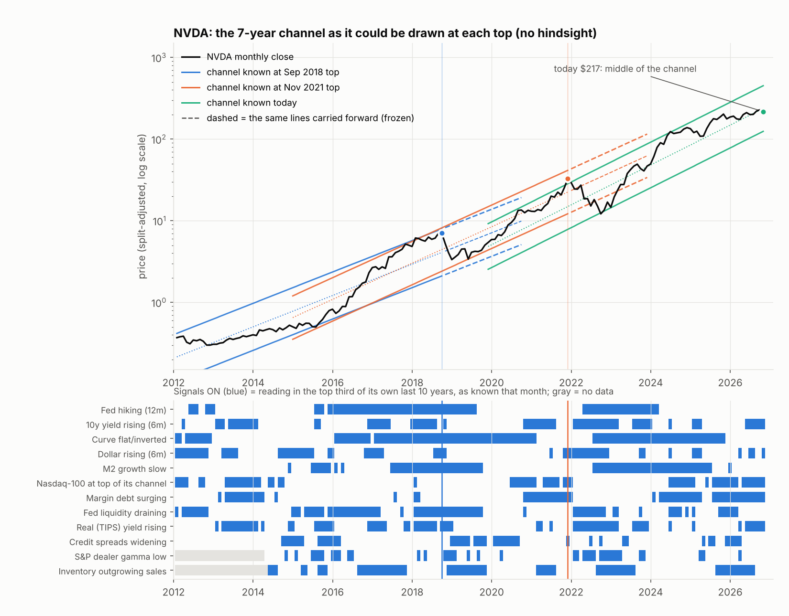
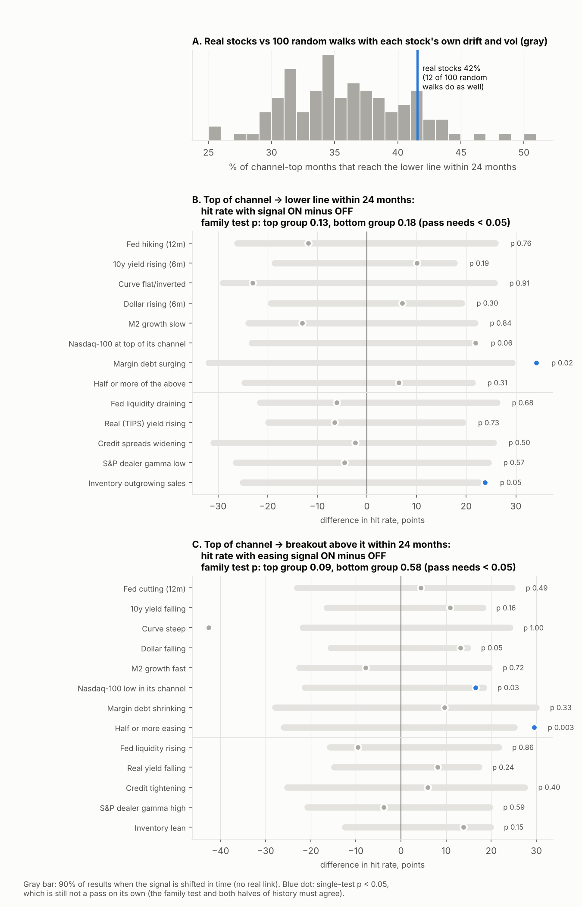

# What predicts a full swing to the other side of a multi-year log channel? (NVDA 2018 and 2022)

**Agent / session:** Claude (Opus 5.5), claude.ai session for the owner, 2026-10-15
**Started:** 2026-10-15   **Pre-registered at commit:** 17c0c17 (local; README, data scripts, no results)
**Type:** new question (extends `research/microstructure` §1–4 from daily channels to multi-year monthly channels)
**Verdict:** extends `microstructure` §3 to monthly multi-year channels with the same answer (not beyond chance); inconclusive on every macro predictor (none passes)

## Question

NVDA's monthly log chart (2016→2026) sits in a rising channel. Twice (Oct 2018 → Dec 2018, Nov 2021 → Oct 2022) it
swung from the top of the channel to the bottom. The owner asks:

1. **Premise:** is "top of the channel → lower line" more common than a random walk with the stock's own drift and
   volatility would produce?
2. **Under the hood:** did liquidity, rates, the dollar, leverage, credit, market gamma or the company's inventory
   cycle mark the tops that swung to the lower line, as opposed to tops that didn't?
3. **The tail:** what preceded upside breakouts above the channel (the 1998–2000 dot-com pattern)?
4. **Today:** where NVDA sits now on all of the above.

Universe: 44 large US-listed tech, semiconductor and internet stocks plus ^NDX, ^IXIC, ^SOX, ^GSPC
(`fetch_data.py`, list frozen before any outcome was computed; 45 listed, JNPR has no Yahoo history after its
acquisition), monthly bars from the 1970s–2010s to Oct 2026.

## Prior work

* `research/microstructure/REPORT.md` §1–4b @ 2c6250c: on **daily** channels (126/252 bars) line touches are "mostly not
  magic" (rejection rates inside the block-bootstrap null's CI); breakout odds are partly predictable (AUC 0.62).
  This study asks the same kind of question at the **monthly, multi-year** scale and with **macro** predictors.
* Channel fit: `fit_channel` copied verbatim from `research/microstructure/channels.py` @ 2c6250c into `channel_fit.py`.
* Rules followed: `docs/conventions.md` @ 2c6250c (timing, circular-shift null, episodes, multiverse, frozen criteria,
  trailing-percentile states).

## Disclosure before running

Before writing this file the agent had seen: data coverage per series (`out/data_coverage.csv`), spot values of the
macro table at 8 dates, and NVDA's inventory-vs-revenue growth for 2017–2022 (used to check SEC filing dates). No channel
position, outcome or variable-outcome relation had been computed. From general knowledge the agent also expects that
both NVDA tops coincided with Fed tightening and an inventory glut; that expectation is the hypothesis being tested.

## Definitions (primary specification)

* **Bars:** calendar months; high/low from daily bars, close = last close. The current month (Oct 2026) is partial and is
  used only to score "today".
* **Channel at month t:** `fit_channel` on the trailing **W = 84** monthly log highs/lows/closes ending at t, envelope
  quantile **q = 0.05**. Valid if slope > 0 and R² (log close on the line) ≥ **0.80**. Fit uses bars ≤ t only.
* **Channel position z_t:** −1 = lower line, 0 = middle, +1 = upper line, at the month-t close.
* **Top state:** valid channel and z_t ≥ **0.5**.
* **Reversion (outcome):** within **H = 24** months after t, a monthly low reaches the lower line of the channel
  **frozen at t** and extrapolated forward. Outcome window starts at t+1.
* **Breakout (outcome):** within H months, a monthly close at z ≥ 1.5 on the frozen channel (half a band-width above the
  upper line).
* **Censoring:** months whose window runs past the last complete month (Sep 2026) are dropped unless the event already
  happened.

## Variables (all values as known at the month-t close; publication lags in `build_panel.py`)

Each is signed so that **high = the theorised bearish / tightening reading**. Its **signal is "on"** when the value is in
the top third of its own trailing 120 months (at least 36 months of history; `docs/conventions.md` rule 9 at monthly
scale).

| Family | Name | Definition | From |
|---|---|---|---|
| primary | `FF_HIKE` | 12-month change in the fed funds rate | 1981 |
| primary | `Y10_UP` | 6-month change in the 10-year Treasury yield | 1981 |
| primary | `CURVE_FLAT` | −(10y − 3m yield) | 1982 |
| primary | `USD_UP` | 6-month log change in the dollar index | 1981 |
| primary | `M2_SLOW` | −(M2 year-on-year growth) | 1981 |
| primary | `MKT_EXT` | ^NDX's own channel position z (same method, used whether or not the index channel passes R²) | 1993 |
| primary | `MARGIN_FROTH` | FINRA margin debt year-on-year growth | 1999 |
| primary | `COMPOSITE` | at least half of the seven primary signals above that have data are on | 1981 |
| secondary | `LIQ_DRAIN` | −(6-month log change in Fed net liquidity: assets − TGA − reverse repo) | 2003 |
| secondary | `TIPS_UP` | 6-month change in the 10-year TIPS real yield | 2003 |
| secondary | `CREDIT_WIDEN` | −(6-month return of HYG minus IEF) | 2008 |
| secondary | `GEX_LOW` | −(S&P dealer gamma, SqueezeMetrics, month mean) | 2011 |
| secondary | `INV_GLUT` | inventory YoY growth − trailing-12-month revenue YoY growth (SEC, known at filing date; companies with inventory) | 2010 |

Options positioning for single stocks (ThetaData, 2020+) covers one NVDA top only, so it is **not** tested here; it is
shown descriptively for the Nov 2021 top.

## Tests and frozen pass/fail criteria

**A. Premise (reversion rate vs random walk).** Statistic: P(reversion | top state), pooled over stock-months.
Null: 20 stationary block-bootstrap paths per stock (mean block 6 months, the stock's own monthly log returns), run
through the identical pipeline. **Pass ("the channel pulls price back") if the real rate exceeds the null's mean by ≥ 5
points AND exceeds the null's 95th percentile.** Otherwise: the swing to the lower line is what volatility alone does.

**B. Variables (reversion).** Statistic per variable: Δ = P(reversion | top, signal on) − P(reversion | top, signal off).
Null: circular time shift of the signal series within its own available window, shift drawn as a fraction of the window
in [0.1, 0.9], the **same fraction for every variable** in a draw (keeps cross-correlation; stock-specific `INV_GLUT`
shifts each stock by the same fraction); 1,000 draws. One-sided p. Joint p per family: maximum of the standardised Δ
across the family vs the same maximum in each null draw.
**A variable passes only if all three hold:**
1. Δ > 0 with shift p < 0.05;
2. its family's joint p < 0.05;
3. Δ > 0 in both halves of its sample (primary: before / from 2010; secondary: before / from 2018).

**Multiverse (free choices):** W ∈ {60, 84, 120} × top z ∈ {0.33, 0.5, 0.67} × H ∈ {12, 24} × signal cut {top third,
above median} = 36 specifications. For each variable, the statistic is the median Δ across specifications, with the
same shift null. A variable that passes B but has multiverse p ≥ 0.05 is reported as **fragile**, not as a pass.

**Episodes.** An episode is a run of consecutive top-state months for one stock; it "reverted" if the run's last month
has a reversion outcome. Reported: number of episodes, reverting episodes, and the number of distinct calendar
**waves** (reversion episodes whose run ends fall within the same 12 months count as one wave). Macro variables
cannot have more independent tests than there are waves; that number is stated next to every macro result.

**C. Breakouts (dot-com tail).** Same statistic and null with the breakout outcome and the signals flipped to the easing
side (`FF_CUT` = −`FF_HIKE`, etc.). Pre-declared as **descriptive**: if fewer than 4 distinct breakout waves exist, no
pass/fail is claimed, only the conditional rates and the 1998–2000 readings next to today's.

**D. NVDA and today.** Descriptive: NVDA's ex-ante channel, z, and each signal at the 2018 and 2021 tops and now; the
historical reversion and breakout rates for today's combination, with Wilson 95% intervals and episode counts.

**What would prove the hypothesis wrong:** A fails (reversion is just volatility) and no variable passes B. Then the
honest answer is that the two NVDA swings were not forecastable from these variables with the data available.

## Method notes

* Leak checks before results are trusted: (1) z_t is unchanged when all bars after t are scrambled; (2) every signal at t
  is unchanged when data after t's publication date are deleted; (3) outcomes start at t+1.
* Survivorship: Yahoo has no delisted tickers (no Sun, Lucent, Nortel, JDSU…), so dot-com collapses are
  under-represented; reversion rates are biased **down**.
* Monthly lows are daily lows, so an intramonth wick counts as a touch.

## Results

**Answer first.** The swing from the top of a multi-year channel to the lower line is mostly volatility, not a pull
back to the line, and none of the 13 liquidity, rate, leverage, credit, gamma or inventory variables passes as a warning
sign. The classic "the Fed is tightening" readings point the wrong way. The two leads worth watching are margin-debt
froth (reversion) and an easing Fed while a stock is at the top (breakout), and neither clears the frozen bar.




### A. Premise: does price get pulled back to the lower line? **Fails.**

| | real stocks | random walks (stock's own drift and vol) |
|---|---|---|
| top-of-channel months reaching the lower line within 24 months | **41.6%** (989 stock-months, 36 stocks, 1983–2025) | 36.3% mean, 41.7% at the 95th percentile (20 paths, pre-registered) |
| post-hoc, 100 paths | | 36.0% mean, 43.3% at the 95th percentile; 12 of 100 paths do as well (p 0.13) |

Real stocks reach the lower line 5 points more often than random walks, which clears the first half of the criterion,
but they do not beat the null's 95th percentile. Same verdict as the daily-channel study (§3 of the original).
Post-hoc and not pre-registered: real stocks also **break out above** the channel more often than the random walks
(51.1% vs 42.1%; all 20 paths lower). Extremes are bigger in both directions than a random walk gives, which reads as
volatility regimes and momentum, not as a channel that holds.

### B. Which variables marked the tops that swung to the lower line? **None passes.**

Base specification (7-year channel, top = z ≥ 0.5, 24 months). 208 top-of-channel episodes, 120 reached the lower line,
in **17 distinct waves** (1983, 1995, 1997, 1998, 1999, 2000, 2007, 2011, 2013, 2015, 2018, 2019, 2020, 2021, 2023,
2024, 2025). No macro variable can have more independent tests than that.

| Signal ON | hit rate ON vs OFF | difference | shift p | both halves agree | multiverse p |
|---|---|---|---|---|---|
| Fed hiking (12m) | 35% vs 47% | −12 | 0.76 | no | 0.77 |
| 10y yield rising (6m) | 47% vs 37% | +10 | 0.19 | yes | 0.29 |
| Curve flat or inverted | 34% vs 58% | −23 | 0.91 | no | 0.64 |
| Dollar rising (6m) | 46% vs 39% | +7 | 0.30 | yes | 0.08 |
| M2 growth slow | 33% vs 46% | −13 | 0.84 | no | 0.86 |
| Nasdaq-100 at the top of its own channel | 54% vs 32% | +22 | 0.06 | no (−14 before 2010) | 0.18 |
| Margin debt surging | 60% vs 26% | **+34** | **0.02** | no (only 2006–09 before 2010, −29) | 0.16 |
| Half or more of the above | 45% vs 39% | +6 | 0.31 | no | 0.34 |
| Fed liquidity draining (2003+) | 35% vs 41% | −6 | 0.68 | no | 0.74 |
| Real (TIPS) yield rising (2003+) | 35% vs 41% | −7 | 0.73 | no | 0.84 |
| Credit spreads widening (2008+) | 37% vs 39% | −2 | 0.50 | no | 0.37 |
| S&P dealer gamma low (2011+) | 36% vs 41% | −5 | 0.57 | no | 0.72 |
| Inventory outgrowing sales (2010+) | 57% vs 33% | +24 | **0.047** | n/a (too few rows before 2018) | 0.14 |

Family tests: primary joint p **0.13**, secondary **0.18** (post-hoc min-p version: 0.12 and 0.20). Pass needs < 0.05.

What the leads look like up close (post-hoc, `posthoc.py` P3):
* **Margin debt** is a post-2010 effect: of 160 episodes since 2010, 79% reverted with froth ON (56 episodes) vs 45% OFF
  (104). Before 2010 there are two usable episodes, so the "both halves" test cannot be met; this is a lead, not a result.
* **Inventory glut** disappears at the episode level (67% vs 63%, 81 episodes): the row-level gap comes from a few long
  runs. Not a signal.
* **Nasdaq extended** flips sign before and after 2010 (60% vs 83% before, 73% vs 48% after). Not a signal.
* Calibration warning: on this panel the shift null gives **8.5%** false positives at p < 0.05 (`verify.py` V6, 200
  no-effect signals), so single p-values near 0.02–0.05 are weaker than they look.

### C. Breakouts above the channel (the dot-com tail). **Fails the frozen bar; one strong lead.**

210 episodes, 71 broke out (z ≥ 1.5 within 24 months) in 13 waves. From the top of the channel, a breakout followed
51% of the time.

* **Half or more of the easing signals ON** (Fed cutting, yields falling, steep curve, weak dollar, fast M2, Nasdaq low in
  its channel, margin debt shrinking): **78% vs 48%** broke out, shift p 0.003, positive in both halves, multiverse
  p 0.001. But the pre-registered family p is **0.095**, so it fails. Post-hoc min-p family p is 0.007.
* Why to stay cautious: it rests on 103 stock-months, 16 episodes and **3 waves**, and 68 of the 103 months are 2020.
  The rest are 1998–2000 (12 months, 8 broke out; the 2 in 2000 did not) and 2016, 2019, 2023. It is really "2020,
  with a dot-com echo".

### D. NVDA, and today

* **Sep 2018 top:** z +0.82 on the 7-year channel known then. Signals ON: Fed hiking, curve flat, dollar rising, M2 slow,
  liquidity draining, real yields rising. The Dec 2018 low **did not reach** that channel's lower line (z −0.64); on a
  5-year channel it did. Whether 2018 "reverted" depends on the window.
* **Nov 2021 top:** z +0.61. Signals ON: margin debt surging, Nasdaq extended, dollar rising, credit starting to widen;
  the Fed had not hiked yet. Reached the lower line 6 months later (May 2022).
* The two tops had **different fingerprints**: 2018 was Fed tightening, 2021 was leverage froth. Only "dollar rising" was
  on at both. The inventory glut showed up in filings **after** each top (Nov 2018–Feb 2019; Aug–Nov 2022), too late to warn.
* **Today (Oct 15 2026, $217.23):** middle of the 7-year channel (z −0.13; lower **124**, mid **237**, upper **451**).
  The lines rise **75% a year**, so a flat NVDA meets the lower line in about **12 months** without any selloff.
  Historically, from this part of a channel 75% of stock-months touched the lower line within 24 months (900 stock-months,
  40 stocks; 77% for channels rising ≥ 50%/yr), and breakouts from here were rare (1.5% for fast channels).
* **Signals now:** 10y and real yields rising, Nasdaq-100 near the top of its channel, margin debt +32% year on year,
  dollar firming in October. That is closer to the 2021 fingerprint than to 2018. Easing composite: off.

**1998–2000 vs now** (macro table in `out/posthoc.json` P5):

| | Sep 1998 | Jun 1999 | Dec 1999 | Feb 2000 | Sep 2026 |
|---|---|---|---|---|---|
| Fed funds, 12-month change | 0.0 | −0.8 | +0.6 | +1.0 | −0.5 |
| 10y yield | 4.8 | 5.9 | 6.3 | 6.5 | 5.0 |
| CPI year on year | 1.6 | 2.1 | 2.6 | 2.7 | 3.3 |
| margin debt, year on year | +23% | +23% | +38% | +47% | +32% |
| Nasdaq-100 channel position z | 0.4 | 0.9 | **2.1** | **2.5** | 0.8 |

Today rhymes with mid-1999 (Fed cutting, margin debt surging, Nasdaq in the upper half of its channel) with higher
inflation. The 1999–2000 blow-off took the Nasdaq-100 to z 2+; it is at 0.8 now. One analog is not a forecast.

## Threats to validity

* **Few independent macro episodes.** 17 reversion waves and 13 breakout waves. Macro tests share those waves across
  all stocks; the shift null keeps that dependence, but power is low: a real but modest macro effect could be missed.
* **Survivorship.** No delisted names (Sun, Lucent, Nortel, JDSU…). Dot-com collapses are under-represented, which biases
  reversion rates down and may weaken 2000-era tests.
* **Channel choices.** R² ≥ 0.80 keeps only clean trends (28% of 7-year windows). The multiverse covers window, top
  threshold, horizon and cut; the envelope quantile (q 0.05) and R² floor were not varied.
* **Variables not tested:** single-stock options positioning (ThetaData starts 2020, one NVDA top), credit spreads before
  2007, hyperscaler capex, AI-specific funding. Credit before 2007 would need a FRED key (Baa spread).
* **CPI for Oct 2025** was never published (funding lapse); filled geometrically between Sep and Nov 2025.
* **Shift null slightly liberal** on this panel (8.5% false positives at 5%).

## Verdict

**Extends** `microstructure` §3 to monthly multi-year channels with the same answer: the lines describe the trend but do
not pull price back beyond what volatility does. **Inconclusive** on the owner's macro question: none of 13 pre-registered
variables marks the tops that swung to the lower line, and the textbook Fed-tightening readings point the wrong way.
Two leads deserve a fresh-sample test before anyone trades them: **margin-debt froth before reversions (post-2010)** and
**easing conditions before breakouts (mostly 2020 and 1998–99)**. Nothing in the original studies needs correcting.

## Reproduce

```bash
python fetch_data.py                       # downloads to data/ (gitignored), ~2 min; no keys
python build_panel.py                      # monthly prices, macro table with publication lags, SEC inventory gap
OMP_NUM_THREADS=1 python channels_panel.py           # ex-ante channels, all windows (~1.5 min)
OMP_NUM_THREADS=1 python channels_panel.py --boot 20 # pre-registered random-walk null (~7 min)
OMP_NUM_THREADS=1 python verify.py         # V1-V6 checks (look-ahead, publication lags, hand case, null calibration)
OMP_NUM_THREADS=1 python tests.py          # parts A-D -> out/results.json, episode tables
OMP_NUM_THREADS=1 python channels_panel.py --boot 80 --seed 2 --out channels_boot_extra.pkl   # post-hoc, ~25 min
OMP_NUM_THREADS=1 python posthoc.py        # post-hoc checks P1-P5 -> out/posthoc.json
python figures.py                          # out/fig_nvda.png, out/fig_tests.png
```
