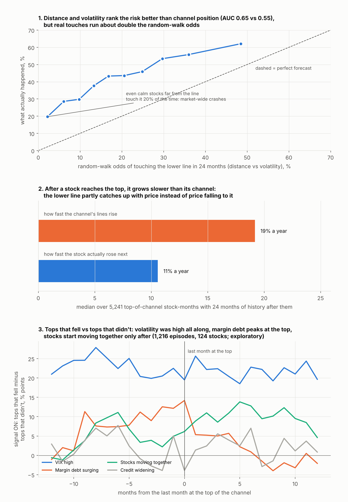
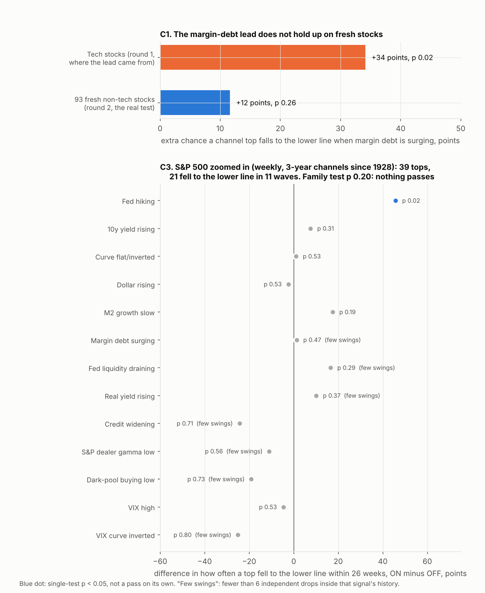

# Round 2: does anything predict the swing to the lower channel line? Fresh stocks, the S&P zoomed in, and why it fails

**Agent / session:** Claude (Opus 5.5), claude.ai session for the owner, 2026-10-15
**Started:** 2026-10-15   **Pre-registered at commit:** 2934c47 (local; no results at that commit)
**Type:** replication on fresh data + new question + method improvement
**Verdict:** replicates round 1's null; **contradicts** the margin-debt lead (fails on fresh stocks); the distance-vs-volatility theory is **partly supported** (beats channel position, nothing adds to it) but misses its frozen bar

## Why this round

Round 1 (`research/agents/2026-10-15-channel-reversion-macro`, commit 97ef918) found:
* top-of-channel → lower line within 24 months happens about as often as in random walks with each stock's own drift
  and volatility (41.6% vs 36%, p 0.13);
* none of 13 macro, liquidity, leverage, credit, gamma or inventory variables passed;
* one lead: **margin debt surging** (60% vs 26% of top months reverted, shift p 0.02, but only measurable after 2010);
* the textbook Fed-tightening readings pointed the wrong way.

The owner asked for: (1) the margin-debt lead tested on stocks it has never seen, (2) the S&P 500 added and zoomed in,
so the variables that failed get a fairer test with many more swings, (3) my own theories for why it fails, tested,
(4) ideas from the literature.

## Literature that shaped the hypotheses (searched before any round-2 result)

* **Goyal & Welch (2008), Goyal, Welch & Zafirov (2024, RFS):** almost no macro/valuation variable predicts the equity
  premium out of sample; a few survive (short interest, technical indicators, T-bill rate, average correlation,
  equity issuance). Round 1's null result is the expected one.
* **Deuskar, Kumar & Poland (2017), "Margin Credit and Stock Return Predictability":** the *credit* side of margin
  accounts (excess debt capacity that leveraged longs choose not to use) predicts returns and crashes out of sample;
  plain margin *debt* is popular but weak out of sample. → new variable `MARGIN_CREDIT`.
* **Neely, Rapach, Tu & Zhou (2014):** price-trend rules (price vs 12-month moving average, 12-month momentum) catch the
  decline near cycle peaks better than macro variables. → `TECH_MA`.
* **Pollet & Wilson (2010):** average pairwise correlation of stocks tracks aggregate risk and predicts the market.
  → `AVG_CORR`.
* **Fed hiking studies (Truist, Dimensional, NDR/Schwab 2026):** stocks rose in 11 of 12 hiking cycles; what matters is
  the **pace** (fast cycles, deeper drawdowns). → explains round 1's sign; new variable `FAST_HIKE`.
* **Bear-market prediction (Chen 2009; Chen, Chen & Chou 2017; Tokic & Jackson 2023):** credit spreads and the yield
  curve help a few months ahead; the depth of a drawdown is driven by credit stress that arrives *after* the drawdown
  starts. → motivates the lead–lag check E1 (signals that only light up after the turn look predictive in hindsight).

## My theory for why it fails (tested as C2)

**The swing to the lower line is a race between distance and volatility.** If price wanders around the channel's
trend, the chance it touches the lower line within H months is roughly the chance a random walk with zero drift
(relative to the line) covers the distance x₀ = log(close) − log(lower line): **P = 2·Φ(−x₀ / (σ·√H))**, σ the stock's
recent volatility. Anything that does not change x₀ or σ cannot predict the touch. Fed hiking happens in calm, growing
markets (low σ), which would explain why it *lowered* the reversion rate in round 1.

## Data (built before any outcome was computed)

* **Fresh stocks:** 93 large US non-tech names in 9 sectors (`build.py`; BK failed to download), monthly bars adjusted
  for dividends and distributions (Yahoo's split-only close turns spin-offs such as MO 2008 and KR's 1988
  recapitalisation into fake crashes). No overlap with round 1's tech universe.
* **S&P 500:** Yahoo ^GSPC daily from 1928 (before 1962 Yahoo has closes only, so weekly lows are close-based), weekly
  bars to Fridays (`sp_build.py`).
* **Signals:** round-1 macro table reused; weekly versions built with the known-at rules in `sp_build.py`; ex-ante
  volatility and average correlation from daily returns (`extra_signals.py`); FINRA free credit balances in margin
  accounts start Feb 2010.
* Seen before writing this file: download coverage, the large-move audit that led to adjusted bars, the share of
  valid channels per window, summary stats of average correlation. No outcome, rate or variable-outcome relation.

## Shared definitions

Monthly panels: channel fit as round 1 (`fit_channel` of the owner's study, W = 84 months, q = 0.05, valid if slope > 0
and R² ≥ 0.80), top = z ≥ 0.5, outcome = a monthly low reaches the channel's lower line (frozen at t) within H = 24
months. Signals "on" = top third of the trailing 120 months (≥ 36 months of history) unless binary by definition.
Null = circular time shift of the signal within its own window, the same shift fraction for every variable in a draw,
1,000 draws, seed 20261016. Multiverse = W {60, 84, 120} × top z {0.33, 0.5, 0.67} × H {12, 24} × cut {top third,
above median} (36 specifications).

S&P weekly: W = 156 weeks (multiverse 104/156/260), top z ≥ 0.5, H = 26 weeks (multiverse 13/26), weekly lows,
percentiles over the trailing 260 weeks (≥ 104).

**Family test change (decided before any S&P result):** round 1's family test (maximum standardised difference)
misbehaved when variables had very different sample sizes (round 1 post-hoc P1). Round 2 uses the **min-p
(Westfall–Young)** family test throughout.

## Confirmatory tests and frozen pass/fail criteria

### C1. Margin debt on fresh stocks
Panel: the 93 non-tech stocks. Signal `MARGIN_FROTH` exactly as round 1. Statistic Δ = P(reversion | top, on) −
P(reversion | top, off). **Pass if all hold:** (1) Δ > 0 with shift p < 0.05; (2) Δ > 0 in the 2010+ subset (where round
1's lead lived); (3) at the episode level, episodes whose last top month has the signal on reverted more often than
those with it off. If the no-effect calibration check on this panel (200 persistent random signals) shows more than 10%
false positives at p < 0.05, criterion (1) tightens to p < 0.01. Multiverse p ≥ 0.05 → reported as **fragile**.
**Fail** → the round-1 lead was chance or tech-specific.

### C2. The barrier theory
Rows: valid-channel stock-months with price above the lower line, tech + non-tech panels, W = 84, H = 24.
P_BM = 2Φ(−x₀/(σ√24)), σ = std of the last 126 daily log returns × √21 (known at t).
**Theory supported if all hold, on top-state rows:** (1) AUC of P_BM ≥ 0.65; (2) AUC(P_BM) − AUC(z) > 0 with a 95%
month-block bootstrap interval above zero; (3) calibration slope (logit y on logit P_BM) between 0.7 and 1.3.
Also reported (no pass/fail): each round-1 variable's effect after controlling for P_BM (logistic, shift-null p), and
volatility with the signal on vs off.

### C3. S&P 500 zoomed in (weekly)
Variables (high = theorised bearish): `FF_HIKE`, `Y10_UP`, `CURVE_FLAT`, `USD_UP`, `M2_SLOW`, `MARGIN_FROTH`,
`LIQ_DRAIN`, `TIPS_UP`, `CREDIT_WIDEN`, `GEX_LOW`, `DIX_LOW`, `VIX_HIGH`, `VIX_INVERT` (VIX / VIX3M).
**A variable passes if:** shift p < 0.05, family min-p < 0.05 (13 variables), Δ > 0 in both halves (split 2010-01-01
for series starting before 2000, 2018-01-01 otherwise). Multiverse p ≥ 0.05 → fragile. Waves (reversion episodes whose
runs end within 26 weeks of each other count as one) are reported with every result. If fewer than 6 reversion waves
fall inside a variable's sample, its result is labelled underpowered whatever the p-value.

### C4. Literature variables (pooled tech + non-tech monthly panel)
`MARGIN_CREDIT` = log(free credit balances in margin accounts / S&P 500 level), known at the end of the following month,
high = bearish; `TECH_MA` = S&P 500 below its 12-month average (binary); `AVG_CORR` = average pairwise correlation of
daily returns across the universe, trailing 63 sessions, high = bearish; `FAST_HIKE` = fed funds up ≥ 1.5 points in 12
months (binary).
**A variable passes if:** shift p < 0.05, family min-p < 0.05 (4 variables), Δ > 0 separately in the tech and the
non-tech panel, Δ > 0 in both halves (split 2010; `MARGIN_CREDIT` 2018). Also shown on the S&P weekly (descriptive).

## Exploratory (no pass/fail; labelled as such in the results)

* **E1 Lead–lag:** share of each signal on from 12 months before to 12 months after the last top month, reverting vs
  non-reverting episodes. Does it light up before the turn, or only after?
* **E2 Trend break:** among middle-of-channel rows (−0.5 ≤ z < 0.5), does being below the stock's own 10-month average
  add to P_BM? (logistic, per-stock shift null)
* **E3 Crowding:** share of the universe at the top of its channel at the same time, as a signal.
* **E4 Stretch × tightening:** top rows with z ≥ 1 and round 1's composite on vs off.
* **E5 Volatility and the Fed-hike sign:** σ with `FF_HIKE`, `CURVE_FLAT`, `M2_SLOW` on vs off; their Δ within P_BM
  terciles.
* **E6 NVDA zoomed in:** NVDA on 2- and 3-year weekly channels today, with P_BM for the next 26 weeks.

## Results

**Answer first.** Nothing predicts the swing to the lower line beyond how far price is from the line and how much it
moves. The margin-debt lead failed on 93 fresh stocks. The S&P 500 zoomed in (weekly, since 1928) gave the variables a
fairer test with 39 tops, and none passed. Two reasons it keeps failing, both measured: (1) after a stock reaches the
top, it grows at about **half** the speed of its channel, so the rising lower line catches up with it; (2) touches
cluster in a few **market-wide crashes**, which hit calm and volatile stocks alike, so there are few independent events
and each had a different trigger.




### C1. Margin debt on fresh stocks: **fails**

| | top-of-channel months | ON | OFF | difference | shift p |
|---|---|---|---|---|---|
| round 1, tech (where the lead came from) | 792 | 60% | 26% | +34 | 0.02 |
| **round 2, 93 non-tech stocks** | 1,928 (88 stocks) | 51% | 39% | **+12** | **0.26** |

* 2010+ only: +4 points (round 1's lead lived after 2010; here the gap sits before 2010, +41). Episodes: 64% vs 55%
  (475 episodes, 17 waves). Multiverse: median −3 points, positive in 28% of 36 specifications, p 0.52.
* Null calibration on this panel: 6.5% false positives at p < 0.05, so the p < 0.05 bar stood.
* **Verdict:** the round-1 lead was chance or tech-specific. Where it "works" flips between eras and panels.

### C2. The distance-vs-volatility theory: **partly supported, misses the frozen bar**

Top-of-channel stock-months, tech + non-tech (5,276 rows, 124 stocks):

| | AUC (0.5 = coin flip) |
|---|---|
| channel position z alone | 0.55 |
| volatility alone | 0.58 |
| distance to the lower line alone | 0.57 |
| **random-walk odds from distance and volatility** | **0.65** (difference vs z: +0.07 to +0.12, 95% interval) |
| same, on all valid channel months (20,410) | 0.76 |
| same, S&P weekly tops (252) | 0.74 (vs 0.53 for z) |

* Criterion 1 missed by a hair (0.647 vs 0.65). Criterion 3 failed: calibration slope 0.47. The model predicts 21% and
  42% happened. It under-shoots everywhere, most at the calm end: stocks with a 2% random-walk chance touched the line
  20% of the time.
* After controlling for these odds, only the inventory glut dips under 5% (p 0.047; margin debt 0.07), about what
  chance gives across 17 tries (300 shifts each).

**Why the model under-shoots (post-hoc, `r2_explore.py` E7).** Over 5,241 top-of-channel months with 24 months of
history after them, the channel's lines rose at a median **19% a year**; the stocks then rose **11% a year**. Volatility
after the top was only 5% higher than before. So the lower line catches price. Feeding that slowdown into the model
(estimated only from earlier episodes) lifts its average to 32% but does not fix the shape (slope 0.42): the calm stocks
that touch anyway are the **crash** cases (2000, 2008, 2020, 2022), when everything falls together.

### C3. S&P 500 zoomed in (weekly, 3-year channels since 1928): **nothing passes**

252 top-of-channel weeks, 39 episodes, 21 reached the lower line within 26 weeks, in **11 waves**. Family test (min-p,
13 variables) p **0.20**.

* **Fed hiking** has the textbook sign on the index: 80% vs 34% (25 weeks ON), p 0.02, positive before and after 2010,
  9 waves. It fails the family test (p 0.20) and the multiverse (p 0.19). On single stocks the sign reversed (below).
* Everything else is noise or underpowered: VIX, VIX curve, dealer gamma, dark-pool index, credit, liquidity, real
  yields have fewer than 6 independent drops inside their history, or p ≥ 0.19.
* Literature variables on the S&P: average correlation +2 (p 0.45); fast hikes −8; price below its 12-month average
  never happens at a channel top, so it cannot be tested there; margin credit never triggered.

### C4. Literature variables on the pooled stock panel: **none passes** (family p 0.81)

| | ON vs OFF | difference | shift p | note |
|---|---|---|---|---|
| Margin credit (Deuskar et al.) | n/a | n/a | n/a | never in its top third since 2013: the credit/S&P ratio fell the whole time, so the trailing-percentile rule could not fire. Untested as specified. |
| S&P below its 12-month average (Neely et al.) | 41% vs 42% | −1 | 0.53 | tech −25, non-tech +2 |
| Stocks moving together (Pollet & Wilson) | 45% vs 42% | +3 | 0.38 | |
| Fed hiking fast (≥ 1.5 points a year) | 27% vs 43% | −16 | 0.86 | wrong way |

### Exploratory (no pass/fail)

* **E1 Lead–lag (1,216 episodes):** the gap between tops that fell and tops that didn't, for each gauge, from 12 months
  before to 12 after. **VIX high** is about +20 points the whole time, a regime and not a warning. **Margin debt** builds to
  +14 at the last top month, then fades. **Stocks moving together** rises only after (+5 before, +11 after). Credit is noise.
* **Post-hoc VIX check** (pooled tops): 52% vs 37% with VIX in its top third, +15 points, p 0.09, positive in tech (+19)
  and non-tech (+14) and in both halves (+13, +14). It fits the theory (volatility drives touches) but is not significant,
  and on the S&P weekly it is −5. A candidate for a fresh pre-registered test, nothing more.
* **E2 Trend break:** in the middle of the channel, being below the 10-month average lifts the touch rate (69% vs 66%),
  but the random-walk odds already explain it (55% vs 47%); after controlling, nothing is left (p 0.60).
* **E3 Crowding** (many stocks at the top at once): +5 points, p 0.17. Today 22% of the universe is at the top, 43rd
  percentile of the last 10 years.
* **E4 Stretch:** tops at z ≥ 1 fell **less** often (37%) than tops at 0.5–1 (43%). More stretch, more momentum.
* **E5 The Fed-hike sign:** volatility is only slightly lower when the Fed is hiking (6.3% vs 6.8% a month), so it is
  not the main reason. Composition is: many stocks at the top during fast hikes were energy (3% fell; 2005–06 and
  2022–23) and health care (11%), which kept rising in those booms. Financials at the top in 2005–06 did fall (72%,
  into 2008).
* **E6 NVDA now ($217.23):**
  * 7-year monthly channel: middle (z −0.13), lower line $124 rising 75% a year. Random-walk odds of touching it within
    24 months 31%, slowdown-adjusted 42%; both under-shoot. Historically, 75% of stock-months in this part of a channel
    touched the lower line within 24 months (round 1).
  * Weekly 3-year channel: NVDA sits **on its lower line** (about $211; z −0.92), lines rising 70% a year. R² 0.79, just
    under the validity floor.
  * Weekly 2-year channel: no clean channel (R² 0.75).

## Threats to validity

* **Few independent events.** 17 (tech), 17 (non-tech, in margin data), 11 (S&P weekly) reversion waves. Macro
  variables get roughly one test per wave.
* **Survivorship:** survivors only, in both panels.
* **Bars:** non-tech uses distribution-adjusted bars, tech (round 1) split-adjusted only (tech dividends are small).
  S&P before 1962 has closes only.
* **Margin credit** has FINRA data only from 2010 and never triggered; Deuskar et al.'s detrended version was not tried
  (it would be post-hoc).
* **Post-hoc parts** (E7, the VIX check, the composition breakdown) are labelled and not counted as results.

## Verification

`r2_verify.py`: W1 channel positions ignore the future (non-tech, S&P weekly); W2 weekly known-at rules (margin,
liquidity, VIX curve) match by hand; W3 spin-off months are no longer fake crashes; W4 S&P weekly null gives 4.5% false
positives at 5%; W5 the barrier formulas match Monte Carlo within 1 point. All pass. Re-running `r2_tests.py` and
`r2_explore.py` reproduces both JSON files byte for byte.

## Verdict

**Replicates** round 1: neither the monthly stock panels nor the weekly S&P show a macro, liquidity, leverage, credit,
gamma or volatility gauge that marks the tops that fall to the lower line. **Contradicts** round 1's margin-debt lead:
on 93 fresh stocks it is +12 points, p 0.26, and its sign by era flips. The **distance-vs-volatility** view explains
more than channel position (AUC 0.65 vs 0.55 on stocks, 0.74 vs 0.53 on the S&P) and nothing adds to it, but it misses
the frozen AUC bar by 0.003 and under-predicts touches by half, because stocks slow after the top and crashes hit
everyone at once. Next step worth pre-registering: a fresh-universe test of **VIX high at the top** and a touch model
with market-crash risk built in.

## Reproduce

```bash
python build.py                 # fresh non-tech panel: downloads, adjusted monthly bars, channels (~3 min)
python sp_build.py              # S&P daily from 1928 -> weekly bars, weekly channels, weekly signal table
python extra_signals.py         # ex-ante volatility, average correlation, S&P weekly vol
OMP_NUM_THREADS=1 python r2_verify.py    # W1-W5
OMP_NUM_THREADS=1 python r2_tests.py     # C1-C4 -> out/results_r2.json (~1 min)
OMP_NUM_THREADS=1 python r2_explore.py   # E1-E7 -> out/explore_r2.json, out/e1_leadlag.csv
python r2_figures.py            # out/fig_r2_why.png, out/fig_r2_tests.png
```
(Round 1 must be built first: `../2026-10-15-channel-reversion-macro`, see its README.)
