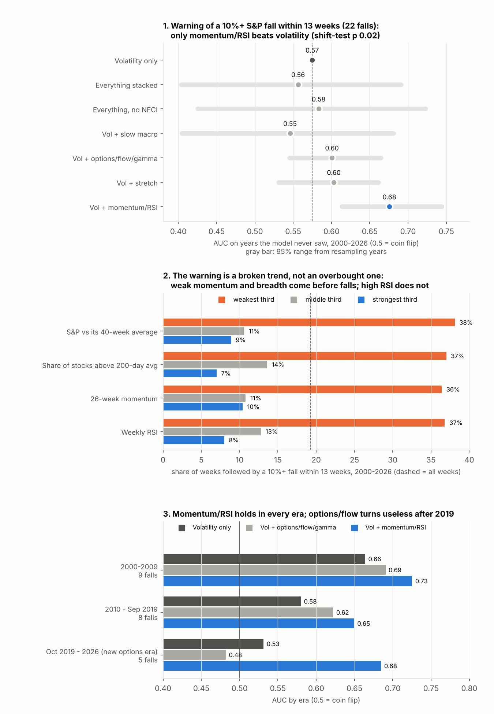

# Does a stack of signals (macro + options/flow + momentum/RSI + stretch) warn of S&P 500 corrections?

**Agent / session:** Claude (Opus 5.5), claude.ai session for the owner, 2026-10-15
**Started:** 2026-10-15   **Pre-registered at commit:** 44cf3f9 (pushed before any model was trained)
**Type:** new question (multivariate follow-up to rounds 1 and 2)
**Verdict:** the stack **fails** (primary test). Post-hoc, **momentum/RSI alone** adds real warning power (family-wise shift p 0.02, every era); macro and options/flow/gamma add nothing, options turn useless after 2019. The warning is a broken trend, not an overbought one.

## Question

Rounds 1 and 2 tested signals one at a time and found nothing beyond distance-to-the-line and volatility. The owner's
view: a warning should come from a **stack** — slow macro conditions first, then options flow and gamma weeks to
months ahead, with momentum/RSI and how stretched the market is. And the options market changed after 2019
(zero commissions, retail flow, daily 0DTE), so options signals may need their own regime.

**Asset:** the S&P 500 (^GSPC; SPY tracks it). Weekly, as of each Friday close, 1992–2026.

## Outcomes (forward from each Friday close; label windows start the next trading day)

1. **`Y_CORR` (primary): a fall of 10% or more** (daily low vs that Friday's close) within 13 weeks.
2. **`Y_BEAR` (secondary): a fall of 20% or more** within 52 weeks — the 2022-style case.
3. **`Y_CHAN` (secondary): a touch of the lower line** of the 3-year weekly channel (round 2's channel) within 26 weeks,
   weeks with a valid channel only.

## Features (`features_mv.py`; every value as known at that Friday's close)

| Layer | Features |
|---|---|
| **V** volatility (the baseline) | VIX; 20- and 126-day realized vol |
| **M** slow macro | Fed funds 52-week change; 10y 26-week change; 10y−3m curve; dollar 26-week change; M2 growth; CPI; margin debt growth; Fed net liquidity 26-week change; TIPS 26-week change; HYG vs IEF; margin credit; Chicago Fed NFCI and its risk, credit and leverage parts, and NFCI 13-week change |
| **O** options / flow / vol structure | VIX/VIX3M; VIX9D/VIX; VVIX; SKEW; VIX minus 20-day realized vol; Cboe total, equity and index put/call (10-day means; archive to Oct 2019, daily statistics after); S&P dealer gamma (GEX) and dark-pool index (DIX), SqueezeMetrics |
| **R** momentum and RSI | RSI(14) on daily, weekly and monthly bars; 4, 13, 26, 52-week momentum; 12-1 momentum; weekly MACD histogram; distance from the 40-week average; breadth (share of 137 stocks above their 200-day average); bearish RSI divergence (price within 1% of its 26-week high while weekly RSI is 10+ points below its prior 26-week peak) |
| **S** stretch / mean reversion | 3-year weekly channel position and R²; drawdown from the 52-week high; average pairwise correlation of stocks |
| **ERA** regime | zero-commission era (from 2019-10-04); daily-0DTE era (from 2022-05-13) — the eras in `research/microstructure` §4g |

Model inputs: trailing 260-week percentile (centred) for most features; RSI, channel position/R², drawdown and the
binary flags on their natural scale. Features that start late are missing before they exist.

Known limitations stated up front: the NFCI file is today's vintage (revised history; it also ends Apr 2026), so every
model is also run **without NFCI**; Cboe's put/call is Cboe-exchange volume only and its index ratio includes 0DTE
SPXW after 2022; breadth uses survivors only.

## Models and walk-forward (settings fixed here, no tuning on test years)

* **GBM (primary):** `HistGradientBoostingClassifier(max_depth=3, max_iter=150, learning_rate=0.05,
  min_samples_leaf=40, l2_regularization=1.0, random_state=0)`, missing values handled natively. It can find stacked
  combinations ("tightening AND low gamma AND stretched").
* **LOGIT (secondary):** L2 logistic regression, C = 0.3; missing → 0 (neutral) plus one missing flag per late feature;
  options-layer features also enter **interacted with the zero-commission era flag**, so their effect can differ after
  2019.
* **Walk-forward:** for each test year Y = 2000 … 2026, train on weeks from 1992 whose outcome window ended before
  Jan 1 of Y (purged), predict every week of Y. Evaluate on resolved weeks.
* **Specifications** (both models): `VOL` = V only (the bar to beat); `FULL` = all layers + ERA; drop-one
  (`FULL−M`, `FULL−O`, `FULL−R`, `FULL−S`); add-one (`V+M`, `V+O`, `V+R`, `V+S`); `FULL_RECENT` = FULL with weeks
  from Oct 2019 on weighted 2× in training; `FULL_NO_NFCI`.

## Frozen pass/fail

**Primary:** `Y_CORR`, GBM, `FULL` vs `VOL`, out of sample 2000–2026. **Pass only if both:**
1. AUC(FULL) − AUC(VOL) ≥ **0.05**, with the 95% interval from resampling **calendar years** (1,000 draws) above zero;
2. Brier skill of FULL relative to VOL > 0 (FULL's probabilities are more accurate).

The same test is reported for LOGIT, `Y_BEAR` and `Y_CHAN` (secondary; a pass there is labelled secondary), for
`FULL_NO_NFCI` (a pass that disappears without NFCI is reported as **NFCI-dependent**), and separately for the old
(2000 – Sep 2019) and new (Oct 2019 – 2026) option regimes.

**Which layer matters** (reported, no pass/fail): ΔAUC of each drop-one and add-one specification vs `VOL` and `FULL`,
with year-block intervals.

**Event counts:** the number of distinct corrections (separate 10% falls) and bear markets inside each test window is
stated next to every result. Fewer than 8 distinct events in a window → labelled underpowered.

## Exploratory (no pass/fail)

* **Stacked rule:** macro composite (≥ half of the macro signals in their bearish third) AND a fast trigger (VIX curve
  inverted-third, GEX bottom third, or equity put/call top third) AND stretched (weekly RSI ≥ 70, channel z ≥ 0.5 or
  distance from the 40-week average in its top third) vs the base rate, with a circular-shift null.
* **SPY's own gamma** (the owner's engine, `research/microstructure/out/td_gamma_SPY.csv`, 2020+): flip distance,
  near-price OI, call/put walls and gamma share expiring within a day, in the weeks before each 2020–2026 correction
  vs other weeks. Too few events to model.
* **Today:** the FULL model's current probabilities.

## Results

**Answer first.** Stacking everything does **not** beat volatility alone (primary test fails). One layer does add
real warning power: **momentum/RSI**. It does not say "overbought, top coming". It says "the trend has broken, the
next leg down is more likely". Slow macro and options/flow/gamma add nothing on top of volatility, and the options
layer turns **useless after 2019** (AUC 0.48 in the new era). Bear markets (20%+) could not be forecast at all.



### Primary: 10%+ fall within 13 weeks, gradient boosting, out of sample 2000–2026 (1,384 weeks, 22 falls)

| Model | AUC | vs volatility (95% by year) | Brier skill vs volatility |
|---|---|---|---|
| Volatility only (the bar) | 0.57 | | |
| **Everything stacked** | **0.56** | −0.02 (−0.17, +0.12) | −10% |
| Everything, no NFCI | 0.58 | +0.01 (−0.15, +0.15) | −8% |
| Everything, new era weighted 2× | 0.56 | −0.02 | −11% |
| Vol + slow macro | 0.55 | −0.03 | −14% |
| Vol + options/flow/gamma | 0.60 | +0.03 (−0.03, +0.09) | −3% |
| Vol + stretch | 0.60 | +0.03 (−0.04, +0.09) | −6% |
| **Vol + momentum/RSI** | **0.68** | **+0.10 (+0.04, +0.17)** | **+7%** |

**Primary verdict: fails** (+0.05 bar not met, Brier skill negative). Logistic regression: the same picture
(everything 0.55 vs volatility 0.59; vol + momentum/RSI 0.66, +0.07, Brier +5%). With 47 inputs and 22 falls, the full
model overfits. The momentum/RSI row was one of the pre-registered add-one comparisons (reported without a pass bar),
so its strength is tested post-hoc below.

### Momentum/RSI under stress (post-hoc, `posthoc_mv.py`, `lead_mv.py`)

* **Not luck from picking the best layer:** shifting each layer's features in time (200 draws, refit every time) and
  taking the best of the four add-one layers gives a family-wise **p = 0.02**; momentum/RSI alone p = 0.01. Macro
  p 0.43, options/flow 0.25, stretch 0.30.
* **Every era:** AUC 0.73 vs 0.66 (2000–09, 9 falls), 0.65 vs 0.58 (2010–Sep 2019, 8 falls), 0.68 vs 0.53 (Oct
  2019–2026, 5 falls).
* **What carries it:** trend features, all doing the same job: distance from the 40-week average (alone 0.67),
  breadth (0.67), 52-week momentum (0.66), 13-week momentum (0.65). RSI divergence adds nothing (0.57). Dropping any
  single feature changes little: it is one signal measured several ways.
* **Direction (descriptive, 2000–2026):** a 10%+ fall within 13 weeks followed 38% of weeks in the weakest third of
  distance from the 40-week average, vs 9% in the strongest third; breadth 37% vs 7%; weekly RSI 37% vs 8%. **High RSI
  means lower risk, not higher.** Bearish RSI divergence (38 weeks) was followed by a 10% fall only 3% of the time.
  Simple split: S&P below its 40-week average → 40% (403 weeks); above → 11% (981 weeks).
* **Timing:** flagged at ≥ 2× the base rate, it warned on 19 of 23 separate 10%+ declines (zigzag), and 32% of flagged
  weeks were followed by a 10% fall (base 19%; volatility alone 22%). It **missed the shocks out of a strong trend**:
  2010, Aug 2015, Feb 2018, Jul–Oct 2023 (and 2011 came late). Most "early" warnings came during an already broken
  market (2001–03, 2008, 2022, late 2015, mid 2018). Warnings from a still-rising market (Dec 2019, Oct–Nov 2021,
  Nov 2024) were short-lived blips 2–3 months early. Read it as a **risk-regime** gauge, not a top-caller.

### Secondary outcomes

* **20%+ fall within 52 weeks (10 bear markets):** every model below 0.5 out of sample (volatility 0.44, everything
  0.43). Fails. Training starts in 1992 and the first test years (2000–02) had no prior bear market to learn from.
* **Touch of the 3-year channel's lower line within 26 weeks (9 events):** formally passes (everything 0.66 vs
  volatility 0.44, +0.22 (+0.08, +0.37)) but **not trusted**: it disappears without NFCI (revised data, CI includes
  zero), the volatility bar is worse than a coin flip, and in the new era everything scores 0.50.

### The owner's stack and SPY's own gamma (exploratory)

* **Stacked rule** (macro tightening AND a fast trigger AND stretched): followed by a 10% fall **4%** of the time
  vs 17% otherwise (27 weeks). Being stretched lowers the odds (8% vs 23%). The **fast trigger alone** (VIX curve in
  its inverted third, S&P gamma in its bottom third, or equity put/call in its top third): 22% vs 12%, shift p 0.02,
  one of seven combinations tried. Macro + trigger: 23% vs 15%, p 0.21.
* **SPY's own gamma (engine, 2020–2026, 5 falls):** weeks followed by a 10% fall had SPY **below its gamma flip 68%**
  of the time vs 52% otherwise, and gamma at the 33rd vs 53rd percentile of its trailing year. Consistent with the
  repo's §4d (low gamma → bigger moves), but 5 events.

### Today (week of Oct 16 2026)

* Momentum/RSI model: **18%** chance of a 10%+ fall within 13 weeks vs a 16% base rate: normal risk.
* S&P 6.3% above its 40-week average; 26-week momentum +8%; weekly RSI 62, monthly RSI 75: **trend intact**.
* Breadth 58% of stocks above their 200-day average: bottom third since 2000, a narrow market (survivor universe).
* Bearish RSI divergence is on; historically not a warning.
* SPY above its gamma flip, gamma at the 87th percentile, i.e. dampened (engine data to Oct 9). Stacked rule and fast
  trigger: off.

## Threats to validity

* **Few events:** 22 corrections, 10 bear markets, 9 channel touches out of sample; 5 corrections in the new era.
* **Post-hoc:** the momentum/RSI finding was a pre-registered comparison without a pass bar; its shift test, era
  split and feature breakdown were run after seeing it. It needs a fresh test (e.g. other countries' indices).
* **NFCI** is the current vintage (revised history); all conclusions hold without it.
* **Breadth** uses 137 surviving stocks, not the full S&P.
* **Cboe put/call** is Cboe-exchange volume only; the index ratio includes 0DTE SPXW after 2022.

## Verification

`verify_mv.py`: M1 every feature on or before three cutoffs is identical when later data are removed (0 mismatches);
M2 every training label window ends before its test year; M3 labels match known history; M4 the shift null gives 5.0%
false positives at 5%. All pass. `posthoc_mv.py` reproduces the main run's AUCs (0.6756, 0.5748) from scratch.

## Verdict

**Inconclusive → negative for the stack.** Slow macro and options/flow/gamma do not add warning power for S&P
corrections beyond volatility, out of sample, and the options layer stops working after 2019. **Extends** round 2 and
agrees with Neely, Rapach, Tu & Zhou (2014): price-trend information (momentum, distance from the 40-week average,
breadth) is the one layer that helps, as a risk-regime gauge after the trend breaks. Worth a fresh pre-registered test
on other indices before anyone trades on it.

## Reproduce

```bash
python fetch_mv.py                        # SKEW, VVIX, VIX9D, Cboe put/call (archive + daily JSON), Chicago Fed NFCI
python features_mv.py                     # weekly feature table + outcomes
OMP_NUM_THREADS=1 python verify_mv.py     # M1-M4
OMP_NUM_THREADS=1 python model_mv.py      # walk-forward models -> out/results_mv.json (~5 min)
python explore_mv.py                      # stacked rule, SPY gamma, today's readings -> out/explore_mv.json
OMP_NUM_THREADS=1 python posthoc_mv.py    # momentum/RSI stress tests -> out/posthoc_mv.json (~25 min)
python lead_mv.py                         # warning timing vs each 10% decline -> out/lead_mv.json
python figures_mv.py                      # out/fig_mv.png
```
(Rounds 1 and 2 must be built first; this study reads their data and outputs.)
