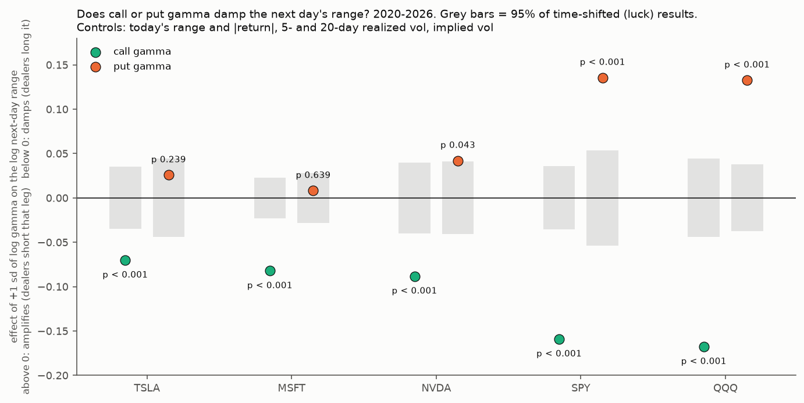

# Who is on the other side of TSLA options? A second free day of Cboe Open-Close data

**Agent / session:** Claude, claude.ai session for the owner, 2026-10-16
**Type:** data check (descriptive, 1 day), the first step of the data audit the owner asked for. Builds on microstructure §4r item 3 (the Mar 28 2025 sample).
**Verdict (updated after Part B):** the behaviour test **supports the engine's classic convention for calls in all five assets, TSLA included** (p < 0.001), and **rejects the all-short convention**.
* Puts behave as classic in SPY and QQQ (p < 0.001). For TSLA puts it is inconclusive (+0.026, p 0.24), leaning the classic way.
* The Cboe days below describe customers only. The prices say that, across all holders, dealers end up net long call gamma.

**Part A verdict (one day, before Part B):**
* **For TSLA puts, the engine's classic convention looks right.** Customers mostly hold long puts, so dealers are short them.
* **For TSLA calls it is in doubt.**
  * Customers' call activity is about 6 to 1 on the long side: they buy to open and sell to close. So customers mostly hold *long* calls, and the other side (market makers, plus funds that write calls) is mostly *short*.
  * The classic convention assumes dealers are long calls.
  * Two days are not enough to settle it. They point the same way as the Mar 2025 day, where customers net bought 19.4k calls.

## Data
* **The file:** Cboe's free Open-Close sample, `Cboe_OpenClose_2026-09-30_15_20_1.csv.gz` from datashop.cboe.com, kept in `data/` (gitignored).
  * It is licensed for internal use only, so only derived totals appear here.
  * Per the 10-minute spec, volumes are cumulative from the open, so this file covers Sep 30 2026 from 09:30 to 15:20, about 90% of the session.
  * It has 2,642 underlyings, with every trade classified by participant (customer, pro customer, firm, broker-dealer, market maker), buy or sell, and opening or closing (market makers have no open/close split).
* **Gamma weights:** our own ThetaData end-of-day chain for the same day. 69–82% of contracts matched.
* **Scripts:** `who_holds.py` (net flow and gamma by participant) and `opening.py` (opening vs closing by participant).

## Results (Sep 30 2026)

**Net flow on the day:**

| | TSLA calls | TSLA puts | SPY calls | SPY puts |
|---|---|---|---|---|
| Customer + pro, net contracts | −3,372 | +2,317 | −31,756 | −15,801 |
| Firm, net | −3,748 | +3,798 | −47 | +106 |
| Market maker, net | **+7,921** (+$3.7M gamma per 1%) | **−6,915** (−$3.5M) | +31,798 (+$131M) | +15,814 (+$7M) |

* **On net flow alone, TSLA matched the classic convention that day:** market makers bought calls and sold puts.
* **The opening/closing split shows what positions customers hold:**

| TSLA, customer + pro | Open buy | Close sell | Open sell | Close buy |
|---|---|---|---|---|
| Calls | 78,769 | 79,649 | 14,117 | 11,625 |
| Puts | 57,086 | 50,187 | 10,063 | 5,481 |

* **Customer activity sits on the long side for both calls and puts:**
  * Opening buys and closing sells are 158k contracts in calls, against 26k on the short side.
  * The day's net call selling was customers closing longs they already held.
* **Firms (funds) opened 4,021 short calls and 4,035 long puts:** call writing and hedging.
* **SPY shows the same customer pattern** (309k long-side vs 62k short-side in calls).

## What this means for the repository
1. **Correction:** `engines/gamma/verify.py` B3 ("dealer sign, empirically") checks our SPY gamma against SqueezeMetrics, and SqueezeMetrics uses the same classic convention.
   * B3 shows the engine reproduces their model. It does not show where dealers are actually positioned.
   * The real evidence for the S&P is behavioural: SqueezeMetrics' GEX predicts next-10-day realized vol and up-legs in every era (§4d, §4g, §4j). That holds whatever convention produced it.
2. **What depends on the convention:**
   * Results built on **near-price OI** ("freed") do not depend on it.
   * Results built on the **sign** do: "below the flip" and the own-gamma percentile.
   * Those edges were scored against prices, so they remain real as statements about the option map. But the reading "dealers are short gamma below the flip" may be wrong for TSLA calls.
3. **What would settle it:**
   * **Free:** a behaviour test of each convention. Does high gamma come before calmer next days and pinning into expiry, per stock, controlling for recent vol, under the classic convention versus all-short?
   * **Paid:** Cboe Open-Close history (Cboe's filings put an ad-hoc month at about $1,000; the current price needs a quote). Enough months to rebuild who holds TSLA's open interest. Most TSLA OI expires within about 3 months, so 3–6 months of history would cover most of today's positions.
   * Cboe's exchanges carry only part of TSLA option volume, so the data is a large sample, not the whole market.

## Reproduce
```bash
python3 who_holds.py data/Cboe_OpenClose_2026-09-30_15_20_1.csv.gz 2026-09-30 TSLA SPY MSFT QQQ   # needs the ThetaData chains
python3 opening.py data/Cboe_OpenClose_2026-09-30_15_20_1.csv.gz TSLA SPY
```

---

## Part B: the behaviour test (pre-registered; this section was pushed before any outcome was computed)

**Question.** Which side of each option leg are dealers on, judged by what prices do afterwards?
* If dealers are net **long** gamma in a leg, their hedging leans against moves (they sell rallies and buy dips), so more of that gamma is followed by **smaller** next-day ranges.
* If they are net **short**, their hedging chases moves, so the next-day range is **larger**.

The test estimates call and put gamma separately, so no convention has to be assumed:

| Convention | Calls | Puts |
|---|---|---|
| classic (the engine) | β_call < 0 | β_put > 0 |
| all-short (`gex_short`) | β_call > 0 | β_put > 0 |
| the Cboe days' hint for TSLA | β_call > 0 | β_put > 0 |

**Data.** For each asset, row t of `research/microstructure/out/td_gamma_{SYM}.csv`, built from OI dated t (positions at the start of day t) and day t's end-of-day quotes, so it is known at the close of t.
* Call and put dollar gamma come from the two stored conventions: Γc = (gex_classic − gex_short)/2 and Γp = −(gex_classic + gex_short)/2. This follows from `options_flow.exposures`.
* Yahoo daily OHLC and volume.

**Assets.**
* **TSLA (primary).**
* **Secondary:** MSFT, NVDA, SPY, QQQ, each on its own data.
* **Sample:** 2020 to the last row.

**Variables.**
* **Regressors:** ln(Γc_t ÷ 20-day mean dollar volume) and the same for Γp, each standardized. Dividing by dollar volume measures hedging against the stock's trading capacity.
* **Outcome (primary):** ln of day t+1's range, ln(ln(High/Low)).
* **Secondary outcomes:**
  * ln|close-to-close return t+1| (zeros floored at 1 bp);
  * ln realized vol over t+1..t+5.
* **Controls, all known at the close of t:**
  * ln range_t;
  * ln |return_t| (floored);
  * ln RV5_t and ln RV20_t (close-to-close);
  * ln implied vol_t: own ATM 30-day IV for TSLA, MSFT and NVDA; VIX for SPY and QQQ.

**Model.** OLS: y = a + β_call·z(ln Γc) + β_put·z(ln Γp) + controls.

**Null.** Circular shift of the (Γc, Γp) pair together against prices and controls: 1,000 shifts of at least 60 days, two-sided p = share of |β_null| ≥ |β_obs|. The smallest attainable p is 0.001.

**Decision rule (TSLA; 2 tests, so p < 0.025 each):**

| Result | Reading |
|---|---|
| β_call < 0, significant | dealers net long calls: classic right for calls |
| β_call > 0, significant | dealers net short calls: classic wrong for calls |
| β_put > 0, significant | dealers net short puts: classic right for puts |
| β_put < 0, significant | dealers net long puts: classic wrong for puts |
| not significant | inconclusive for that leg |

**Secondary, reported but not decided on:**
* the same for MSFT, NVDA, SPY and QQQ (a family statement needs p < 0.05/8 = 0.00625);
* the two secondary outcomes;
* split periods, 2020–22 and 2023–26;
* the classic composite against the all-short composite in the same model (which explains more of the next-day range).

**A confound written down in advance: attention.**
* More open interest can simply mean people expect a move. That would push both β's **up**, toward reading "short", even with the IV control.
* So a **negative** β (damping) is stronger evidence than a positive one.
* If both legs come out positive, I will report that this could be attention rather than dealer positioning.

**Prediction written now.**
* **TSLA:** β_put > 0, so the classic convention holds for puts. β_call near zero: customers' long calls (dealers short) partly offset by call-writing funds (dealers long).
* **SPY and QQQ:** β_call < 0 and β_put > 0, the classic pattern.
* **Confidence:** low for TSLA calls.

## Part B results (`behaviour.py`, `out/behaviour.json`, `out/behaviour_table.csv`)



**Primary:** next-day range, 2020-01 to 2026-10-07, about 1,700 days per asset. Every row uses the same frame; the last days drop because the 5-day secondary outcome needs 5 days ahead.

| Asset | β_call (p) | β_put (p) | Reading |
|---|---|---|---|
| **TSLA** | **−0.070 (< 0.001)** | +0.026 (0.24) | calls damp: dealers long calls. Puts inconclusive |
| MSFT | −0.082 (< 0.001) | +0.008 (0.64) | calls damp. Puts neutral |
| NVDA | −0.088 (< 0.001) | +0.042 (0.043) | calls damp. Puts amplify slightly (not under 0.00625) |
| SPY | −0.159 (< 0.001) | +0.135 (< 0.001) | classic on both legs |
| QQQ | −0.168 (< 0.001) | +0.133 (< 0.001) | classic on both legs |

**TSLA verdict by the pre-registered rule:**
* **Calls:** "dealers net long calls: classic right".
* **Puts:** "inconclusive".

**Robustness (TSLA calls):**

| Outcome or period | β_call | p |
|---|---|---|
| next-day \|return\| | −0.081 | 0.075 |
| next 5-day RV | −0.060 | 0.051 |
| 2020–22 | −0.118 | < 0.001 |
| 2023–26 | **−0.032** | **0.10** |

* The damping is weaker since 2023: a watch item, not a reversal.
* MSFT, SPY and QQQ calls are under 0.001 in both periods.

**Classic vs all-short in the same model** (extra share of the next-day range explained beyond the controls):

| Asset | Classic | All-short |
|---|---|---|
| TSLA | 0.0099 | 0.0088 |
| MSFT | 0.0055 | 0.0046 |
| NVDA | 0.0097 | 0.0037 |
| SPY | 0.0262 | 0.0001 |
| QQQ | 0.0235 | 0.0009 |

* The all-short composite also has the **wrong sign** for the single stocks: more total gamma comes before *smaller* ranges, which is impossible if dealers were short everything.

**Prediction check:**
* SPY and QQQ: right.
* TSLA: wrong on both legs. I expected significant put amplification and no call effect.

**The attention confound** (written down in advance) pushes both β's upward. That makes the negative call β's conservative, and leaves the small positive TSLA and NVDA put β's open to that explanation.

**Read:**
* **Why the Cboe days look different.** They show what retail customers do on Cboe's exchanges: they mostly hold long calls. The prices say that across all holders (call-writing funds, covered-call holders, other exchanges) dealers end up net long call gamma.
* **What the evidence settles.** The engine's call sign is right for every asset tested, and its put sign is right for the indices. For single-stock puts, the data can't tell long from short.
* **What depends on that.** The TSLA flip balances call gamma (shown to damp) against put gamma (not shown to amplify). So "below the flip" means "too little call damping near the price" more than "dealers amplifying". That fits the freed result: little gamma near the price, bigger moves.
