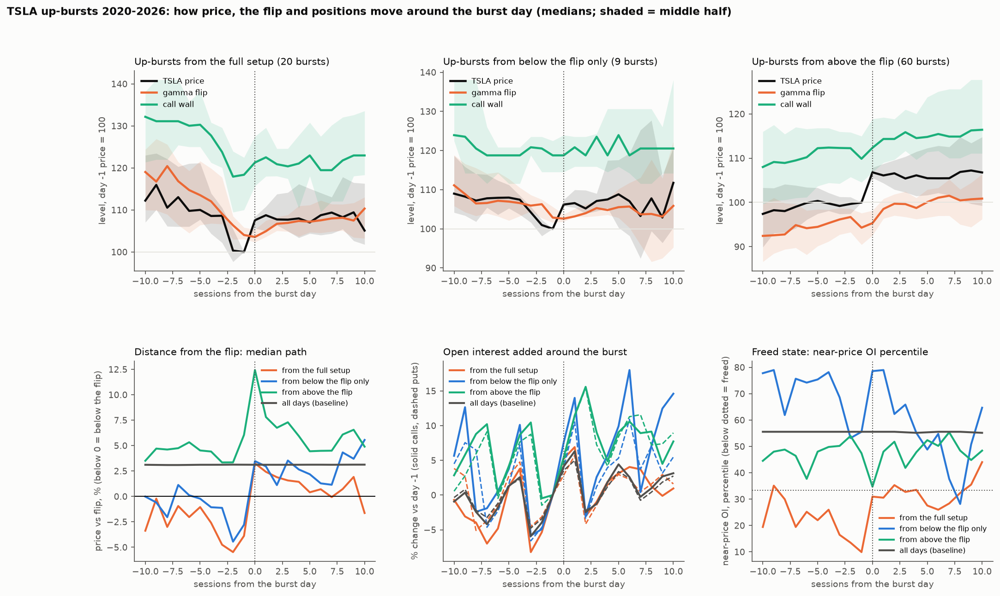

# How do the flip and positions move around TSLA's up-bursts? (descriptive event study)

**Agent / session:** Claude, claude.ai session for the owner, 2026-10-16
**Type:** exploratory, descriptive. **No pass/fail is applied.** Any pattern found here is a hypothesis for a separate, pre-registered test.
**Committed before the run** (0b12c4d). One change at run time: the baseline is every eligible day (1,643), not 2,000 random days, because only about 1,640 days exist.

## Question
The owner's point: our setup reads where the price sits against the flip, but the flip is recomputed every day from positions. How does it move through a burst? Does it chase the price up, lag behind it, or stay put? And what do call OI, put OI, near-price OI and dealer gamma do?

## Design (fixed now)
* **Events:**
  * TSLA up-burst days 2020-2026 (`stock_now.burst_days`, unchanged). Day 0 is the burst day.
  * Split by the state at the close of day −1: in the full setup, below the flip only, or above the flip.
* **Daily series** from `research/microstructure/out/td_gamma_TSLA.csv`:
  * price
  * flip
  * distance above the flip
  * dealer gamma, scaled by price × total OI
  * call OI and put OI as % change vs day −1
  * near-price OI share (trailing-year percentile)
  * call and put walls
* **Timing:** the row for day t uses OI going *into* day t, so the burst day's own new positions appear from day +1.
* **Window:** day −10 to day +10. Medians, with the interquartile range.
* **Baseline:** the same paths around 2,000 random days, for comparison.

## Results



**Bursts from the full setup (20 events; medians, day −1 price = 100):**

| Day | Price | Flip | Price vs flip | Near-price OI percentile | Dealer gamma percentile |
|---|---|---|---|---|---|
| −5 | 110.0 | 113.5 | −1.1% | 22 | 21 |
| −1 (the setup close) | 100.0 | 104.0 | −3.9% | 10 | 17 |
| 0 (burst) | 107.6 | 103.6 | +3.3% | 31 | 48 |
| +3 | 107.7 | 106.9 | +1.6% | 33 | 41 |
| +10 | 105.1 | 110.3 | −1.6% | 44 | 29 |

* **The flip moves with positions.**
  * On the way down it falls with the price but lags, so the price ends about 4% under it, with near-price OI at the 10th percentile.
  * On the burst day the price jumps through the flip, which hasn't moved yet: positions are a day behind.
  * Over days 1–10 the flip climbs about 6% to meet the price. New positions build near the new level, and near-price OI returns to the 31st–44th percentile.
  * By day 10 the price is back below the flip, having given back about a third of the burst.
* **The call wall drops toward the price before the burst:** from about +31% above it at day −10 to about +18% at day −2.
* **Bursts from above the flip (60):** they hold their gain (+6.8% at day 10). The flip stays about 5% below the price.
* **Bursts from below the flip only (9):** they keep climbing (+11.7% at day 10). Too few to read.
* **OI changes** follow the weekly-expiry sawtooth seen on all days. Around the burst they look about like the baseline.

## Hypotheses for pre-registered tests (not findings)
1. **Exit:** a full-setup burst is spent when the flip has climbed back to within about 1% of the price.
2. **Early warning:** the call wall moving toward the price in the days before a full setup raises the burst odds.

## Reproduce
```bash
OMP_NUM_THREADS=1 python flip_paths.py   # -> out/paths.csv, out/summary.json, out/flip_paths.png
```
