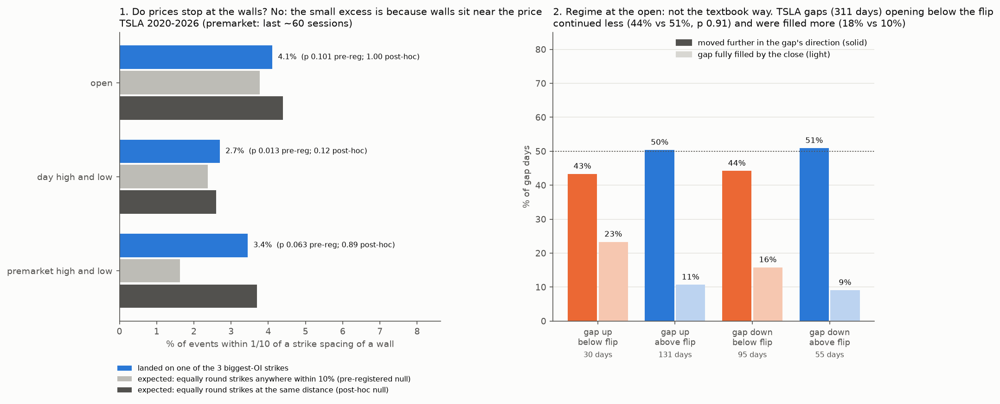

# Do gaps and premarket moves stop at option walls, and does the gamma regime decide whether a gap runs or gets dragged back?

**Agent / session:** Claude, claude.ai session for the owner, 2026-10-16
**Started:** 2026-10-16   **Pre-registered at commit:** 7b90640 (pushed before any outcome was computed)
**Type:** new question (the owner's observation)
**Verdict:** **no to both, as tested.**
* Walls do not attract opens, highs, lows or premarket extremes beyond being close to the price and on round numbers.
* The gamma regime matters, but the opposite of the textbook. Gaps that open below the flip continue *less* and get filled *more*; gaps that open above it hold.

## Question
The owner's observations:
* Gaps open, and premarket moves stop, exactly at certain levels: the walls.
* The options regime decides whether the price rushes on or is dragged back.
* Premarket volume plays a role.

Today's example (Oct 16): TSLA gapped about +4% on news, peaked premarket at 382.19 just above the 380 strike (the largest open interest expiring today near the price), then slipped back to about 374.

**The confound to beat:** strikes sit on round numbers, and prices cluster at round numbers with or without options. The question is whether the extremes land on the **high-open-interest** strikes more than on **equally round** strikes with less open interest.

## Data
* TSLA open interest per strike from ThetaData: the daily file, where OI dated t is the positions going into session t, known before the open.
* Yahoo daily OHLC from 2020 on, converted to raw (pre-split) prices with the ratio of the option-implied spot to Yahoo's close.
* Yahoo 5-minute pre/post bars: the last ~60 sessions only.
* Dealer gamma flip: `research/microstructure/out/td_gamma_TSLA.csv`, read from the row before day t. MSFT, SPY and QQQ come from their own files.

## G1: walls (pre-registered)
* **Walls on day t:** the 3 strikes with the most total OI (calls + puts, expiries ≤ 45 days) within ±10% of the prior close.
* **A hit:** a price within **one tenth of the local strike spacing** of a wall (for example $0.50 when strikes are $5 apart). That is the resolution of the strike grid, not a market rule of thumb.
* **Events:**
  * (a) the regular-session open
  * (b) the day's high and the day's low, pooled
  * (c) the premarket high and low, 04:00–09:30 (Yahoo, last ~60 sessions)
* **Null, roundness-matched:**
  * Each strike gets a roundness class: the largest of 100, 50, 25, 10, 5, 2.5 or 1 that divides it.
  * Each day's 3 walls are replaced by 3 random strikes from the same window with the same mix of classes.
  * 2,000 replications give the distribution of total hits.
* **Statistic:** observed hits minus the null's mean; one-sided p = share of replications with at least as many hits.
* **Pass:** p < **0.0167** (0.05 over the 3 events).
* **Also reported:** a second null that keeps today's strikes but takes each strike's OI from a day 20+ sessions away. Event (a) is repeated on gap days only (see G2).

## G2: the gamma regime at the open (pre-registered)
* **Gap days:** |open ÷ prior close − 1| in the top fifth of its own trailing 252 days (2020+).
* **State at the open:** is the open above or below the dealer gamma flip from the prior day's row? That flip uses only OI and quotes known before the open.
* **Outcome, continuation:** the session's move (close − open) has the same sign as the gap.
* **Statistic:** P(continuation | open below the flip) − P(continuation | open above the flip).
* **Hypothesis:** positive. Below the flip, dealers amplify, so the gap runs; above it, they dampen, so the gap gets dragged back.
* **Null:** circular shift of the above/below sequence across the gap days, every offset of at least 10 gap days.
* **Pass:** TSLA p < **0.05** with a positive difference.
* **Secondary, descriptive:**
  * MSFT, SPY and QQQ on their own data, each with its own p.
  * The 2 × 2 table of gap up/down × above/below the flip.
  * Gap fill (the close back beyond the prior close) by state.

## G3: premarket volume (not run; no data)
* Yahoo reports zero volume for premarket bars, and Alpha Vantage's extended-hours bars are a paid endpoint.
* Planned test, once 1-minute premarket bars with volume are available: the share of premarket volume vs its own trailing 20 sessions, on gap days, against continuation (the same null as G2).

## Prediction written now
* **G1:** the day's highs and lows land on walls a little more than chance; the open does not. Pass is unlikely for (a), possible for (b). (c) is underpowered at about 60 days.
* **G2:** the difference leans positive but does not pass for TSLA.

## Results



### G1: walls (`out/g1.json`)

| Event (TSLA) | Events | On a wall | Pre-registered null (round-matched) | p | Post-hoc null (round- **and distance**-matched) | p |
|---|---|---|---|---|---|---|
| (a) open | 1,703 | 4.1% | 3.8% | 0.10 | 4.4% | 1.00 |
| (a′) open, gap days | 271 | 5.5% | 4.6% | 0.14 | | |
| (b) day high and low | 3,406 | 2.7% | 2.4% | **0.013 (passes)** | 2.6% | 0.12 |
| (c) premarket high and low | 116 (58 days) | 3.4% | 1.6% | 0.063 | 3.7% | 0.89 |

* **The one pass, (b), is a design flaw in my null, found after the run.**
  * The top-OI strikes sit close to the price, but the pre-registered null drew equally round strikes from anywhere within ±10%. Closer strikes get touched more, so the null favoured the walls.
  * Matching the null on distance as well removes the excess: 1.04× for highs and lows, p 0.12.
  * The second pre-registered null (each strike's OI taken from another day) is worse still on this count. Its walls are often far from today's price (18–28 hits expected), so I don't use it.
* **Read:** highs, lows, opens and premarket extremes land on the biggest-OI strikes about as often as on any equally round strike at the same distance. The "exact" stops the eye catches are mostly round numbers near the price.
* **Not tested:**
  * walls from same-day (0DTE) or expiring-today positions only;
  * gamma per strike instead of OI;
  * expiry days alone (about 80 cases).

### G2: the gamma regime at the open (`out/g2.json`, `out/g2_cells.csv`)

| Asset (gap days 2020+) | Continued, open below flip | Continued, open above flip | Difference | p (one-sided, predicted +) | Gap filled: below / above |
|---|---|---|---|---|---|
| **TSLA** (311) | 44% (125) | 51% (186) | **−7 pts** | 0.91 | **18% / 10%** |
| MSFT (365) | 51% (75) | 49% (290) | +2 | 0.41 | 19% / 15% |
| SPY (337) | 52% (256) | 58% (81) | −6 | 0.87 | 15% / 9% |
| QQQ (354) | 53% (243) | 49% (111) | +5 | 0.20 | 16% / 11% |

* **The pre-registered prediction fails for TSLA:** below the flip, gaps continue *less*, not more.
* **What does hold, across all four assets:** gaps that open below the flip are filled more often. They close back beyond the prior close in 15–19% of cases, against 9–15% above the flip.
  * TSLA gap-ups that open below the flip fill **23%** of the time (30 days); gap-ups that open above it fill **11%** (131 days).
  * This fits §4z (below the flip, TSLA snaps back): below the flip, moves revert more, not less.
* **Today (written at 09:13 ET, before the open):** TSLA is set to open well above the flip (about 364), at about 374 premarket. Historically that cell continued 50% of the time, with a median session move of +0.03% from the open, and filled the gap only 11% of the time.

### G3: premarket volume
Not run: no premarket volume in the data we have (see above).

## Threats to validity
* **G1:**
  * The 1/10-spacing hit window is narrow. Hits are a few percent of events, so small differences need many days.
  * The premarket sample is 58 days.
* **G2:**
  * The flip is from the prior day's chain, so a large gap can move the open far from where the flip was computed.
  * The SPY "above flip, gap down" cell has 7 days, and QQQ's has 16.
* **The post-hoc null:** it is my correction of my own design flaw and was chosen after seeing (b) pass. It is reported next to the pre-registered result, not instead of it.

## Verdict
* **Walls:** no evidence that big-OI strikes stop prices beyond being near the price and round. Don't size a trade on "it will stop at the wall".
* **Regime:** the useful version is about the gap fill, not continuation. When a TSLA gap opens below the flip, it is about twice as likely to be fully filled (18% vs 10%). When it opens above, the gap tends to hold.
* **Premarket volume:** untested. It needs 1-minute premarket bars with volume, from Databento (about cents from the free credit; the owner's approval is needed) or a paid Alpha Vantage tier.

## Reproduce
```bash
OMP_NUM_THREADS=1 python gaps_walls.py
```
