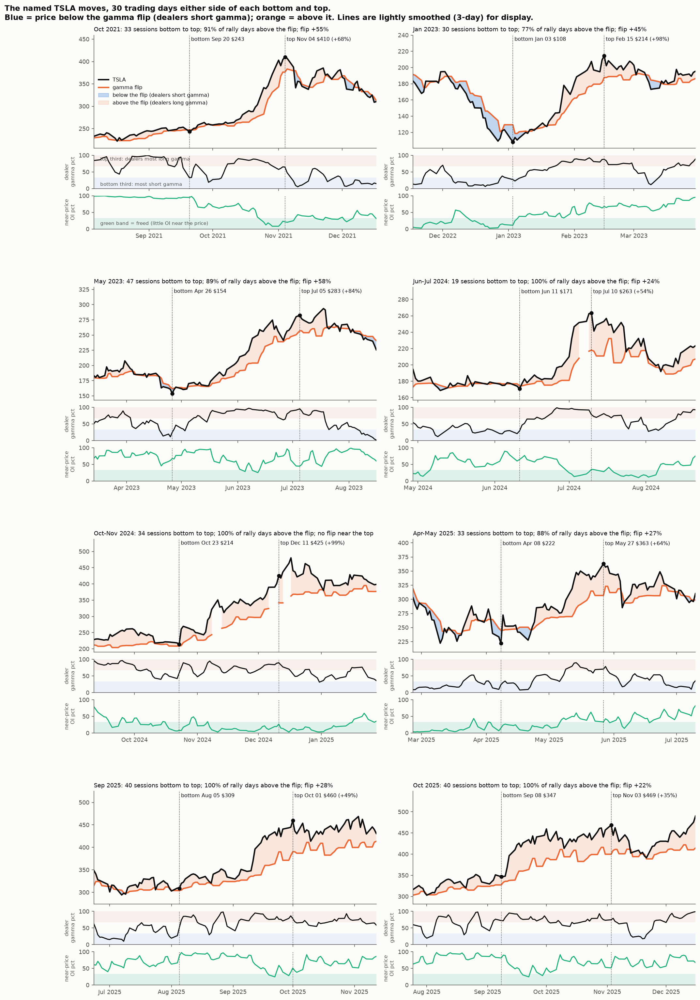

# The owner's named TSLA moves, bottom to top: price, flip, dealer gamma, freed state and walls on one timeline

**Agent / session:** Claude, claude.ai session for the owner, 2026-10-16
**Type:** descriptive (8 hand-picked moves). **No pass/fail.** Eight events cannot establish an edge (§4ad). This shows how the metrics track so the owner can see the mechanics; any rule seen here needs its own pre-registered test.
**Committed before the run** (7bbb370). At the owner's request the figure shows 30 trading days either side. The lines are lightly smoothed (3-day centred) for display only; the table uses raw daily values.

## The owner's view to check
* The trends were driven by negative gamma.
* That only works if the flip keeps moving up ahead of the price during the rally.
* The top comes when gamma turns heavily positive again, which could serve as a profit-taking or top signal.

## Moves
The 8 moves in `research/microstructure/named_weeks.MOVES` (the owner's dates):
* Oct 2021
* Jan 2023
* May 2023
* Jun–Jul 2024
* Oct–Nov 2024
* Apr–May 2025
* Sep 2025
* Oct 2025

## Bottom and top, fixed now (mechanical, so they cannot be picked to fit a story)
* **Top:** the highest close from the window's first day to 15 sessions after its last day.
* **Bottom:** the lowest close in the 15 sessions before the window up to the top.

## Metrics, daily (`research/microstructure/out/td_gamma_TSLA.csv`; the row for day t uses OI going into day t)
* the price and the gamma flip, with the zone below the flip shaded (dealers short gamma)
* call wall and put wall
* dealer gamma at the price: own-gamma percentile vs its trailing year (low = most negative)
* freed: near-price OI percentile at or below 1/3

## Read-outs per move
At the bottom, through the rally, and at the top:
* price vs flip
* the share of rally days below the flip
* whether the flip rose during the rally
* gamma percentile at the bottom and at the top
* freed at the bottom and at the top

## Results

Table: `out/named_moves_table.csv`.

| Move | Bottom → top | Gain | At the bottom: vs flip / gamma pct | Rally days above the flip | Flip change | At the top: vs flip / gamma pct | First close back at the flip after the top | Drop from the top by then |
|---|---|---|---|---|---|---|---|---|
| Oct 2021 | Sep 20 → Nov 4 | +68% | −2% / 0 | 91% | +55% | +6% / 77 | +3 sessions | −17% |
| Jan 2023 | Jan 3 → Feb 15 | +98% | −16% / 10 | 77% | +45% | +14% / 96 | +10 | −11% |
| May 2023 | Apr 26 → Jul 5 | +84% | −5% / 1 | 89% | +58% | +10% / 98 | +11 | −7% |
| Jun–Jul 2024 | Jun 11 → Jul 10 | +54% | −2% / 18 | 100% | +24% | +22% / 89 | +10 | −18% |
| Oct–Nov 2024 | Oct 23 → Dec 11 | +99% | +3% / 37 | 100% | n/a (no flip near the top) | n/a / 91 | +14 | −11% |
| Apr–May 2025 | Apr 8 → May 27 | +64% | −8% / 9 | 88% | +27% | +18% / 84 | +7 | −22% |
| Sep 2025 | Aug 5 → Oct 1 | +49% | +2% / 33 | 100% | +28% | +18% / 96 | +31 | −13% |
| Oct 2025 | Sep 8 → Nov 3 | +35% | +6% / 70 | 100% | +22% | +17% / 90 | +8 | −14% |

**What the pictures show (descriptive, 8 moves):**
1. **Negative gamma is where the moves start, not what drives them.**
   * The declines into the bottoms ran mostly below the flip, most clearly in Jan 2023 and Apr 2025 (23 and 21 of the 30 days before the bottom).
   * Dealer gamma sat in its bottom fifth at 6 of the 8 bottoms.
2. **The rallies run above a rising flip.**
   * 77–100% of rally days were above the flip, which rose 22–58% and trailed under the price like a floor.
   * Dealer gamma moved into its top third within days to weeks and stayed there.
   * The trend is a grind in positive gamma, not a squeeze in negative gamma.
3. **High gamma does not mark the top.**
   * It reached its 90th percentile 8–39 sessions before each top, with +4% to +64% still to come.
   * On all days since 2021, "gamma at or above its 90th percentile and the price 6%+ above the flip" was followed by a median −0.7% over 10 days (52% fell, vs 49% on all days).
4. **The visible end is the gap closing.** After each top, the price came back to the flip within 3–31 sessions (median about 10). By then it was 7–22% below the top. The flip works as a floor during the rally, but touching it is a late exit.
5. **Near-price OI (freed)** shows no consistent pattern across the moves.

## Hypotheses for pre-registered tests (not findings)
1. A rally is intact while the price stays above a rising flip.
2. An earlier exit than the flip touch: the gap between the price and the flip shrinking from its peak (for example, to half), tested against fixed holding periods.
