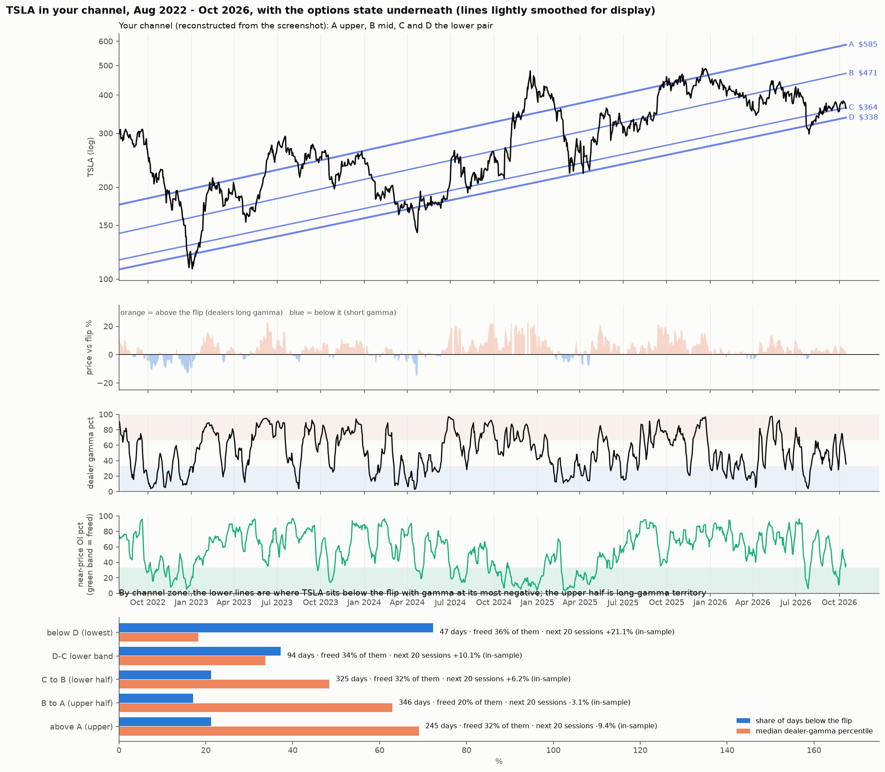
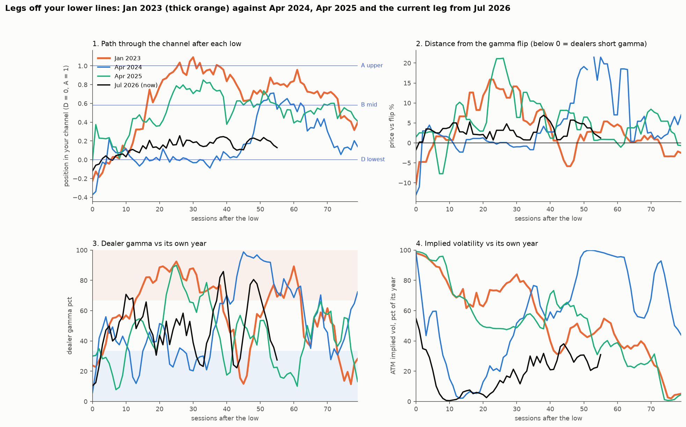

# The owner's weekly TSLA channel (lower line → mid line → upper line) against the options state

**Agent / session:** Claude, claude.ai session for the owner, 2026-10-16
**Type:** descriptive.
* The lines were drawn by the owner on a finished chart, so they fit their own history by construction.
* This shows which options states **go with** each channel zone. It cannot show that the channel predicts.
* Forward returns by zone are reported only as in-sample description.
**Committed before the run.**

## The owner's observation
Each leg moves up from the lowest lines, consolidates at the middle line, then runs to the top line (TradingView, weekly, log scale, 2022–2026).

## Reconstruction of the lines
The owner's screenshot (`data/owner_channel_screenshot.png`, gitignored) is read through its log price axis (2200 … 41) and year axis.

| Line | Anchor 1 | Anchor 2 | Slope | Level on Oct 16, 2026 |
|---|---|---|---|---|
| A, upper | 2022.655, $179 | 2027.188, $656 | 0.286 ln/yr | ~$587 |
| B, mid | 2022.931, $156 | 2027.456, $571 | 0.287 | ~$474 |
| C, second lowest | 2022.983, $129 | 2028.484, $578 | 0.273 | ~$365 |
| D, lowest | 2022.421, $103 | 2028.207, $497 | 0.271 | ~$339 |

Reading error is about ±3% per line. The screenshot itself was taken on Oct 16 at $364.62, which sits on line C, so the reconstruction matches that point.

## Zones and metrics (daily, Aug 2022 – Oct 2026)
* **Zones:**
  * below D
  * D–C (the lower band)
  * C–B
  * B–A
  * above A
* **For each zone:**
  * days in the zone
  * share of days below the gamma flip, and the median distance from it
  * median dealer-gamma percentile
  * median near-price OI percentile, and the share of days freed
  * in-sample next-20-session return and up-burst odds within 10 sessions
* **Figure:** price with the 4 lines; price vs flip (shaded blue below, orange above); dealer-gamma percentile; near-price OI percentile. All on one time axis.

## Results

`out/zones.csv`; Aug 2022 – Oct 14, 2026.

| Zone of the owner's channel | Days | Below the flip | Median vs flip | Dealer-gamma pct (median) | Near-price OI pct (median) | Freed | Next 20 sessions (in-sample) |
|---|---|---|---|---|---|---|---|
| below D (lowest line) | 47 | **72%** | −2.2% | **18** | 47 | 36% | +21.1% |
| D–C lower band | 94 | 37% | +1.0% | 34 | 56 | 34% | +10.1% |
| C to B (lower half) | 325 | 21% | +2.9% | 48 | 49 | 32% | +6.2% |
| B to A (upper half) | 346 | 17% | +4.7% | 63 | **67** | **20%** | −3.1% |
| above A (upper line) | 245 | 21% | +5.1% | **69** | 56 | 32% | −9.4% |

* **The channel and the options state move together, step by step.**
  * At and under the lower lines, TSLA is mostly below its flip, with dealer gamma at its most negative: the coiled spring of the full setup.
  * Up through the channel, the price sits further above the flip and gamma turns steadily more positive.
* **The consolidation above the mid line coincides with pinning.** B to A has the most open interest near the price (67th percentile) and the fewest freed days (20%).
* **Why they line up:** both measure the same thing from two angles. A drop toward the lower lines leaves the price under a lagging flip; a run to the upper lines leaves it far above a rising one (see `2026-10-16-named-moves-gamma`).
* **Limits:**
  * The lines were drawn after the fact. The forward returns are in-sample, so they overstate any edge.
  * Earlier channel studies found touches of fitted channels no better than a random walk (`2026-10-15-channel-reversion-*`).
  * The options state, by contrast, was tested forward (§4w, §4ad).
* **Now (Oct 16):**
  * TSLA ~$364 sits on line C (~$364), in the D–C lower band. D is about $338.
  * After today's expiry TSLA is above its flip (~$348–356) and freed: the channel says "lower band", the options say not yet coiled.
  * A drop to line D would bring it near or below the flip, which is the full setup.

## Follow-up: why the Jan 2023 leg overshot while later legs paused at the mid line (`legs.py`, `out/legs.csv`, `out/legs.png`; descriptive, 4 legs)

| | Jan 2023 | Apr 2024 | Apr 2025 | Jul 2026 (now) |
|---|---|---|---|---|
| Low (close) | $108.1, Jan 3 | $142.1, Apr 22 | $221.9, Apr 8 | $298.3, Jul 29 |
| **Below the 52-week high** | **−73%** | −52% | −54% | −39% |
| Below line D | −10.5% | −17.4% | −0.6% | −6.4% |
| Below the flip | −16.4% | −15.0% | −8.0% | −3.7% |
| Dealer-gamma pct / near-OI pct at the low | 10 / 3 | 5 / 1 | 9 / 5 | 2 / 5 |
| ATM IV at the low (pct of its year) | 86% (99) | 64% (100) | 98% (100) | 49% (71) |
| **IV during the climb** | **stayed at its 60–80th pct** | fell to ~5th, rose late | fell to ~50th | fell to ~0, then 20–35th |
| Calls/puts OI at the low | 1.26 | 1.12 | 1.09 | 1.24 |
| Highest channel position in 80 sessions (A = 1) | **1.09** | 0.71 | 0.85 | 0.26 so far |
| Sessions within 0.08 of the mid line | 7 | 12 | **29** | 0 |
| S&P over the window | +8% | +9% | +25% | +6% |
| TSLA 40 sessions after the low | **+88%** | +32% | +50% | +27% |

**What separates Jan 2023 in the data:**
* **The deepest crash before the low:** −73% from its high, against −39% to −54% for the others. This was the first leg out of a bear-market capitulation, not a leg inside an established channel.
* **IV stayed high through the climb.** The market kept paying up for options all the way up; in every later leg IV collapsed as the price recovered.

**What does not separate it:**
* Depth below the flip (Apr 2024 was as deep).
* Dealer gamma and the freed state at the low (all near their extremes).
* The market backdrop (Apr 2025 had a far bigger S&P rally, and TSLA still consolidated at the mid line).
* The spot-vol correlation in the first 30 sessions: Jan 2023 +0.14, Apr 2024 +0.10, Apr 2025 −0.62, now +0.61. Mixed.
* The other big overshoot, Nov–Dec 2024 (the election), did come with spot-up/vol-up (+0.45 over 20 sessions, near the 90th percentile of the measure).

**Read:**
* The overshoots came out of an extreme (a −73% crash, or an event like the election) with options demand that stayed high.
* The clean legs came out of ordinary pullbacks, with IV deflating as the price rose. Those consolidate at the mid line.
* This is 4 legs; a hypothesis for a pre-registered test, not a finding: does IV holding up during a rally off the lower lines predict an overshoot of the upper line?
