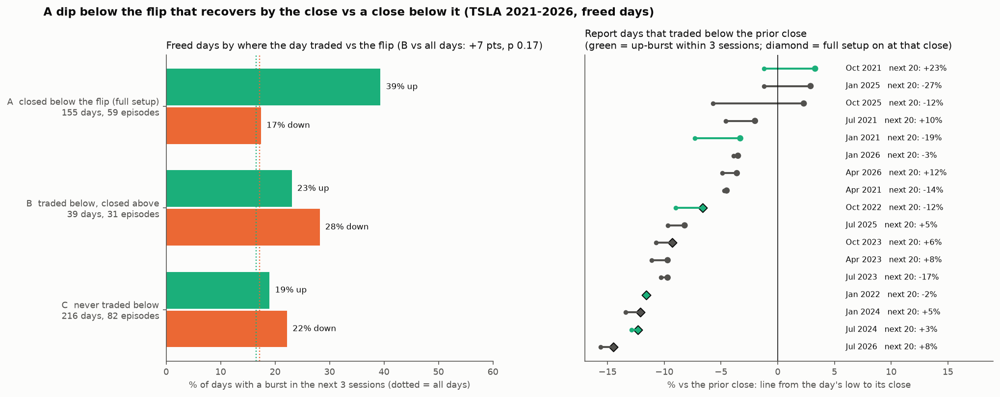

# Is a day that trades below the flip but closes back above it the same setup as a close below?

**Agent / session:** Claude, claude.ai session for the owner, 2026-10-16
**Started:** 2026-10-16   **Pre-registered at commit:** 41c1b14 (pushed before any outcome was computed)
**Type:** new question (the owner's hypothesis), builds on the full setup (microstructure §4w, reproduced by `edge_lab.py`)
**Verdict:** **no.** A dip below the flip that recovers by the close is not the full setup. After those days, down-bursts (28%) outnumber up-bursts (23%). H1 fails (+7 pts vs all days, p 0.17), as predicted.

## Question
The owner's two paths into the Oct 21 report:
1. TSLA dips into the report and closes below the flip, which turns the full setup on; the report then launches it.
2. The report reaction drops, then climbs back the same day to close flat or green. The owner's view: structurally the same as path 1, only the flush happens inside the day instead of at a close.

Path 1 is the tested full setup (freed AND close below the flip → up-burst within 3 sessions 39% vs 17% down, 155 days / 59 episodes since 2021).
Path 2 has never been measured. The full setup is read at the close, and an earlier check found no edge on the day the close reclaims the flip (16% / 16%). This test asks whether an *intraday* dip below the flip that recovers by the close carries the same edge.

## Data
* `research/microstructure/edge_lab.load()`: the production analysis frame, 2021-01-04 to 2026-10-14, 1,452 days. It includes the freed state (near-OI percentile ≤ 1/3) and `below` (close below the flip, or no flip in range with negative gamma).
* The flip (row t) is converted to Yahoo's split-adjusted units with the split factor (spot ÷ close, nearest of 1, 3, 15).
* Yahoo daily low for day t.
* Outcome: the production up-burst mark (`burst_days`: +5% in a day or +9% in two) in sessions t+1 to t+3, `edge_lab.outcome(..., 3)`.

## Groups (freed days only, read at the close of day t)
* **A, the full setup:** closed below the flip. 155 days, 59 episodes.
* **B, pierce and reclaim:** did not close below the flip, but the day's low was below it. 39 days, 31 episodes.
* **C, stayed above:** the low never went below the flip. 216 days, 82 episodes.

The group sizes were counted before the run; no outcomes were looked at.

## H1 (primary)
* **Statistic:** the up-burst-within-3 rate on B days minus the rate on all 1,452 days.
* **Null:** circular shift of the B marks, 1,000 shifts of at least 60 days, using `edge_lab.edge_test`, the same machinery as the published full setup.
* **Pass:** p < 0.05 with a positive lift. The smallest attainable p is 0.001.
* **Power:** 31 episodes. A lift as large as the full setup's (+23 pts) is about 2 standard errors, so a real but smaller effect can fail.

## Secondary (descriptive, no pass/fail)
* The up- and down-burst rates for A, B and C side by side. The owner's "structurally the same" claim reads as B ≈ A.
* B on all days, freed or not (232 days, 172 episodes), with its own shift-null p.
* Every report reaction day since 2020 whose low went below the flip or the prior close and that closed above the flip, with the next 3 and 20 sessions.

## Prediction written now
* B falls between C and A, closer to C.
* H1 does not pass: the earlier reclaim result says the close is what carries the state, and B is small.

## Threats to validity
* **Approximate intraday flip.** The flip on row t is computed from end-of-day quotes, so the intraday flip was at a slightly different level. An intraday pierce of a level computed at the close is an approximation.
* **Small B.** 39 freed days.
* **Partly overlapping groups.** B days often sit next to A days in the same episode.

## Results



### H1 and the groups (`out/results.json`)

| Freed days, TSLA 2021–2026 | Days (episodes) | Up-burst within 3 | Down-burst within 3 |
|---|---|---|---|
| **A: closed below the flip (the full setup)** | 155 (59) | **39%** | 17% |
| **B: traded below, closed above** | 39 (31) | 23% | **28%** |
| C: never traded below | 216 (82) | 19% | 22% |
| All 1,452 days | | 17% | 17% |

* **Check:** A reproduces the published full setup (+22.8 pts, p < 0.001).
* **H1: fails.** B is +7 pts over all days, p 0.17.
* **B is a two-way state, not an up-leaning one.** Down-bursts follow more often than up-bursts.
* **B on all days, freed or not (232 days):** 18% up, 19% down, p 0.38.
* **The prediction was right:** B falls between C and A, closer to C, and does not pass.

### Report reaction days (`out/report_days.csv`, descriptive)

**Dipped below the prior close and closed green** (the owner's path 2): 3 days.

| Day | Low | Close | Next 20 sessions |
|---|---|---|---|
| Oct 2021 | −1.2% | +3.3% | +23% |
| Jan 2025 | −1.2% | +2.9% | −27% |
| Oct 2025 | −5.7% | +2.3% | −12% |

* 1 of the 3 went on to rise.
* The two failures came from high in the owner's channel (positions 1.16 and 0.99).

**Closed below the flip while freed, so the full setup was on at the reaction close:** 6 days.
* The days: Jan 2022, Oct 2022, Oct 2023, Jan 2024, Jul 2024, Jul 2026.
* 3 of the 6 had an up-burst within 3 sessions.
* Median over the next 20 sessions: +4%.

### Read
* **The close carries the state, not the intraday low.** A day that dips under the flip and recovers ends with dealers back on the long-gamma side. The edge is not there.
* **A report that drops and *stays* down at the close is the setup.** It turns the full setup on at that close, and 3 of 6 such report days burst up within 3 sessions.

## Reproduce
```bash
OMP_NUM_THREADS=1 python pierce_reclaim.py
```
