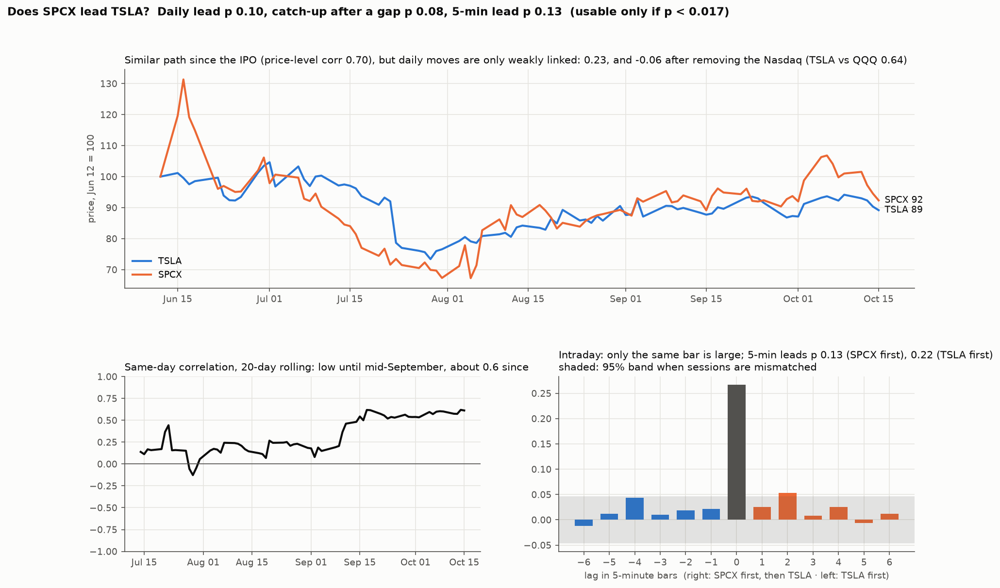

# Does SpaceX (SPCX) lead TSLA, so it can be used as a signal?

**Agent / session:** Claude, claude.ai session for the owner, 2026-10-16
**Started:** 2026-10-16   **Pre-registered at commit:** 52ef023 (pushed before any return was computed)
**Type:** new question (cross-asset; the owner's observation)
**Verdict:** **inconclusive, leaning no.** None of the three lead tests passes. SPCX does not move first: not by a day, not by 5 minutes, and not as a gap that TSLA closes. Since mid-September the two have moved together on the same day beyond the market, which is useful context but not a predictor.

## Question

The owner noticed that SPCX (Space Exploration Technologies, on Nasdaq since 2026-06-12) and TSLA have moved together since SPCX listed.

Moving together on the same day is not a signal: by the time you see SPCX's move, TSLA has already made its own. SPCX is only usable if its move comes **first**, in one of three ways:
* yesterday's SPCX move predicts today's TSLA move;
* SPCX's last 5 minutes predict TSLA's next 5 minutes;
* a gap that opens between the two closes, with TSLA catching up.

Each test controls for TSLA's own last move and the market (QQQ), so SPCX must add something those don't.

## Data

* Yahoo daily bars for SPCX, TSLA and QQQ, 2026-06-12 to 2026-10-15: about 86 daily returns. Day 1's return from the IPO price is not available.
* Yahoo 5-minute bars, regular hours, for the last ~60 sessions only (Yahoo's limit). Returns within a session only; the overnight gap is excluded. The first weeks after the IPO are therefore not in the intraday test.

## Tests and pass/fail criteria (fixed before any result)

| | Statistic | Null |
|---|---|---|
| **D0** (description, not a test) | Same-day correlation of daily returns, SPCX vs TSLA; the same after removing QQQ; TSLA vs QQQ for comparison; 20-day rolling correlation | none |
| **H1** daily lead | Partial correlation of TSLA's return on day t+1 with SPCX's on day t, controlling for TSLA's and QQQ's day-t returns | Circularly shift the SPCX series against the others, every offset from 10 to n−10 |
| **H2** intraday lead | Partial correlation of TSLA's next 5-minute return with SPCX's last 5-minute return, controlling for TSLA's and QQQ's last 5-minute returns, pooled over sessions | Pair SPCX's session d with TSLA's session d+k, every k ≠ 0 (keeps the intraday pattern, breaks the same-day link) |
| **H2r** reverse (diagnostic) | The same with the roles swapped: does TSLA lead SPCX? | as H2 |
| **H3** catch-up | Correlation of TSLA's next-5-session return with the prior 5 sessions' SPCX-minus-TSLA return gap | Circular shift of the gap series, offsets 10 to n−10 |

* **Usable signal:** H1, H2 or H3 with p < 0.0167, which is 0.05 split over the three tests.
* All p-values are two-sided: a negative lead would also be usable.
* For H2, also report how much of TSLA's next 5-minute move the lead explains, and the size of the move it implies. A real but tiny lead is not tradable.
* **Power, stated in advance:**
  * About 86 daily returns can only detect a daily lead with |r| ≥ ~0.33 (80% power at α 0.0167).
  * The intraday test has about 4,500 bar pairs and can detect |r| ≥ ~0.05.
  * A null daily result therefore means "no strong lead", not "no lead".
* **What would prove the idea wrong:**
  * All three tests have p ≥ 0.0167.
  * Or H2r shows TSLA leading SPCX, which would make SPCX the follower.

## Results



**D0, what the owner saw (description):**
* The **paths** look alike: the price-level correlation is 0.70, and both fell into early August and then recovered (SPCX 92, TSLA 89, Jun 12 = 100). Trending price levels correlate easily, so this alone says little.
* **Daily moves** are only weakly linked over the whole period: 0.23. After removing the Nasdaq (QQQ) it is −0.06. Over the period, TSLA tracks QQQ (0.64) far more than SPCX.
* **5-minute bars:** the same-bar correlation is 0.27.

| Test (pre-registered) | Statistic | p (shift null) | Usable (p < 0.0167)? |
|---|---|---|---|
| H1: yesterday's SPCX predicts today's TSLA (85 days) | partial corr +0.19 | 0.10 (67 shifts) | no |
| H2: SPCX's last 5 min predicts TSLA's next 5 min (4,560 bar pairs, 60 sessions) | partial corr +0.03 | 0.13 (59 shifts) | no |
| H2r: TSLA leads SPCX (diagnostic) | +0.03 | 0.22 | no, so SPCX is not simply the follower either |
| H3: TSLA catches up after a 5-day gap (77 overlapping windows) | corr +0.28 | 0.08 (58 shifts) | no |

* **Size of the intraday lead even if it were real:**
  * It explains 0.1% of TSLA's next 5-minute move.
  * A 1-sd SPCX bar implies 0.5 bp on TSLA, against TSLA's typical 5-minute move of 20 bp. That is far below trading costs.
* **Power:**
  * H1 (+0.19) and H3 (+0.28) are below the |r| ≈ 0.33 that 85 days can detect. They are **unresolved, not refuted**; both lean positive.
  * H2 had the power to detect |r| ≈ 0.05 and found +0.03 with p 0.13, so any intraday lead is too small to matter.

**Post-hoc (chosen after seeing the rolling correlation; descriptive, no p-value):**

| Window | Days | Same-day corr | After removing QQQ | Next-day lead |
|---|---|---|---|---|
| Jun 15 – Sep 12 | 62 | 0.19 | −0.10 | +0.19 |
| Sep 15 – Oct 15 | 23 | **0.61** | **+0.38** | 0.00 |

In the last month the two started moving together on the same day **beyond the market**. That is the link the owner sees. In that same month there is no next-day lead at all.

## Threats to validity
* **Short history:**
  * 86 daily returns, and only 23 in the recent high-correlation window.
  * The IPO weeks are volatile and only in the daily tests.
  * Yahoo keeps only 60 sessions of 5-minute bars.
* **Changing relationship:** the correlation changed in mid-September. A relationship that is still forming may not hold, and three months cannot say which regime is normal.
* **Yahoo data:** unofficial; IPO-day prices are missing.
* **Design flaw, found after the run:** with every possible shift used, the nulls have only 58–67 draws.
  * The smallest possible p is 1/(draws+1). For H2 (59 draws) that is 1/60 = 0.0167, and for H3 (58 draws) 1/59 = 0.017. Neither is below the 0.0167 threshold, so **H2 and H3 could not have passed by construction**. Only H1 (67 draws, floor 0.015) could.
  * Their actual p-values (0.13 and 0.08) are well above the floor, so the verdict doesn't change.
  * Fix for the rerun: more history gives more shifts. Also check before the run that each test's smallest possible p is below the threshold.

## Verdict
* **Don't use SPCX as a predictor of TSLA yet.** It doesn't move first on any horizon tested, and the 5-minute lead is too small to trade even if real.
* **Two leads are worth re-testing once more data exists:** the next-day lead (+0.19) and the gap catch-up (+0.28). Rerun this script around early February 2027, when about 160 daily returns can detect r ≈ 0.25 at this threshold.
* **What SPCX can do now:** since mid-September it confirms TSLA's same-day moves beyond the Nasdaq (+0.38). A TSLA move that SPCX doesn't join is more likely TSLA-specific news. That is a description, not a tested signal.

## Reproduce
```bash
python spcx_lead.py            # fetches Yahoo bars into data/ (gitignored), runs D0-H3, writes out/
```
