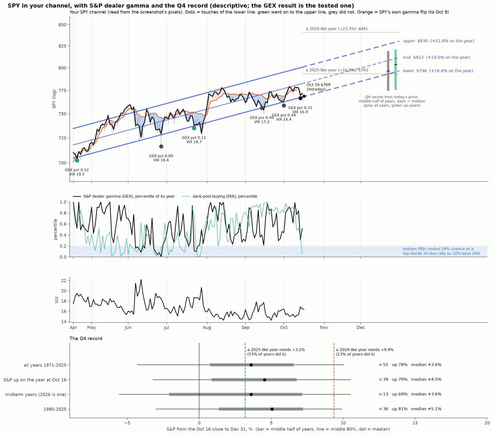
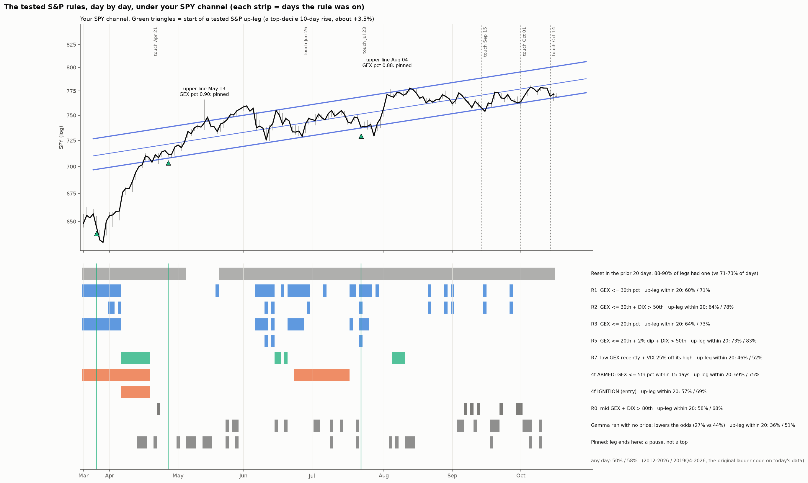
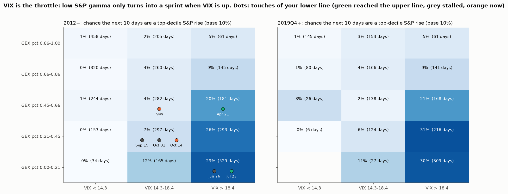

# SPY in the owner's daily channel: what the moves to the upper line had, and what a 2024-25-style year needs

**Agent / session:** Claude, claude.ai session for the owner, 2026-10-16
**Type:** descriptive. The owner's screenshot is the input. Nothing new is tested here; it lines up the channel against the results already tested in `research/microstructure/REPORT.md` (§4d, §4g, §4x).
**Builds on:** owner-channel-gamma (the TSLA version), microstructure §4d (S&P dealer gamma → up-legs), §4g (eras), §4x (Q4 window)
**Verdict:**
* **The channel tracks the S&P gamma cycle.**
  * Both moves from the lower to the upper line (from Apr 21 and from Jul 23) are the two 2026 "legs" §4d already documents. Each started after dealer gamma fell to a low and stalled when gamma rebuilt to its 99th percentile.
  * The touches that stalled at the mid line (Sep 15, Oct 1) came with VIX at 16–17. §4d's tested result is that the index cannot sprint without vol.
* **The channel's own slope is an ordinary Q4.** Riding the lower line to Dec 31 is +3.6% from today, about the median Q4 since 1971 (+3.6%), and lands at a 2025-like year (+16.8%).
  * The upper line by year-end (+8%) is about a top-fifth Q4.
  * A 2024-like year (+23%) is above the channel and was matched in 13% of years.

## The owner's observation
* SPY rose from the lower line to the upper line twice: from late April, and from late July.
* The owner asks whether that repeats from here (SPY is on the lower line today) and whether it fits the tested data.
* The owner also asks for the "narrative" of another green year in the range of the last two (+23.3% in 2024, +16.4% in 2025) and the Q4 run-up.

## Line reconstruction (`spy_channel.py: detect_lines`)
* **The lines:** read from the screenshot's blue pixels, not by eye.
  * Each of the three lines is fitted through 851 pixel columns. Residual scatter is 0.4–0.5 px.
  * The three slopes agree to 0.02%, so the lines are parallel.
* **Price axis:** fitted to the 17 gridlines.
  * A log scale fits within 0.007% at every label; a linear scale is off by up to 0.84%. So the chart is log.
* **Time axis:** fitted to the four month labels on a trading-day axis, which is how TradingView spaces bars.
  * The residuals are under 0.6 px (about 0.1 bar). A calendar axis is off by up to 2.8 px.
* **The channel:**
  * 4.3% wide. The mid line sits at 0.45 of the width above the lower line, not halfway.
  * It rises about 19% a year.
  * 90% of closes since SPY first closed inside it (Apr 17) have been inside it.
* **Levels:**

| | Lower | Mid | Upper |
|---|---|---|---|
| Oct 15 | $767.9 | $782.5 | $800.7 |
| Nov 30 | $784.5 | $799.4 | $818.0 |
| Dec 31 | $796.4 | $811.6 | $830.5 |

## Data
* **SPY and VIX daily bars:** Yahoo, fetched fresh on Oct 16 into `data/` (gitignored).
  * The committed `SPY_1d.json` has a stale intraday Oct 15 bar ($770.19 against the $771.79 close).
  * Today's bar is intraday. All statistics use closes through Oct 15.
* **S&P dealer gamma (GEX) and dark-pool buying (DIX):** SqueezeMetrics, fetched fresh to the Oct 15 row.
  * Each is ranked against its trailing 252 days, the same way as `forecast.build`.
* **SPY's own gamma flip:** `research/microstructure/out/td_gamma_SPY.csv`, through Oct 9.
* **The Q4 record:** S&P 500 (^GSPC) closes, 1971–2025, from the last close on or before Oct 16 to the last close of the year.

## Touches of the lower line (`out/touches.csv`)
**Definition:** a touch is a day whose low reaches the lower line after a close at or above the mid line. The first day inside the channel counts too.

| First touch | S&P GEX pct | VIX | DIX pct | SPY vs its own flip | What followed |
|---|---|---|---|---|---|
| Apr 21 | 0.52 (after the −$7.2B trough on Mar 27, §4d) | 19.5 | 0.61 | −0.4% | **upper line May 13 (16 sessions)** |
| Jun 26 | **0.00** | 18.4 | 0.19 | −2.3% | stalled at 0.71 of the width |
| Jul 23 | **0.11** | 18.7 | 0.76 | −1.8% | **upper line Aug 4 (8 sessions)** |
| Sep 15 | 0.40 | 17.2 | 0.72 | −1.6% | stalled at the mid line (0.47) |
| Oct 1 | 0.44 | 16.4 | 0.81 | −0.6% | stalled at the mid line (0.46) |
| **Oct 14 (now)** | 0.31, then 0.52 on Oct 15 | 16.9 → 16.4 | 0.36 → **0.05** | (no chain after Oct 9) | ongoing |

**Read** (5 completed touches, descriptive):
* **The two launches are the two legs in §4d.** §4d describes the mechanism: a leg starts when dealer gamma is low or negative and ends when the rally rebuilds gamma to an extreme. Here that was the 99th percentile on Apr 16–17 and on Aug 5.
  * **April:** gamma bottomed on Mar 27. The leg ran through the touch of Apr 21.
  * **July:** after July's expiry and the Jul 22 VIX settlement, gamma sat at its 10th–20th percentile on Jul 23–28. The leg then ran through earnings.
* **VIX separates better than GEX here.**
  * Both launches had VIX at 18.7–19.5.
  * The September and October stalls had 16–17.
  * Jun 26 had gamma at zero and VIX at 18.4, and still stalled. It was the only one of the five that rose above the mid line without reaching the upper line.
  * This is 5 cases and descriptive. It matches §4d's tested finding that in low-VIX markets the chance of an up-leg is near zero whatever gamma does.
* **SPY was below its own flip at every touch,** so its own flip does not separate the launches from the stalls.
* **Now:**
  * Gamma is middling: 0.52 on Oct 15.
  * VIX is 16.4, the 38th percentile of its year.
  * Dark-pool buying fell to its 5th percentile on Oct 15. §4y found the high side of DIX weakly supportive (+0.9 pts over 20 sessions, p 0.06), so this is the unsupportive side.
* **The calendar matches July's.** Monthly expiry is today, the VIX settlement is Wed Oct 21, and mega-cap earnings follow. That is the window where gamma fell to its bottom fifth in July.

## The tested result this leans on (§4d, §4g; not re-tested here)
* **S&P dealer gamma in its bottom fifth:**
  * 24% of days are followed by a top-decile 10-day rise, against a 10% base and 2% in the top fifth.
  * Below zero: 33%.
* **It holds in every era,** including 0DTE: 25% → 2% since May 2022 (§4g).
* **It needs vol:** in low-VIX markets the up-leg chance is about zero whatever gamma does.

## Q4 and the year (`out/q4.csv`)

| S&P, Oct 16 close to Dec 31 | Years | Up | Median | Middle half |
|---|---|---|---|---|
| All years 1971–2025 | 55 | 78% | +3.6% | +0.7% to +6.6% |
| S&P up on the year at Oct 16 | 39 | 79% | **+4.5%** | +0.9% to +6.8% |
| Midterm years (2026 is one) | 13 | 69% | +3.6% | −2.1% to +7.2% (2018: −10.8%) |
| 1990–2025 | 36 | 81% | +5.1% | +1.4% to +7.2% |

**What the year needs** (SPY closed 2025 at $681.92; it is +12.8% YTD at today's $768.9):
* **A 2025-like year (+16.4%):** $793, which needs +3.2% from here. 53% of years did that.
  * The median Q4 gets there.
  * So does riding the lower line to Dec 31 ($796, +16.8%).
* **The mid line at Dec 31:** $812 (+19.0%).
* **The upper line at Dec 31:** $830 (+21.8%). That needs about +8%, roughly a top-fifth Q4.
* **A 2024-like year (+23.3%):** $841, which needs +9.4%. 13% of years did that (7 of 55).
  * It is above the channel's upper line at year-end, so it needs a breakout.
* **Midterm years are no better than other years from this date,** and more spread out. The well-known midterm strength mostly comes earlier, off the October low.

## Threats to validity
* **The lines are the owner's, drawn with hindsight** through these touches.
* **Small sample:** the touch table is 5 completed cases.
* **The future part of the time axis assumes NYSE holidays.** TradingView's future bars may not skip them, which would shift the projected levels by under a day.
* **Q4 history is price-only S&P,** not SPY total return.

## Reproduce
```bash
cd research/agents/2026-10-16-spy-channel
curl -sS -o data/SPY_1d.json "https://query1.finance.yahoo.com/v8/finance/chart/SPY?interval=1d&range=2y" -H "User-Agent: Mozilla/5.0"
curl -sS -o data/VIX_1d.json "https://query1.finance.yahoo.com/v8/finance/chart/%5EVIX?interval=1d&range=2y" -H "User-Agent: Mozilla/5.0"
curl -sS -o data/DIX.csv https://squeezemetrics.com/monitor/static/DIX.csv
OMP_NUM_THREADS=1 python spy_channel.py
```
* The screenshot is `data/owner_spy_channel_screenshot.png` (gitignored, like the TSLA one). Without it, `detect_lines` cannot run; the fitted pixel lines are saved in `out/lines.json`.
* Fresh data will move today's numbers.



## Follow-up: the tested S&P rules applied day by day (`established_rules.py`, `out/spy_rules.png`, `out/rules_*.csv`)

**Why.** The first pass used S&P gamma and VIX as loose descriptors. That is not how TSLA was treated, and the owner flagged it.

This pass applies the repository's own tested S&P rules, imported unchanged:
* the entry ladder R0–R7 (`ladder.rungs`, §4i);
* the reset, "gamma ran with no price" and pinned rules (`reset.prep`, §4p);
* the gamma-release strategy's ARMED and IGNITION (§4f's chosen parameters: GEX ≤ 5th pct within 15 days; VIX ≥ 25% off its 10-day high).

It adds no new rule, threshold or test.



### The odds reproduce (`out/rules_odds.csv`)
These were recomputed with `ladder.py`'s own code on data to Oct 15, as P(a tested up-leg starts within 20 sessions; up-leg = a top-decile 10-day S&P rise).

| Rule | 2012–2026 | 2019Q4–2026 | Report §4i |
|---|---|---|---|
| any day | 50% | 58% | 50% / 58% |
| R1 GEX ≤ 30th pct | 60% | 71% | 61% / 72% |
| R2 GEX ≤ 30th + DIX > 50th | 64% | 78% | 65% / 79% |
| R3 GEX ≤ 20th pct | 64% | 73% | 65% / 73% |
| R5 GEX ≤ 20th + 2% dip + DIX > 50th | **73%** | **83%** | 74% / 83% |
| §4f ARMED (GEX ≤ 5th within 15 days) | 69% | 75% | |
| R0 mid GEX + DIX > 80th | 58% | 68% | 59% / 70% |
| "gamma ran with no price" | 36% | 51% | below base (§4p) |

### What the rules did in 2026, signal by signal
* **R2:** 4 of 8 led to a leg (Mar 6, Apr 1, Jun 30, Jul 23). The Aug 21 and Sep 16 signals passed without one.
* **R5:** 2 of 3 (Mar 6, Jul 23).
* **§4f IGNITION:** 1 of 1 (Apr 8).
* **ARMED:** 1 of 2 (Jun 24, leg on day 20).
* **R3:** 1 of 6.
* **R0:** Apr 23 led to a leg; Sep 8 did not; **Sep 23 is still open, until about Oct 21.**
* **The tested up-legs of 2026** started on Mar 26, Apr 28 and Jul 23.
* **This year has run below the long-run rates** (R2 at 50% against 64–78%).

### Under the owner's channel (`out/rules_touches.csv`)

| Touch | Rules on from 10 sessions before to the outcome | Tested up-leg | At the upper line |
|---|---|---|---|
| Apr 21 | R0–R3, R6, R7, ARMED, **IGNITION** (Apr 8) | **Apr 28** | May 13, GEX pct 0.90: **pinned** |
| Jun 26 | R1–R7, ARMED | none (the June miss; it came Jul 23) | — |
| Jul 23 | R1–R6, ARMED (since Jun 24), **R5** | **Jul 23** | Aug 4, GEX pct 0.88: **pinned** |
| Sep 15 | R0, R1, R2 only (GEX never ≤ 20th) | none | stalled at the mid line |
| Oct 1 | R0, R1, R2 only | none | stalled at the mid line |
| Oct 14 (now) | R0 (Sep 23, open), reset in the prior 20 days | — | — |

**Read:**
* **Both lower-to-upper moves are tested up-legs, and both came after the deep rungs** (GEX at or under its 20th percentile, ARMED, IGNITION or R5).
* **Both ended pinned at the upper line** (GEX 0.88–0.90). §4p's tested read of a pinned leg end is consolidation 55% vs 30%: a pause, not a top. That is the Aug–Oct chop between the mid and lower lines.
* **The September and October touches only reached the shallow rungs** (R1/R2, GEX 0.22–0.30), and both R2 signals passed with no leg.

### Now (Oct 15 close)
* **On:** reset in the prior 20 days, the precondition (88–90% of legs had one, against 71–73% of all days).
* **Off:** every other rung, ARMED and IGNITION.
* **The state:**
  * GEX is at its 52nd pct (it was 0.31 on Oct 14).
  * DIX fell to its **5th pct**.
  * VIX is 16.5.
  * The S&P is 1.0% under its 10-day high.
* **Today's cell (mid GEX, DIX under its 50th):** the next-10-day rise was top-decile on 6.8% of days, against 10% for all days, in 2012–2026. In 2019Q4–2026 the cell is neutral (14.7% vs 13.4%), so low DIX is not a reliable negative lately.
* **What would turn the deep rungs on**, as before both 2026 launches:
  * **R3:** GEX ≤ 20th pct. Expiry day usually drops GEX about 17 points (§4h).
  * **R4/R5:** the same plus the S&P 2% under its 10-day high. That is about 7,663 on the S&P, roughly SPY $764, which is about 1% under the owner's lower line (~$769–771 next week). Both 2026 launches came off a dip just under the lower line (Jun 26 −1.6%, Jul 23 −0.3%). Add DIX back over its 50th for R5.
  * **Or ARMED, then IGNITION:** the April entry.

## Follow-up 2: VIX is the throttle (`vix_throttle.py`, `out/vix_throttle.png`, `out/vix_throttle*.csv`)

**What is being checked.** §4d states: "Within high-VIX days, P(elevator) runs 29% → 5% from low to high GEX. In low-VIX markets it is ~0 whatever GEX does." No script in the repository produces that line.

This check reproduces it with `release.py`'s own frame and outcome: the next-10-day S&P return in its top decile, base 10%, 2012-04 to 2026-10.
* The VIX split is the sample's own terciles (14.3 and 18.4). That split was chosen here, after the fact.
* The median split (16.1) is shown alongside for comparison.



**The claim reproduces.**

| GEX pct (quintile) | VIX < 14.3 | VIX 14.3–18.4 | VIX > 18.4 |
|---|---|---|---|
| 0.00–0.21 | 0% (34 days) | 12% | **29%** |
| 0.21–0.45 | 0% | 7% | **26%** |
| 0.45–0.66 | 1% | 4% | **20%** |
| 0.66–0.86 | 0% | 4% | 9% |
| 0.86–1.00 | 1% | 2% | 5% |

* **Median split:** above VIX 16.1 the odds run 27% → 2.5% across the gamma quintiles; below it they are 1–3% at every level of gamma.
* **2019Q4+:** the same picture (30–31% in the bottom two gamma quintiles with VIX over 18.4).
* **Part of this is arithmetic.** A top-decile 10-day rise is about +3.5%, which is 1.4 standard deviations at VIX 12 and 0.9 at VIX 20. Either way, the index does not sprint without vol.

**The owner's touches** (`out/vix_throttle_touches.csv`):

| Touch | GEX pct | VIX | Cell | Outcome |
|---|---|---|---|---|
| Apr 21 | 0.52 | 19.5 | 20% | upper line |
| Jun 26 | 0.00 | 18.4 | 29% | stalled; the leg came 4 weeks later |
| Jul 23 | 0.11 | 18.7 | 29% | upper line |
| Sep 15 | 0.40 | 17.2 | 7% | stalled at the mid line |
| Oct 1 | 0.44 | 16.4 | 7% | stalled at the mid line |
| Oct 14 | 0.31 | 16.9 | 7% | ongoing |
| **Oct 15 (now)** | **0.52** | **16.5** | **4%** | |

**Read:**
* **Every 2026 touch with VIX above 18.4 sat in a 20–29% cell,** and 2 of the 3 went on to the upper line.
* **Every touch with VIX in the middle third sat in a 4–7% cell,** and all of them stalled at the mid line.
* **Getting back into a launch cell takes VIX over about 18.4,** 2 points above today, with gamma under its 66th percentile.
* **This fits the ladder:** the R4/R5 dip of 2% (SPY about $764) is the kind of move that lifts VIX about that much.
* **For options (§4i):** the high-VIX cells are where calls are expensive. Spreads hold up from R2 on; naked calls only pay after the VIX crush (R7).

## Follow-up 3: does a 2% dip line the conditions up? (`dip_lineup.py`, `out/dip_lineup.csv`; descriptive, 13 cases)
* **The cases:** first days the S&P closed 2% under its 10-day high (the R4 dip), from a state like Oct 15. Five sessions earlier, GEX was at its 35th–66th pct and VIX in its middle third.
* **Within the dip day and the next 3 sessions:**
  * GEX fell to ≤ 0.20 in 85% of cases (median 0.11 on the dip day).
  * VIX rose above 18.4 in 77% (median 19.7).
  * DIX rose above its 50th pct in 62% (median 0.75).
  * All three lined up in 38%.
* **What followed** (a tested up-leg within 20 sessions):
  * All such dips: 46%, no better than any day (50%).
  * When all three lined up: 4 of 5.
  * When they didn't: 2 of 8.
  * The DIX split: 5 of 8 dips with DIX back over its 50th led to a leg, against 1 of 5 without.
  * In 2026, the dips with DIX at 0.00–0.03 (Jan 20, Feb 5, Jun 23) had no leg; Jul 23 (DIX 0.76) did.
* **The dip level is read at the close and rolls with the 10-day high:**
  * about SPY $764 through Mon Oct 19 (S&P high 7,818.9 on Oct 6);
  * about $763 from Oct 20 to Oct 26;
  * lower after that unless the S&P makes new closing highs.
* **Read:** the dip by itself is not the edge; it is the trigger that usually drags gamma down and lifts VIX. Whether buyers show up in the dark pools (DIX back over its 50th) is what separated the legs from the failures in these 13 cases. Too few cases to call tested.
