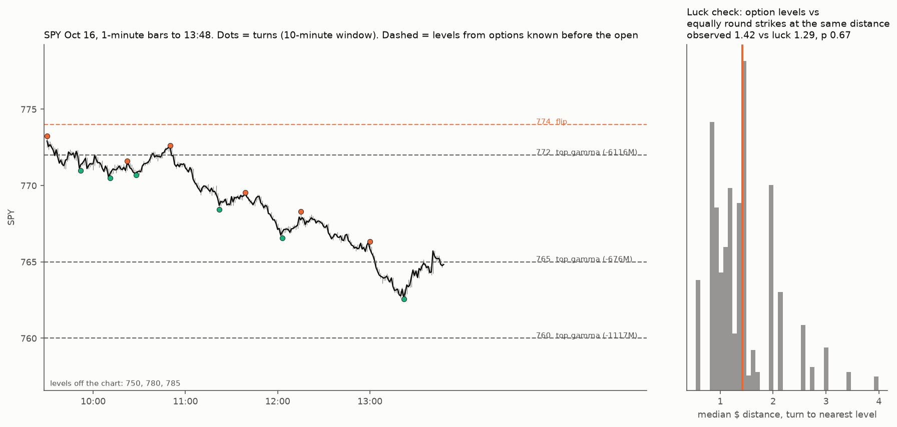
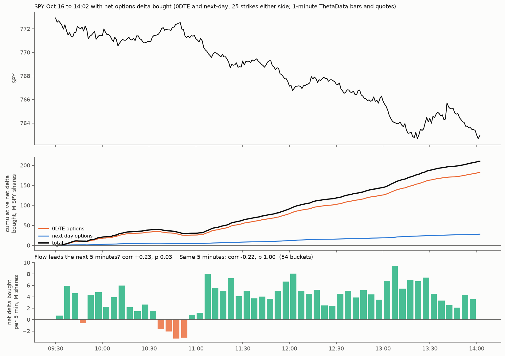

# Did SPY's intraday turns on Oct 16 2026 land on option-inferred levels more than luck allows?

**Agent / session:** Claude, claude.ai session for the owner, 2026-10-16 (written at about 13:20 ET, during the session)
**Type:** one-day test against a luck baseline. The design below was pushed before any distance from a turn to a level was computed.
**Builds on:** gaps-and-walls (the walls were no better than equally round strikes at the same distance, so that null is reused here)
**Verdict (to 13:48 ET; rerun at the close):** **no, as predicted.** Today's turns sat no closer to the option levels than to equally round strikes at the same distance (p 0.54–0.67 across the three turn windows). Price did not *turn* at the levels. It *trended through* them, from just under the intraday flip.

## Question
The owner asks whether a day trader could have used today's SPY option levels: did price turn at the lines inferred from options, exactly, beyond what luck gives?
* **What can be measured:** price levels.
* **What cannot:** options order flow. We have no signed intraday options tape, and signing from tick data failed (microstructure §4r: 55–60% agreement).

## Levels, all known before the open
* **Inputs:**
  * SPY open interest dated Oct 16 (positions at the Oct 15 close), from ThetaData;
  * implied vols from the latest SPY end-of-day chain on file (Oct 9, so stale; disclosed);
  * spot = the Oct 15 close, $771.79;
  * the engine's classic convention, which the dealer-sign Part B test supports for SPY on both legs.
* **L1:** the 5 strikes with the largest absolute dealer gamma (summed across all expiries, including today's) within ±3% of the prior close.
* **L2:** the call wall and the put wall. These are the strikes with the most call OI and the most put OI within ±3%, expiries out to 45 days.
* **L3:** the gamma flip, including today's expiring options, rounded to the nearest $1 strike.
* **The level set** is the union of L1–L3 (unique strikes).

## Turns
* **Bars:** Yahoo 1-minute SPY bars, regular session, from 09:30 to the time of the run.
* **Turns:**
  * A swing high is a minute whose high is the highest of the 10 minutes either side; a swing low is defined the same way.
  * The session high and low are always included.
* **Sensitivity:** windows of 5 and 20 minutes.
* **Rerun:** at the close, on the full day.

## Statistic and null
* **Statistic:** the median $ distance from each turn's extreme (high or low) to the nearest level.
* **Null:** 2,000 random level sets of the same size.
  * Each level is replaced by a random strike within ±3% of the prior close.
  * The replacement has the **same roundness class** (a multiple of $10, of $5, or a $1 strike) and lies in the **same distance decile** from the prior close.
  * This is the gaps-and-walls null, matched on both roundness and distance.
* **p:** one-sided, the share of null sets with a median distance at or below the observed.
* **Pass:** p < 0.05. Even a pass is one day, not an edge.

## Prediction written now
**Not significant.** With about 15–25 turns and SPY strikes every $1, only a large effect would show. I expect today's turns to sit no closer to the option levels than to equally round strikes at the same distance.

## Results (to 13:48 ET)

**Correction to the design text:** the implied vols came from the Oct 14 chain, not Oct 9 (the SPY raw files run to Oct 14).

**The map before the open** (OI dated Oct 16, spot $771.79):

| Level | What it is |
|---|---|
| $774 | the flip, with today's expiring options included |
| $772 | the largest gamma strike, −$6.1B per 1% move (put-heavy and mostly expiring today; 43% of all absolute gamma expired today) |
| $760, $765, $750 | the next-largest gamma strikes, all negative (−$1.1B, −$0.68B, −$0.71B) |
| $780 | the largest positive gamma strike (+$0.69B) |
| $785 / $750 | call wall / put wall |

**The test** (`out/levels_k*.json`, `out/turns_k*.csv`):

| Turn window | Turns | Median $ to the nearest level | Luck (round- and distance-matched) | p |
|---|---|---|---|---|
| 5 min | 34 | 1.32 | 1.32 | 0.54 |
| **10 min (primary)** | **12** | **1.42** | **1.29** | **0.67** |
| 20 min | 7 | 1.58 | 1.58 | 0.62 |

**What the day did:**
* SPY opened at $773.24. The session high, $773.25, came in the first minute, **$0.56 under the intraday flip**, and SPY never traded above it.
* It then ground lower through $772, $770 and $765 to $762.58 at 13:22, and bounced back to about $765.
* The eye sees a "retest" of $765. The luck check says equally round strikes at the same distance get touched about as often.
* **This fits a short-gamma day:** below the flip, with the biggest strike negative, levels get run through rather than defended. The test only shows the negative part (no turning at levels). That the trend came *because of* gamma is one day of description, not a test.

## Exploratory (no test)
* The planned before/after-the-flip comparison was not possible: SPY never traded above the flip ($774) today.

---

## Part B: did SPY follow the options order flow today? (pre-registered; pushed before any flow was computed)

**The data we found.** Our ThetaData Value key serves **1-minute OHLC with volume and VWAP per option contract**, and **1-minute NBBO quotes**. Tick trades need the Standard tier (checked: permission denied).

**Pull.** SPY options expiring Oct 16 (0DTE) and Oct 19 (the next daily), the 25 strikes either side of the money, 1-minute bars and quotes for the regular session.

**Signing.** For each contract-minute with volume:
* s = clip((VWAP − mid) ÷ half-spread, −1, +1);
* mid = the average of the quote at the start of the minute and the quote at the start of the next minute. That cancels most of the stale-quote bias: quotes from the start alone would label trades in a rising minute as buys, and quotes from the end alone would do the opposite.

**Flow.** Per minute, Σ s × volume × delta × 100: net delta bought, in SPY shares. Positive means net buying of upside.
* Delta is Black-Scholes from the IV implied by that minute's mid, with SPY's minute close as spot and time to the 16:00 expiry.

**Tests (5-minute buckets, 09:30 to the last full bucket):**
* **H1, flow leads price (primary):** corr(flow in bucket b, SPY return in bucket b+1) > 0.
* **H2, price moves with flow:** corr(flow_b, return_b) > 0. This is expected to be positive partly by construction, so it is descriptive only.
* **Null:** circular shift of the flow series against SPY returns within the day (shifts of at least 6 buckets, 2,000 draws); one-sided p.
* **Pass for H1:** p < 0.05. Even a pass is one day.

**Prediction written now.** H1 does not pass: flow does not lead SPY at 5 minutes on one day. H2 is positive.

**What it cannot say.** Minute-level signing is the same family of method that missed customer *direction* in §4r (55–60%). It measures aggressor pressure, not who ends up holding the position.

### Part B results (to 14:02 ET; `flow_today.py`, `out/flow.json`, `out/flow_buckets.csv`)

**Coverage:** 25,637 signed contract-minutes; 89% of the signed volume was 0DTE.

| | corr | p (one-sided, circular shift) |
|---|---|---|
| **H1: flow in bucket b → SPY return in bucket b+1** | **+0.23** | **0.027 (passes)** |
| H2: flow and return in the same bucket | **−0.22** | 1.00 |
| Post-hoc: H1 controlling for SPY's own return in bucket b | +0.23 (partial) | 0.047 |

**Notes on the inference:**
* There are 54 five-minute buckets, so the circular null has only 43 distinct shifts. The smallest attainable p is about 0.023, and both p's sit near that floor.
* SPY's own 5-minute reversal today was −0.04. So the lead is not just price bouncing: flow adds about +1.7 bp to the next 5 minutes per standard deviation, while SPY's own last return adds about 0.

**Read:**
* **Within the day, the options flow ran against price and was then followed by it.** Traders bought delta in the buckets where SPY fell (H2 < 0), and the next 5 minutes moved their way (H1 > 0).
* **The effect is modest:** about 5% of the next-5-minute variance.
* **This is one day.** The prediction (H1 would not pass) was wrong. The prediction for H2 (positive) was also wrong.

**Do not read the cumulative total.** The figure shows +210M SPY-share deltas net bought, more than SPY's whole share volume. Minute-level signing almost certainly carries a level bias on a trending day. The test uses only the bucket-to-bucket variation, which is much less sensitive to a constant bias.

**Answer to the owner's question for today:**
* **Levels from options:** no. Turns were no closer than luck (Part A).
* **Options order flow:** yes, modestly, in the narrow sense that 5-minute net delta bought led the next 5 minutes.

The 60-day version (both questions, split by long- and short-gamma days) is the real test.
