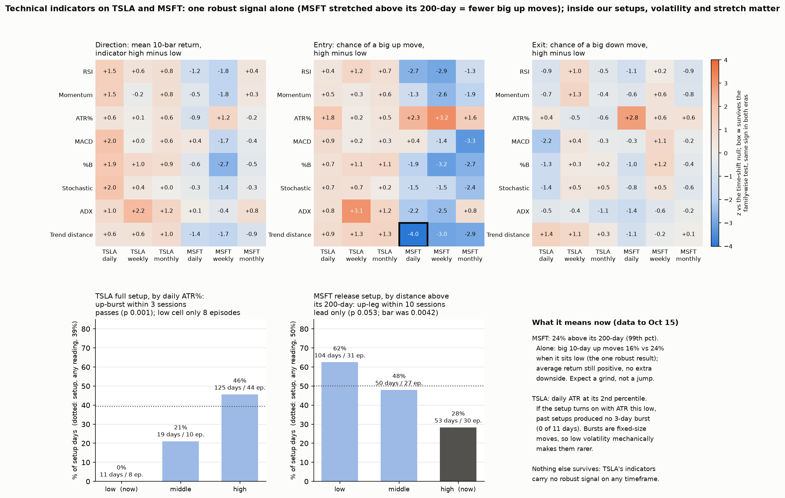
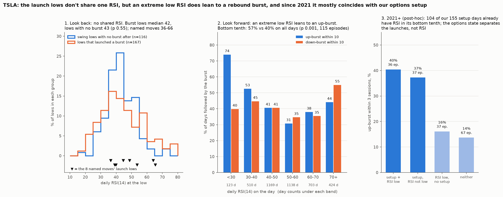

# Do classic technical indicators (RSI, momentum, ATR, MACD, ...) on daily, weekly and monthly bars give TSLA and MSFT entries or exits, and do they add to our setups?

**Agent / session:** Claude, claude.ai session for the owner, 2026-10-16
**Started:** 2026-10-16   **Pre-registered at commit:** e91f147 (pushed before any outcome was computed)
**Type:** new question (extension)
**Verdict:** **mostly no, with two useful refinements.**
* **On their own, the indicators barely predict.** One of 144 statistics survives: MSFT far above its 200-day → fewer big up moves. TSLA has nothing robust on any timeframe, and no indicator flags big down moves (exits) for either stock.
* **Inside our setups:** TSLA's setup produced no bursts when its ATR was low (passes, but only 8 episodes). MSFT's release setup worked about half as often when MSFT was stretched (a lead, p 0.053).

## Question

The owner's view: standard technical indicators, read on monthly, weekly and daily bars, should give at least an additional entry or exit signal.

* **Part A, the indicators on their own:** does an indicator's state predict TSLA's or MSFT's next move? Three kinds of prediction:
  * **direction**
  * **an entry** (a big up move)
  * **an exit** (a big down move)
* **Part B, added to our setups:** within days when a setup is on, does the indicator change the odds?
  * TSLA: freed and below its own gamma flip (microstructure §4w/§4ad).
  * MSFT: the release setup, MSFT leading SPY while S&P dealer gamma is low (§4aa).

## Prior work
* `research/agents/2026-10-15-sp-multivariate` @ ecd5c43 found that weekly momentum/RSI warns of **S&P 500** corrections. The warning came from a broken trend: high RSI meant *lower* risk. That covers one index, one outcome (a 10% fall) and two indicator types.
* Not yet tested anywhere here:
  * single stocks
  * entries
  * ATR, MACD, Bollinger, stochastic and ADX
  * daily and monthly bars
  * whether any indicator adds to the options setups
* Setups from `research/microstructure` @ 58b9d1d: `burst_gamma.state`, `stock_gamma.frame` (TSLA) and `held_back` (MSFT release), imported unchanged.

## Data
* Yahoo daily OHLC with dividend-adjusted closes:
  * **TSLA:** 2010-06-29 to 2026-10-15
  * **MSFT:** 1986-03-13 to 2026-10-15
* High, low and open are scaled by adjclose/close.
* Weekly bars end on Friday; monthly bars end at month-end. The last bar of each is used only once complete.

## Indicators (standard parameters, the same bar counts on every timeframe)

| | Definition |
|---|---|
| RSI | RSI(14), Wilder smoothing |
| Momentum | rate of change over 12 bars (12 days, 12 weeks, or the classic 12 months) |
| ATR% | ATR(14) ÷ close |
| MACD | MACD(12, 26, 9) histogram ÷ close |
| Bollinger %B | (close − lower band) ÷ (upper − lower), 20 bars, 2 sd |
| Stochastic | slow %K(14, 3) |
| ADX | ADX(14), Wilder |
| Trend distance | close ÷ SMA − 1: SMA(200) daily, SMA(40) weekly, SMA(10) monthly (each about 200 trading days) |

**States:**
* Each indicator becomes a percentile against its own trailing window: 252 bars for daily (min 120), 52 for weekly (min 26), 60 for monthly (min 36). Monthly uses a longer window because 12 points cannot form thirds.
* **low** = bottom third; **high** = top third.
* Sensitivity check, outside the family: the classic fixed thresholds RSI > 70 / < 30 and stochastic > 80 / < 20.

## Outcomes (strictly after the bar's close)
| Timeframe | Horizon H | Forward return R |
|---|---|---|
| daily | 10 sessions | log return, close t to close t+10 |
| weekly | 4 weeks | close of week w to week w+4 |
| monthly | 3 months | month m to m+3 |

* **Entry outcome (UP):** R in that asset-timeframe's top 20%.
* **Exit outcome (DOWN):** R in its bottom 20%.

## Part A: statistics, null and pass/fail (fixed now)
* **Three statistics** for each asset × timeframe × indicator:
  * **S1, direction:** mean R when the indicator is high, minus when it is low.
  * **S2, entry:** P(UP | high) − P(UP | low).
  * **S3, exit:** P(DOWN | high) − P(DOWN | low).
* **Families:** each asset × timeframe is one family of 24 statistics (8 indicators × 3). There are 6 families.
* **Null:**
  * Shift all of a family's indicator series together, circularly, against the outcomes.
  * Daily uses 1,000 random offsets of at least 60 bars; weekly every offset of at least 13; monthly every offset of at least 6.
  * Each statistic becomes a z-score against its own null.
  * The **family-wise p** is the share of shifts whose largest |z| in the family is at least the real largest |z|. Each statistic's own two-sided p is reported too.
* **Survivor:** a statistic whose step-down family-wise p is < **0.0083** (0.05 over the 6 families).
* **Robust survivor:** also has the same sign in 1986/2010–2020 and in 2021–2026.
* **Smallest possible p, checked before the run** (bar counts only, no outcomes): daily 0.001; TSLA weekly ≈ 0.0013, monthly ≈ 0.0073; MSFT weekly < 0.001, monthly ≈ 0.0022. All are below 0.0083, so every family can pass.

## Part B: added to the setups (fixed now)
* **TSLA**, 2021+, days in the full setup (freed and below its flip):
  * up-burst within 3 sessions
  * down-burst within 3 sessions
* **MSFT**, 2012+, days in the release setup (20-day lead over SPY in its top third, S&P gamma in its bottom third):
  * up-leg starts within 10 sessions
  * down-leg starts within 10 sessions
  * (Both as in `held_back.outcomes`.)
* **Indicators tested:**
  * A fixed a-priori trio, chosen now: daily RSI, daily ATR% and weekly momentum.
  * Plus every robust Part A survivor for that asset, reported separately.
  * Weekly and monthly values reach the daily setup as the last completed bar.
* **Statistic:** within setup days, P(outcome | indicator high) − P(outcome | indicator low).
* **Null:** shift the indicator series alone against the fixed setup and outcomes, with 1,000 random offsets of at least 60 sessions; two-sided.
* **Pass:** p < **0.0042** (0.05 over the 3 indicators × 2 outcomes × 2 assets). Days and episodes are reported.
* **Power, stated now:** with about 60 setup episodes, an edge needs roughly +17 points to be seen (§4ad). A Part B null means "no large addition", not "no addition".

## What would prove the idea wrong
* **Part A:** no survivor in any family, or survivors that flip sign between eras.
* **Part B:** no indicator passes, and none shows a difference the sample could detect.

## Results



### Part A: indicators on their own (`out/part_a.csv`)

| Family | Bars | Family-wise p (single-step) | Survives 0.0083? |
|---|---|---|---|
| TSLA daily | 3,772 (2011–2026) | 0.27 | no |
| TSLA weekly | 782 | 0.018 | no |
| TSLA monthly | 139 | 0.74 | no |
| **MSFT daily** | 9,899 (1987–2026) | **0.002** | **yes** |
| MSFT weekly | 2,050 | 0.024 | no |
| MSFT monthly | 430 | 0.019 | no |

**The one robust survivor: MSFT's distance above its 200-day average, as an entry statistic.**

| MSFT trend distance (trailing-year third) | Days | Big 10-day up move (top 20%) | Big 10-day down move (bottom 20%) | Mean 10-day return |
|---|---|---|---|---|
| low (near or below its 200-day) | 3,605 | **24.2%** | 22.1% | +1.04% |
| middle | 2,743 | 20.2% | 17.8% | +0.86% |
| high | 3,551 | **15.6%** | 19.5% | +0.48% |
| top 5% (like now) | 965 | 14.2% | 18.0% | +0.47% |

* z −4.0 against the shift null; step-down family-wise p 0.002.
* The same sign in both eras: −9.1 points before 2021, −6.8 points since.
* Stretched MSFT has **fewer jumps but no extra downside**. The direction (S1) and exit (S3) statistics are not significant.

**Near misses that point the same way (not survivors):**
* MSFT on weekly and monthly bars: when RSI, %B, momentum, MACD or trend distance are high, big up moves are rarer (z −2.6 to −3.3).
* When volatility (ATR%) is high, both kinds of big move are more frequent (weekly entry z +3.2, daily exit z +2.8). Volatility carries size, not direction.
* TSLA weekly ADX: a strong trend led to more big up moves (z +3.1), but only before 2021 (+27 points vs +0.4 since). Not robust.

**Classic thresholds (sensitivity, `out/classic.csv`):**
* RSI > 70 vs < 30 and stochastic > 80 vs < 20 show nothing for TSLA.
* For MSFT, daily RSI > 70 means fewer big up moves (−16 points, raw p 0.018), the same theme as above.
* Weekly and monthly classic cells are tiny (RSI < 30 occurs 0–10 times).

### Part B: added to the setups (`out/part_b.csv`)

| Setup × indicator (pre-registered trio) | Outcome | High | Low | Difference | p | Pass (< 0.0042)? |
|---|---|---|---|---|---|---|
| TSLA full setup × daily RSI | up/down-burst 3 | never high in the setup | | | | not testable (the setup needs a drop below the flip) |
| **TSLA full setup × daily ATR%** | up-burst 3 | 46% (125 d / 44 ep) | **0% (11 d / 8 ep)** | +46 pts | **0.001** | **yes** |
| TSLA full setup × daily ATR% | down-burst 3 | 18% | 9% | +9 | 0.49 | no |
| TSLA full setup × weekly momentum | up-burst 3 | 21% (14 d / 9 ep) | 44% | −22 | 0.057 | no |
| MSFT release × daily RSI | up-leg 10 | 35% | 55% | −20 | 0.22 | no |
| MSFT release × daily ATR% | up-leg 10 | 54% | 35% | +20 | 0.17 | no |
| MSFT release × weekly momentum | up-leg 10 | 30% (64 d / 29 ep) | 64% (108 d / 34 ep) | −34 | 0.053 | no (lead) |
| MSFT release × daily trend distance (Part A survivor) | up-leg 10 | 28% (53 d / 30 ep) | 62% (104 d / 31 ep) | −34 | 0.053 | reported separately (lead) |

* The TSLA middle-ATR third had 21% (19 days, 10 episodes).
* No indicator changed the setups' down-move odds.

### Today (`out/today.csv`, bars to Oct 15; weekly to Oct 9; monthly to Sep 30)

**MSFT is stretched on every daily and weekly measure:**
* daily trend distance +24% (99th percentile)
* weekly momentum and RSI at the 100th percentile
* daily RSI 65

The MSFT release setup was on at the Oct 14 close. Oct 15 is pending S&P gamma data.

**TSLA:**
* Daily ATR% is at its **2nd percentile**, with ADX low, so there is no trend.
* Seven of its eight monthly indicators are in their bottom third (all but ATR%), with momentum −20% over 12 months.
* The full setup was off at the Oct 14 close (above its flip).

## Threats to validity
* **The TSLA ATR result:**
  * The low cell is 11 days in 8 episodes, below what §4ad says this method can resolve on its own.
  * Part of it is mechanical: a burst is a fixed +5% day or +9% over two days, which low volatility makes rarer by construction.
  * It passed the pre-registered bar, but treat it as a strong caution, not a precise rate.
* **MSFT Part B leads (p 0.053):** about 30 episodes per cell. These two indicators are also nearly the same measurement (stretch).
* **Many related indicators** (RSI, %B, stochastic, momentum, trend distance) measure much the same thing. The family-wise test accounts for this, but it also means the near misses are one theme, not several independent confirmations.
* **Yahoo data:** dividend-adjusted closes; early-1990s MSFT bars are coarse.
* **Deviation from the pre-registration:**
  * The MSFT release setup comes from `held_back.frame` unchanged, whose MSFT price file starts in October 2016. The setup history therefore starts in 2017, not 2012.
  * `forecast.build` reads `data/DIX.csv` by relative path, so the setups are built from inside `research/microstructure`.
* **Bug found and fixed before the write-up:** an empty cell (TSLA RSI never high in the setup) first scored p = 0.001 and "passes". It is now marked not testable.

## Verdict
* **Entries:**
  * Classic indicators don't time TSLA.
  * For MSFT, the best big-up entries come when it is near or below its 200-day, not when it is stretched.
  * "Overbought" doesn't predict a drop. It predicts fewer jumps.
* **Exits:** no indicator flags big down moves for either stock beyond what volatility (ATR) says about size.
* **Use with the setups:**
  * **TSLA:** treat a full setup with daily ATR in its bottom third as unlikely to burst within 3 sessions. TSLA's ATR is at its 2nd percentile now, so if the setup turns on, expect the burst odds to come in well below the setup's usual 39%.
  * **MSFT:** the release setup historically worked about half as often when MSFT was this stretched (28–30% vs 62–64%). It's a lead, not proven, but it argues for smaller size or waiting for a pullback toward the 200-day.
* **Fits the S&P study:** `2026-10-15-sp-multivariate` found high momentum/RSI means *lower* crash risk. Here, being stretched doesn't add downside either. In both, trend indicators describe the path, not a reversal.


## Follow-up A (pre-registered 2026-10-16, before running): the owner's claim that TSLA's burst launches came from lows with a shared, relatively low RSI

The claim is about **the lows the bursts launched from**. A low comes at the end of a decline, and RSI measures recent decline, so a low RSI at a low is expected whether or not a burst follows. The claim is useful only if burst lows differ from other lows, or if a low RSI reading predicts a burst going forward.

* **Events:**
  * TSLA up-burst start days 2011–2026 (`stock_now.burst_days`, unchanged).
  * The **launch low** is the lowest close in the 10 sessions before each burst day.
  * The 8 named moves (`named_weeks.MOVES`) are shown individually.
* **Comparison lows:** every **swing low** (a close that is the lowest within ±5 sessions) that was not followed by an up-burst within 10 sessions.
* **Measured at each low:** daily RSI(14), its trailing-year percentile, and weekly RSI(14) from the last completed week.
* **F1 (look-back, the claim as stated):** compare launch-low daily RSI with non-launch swing-low RSI. Statistic: difference in medians. Null: 2,000 random relabellings of which swing lows launched a burst.
* **F2 (forward, the tradable version; primary):** on days when daily RSI is in its trailing-year bottom tenth, the chance of an up-burst within the next 10 sessions (t+1..t+10), minus the chance on all days. Null: 1,000 circular shifts of the RSI series (offset ≥ 60).
* **F3 (secondary):** the same with classic RSI < 30, and with weekly RSI in its bottom third.
* **Pass:** F2 p < 0.05 with a positive difference. F1 and F3 are reported without a pass bar.
* **Smallest possible p:** about 0.001 for F2 and F3 and 0.0005 for F1, both below 0.05.
* **Prediction written now:** F1 shows burst lows have low RSI, but no lower than other lows; F2 does not pass.


### Follow-up A results (`followup_rsi_lows.py`, `out/followup_rsi_lows.json`)



**My written prediction was half wrong.** F1 came out as predicted; F2 passes, which I predicted it would not.

* **F1, look-back: no shared RSI at the launch lows.**
  * The 167 burst-launch lows had a median daily RSI of 42 (IQR 35–55). The 116 swing lows with no burst after had 43 (IQR 37–48). Difference −1.1, p 0.55.
  * The 8 named moves launched from RSI **36 to 66**:
    * Oct 2021: 64
    * Jan 2023: 39
    * May 2023: 45
    * Jun–Jul 2024: 54
    * Oct 2024: 36
    * Apr 2025: 40
    * Sep 2025: 49
    * Oct 2025: 66
  * Only the extreme is over-represented: 15% of launch lows had RSI < 30 vs 7% of the other lows.
* **F2, look-forward (primary): passes.**
  * With daily RSI in its trailing-year bottom tenth (447 days, 115 episodes), an up-burst followed within 10 sessions **57%** of the time vs 40% on all days (+17 points, p 0.001).
* **F3, secondary:**
  * RSI < 30: 123 days, 40 episodes; up-burst within 10 sessions **74%** vs 40%, p 0.001. The mean 10-day return was +4.3% (median +6.2%, 72% up).
  * Weekly RSI in its bottom third adds nothing: 41% vs 41%, p 0.82.
* **Post-hoc checks (chosen after seeing F2; descriptive):**
  * **Not just volatility.** At RSI < 30, down-bursts followed 40% of the time against 74% for up-bursts. Within every volatility third, RSI < 30 kept an up-lean: up 62–80% vs 33–45% at RSI 30–70, down 25–53%. RSI 70+ leans the other way (up 44%, down 55%).
  * **It mostly *is* our setup since 2021.** 104 of the 155 full-setup days had RSI in its bottom tenth. Up-burst within 3 sessions:

    | Group | Up-burst within 3 | Episodes |
    |---|---|---|
    | setup + low RSI | 40% | 36 |
    | setup without low RSI | 37% | 37 |
    | low RSI without the setup | 16% | 37 |
    | neither | 14% | 67 |

    Since 2021, the options state is what separates the low-RSI days that launched from those that didn't. Low RSI alone adds little over 3 sessions: 16% vs 14%. Over 10 sessions it adds more: 52% vs 44%.
* **Today:**
  * TSLA's daily RSI is 46.5 (40th percentile). The bottom-tenth line is RSI 38.3, about a **$344 close** tomorrow (−5.1%). RSI < 30 needs about **$320** (−11.7%).
  * Both are one-day moves; a slower slide reaches the same RSI at a slightly different price.
  * Below about $355 after Friday's expiry, the options full setup is on too (§4ae).


## Follow-up B (pre-registered 2026-10-16, before running): can RSI tell a true low from a false one, in real time?

The owner's use: avoid entering at a "false" low, one that gets broken soon after entry. Everything below is known at the close of the day it is measured.

* **Candidates (TSLA daily, 2011–2026):**
  * **(a) At the low:** a new 20-session closing low.
  * **(b) After the first bounce:** the first close at least 1 ATR(14) above the most recent 20-session closing low, within 10 sessions of it. The low being judged is that earlier closing low.
* **Outcome, a true low:** no close below the candidate low in the next 10 sessions after the candidate day. Also reported: the up-burst rate within 10 sessions.
* **Predictors at each candidate:**
  * **D, bullish divergence (primary).** The candidate low is below the previous 20-session closing low from 5–30 sessions earlier, while daily RSI is higher than it was at that earlier low. Only candidates with such an earlier low count.
  * **L, RSI level (secondary).** Daily RSI in its trailing-year bottom tenth at the low.
  * **S, our options setup (secondary, 2021+).** The TSLA full setup is on at the candidate day.
* **Statistic:** P(true low | predictor on) − P(true low | off), among candidates.
* **Null:** circularly shift the predictor's on/off sequence across the ordered candidates (offset ≥ 10 candidates, every offset). This keeps the predictor's clustering.
* **Pass:** D in framing (a) or (b) with p < 0.025 (0.05 over the two framings) and a positive difference. L and S are reported without a pass bar.
* **Smallest possible p:** this depends on the candidate count. The script prints it first and marks any test that cannot reach 0.025.
* **Prediction written now:** divergence raises the hold rate a little (+5 to +10 points) but does not pass. Most false lows come in high-volatility slides, which RSI does not see.

## Reproduce
```bash
OMP_NUM_THREADS=1 python indicators.py      # Part A + Part B + today's readings -> out/ (about 10 seconds)
OMP_NUM_THREADS=1 python figures.py         # out/indicators.png
OMP_NUM_THREADS=1 python followup_rsi_lows.py   # follow-up A -> out/followup_rsi_lows.json, .png
```
