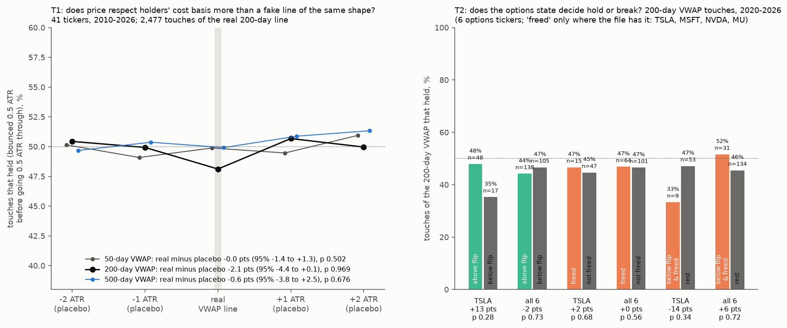
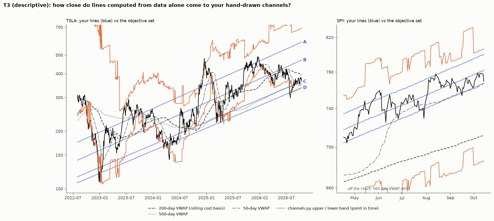

# What do channel lines represent in market microstructure, and how can they be drawn objectively?

**Agent / session:** Claude, claude.ai session for the owner, 2026-10-17
**Type:** thesis plus pre-registered tests. The plan was pushed at a9b309f before any test ran. T1–T3 have been run, and the results are below the plan.
**Builds on:**
* microstructure TL;DR 2 (the moving-average identity) and §3 (lines are mostly not magic);
* owner-channel-gamma (the channel zones against the gamma state);
* spy-channel (the upper-line hits came with gamma pinned);
* the full-setup results.

**Verdict: the lines can be drawn objectively, but they are not levels that hold.**
* **T1 fails.** Rolling cost-basis lines are not respected beyond fake lines of the same shape.
  * Touches of the 50-, 200- and 500-day VWAP hold 48–50% of the time. Placebo curves 1–2 ATR away also hold 49–51%.
  * Primary N = 200: real minus placebo −2.1 points (95% −4.4 to +0.1), p 0.97.
* **T2 fails.** At 200-day VWAP touches, the options state does not decide hold or break.
  * TSLA holds 48% above its flip vs 35% below (+13 points). That is the predicted direction, but n = 65 and p = 0.28.
  * Pooled over 6 tickers: −2 points. Freed vs not: no difference.
* **T3 (descriptive).** The objective set reproduces the owner's lines closely:

  | Owner's line | Closest objective line | Median gap |
  |---|---|---|
  | TSLA B | 200-day VWAP | 7% |
  | TSLA C | 500-day VWAP | 3.5% |
  | TSLA D | 500-day VWAP | 9% |
  | SPY lower | 50-day VWAP | 0.7% |
  | SPY mid | 50-day VWAP | 1.8% |
  | SPY upper | `channels.py` upper band | 2.7% |

* **What survives of the thesis.** Layer 1 (geometry: the lines are holders' cost basis at different horizons) survives as a way to draw them. Layer 2 (holders defend those lines) and layer 3 (the options state decides hold or break) do not.
* **In practice.** A touch of one of these lines is a coin flip. The edge stays in the tested states (the full setup, the S&P rungs), not at the line.

## The thesis: three layers, three time scales

1. **Geometry: why the lines are straight and parallel (years).**
   * In a trend with steady log growth *b* per day, any trailing average over *N* days is a straight line parallel to price, offset below it by *b·(N−1)/2*. This is the moving-average identity, microstructure TL;DR 2.
   * So a set of parallel channel lines is what you get from **holders' cost bases at different horizons** during steady growth.
   * The lines look straight only while growth is steady. When growth changes, they bend, and hand-drawn lines get redrawn.

2. **Cost-basis memory: the lower lines (months).**
   * A trailing average price over a horizon (a rolling VWAP or moving average) is where holders on that horizon are at breakeven.
   * At breakeven, holders defend the price or add to it. Below breakeven, exits pile up and moves accelerate.
   * Lower lines should therefore be **rolling** cost bases.
   * **Anchored** cost basis from one low (an anchored VWAP) flattens over time, so it can only match a straight line for some months after the low.

3. **Positioning: hold or break (days to weeks).**
   * Option levels (flip, walls) move with price within weeks, so they cannot draw multi-year lines.
   * They decide **whether a line holds** on a given day:
     * above the flip, dealers damp moves, so touches should reject;
     * below the flip and freed, they amplify, so lines break, flush, then snap back (the tested full setup).
   * **The upper line** sits above price, so in an uptrend it cannot be a trailing average. It is a positioning or overextension boundary: where call positions cap the price and gamma pins (the SPY upper-line hits came with gamma at its 88th–90th percentile).

## Exploratory evidence (descriptive; owner's TSLA lines, 2022-06 to 2026-10)

Median |gap| to each of the owner's lines, % (`out/explore_gaps.csv`):

| Candidate | A | B | C | D |
|---|---|---|---|---|
| cost basis since the Apr 2024 low (anchored VWAP) | 42 | 21 | **5.5** | 11 |
| cost basis since the Jul 2026 low (short history) | 51 | 29 | **3.3** | **4.4** |
| **200-day average** | 25 | **6.2** | 20 | 28 |
| 50-day average | 24 | 14 | 24 | 31 |
| gamma flip / put wall / call wall (20-day medians) | 20–30 | 17 | 19–38 | 23–45 |

* **B tracks the 200-day average,** a rolling cost basis.
* **C and D track the cost basis from the latest major low** for a while. The anchored VWAPs then flatten away from the straight lines, as layer 2 says they must.
* **Option levels track no line.** They live on a shorter time scale, as layer 3 says.
* **Today's confluence** (Oct 14–16): cost basis since the July low $354, gamma flip $353–357, put wall $350, 50-day average $358, volume-node line $353. TSLA closed at $354.72.

## The objective drawing rule (proposed; every input is known on the day)
1. **Lower lines:** rolling volume-weighted average price over N = 50, 200 and 500 sessions. These are the actual curves, not hand-drawn straight lines.
2. **Upper line:** the regression channel's upper band from `research/microstructure/channels.py` (the existing objective algorithm: the narrowest log band holding 70% of wicks).
3. **State on the day:** the stock's own gamma flip and freed state (`td_gamma`), which say whether a line should hold or break.

## Pre-registered tests (not yet run)

**T1: are rolling cost-basis lines respected beyond placebos? (primary)**
* **Data:** about 45 tickers with Yahoo daily data, 2010–2026.
* **Touch:** a session whose low-to-high range reaches the rolling VWAP(N), after a close beyond it on one side.
* **Outcome:** first passage within 20 sessions: back 0.5 ATR(20) on the approach side (reject) before 0.5 ATR through (break).
* **Placebos:** the same VWAP curve shifted by ±1 and ±2 ATR(20). Same shape, but no one's cost basis.
* **Statistic:** rejection rate at the real line minus the placebo average.
* **Null:** ticker-year block bootstrap, 2,000 draws. One-sided p.
* **Primary:** N = 200, pass at p < 0.025. N = 50 and N = 500 are secondary.
* **Prediction:** a small excess of 2–5 points that may pass. §3 found +4 points at algorithmic lines, inside the random-walk band.

**T2: does the options state decide hold or break? (6 options tickers, 2020+)**
* At T1 touches of VWAP(200): rejection rate when the close before the touch was above the stock's own flip vs below it, and freed vs not.
* **Prediction:** above the flip rejects more. Below the flip and freed, the break rate is higher, followed by snap-backs.
* **Pass:** p < 0.05 for TSLA, with the others reported.

**T3: does the objective set reproduce the owner's lines? (descriptive)**
* The median gap between each objective line and the owner's TSLA and SPY lines, over time.

## Threats to validity
* **Hindsight.** The owner's lines were drawn after the fact, so T3 is descriptive only. T1 and T2 use no hand-drawn lines.
* **Touch definitions on daily bars are coarse.** The first passage is measured on closes.
* **Volume.** Yahoo volume is consolidated tape volume, which mixes in off-exchange and dark-pool prints.

## Results (run after the plan was pushed; `run_tests.py`)

**Run:** `OMP_NUM_THREADS=1 python run_tests.py` (about 1 minute). Outputs:
* `out/t1.json`, `out/t2.json` and `out/t3_gaps.csv`;
* `out/events.csv.gz`, every touch with its outcome;
* `out/tests.png` (T1, T2) and `out/lines.png` (T3).

### Deviations and choices made at run time (before seeing any result)
* **Tickers:** 41, not "about 45": every stock and ETF in `research/microstructure/data`, with indices excluded (no volume). Each ticker runs from its first bar, warming up the averages, and touches count from 2010.
* **Last bar:** each ticker's last committed bar is dropped, because it can be an intraday snapshot.
* **T2 null:** the plan did not name one. A label permutation is used, shuffled within ticker, 2,000 draws, one-sided in the predicted direction. With one ticker, a year-block bootstrap would have only about 7 blocks.
* **"Freed":** it needs `near_oi_share`, which the SPY and QQQ gamma files do not have. Freed is therefore tested on TSLA, MSFT, NVDA and MU only.
* **Correction to the thesis text:** `channels.py` uses q = 0.03. Its band holds 97% of highs below the upper line and 97% of lows above the lower line, not "70% of wicks".

### T1: are rolling cost-basis lines respected beyond placebos? Fail.

A touch "held" when price bounced 0.5 ATR back to the approach side before going 0.5 ATR through, on closes, within 20 sessions.

| VWAP | touches of the real line | held: real line | held: placebos (−2, −1, +1, +2 ATR) | real minus placebo (95% CI) | p (one-sided) |
|---|---|---|---|---|---|
| 50-day | 6,276 | 49.9% | 50.2, 49.1, 49.5, 50.9% | −0.0 (−1.4 to +1.3) | 0.50 |
| **200-day (primary)** | **2,477** | **48.1%** | 50.4, 49.9, 50.7, 50.0% | **−2.1 (−4.4 to +0.1)** | **0.97** |
| 500-day | 1,368 | 49.9% | 49.7, 50.4, 50.9, 51.3% | −0.6 (−3.8 to +2.5) | 0.68 |

* **By side:** support (approach from above) and resistance (from below) both fail at every N.
  * Best: resistance at the 500-day, +1.3 points, p 0.29.
  * Worst: support at the 200-day, −3.0 points, p 0.98.
* **Prediction check:** the predicted +2–5 point excess did not appear. If anything, the 200-day line breaks slightly more often than a fake line. That fits momentum (crossing the 200-day is a trend signal), not defended cost basis. It was not the tested direction, so it is not a finding.

### T2: does the options state decide hold or break? Fail.
Primary: touches of the 200-day VWAP, 2020–2026, with the state taken at the prior close.

| | touches | held: above flip | held: below flip | diff (p) | freed vs not | below flip & freed vs rest |
|---|---|---|---|---|---|---|
| **TSLA** | 65 | 48% (48) | 35% (17) | **+13 (p 0.28)** | +2 (p 0.68) | −14 (p 0.35; n = 9) |
| all 6 | 243 | 44% (138) | 47% (105) | −2 (p 0.73) | +0 (p 0.56) | +6 (p 0.72) |
| MSFT | 38 | | | +24 (p 0.27; 6 below) | | |
| NVDA | 24 | | | −34 (p 0.98) | | |
| MU | 56 | | | −19 (p 0.96) | | |
| SPY / QQQ | 39 / 21 | | | +2 / +3 (p 0.61 / 0.75) | n/a | n/a |

* **Snap-back after a break** (a close back on the approach side within 10 sessions): below-flip-and-freed breaks don't snap back more (pooled −4 points, p 0.65).
* **Secondary (all three N pooled, 1,003 touches):** above vs below the flip −1 point. Freed touches hold *more*, not less (+6, p 0.95 in the predicted direction). TSLA: −2 points.
* **Reading:** TSLA's +13 points points the predicted way, but it is not distinguishable from luck at n = 65. The other tickers disagree in sign.

### T3: does the objective set reproduce the owner's lines? (descriptive)

Median |log gap|, % (`out/t3_gaps.csv`). Every objective line is computed from data through the prior close. TSLA covers 2022-08 to 2026-10, SPY 2026-04 to 2026-10.

| objective line | TSLA A | TSLA B | TSLA C | TSLA D | SPY upper | SPY mid | SPY lower |
|---|---|---|---|---|---|---|---|
| 50-day VWAP | 24.4 | 14.0 | 24.0 | 31.3 | 4.1 | **1.8** | **0.7** |
| 200-day VWAP | 27.4 | **7.3** | 21.8 | 29.2 | 10.6 | 8.3 | 6.4 |
| 500-day VWAP | 43.5 | 25.3 | **3.5** | **8.9** | 19.3 | 17.0 | 15.1 |
| `channels.py` upper band | 28.9 | 50.5 | 75.3 | 82.7 | **2.7** | 5.0 | 6.9 |
| `channels.py` mid | **11.0** | 20.1 | 43.0 | 50.4 | 6.0 | 3.7 | 1.9 |
| `channels.py` lower band | 39.2 | 18.7 | 17.8 | 15.6 | 14.8 | 12.5 | 10.6 |
| VWAP from the channel's anchor low (extra, not pre-registered) | 32.4 | 14.1 | 14.8 | 20.4 | 27.1 | 24.8 | 22.9 |

* **The owner's lines are, to a close approximation, cost bases at a few horizons.**
  * The short SPY channel matches the 50-day VWAP, with the `channels.py` band on top.
  * The long TSLA channel matches the 200- and 500-day VWAPs.
* **TSLA's upper line A has no close objective match.** The nearest is the `channels.py` mid (11%). The point-in-time band jumps whenever the detector re-anchors.
* **Hindsight caveat:** the owner's lines were drawn after the fact, so this shows resemblance, not skill.

### What this means for the thesis
1. **Geometry (layer 1): kept, as a drawing rule.** The lines are cost bases at different horizons, which is why they look straight and parallel during steady growth.
2. **Cost-basis memory (layer 2): rejected as an edge.** Holders do not measurably defend those lines. A touch is a coin flip, the same as at a fake line beside it.
3. **Positioning (layer 3): not supported at the lines.** The options state did not change hold vs break at VWAP touches. Its tested value stays where it was found: the full setup and the S&P rungs, which do not need a line.
