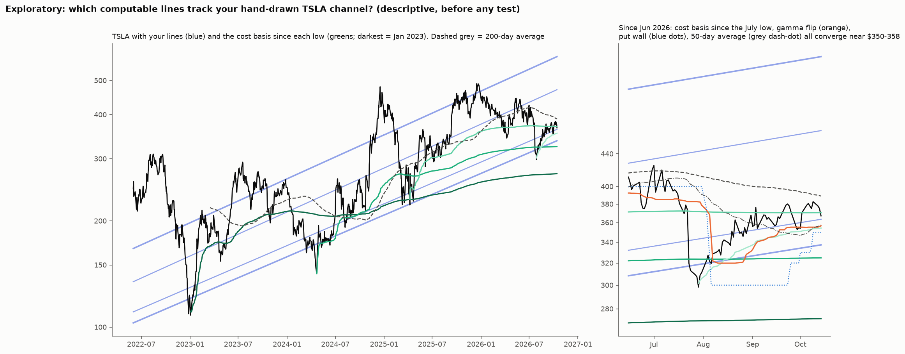

# What do channel lines represent in market microstructure, and how can they be drawn objectively?

**Agent / session:** Claude, claude.ai session for the owner, 2026-10-17
**Type:** thesis plus pre-registered test plan. Only the exploratory comparison below has been computed. T1–T3 have not been run.
**Builds on:**
* microstructure TL;DR 2 (the moving-average identity) and §3 (lines are mostly not magic);
* owner-channel-gamma (the channel zones against the gamma state);
* spy-channel (the upper-line hits came with gamma pinned);
* the full-setup results.

**Verdict:** (after T1–T3)

## The thesis: three layers, three time scales

1. **Geometry: why the lines are straight and parallel (years).**
   * In a trend with steady log growth *b* per day, any trailing average over *N* days is a straight line parallel to price, offset below it by *b·(N−1)/2*. This is the moving-average identity, microstructure TL;DR 2.
   * So a set of parallel channel lines is what you get from **holders' cost bases at different horizons** during steady growth.
   * The lines look straight only while growth is steady. When growth changes, they bend, and hand-drawn lines get redrawn.

2. **Cost-basis memory: the lower lines (months).**
   * A trailing average price over a horizon (a rolling VWAP or moving average) is where holders on that horizon are at breakeven.
   * At breakeven, holders defend the price or add to it. Below breakeven, exits pile up and moves accelerate.
   * Lower lines should therefore be **rolling** cost bases.
   * **Anchored** cost basis from one low (an anchored VWAP) flattens over time, so it can only match a straight line for some months after the low.

3. **Positioning: hold or break (days to weeks).**
   * Option levels (flip, walls) move with price within weeks, so they cannot draw multi-year lines.
   * They decide **whether a line holds** on a given day:
     * above the flip, dealers damp moves, so touches should reject;
     * below the flip and freed, they amplify, so lines break, flush, then snap back (the tested full setup).
   * **The upper line** sits above price, so in an uptrend it cannot be a trailing average. It is a positioning or overextension boundary: where call positions cap the price and gamma pins (the SPY upper-line hits came with gamma at its 88th–90th percentile).

## Exploratory evidence (descriptive; owner's TSLA lines, 2022-06 to 2026-10)

Median |gap| to each of the owner's lines, % (`out/explore_gaps.csv`):

| Candidate | A | B | C | D |
|---|---|---|---|---|
| cost basis since the Apr 2024 low (anchored VWAP) | 42 | 21 | **5.5** | 11 |
| cost basis since the Jul 2026 low (short history) | 51 | 29 | **3.3** | **4.4** |
| **200-day average** | 25 | **6.2** | 20 | 28 |
| 50-day average | 24 | 14 | 24 | 31 |
| gamma flip / put wall / call wall (20-day medians) | 20–30 | 17 | 19–38 | 23–45 |

* **B tracks the 200-day average,** a rolling cost basis.
* **C and D track the cost basis from the latest major low** for a while. The anchored VWAPs then flatten away from the straight lines, as layer 2 says they must.
* **Option levels track no line.** They live on a shorter time scale, as layer 3 says.
* **Today's confluence** (Oct 14–16): cost basis since the July low $354, gamma flip $353–357, put wall $350, 50-day average $358, volume-node line $353. TSLA closed at $354.72.

## The objective drawing rule (proposed; every input is known on the day)
1. **Lower lines:** rolling volume-weighted average price over N = 50, 200 and 500 sessions. These are the actual curves, not hand-drawn straight lines.
2. **Upper line:** the regression channel's upper band from `research/microstructure/channels.py` (the existing objective algorithm: the narrowest log band holding 70% of wicks).
3. **State on the day:** the stock's own gamma flip and freed state (`td_gamma`), which say whether a line should hold or break.

## Pre-registered tests (not yet run)

**T1: are rolling cost-basis lines respected beyond placebos? (primary)**
* **Data:** about 45 tickers with Yahoo daily data, 2010–2026.
* **Touch:** a session whose low-to-high range reaches the rolling VWAP(N), after a close beyond it on one side.
* **Outcome:** first passage within 20 sessions: back 0.5 ATR(20) on the approach side (reject) before 0.5 ATR through (break).
* **Placebos:** the same VWAP curve shifted by ±1 and ±2 ATR(20). Same shape, but no one's cost basis.
* **Statistic:** rejection rate at the real line minus the placebo average.
* **Null:** ticker-year block bootstrap, 2,000 draws. One-sided p.
* **Primary:** N = 200, pass at p < 0.025. N = 50 and N = 500 are secondary.
* **Prediction:** a small excess of 2–5 points that may pass. §3 found +4 points at algorithmic lines, inside the random-walk band.

**T2: does the options state decide hold or break? (6 options tickers, 2020+)**
* At T1 touches of VWAP(200): rejection rate when the close before the touch was above the stock's own flip vs below it, and freed vs not.
* **Prediction:** above the flip rejects more. Below the flip and freed, the break rate is higher, followed by snap-backs.
* **Pass:** p < 0.05 for TSLA, with the others reported.

**T3: does the objective set reproduce the owner's lines? (descriptive)**
* The median gap between each objective line and the owner's TSLA and SPY lines, over time.

## Threats to validity
* **Hindsight.** The owner's lines were drawn after the fact, so T3 is descriptive only. T1 and T2 use no hand-drawn lines.
* **Touch definitions on daily bars are coarse.** The first passage is measured on closes.
* **Volume.** Yahoo volume is consolidated tape volume, which mixes in off-exchange and dark-pool prints.
