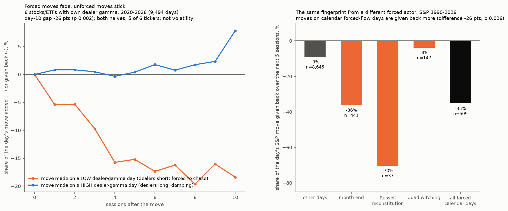

# Forced flow: is price predictable only where someone must trade?

**Agent / session:** Claude, claude.ai session for the owner, 2026-10-24
**Type:** a theory with pre-registered falsification tests, then diagnosis and follow-up tests, each pre-registered before it runs. This file was pushed before any test ran.
**Builds on:**
* dealer-sign (call gamma damps the next-day range);
* the full setup (§4w, edge_lab);
* spy-channel (S&P gamma rungs, VIX × gamma);
* the failures of shape, macro and candle-model forecasts (2026-10-24 analogs, Kronos).

**Verdict: one law survived three rounds of attack. Forced moves fade; unforced moves stick.**
* **Single names (TSLA, MSFT, NVDA, SPY, QQQ, MU; 2020–2026):**
  * a move made on a day when dealers are short gamma is given back over the next two weeks (−18% of the move by day 10);
  * a move made when dealers are long gamma persists (+8%).
  * The day-10 gap is −26 points (p 0.002). It is not volatility (p 0.0005 with volatility held fixed), and it holds in both halves of the period and in 5 of 6 tickers.
* **The same fingerprint from a different forced actor:** S&P moves made on calendar forced-flow days are given back more over the next 5 sessions than other days' moves (−35% vs −9%, p 0.026; 1990–2026). Month-end gives back −36%, Russell reconstitution −70% (n 37), quad witching −4%.
* **What died:** the naive dealer sign flip, last-half-hour momentum, the expiry-release size law, volatility-target window drop-out as a mechanism, and leverage as fuel for selloffs.
* **The original theory predicted the wrong sign for A1.** The law that survived came from diagnosing that failure, and it was then confirmed on fresh splits and a different actor.

## The theory
* **Discretionary flow is arbitraged away;** forced flow is not.
* **Price behaviour is therefore predictable only where an actor must trade by rule regardless of price.**
* **The predictable part is mostly the size and path of moves, not their direction,** and it scales with the forced flow relative to liquidity.
* **Each test below names a forced actor,** derives a prediction no news story would produce, and states what result kills it.

## Data
* Yahoo daily bars (repository copies, outcomes to 2026-10-14).
* SqueezeMetrics `DIX.csv` (S&P dealer gamma, 2011–2026).
* `td_gamma_<sym>.csv` (own dealer gamma for TSLA, MSFT, NVDA, SPY, QQQ, MU; 2020–2026).
* The private SPY 1-minute option files: parity spot, 2023-01-03 to 2026-10-15. These stay outside the repository, and only derived daily numbers are written here.
* The macro panel's FINRA margin debt (monthly, 1998–2026). It is used with a 2-month lag, because FINRA publishes about three weeks after month end.
* ^GSPC daily since 1928.

## A. Dealers (the core): sign flip and size law
* **Forced actor:** option dealers hedging delta.
  * Long gamma, they sell rallies and buy dips, so returns mean-revert.
  * Short gamma, they chase, so returns continue.
* **Size law:** the effect grows with hedge flow relative to liquidity: H = dealer gamma ($ per 1% move) ÷ 20-day average dollar volume.

**A1 (daily, S&P):**
* **Data:** SqueezeMetrics GEX ÷ SPY 20-day dollar volume, 2011–2026.
* **Bins:** H's trailing-252-day percentile, in quintiles (point in time).
* **Statistic:** in each quintile, the slope β of the next-day return on today's return.
* **Prediction:**
  * β falls monotonically from quintile 1 (lowest gamma) to quintile 5;
  * β(Q1) > 0 (continuation) and β(Q5) < 0 (reversal).
* **Pass:** β(Q1) − β(Q5) > 0 with a 20-day block bootstrap p < 0.05 (one-sided, 2,000 draws), **and** a Spearman correlation between β and quintile rank below −0.7.
* **Also:** the 6 single names with their own gamma (`td_gamma`, gex_classic ÷ own dollar volume), 2020–2026, pooled within ticker. Reported; for single names the pass is the same Q1 − Q5 test.

**A2 (intraday, SPY, 2023–2026):**
* **Returns:** r_rest = log(S at 15:30 ÷ prior close); r_last = log(S at 16:00 ÷ S at 15:30). S is the 1-minute parity spot.
* **Statistic:** the slope of r_last on r_rest by quintile of SPY's own H (`td_gamma_SPY` gex_classic ÷ SPY dollar volume, trailing percentile), and by the sign of gex_classic.
* **Prediction:** a positive slope (last-half-hour continuation) when gamma is negative or low, falling toward zero or below when it is high.
* **Pass:** slope(low-H half) − slope(high-H half) > 0 with a block bootstrap p < 0.05.

**Kill for A:** no ordering by H, in daily or intraday data. Then the dealer mechanism is not what drives our gamma results.

## B. Expiry release
* **Forced actor:** dealers' hedges unwind when options expire.
* **Prediction:** the larger the share of gamma that expires at a monthly expiry, the more realized volatility rises from the week before to the week after.
* **Data:** 6 tickers, 2020–2026.
  * x = `gamma_share_1d` on the session before the monthly expiry;
  * y = log(mean |daily return| over the 5 sessions after ÷ the 5 sessions before).
* **Statistic:** the within-ticker slope of y on x.
* **Null:** permute x across expiries within ticker, 2,000 draws.
* **Pass:** slope > 0 with p < 0.05.
* **Kill:** slope ≤ 0.

## C. Volatility-target funds: the window drop-out echo
* **Forced actor:** funds that size positions by trailing realized volatility (often a 1-month window), a large strategy since about 2008.
* **Mechanical prediction:** when a big move drops out of the trailing 21-session window, measured volatility falls by construction, so these funds buy. No news is involved.
  * **Event:** a session whose |return| ≥ 2.5× the prior 20-day standard deviation, and is the largest |return| in its 21-session window.
  * **Outcome:** the S&P return over sessions s+21 to s+23, in excess of the mean 3-session return.
* **Prediction:** positive excess in 2008–2026; about zero in 1960–2007, before the strategy existed at scale.
* **Pass:** post-2008 excess > 0 (bootstrap p < 0.05) **and** greater than the pre-2008 excess.
* **Also reported:** the 63-session (3-month window) echo.

## D. Leverage as fuel
* **Forced actor:** leveraged holders hit by margin calls and risk limits.
* **Prediction:** after a volatility shock, the S&P's drawdown over the next 20 sessions is deeper when margin debt grew fast over the prior year. Average returns over all days do **not** differ by leverage growth.
* **Events, 1998–2026:** VIX 5-day change ≥ +40%, events at least 40 sessions apart.
* **Statistics:**
  * the event's 20-session max drawdown from its close, regressed on margin-debt year-on-year growth (2-month lag);
  * the mean drawdown, top vs bottom half of leverage growth.
* **Null:** permute leverage across events, 5,000 draws.
* **Pass:** drawdown deeper with higher leverage growth, p < 0.05.
* **Control:** the next-20-session mean return over all days, top vs bottom half of leverage growth. The prediction is no difference.

## Predictions (written before the run)
* **A1 and A2:** expected to pass. The literature finds gamma-dependent autocorrelation and last-half-hour momentum.
* **B:** uncertain.
* **C:** uncertain, and weaker, because many funds smooth their windows.
* **D:** low power with about 30 events, so likely inconclusive.

## Then
Each result gets a diagnosis: era and ticker splits, alternative explanations, and what it implies. Any follow-up test is written here as an amendment and pushed before it runs.

## Round 1 results (`test_a.py`, `test_bcd.py`; outputs in `out/`)
| Test | Result | Verdict |
|---|---|---|
| **A1 daily, S&P** (3,768 days) | β by gamma quintile: −0.19, −0.03, −0.10, +0.01, −0.01. **Q1 − Q5 = −0.18** (p 0.84 for the predicted sign); Spearman **+0.80** | **fail, and reversed** |
| A1, 6 names pooled (9,494 days) | β −0.077, −0.047, −0.024, +0.003, +0.029: monotone, Spearman **+1.0**, Q1 − Q5 −0.106 (95% −0.176 to −0.031) | **reversed, and significant** |
| A2 intraday, SPY 2023–2026 (945 days) | last-half-hour slope ≈ 0 overall (−0.005). Low-H half +0.002, high-H half −0.024, difference p 0.11 | fail (predicted sign, weak) |
| B expiry release (486 expiries) | within-ticker slope +0.43, p 0.066. Vol rose +9% after high-share expiries vs +2–4% otherwise. Mixed by ticker | fail (predicted sign, borderline) |
| **C 21-session echo** | **2008–2026: +0.30% excess over 3 sessions, 64% positive (81 events, p 0.034); 1960–2007: −0.06% (205 events). Post − pre +0.36%, p 0.028.** The 63-session echo: nothing | **pass** |
| D leverage as fuel (47 VIX shocks, 1998–2026) | drawdown vs margin-debt growth: slope +0.02 (wrong sign), −2.6% vs −2.7% by half. Control: no return difference over all days (p 0.87) | fail (null) |

## Diagnosis
* **A1 reversed:** low-gamma days are followed by **reversal** the next day, and high-gamma days by slight **continuation**. The naive sign flip predicted the opposite.
  * **Explanation 1, volatility:** low-gamma days are high-volatility days. Daily returns mean-revert in turbulent markets for reasons unrelated to dealers. If so, the gamma ordering should vanish once realized volatility is held fixed.
  * **Explanation 2, a refined dealer theory:** dealers change the **speed** of price discovery, not its destination.
    * Short gamma, they push price too far within the day, and the overshoot corrects the next day.
    * Long gamma, they damp the move within the day, and the unfinished move continues the next day.
    * This predicts the ordering survives the volatility control, and that the gap closes over the following days.
  * **Explanation 3, a vanna or volatility-crush bounce:** after selloffs (low gamma, rising IV), falling IV makes dealers buy back hedges. This predicts the reversal comes mostly after **down** days.
* **A2 null:** last-half-hour momentum is absent in SPY in 2023–2026, a period when 0DTE dominates. It points the predicted way, but weakly.
* **B borderline:** it points the predicted way. The share expiring ignores the size of the released hedge relative to liquidity, and the size law says that is what should matter.
* **C passed:** it is the most mechanical of the four predictions, so it now has to survive checks that distinguish the drop-out mechanism from coincidence: the lag profile, a placebo, the sign of the shock, and the calendar.
* **D null:** margin-debt growth may simply track rising prices rather than leverage. A cleaner proxy is margin debt relative to the market's level.

## Amendment 1: follow-up tests. Pre-registered here before any follow-up runs.
**F1. A1 dissection (pooled names and S&P separately):**
* **Regression:** y = a + b1·x + b2·x·Hc + b3·x·RVc + c1·Hc + c2·RVc.
  * Hc is the H percentile minus 0.5 and RVc is the realized-volatility percentile (trailing 20-day volatility vs the past year, point in time) minus 0.5.
* **Test b2 > 0** (the found ordering) with a 20-day block bootstrap.
* **If b2's p < 0.05:** the ordering is independent of the volatility regime (explanation 2 or 3). **Otherwise** it is volatility (explanation 1).
* **Also:** β by H half, separately for up-days and down-days (explanation 3 predicts the gap mostly on down-days).
* **Also:** the cumulative response over 1–10 days for the low-H and high-H halves. Explanation 2 predicts the gap shrinks by day 10.

**F2. C mechanism checks (post-2008 events; all four must hold for the mechanism to stand):**
1. **Lag profile:** the 3-session excess starting at lags 15–27. The excess at 21 must exceed the mean of the placebo lags (15–18, 24–27), with an event-bootstrap p < 0.05.
2. **Placebo:** shocks that were **not** the largest in their window, so measured volatility does not fall when they drop out, must show a smaller echo than the qualifying shocks. One-sided p < 0.05.
3. **Sign:** both up-shocks and down-shocks echo positive (each mean > 0; reported, given the small samples).
4. **Calendar:** the post-2008 excess stays positive after excluding echo windows that contain the last trading day or the first three trading days of a month.

**F3. B size law:**
* x2 = gamma_share_1d × |gex_classic| ÷ 20-day dollar volume (the released hedge relative to liquidity), at the session before the expiry.
* Same within-ticker permutation. Pass p < 0.05.

**F4. D cleaner leverage (secondary):**
* The 12-month change in log(margin debt ÷ S&P level), with a 2-month lag, in place of margin growth.
* Same test. Pass p < 0.05.

## Round 2 results (`followup.py`; `out/f1.json` to `out/f4.json`)
**F1. A1 dissection**
* **6 names pooled (9,494 days):** the gamma ordering **survives the volatility control.**
  * b2 (today's return × gamma percentile) = +0.107 (95% +0.034 to +0.177), p 0.0005.
  * The volatility interaction is about 0 (−0.005).
  * Gamma and volatility percentiles correlate −0.31, so they are separable.
* **It is an up-day effect:**
  * up days: β −0.062 on low-gamma days vs +0.057 on high-gamma days;
  * down days: about −0.10 in both.
  * That is not the vanna or volatility-crush bounce, which predicted down days.
* **The gap does not close; it widens** (cumulative response, low minus high gamma, by day 1/5/10: −0.06, −0.16, −0.26).
  * Moves made on low-gamma days are progressively given back (−0.18 of the move by day 10).
  * Moves made on high-gamma days persist (+0.08).
  * "Speed, not destination" is rejected.
* **S&P (3,768 days):** the same sign (b2 +0.13) but not significant once volatility is held fixed (p 0.19). Gamma and volatility correlate −0.54 there. On up days: −0.35 on low-gamma days vs +0.04 on high-gamma days.

**F2. Echo mechanism: not established**
* **Check 1 passes:** the lag profile peaks at lags 19–21 (+0.28%, +0.41%, +0.30%) against negative placebo lags. Excess over placebo +0.40%, p 0.013.
* **Check 2 fails:** shocks that were *not* the largest in their window echo just as much (+0.28%; difference +0.01%, p 0.50). The volatility drop-out is therefore not the cause.
* **Check 3 passes:** up-shocks +0.34% (28 events), down-shocks +0.28% (53 events).
* **Check 4 weak:** excluding turn-of-month echo windows leaves +0.18% (57 events, p 0.20).
* **Reading:** something does recur about one month (19–21 sessions) after big moves in 2008–2026, but not because of volatility-window drop-out. The leading alternative is the monthly macro-release calendar (jobs report, CPI, FOMC): shocks happen on release days, and the next month's release falls about 21 sessions later. Untested here, because there is no announcement calendar in this environment.

**F3. Expiry size law: fail.** Slope +0.002, p 0.45. The released hedge relative to liquidity does not predict the volatility change.

**F4. Cleaner leverage: fail, and the opposite way.** High leverage growth relative to the market came with *shallower* post-shock drawdowns (−1.1% vs −4.1%), slope p 0.72.

## Theory update after round 2
* **What died:**
  * leverage as fuel (D, F4);
  * expiry release as a size law (B, F3);
  * the volatility-target echo as a mechanism (C, F2);
  * the naive dealer sign flip (A1 as predicted, A2).
* **What survived and sharpened, the transitory-impact law:**
  * Price moves made while dealers are short gamma (forced chasing) are temporary and get given back over the next two weeks.
  * Moves made while dealers are long gamma (damped) are permanent and continue.
  * Forced flow moves price, but it does not carry information, so its impact decays. That is the forced-flow theory's own logic, applied to the after-effect rather than to the move.

## Amendment 2: round 3 tests. Pre-registered before running.
**R3a. Is the transitory-impact law robust in single names?** Pooled names, same regression as F1. All three must hold:
1. b2 > 0 in both 2020–2022 and 2023–2026, each with block-bootstrap p < 0.10.
2. b2 > 0 for at least 5 of the 6 tickers.
3. The day-10 cumulative gap (low minus high gamma) < 0 with block-bootstrap p < 0.05.

**R3b. Does the law generalize to other forced-flow days?**
* **The prediction:** a big S&P move made on a day when index funds and pensions must trade by calendar should be given back more than a move of the same size on another day.
* **Data:** ^GSPC, 1990–2026.
* **Forced-flow days:**
  * quarterly index rebalances and quad witching (third Friday of Mar/Jun/Sep/Dec; the Thursday if the Friday is a holiday);
  * the last trading day of each month (pension and fund rebalancing);
  * the Russell reconstitution (last Friday of June).
* **Model:** c5 (next-5-day return ÷ the 20-day standard deviation) = a + b·x + d·x·F + e·F. x is the day's z-return and F = 1 on a forced-flow day.
* **Pass:** d < 0 with a 20-day block bootstrap p < 0.05.
* **Also reported:** each day type separately, and c10.

## Round 3 results (`round3.py`; `out/r3a.json`, `out/r3b.json`, figure `out/forced_flow.png`)

**R3a. Robustness in single names: all three checks pass.**

| Check | Result |
|---|---|
| b2 in 2020–2022 | +0.122, p 0.022 |
| b2 in 2023–2026 | +0.088, p 0.029 |
| Per ticker | TSLA +0.18, MSFT +0.02, NVDA +0.19, SPY +0.14, QQQ +0.22, MU −0.05: 5 of 6 positive |
| Day-10 cumulative gap (low − high gamma) | −0.26 (95% −0.40 to −0.10), p 0.0015 |

**R3b. Generalization to calendar forced-flow days (S&P 1990–2026, 9,254 days, 609 forced days): pass.**
* **The model's interaction term (move × forced day):** d = −0.26, p 0.026, for the next 5 days; −0.31 for the next 10 days.
* **Share of the day's move given back over the next 5 sessions:** other days −9%; forced days −35%.
* **By type, for the next 5 / 10 days:**
  * month end (441 days): d −0.27 / −0.21;
  * Russell reconstitution (37 days): −0.61 / −0.80;
  * quad witching (147 days): +0.05 / −0.20.

## What it means
* **The law:** price impact from flow that carries no information is temporary. Dealer short-gamma chasing and calendar rebalancing are two independent examples. The size of the eventual give-back is a measure of how forced the move was.
* **Practical reading:**
  * **A single-name move made under low dealer gamma, for example a squeeze rally while dealers are short gamma, tends to be partly given back over two weeks.** The gap is concentrated on up days.
  * A move made under high gamma tends to stick.
  * **A large S&P move on a month-end or reconstitution day tends to be partly given back the following week.**
* **TSLA, Oct 19–21 (+9%):** the gamma percentile on the three rally days was 55th, 72nd and 91st. All three are in the high-gamma half, where moves have stuck. Thursday's −3.1% (70th) is in the same group.
* **Open question:** the full setup (closes below the flip while freed, then up-bursts) is about down moves. In the pooled names, down-day reversal did not depend on gamma. So this law does not explain the setup's edge; the "freed" variable may be what does. That is a candidate for the next round.
