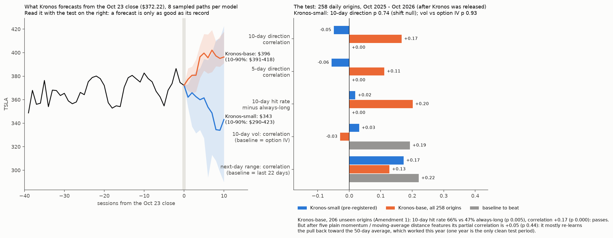

# Does Kronos (a foundation model for price candles) help on TSLA?

**Agent / session:** Claude, claude.ai session for the owner, 2026-10-24
**Type:** zero-shot model check. Pre-registered at d43d835 before any scored run; a smoke run only checked that the model loads. Amendment 1 (a confirmation run) was pre-registered at bc81ff3.
**Builds on:** microstructure §4ab (TimesFM 2.5 zero-shot: no help on direction, volatility below the options' implied vol). The design copies §4ab so the two results compare directly.
**Verdict: no use for volatility. A direction signal from Kronos-base that passes on fresh dates, but it is mostly a pull back toward the 50-day average, which works only in some years.**
* **Pre-registered primary (Kronos-small, 258 origins): fails both tests.**
  * Direction: correlation −0.05 (p 0.74).
  * Volatility: correlation 0.03 vs 0.19 for the option IV (p 0.93).
* **Amendment 1 (Kronos-base on its 206 unseen origins): passes.**
  * 10-day hit rate 66% vs 47% always-long (shift p 0.005).
  * Correlation +0.17 (p < 0.001).
* **Post-hoc (not pre-registered):**
  * Controlling for five plain momentum and moving-average-distance features drops Kronos-base's partial correlation to +0.05 (p 0.44).
  * Its forecast correlates −0.58 with the close's distance from the 50-day average.
  * In TSLA that distance predicted 10-day returns this year (−0.25), but not over 2011–Sep 2025 pooled (+0.02). The yearly sign flips: 2020 had a 34% reversal hit rate, 2023 had 66%.
* **Kronos-base also fails volatility** (−0.03 vs 0.19) and range (0.13 vs 0.22).
* **Bottom line:** one clean year cannot tell whether Kronos-base adapts to the regime or just happened to match this year's mean reversion. Do not trade it on its own. Re-score it as new days arrive.

## The model
* **Kronos** ([shiyu-coder/Kronos](https://github.com/shiyu-coder/Kronos), [arXiv 2508.02739](https://arxiv.org/abs/2508.02739), AAAI 2026) is a decoder-only transformer pre-trained on candle data (open, high, low, close, volume) from more than 45 exchanges. It tokenizes candles and samples future candles autoregressively.
* **Weights used:** `NeoQuasar/Kronos-small` (24.7M parameters) as the primary model and `NeoQuasar/Kronos-base` (102.3M) as the secondary, both with `Kronos-Tokenizer-base`. Context limit 512.
* Run on CPU. Sampling uses the README defaults (T = 1.0, top_p = 0.9).

## Leakage guard
* The paper went up on 2025-08-02, so the pre-training data ends before that.
* Only origins from **2025-10-01** onward are scored, so no outcome could be in the training data. This is the same cut-off as §4ab.

## Design
* **Data:** TSLA daily bars from Yahoo (10 years, fresh through 2026-10-23).
* **Inputs at each origin day t:** the last 400 bars through t (open, high, low, close, volume; the predictor's default `amount` = volume × mean price).
* **Origins:** every trading day from 2025-10-01 to 2026-10-09, the last day with 10 sessions of outcome. That is about 255 origins.
* **Paths:** K = 8 sampled 10-session paths per origin.
  * Kronos-small runs on every origin.
  * Kronos-base runs on every 5th origin (CPU time). Its results are reported as secondary and descriptive.

### Job 1: direction (primary: 10 sessions)
* **Prediction:** log(mean across paths of the close at t+h) − log(close at t), for h = 5 and 10.
* **Scores:** correlation with the realized log return, hit rate, and MAE.
* **Baselines:**
  * hit rate against "always long" (the share of up windows);
  * MAE against a zero-change forecast.
* **Null:** circular shift of the prediction series against the outcomes, 1,000 shifts, minimum shift 20 origins. The p-value is one-sided.
* **Pass (Kronos-small, h = 10):** correlation p < 0.05 **and** hit rate above always-long.

### Job 2: volatility over the next 10 sessions
* **Prediction:** mean across paths of the mean |daily log return| along the path. The first step is from the close at t.
* **Realized:** mean |daily log return| over t+1 to t+10.
* **Baselines:**
  * the last 22 days' mean |return|;
  * a 1/5/22-day blend;
  * **the options' own 30-day ATM implied vol** (`td_gamma_TSLA.csv`, converted to an expected mean |daily return| as IV·√(2/π)/√252).
* **Scores:** correlation and MAE.
* **Pass:** Kronos-small's correlation beats the option-IV correlation, with a 20-day block bootstrap p < 0.05.

### Job 3 (secondary): next-day range
* **Prediction:** mean across paths of the first step's log(high/low).
* **Baseline:** the last 22 days' mean log(high/low).
* **Score:** correlation with the realized range.

### Also reported (descriptive, not a test)
* Both models' 10-session forecast from the **2026-10-23 close**: median path and 10–90% band.

## Prediction (written before the run)
* No usable direction skill: hit rate near always-long, correlation within the shift null.
* Volatility worse than the options' implied vol, as with TimesFM.
* The edges in this repository come from positioning (open interest, gamma, expiry), which a candle-only model cannot see.

## Threats to validity
* About 255 overlapping 10-day windows hold only about 25 independent outcomes. The shift null keeps the serial dependence but has limited power.
* K = 8 paths make the mean forecast noisy, which works against Kronos. The 5-day horizon and the base model act as checks.
* Yahoo prices are split-adjusted. The input is normalized per window, as the predictor does.

## Amendment 1 (written after scoring the pre-registered run, before any new forecast)
**Pre-registered result (primary, Kronos-small, 258 origins): both tests fail.**
* 10-day direction: correlation −0.05 (shift p 0.74). Hit rate 48% vs 47% always-long.
* Volatility: correlation 0.03 vs 0.19 for the option IV (bootstrap p 0.93).

**Why an amendment:** the secondary model, Kronos-base, scored well on its 52 origins (every 5th day).
* 10-day hit rate 69% vs 46% always-long; correlation +0.16.
* The pre-registered shift null (minimum shift 20) has only 12 distinct shifts at n = 52, so its p = 0 is not informative.
* A post-hoc shift null with minimum shift 2 (49 shifts) gives p < 0.02 for both hit rate and correlation.
* It is a secondary model, looked at after the fact, on about 26 independent windows, so it needs confirmation.
* Kronos-base's forecasts correlate 0.79 with Kronos-small's on the same origins, yet small's hit rate there is 44%. The hit rate may hinge on where each model's large downward bias puts the zero line.

**Confirmation test:**
* **Run:** Kronos-base, same settings and seed rule, on the **206 origins it has not seen** (the other four of every five days, 2025-10-01 to 2026-10-09).
* **Pass (both required):**
  1. The 10-day hit rate beats always-long, with a circular-shift null p < 0.05 (minimum shift 10, 1,000 shifts).
  2. The 10-day correlation is above 0 with shift p < 0.05.
* **Volatility:** must beat the option IV (bootstrap p < 0.05) to count as a volatility skill.
* **Caveat:** these origins share the same 12 months and overlapping outcome windows with the 52 already scored. A pass shows the result is not a fluke of which days were sampled, not that it holds in a different period.

## Results (`kronos_check.py`; outputs in `out/`)

**Run:**
1. `python kronos_check.py forecast <Kronos repo> <TSLA_10y.json> small|base|base_rest`. On a 4-core CPU this took about 25 minutes for small and 15 + 60 minutes for base.
2. `python kronos_check.py score <TSLA_10y.json>`.

Outputs: `out/kronos.json` (all numbers), `out/kronos.png`, `out/paths_*.csv.gz` (every sampled path).

### Pre-registered (Kronos-small, 258 origins, Oct 2025 – Oct 2026)
| Job | Kronos-small | Baseline to beat |
|---|---|---|
| 10-day direction | correlation −0.05 (p 0.74); hit rate 48%; MAE 11.0% | always-long 47%; zero forecast MAE 5.7% |
| 5-day direction | correlation −0.06 (p 0.81); hit rate 40% | always-long 47% |
| 10-day volatility | correlation 0.03; MAE 0.99 pts | option IV 0.19 (MAE 0.56); last 22 days 0.16 |
| next-day range | correlation 0.17 | last 22 days 0.22 |

* **Bias:** it forecasts −5.3% per 10 days on average and overstates volatility (2.9% vs 2.2% realized mean |daily return|).

### Kronos-base
| | 52 origins (secondary) | 206 unseen origins (Amendment 1) | all 258 |
|---|---|---|---|
| 10-day hit rate (always-long) | 69% (46%) | **66% (47%), p 0.005** | 67% (47%) |
| 10-day correlation | +0.16 | **+0.17, p < 0.001** | +0.17 |
| 5-day correlation | +0.13 | | +0.11 (p 0.004) |
| volatility correlation (option IV) | −0.01 (0.28) | | −0.03 (0.19) |
| next-day range correlation (last 22 days) | 0.35 (0.24) | | 0.13 (0.22) |

* **Bias:** it forecasts −7.9% per 10 days on average, with a mean absolute error 3× the zero forecast. The sign is informative; the size is not.
* **Top fifth of its forecasts:** the next 10 days averaged +3.5% (up 83%, n = 52, about 5 independent windows) vs −1.7% on other days.
* **By quarter** (hit rate / correlation):

  | 2025Q4 | 2026Q1 | 2026Q2 | 2026Q3 |
  |---|---|---|---|
  | 47% / +0.50 | 82% / −0.09 | 79% / +0.71 | 64% / +0.60 |

### Post-hoc: what Kronos-base is picking up (not pre-registered)
* **Its forecast moves against recent strength:**
  * −0.58 with the close's distance from the 50-day average;
  * −0.29 with the distance from the 20-day average;
  * −0.36 with the past 20-day return.
* **This year TSLA mean-reverted:** the 50-day-average reversal rule hit 57%, and the distance correlated −0.25 with the next 10 days.
* **After controlling for the five features,** Kronos-base's partial correlation is +0.05 (p 0.44).
* **That reversion is not stable in TSLA:** 2011–Sep 2025 pooled correlation +0.02. By year, the reversal hit rate runs from 34% (2020, a trend year) to 66% (2023).
* **Reading:** Kronos-base's sign is better than the plain reversal rule (67% vs 57%). But its continuous information is mostly that rule, and one post-release year cannot separate skill from a lucky regime. The earlier technical-indicator study found that moving-average-distance signals do not hold for TSLA across eras.

### Forecasts from the Oct 23 close ($372.22), descriptive
* **Kronos-small:** day-10 median $343 (10–90%: $290–423).
* **Kronos-base:** day-10 median $396 (10–90%: $391–418). That is +6.3%, at the 73rd percentile of its own past forecasts, so not in the top fifth where it did best.
* The two models disagree in sign.
