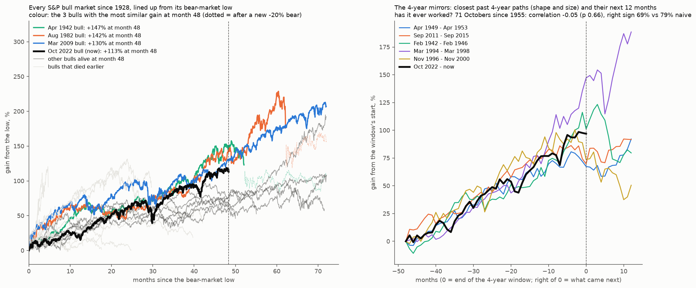

# Which past years has the S&P's 2026 rhymed with, and what came next?

**Agent / session:** Claude, claude.ai session for the owner, 2026-10-24
**Type:** analog study plus a skill test, pre-registered at 8c1c59b before any analog was computed. The only thing looked at beforehand was 2026's own path.
**Builds on:**
* microstructure §4x (state analogs for the S&P: neutral; the Oct–Dec season is the tailwind);
* spy-channel (the Q4 record since 1971).

**Verdict: 2026 does rhyme with past years, but a rhyme has never predicted the next month.**
* **The closest rhymes, by the shape of the year's path:** 1935, 1978, 1989, 2003 and 1933 (correlation 0.89–0.92).
* **From the same point in the year to the end of November** they went +5.5%, −3.4%, −0.3%, +2.7% and +6.9%: three up, two down.
* **Walk-forward over 1950–2025 fails**, with analogs picked only from earlier years:
  * correlation with the realized next month −0.14 (p 0.90);
  * right sign 47% vs 53% for the season.
* **Every secondary variant fails:** year-end outcome, K = 3 or 10, recent-month selector, RMSE selector, and calendar alignment (post-hoc).
* **The year's shape is a memory, not a map.**

## The owner's question
* Based on what the S&P has done this year and this month, what will next month look like?
* Is there a past year that rhymes with this one?
* Show it in a way that is neat, not only averages.

## 2026 so far (^GSPC, through the Oct 23 close)
* **Year to date:** +11.4%.
* **Spring correction:** −5.1% in March, low 6,344 on Mar 30.
* **V rebound:** +10.4% in April, +5.1% in May.
* **Summer plateau:** Jun −1.1%, Jul −0.1%, Aug +2.6%, Sep −0.5%.
* **October:** +2.2% to a new high of 7,819 on Oct 6, then a fade to −0.4% month to date.

## Design
* **Data:** ^GSPC daily from Yahoo, 1928 to 2026-10-23.
* **Path:** each year's log close relative to the prior year's last close, indexed by trading day. Today is trading day n0 = 204.
* **Similarity (primary, shape):** Pearson correlation between 2026's path and year Y's path over trading days 1..n0.
* **Also reported:**
  * the correlation over the last 21 sessions (this month's shape), each re-based to its start;
  * the RMSE of the raw paths (shape plus size).
* **Analogs:** the top K = 5 years by the primary score. A year needs at least n0 + 30 sessions.
* **Outcomes from day n0 in year Y:**
  * (a) to Y's last November close (**"next month"**);
  * (b) to Y's year end.
* **Picture:** 2026's path with the analog years overlaid, each scaled to 2026's level at day n0 and continued to year end.

## Pre-registered skill test: do analogs say anything about the next month beyond the season?
* **Walk-forward over Y = 1950 to 2025:**
  * Pick the top 5 analogs for Y among years before Y only, by the same primary score at Y's day n0.
  * Prediction: the mean of the analogs' outcome (a).
  * Naive prediction: the mean outcome (a) of all prior years (the season).
* **Scores (76 test years):**
  * the correlation of the analog prediction with the realized outcome;
  * the sign hit rate vs the naive hit rate;
  * the realized outcome when the prediction is in its top vs bottom third.
* **Null:** permute predictions across test years, 5,000 draws. One-sided p for the correlation.
* **Pass:** correlation > 0 with p < 0.05 **and** a sign hit rate above naive.
* **Secondary:**
  * outcome (b), to year end;
  * K = 3 and K = 10;
  * the recent-month score as the selector instead of the year-to-date shape.
* **Prediction (written before the run):** analogs add little beyond the season. November is up in most years, so the naive hit rate is hard to beat.

## Threats to validity
* With 76 test years the test has low power: it can detect a strong signal, not a subtle one.
* Choosing the shape metric is itself a degree of freedom. It is fixed above, and the alternatives are reported as secondary.
* Markets before 1950 differ (volatility, the role of index investing). They serve only as candidate analogs, never as test years.

## Results (`analogs.py`; outputs in `out/`)

**Run:** `python analogs.py <GSPC_max.json>`, which takes a few seconds. Outputs: `out/analogs.json`, `out/analogs.csv` (every year's scores and outcomes) and `out/analogs.png`.

### The rhymes (primary: correlation of the January-to-October path, trading-day index)
| Year | Shape correlation | This month's shape | From day 204 to end of Nov | To year end | Whole year |
|---|---|---|---|---|---|
| 1935 | 0.92 | −0.61 | +5.5% | +9.2% | +41.4% |
| 1978 | 0.91 | +0.50 | −3.4% | −1.9% | +1.1% |
| 1989 | 0.91 | +0.71 | −0.3% | +1.8% | +27.3% |
| 2003 | 0.89 | +0.28 | +2.7% | +7.6% | +26.4% |
| 1933 | 0.89 | −0.46 | +6.9% | +7.8% | +44.1% |
| **analog mean** | | | **+2.3%** | | |
| all years 1928–2025 | | | mean +0.55%, up 58% | | |

* **Closest by this month's shape alone:** 1971, 1989, 1999, 2004, 1970.
* **Closest by shape and size (RMSE):** 1964, 2003, 2017, 1944, 1963.
* **1989 and 2003 appear in more than one list.** 1989 was flat to the end of November; 2003 rose.

### The skill test (pre-registered)
* **Primary:** 75 test years, analogs from earlier years only. Correlation −0.14 (p 0.90). Right sign 47% vs 53% naive. **Fail.**
* **Realized outcome by the analogs' forecast:**

  | Forecast third | Mean next month | Up |
  |---|---|---|
  | bottom | +2.0% | 76% |
  | middle | +2.0% | 68% |
  | top | +0.9% | 52% |

  If anything it runs backwards, but not significantly.
* **Secondary, all fail:**

  | Variant | Correlation (p) |
  |---|---|
  | year-end outcome | −0.02 (0.57) |
  | K = 3 | −0.08 |
  | K = 10 | −0.04 |
  | recent-month selector | −0.13 |
  | RMSE selector | −0.01 |

### Post-hoc check: calendar alignment
* **Why:** exchanges traded on Saturdays until 1952, so "trading day 204" falls on a later calendar date in old years (1933: Nov 2).
* **Fix:** every year is re-indexed to 2026's calendar.
* **Result:** the same five rhymes (1935, 1989, 1978, 1933, 2003). The walk-forward still fails: correlation −0.19, p 0.95.
* **The figure uses this alignment.**

### Reading
* **This year's shape:** a March flush (−7% year to date at the low), a V in April and May, a flat summer, and an October stall after a new high.
* **The five years that drew the same curve did not agree on what came next.** In 75 years of out-of-sample tests, the curve has carried no information about the following month.
* **What has carried information** in this repository is the market's positioning state: the S&P gamma rungs, ARMED, and the VIX × gamma cells (spy-channel follow-ups). See those for the month ahead.

## Amendment 2 (owner's follow-up: which years had a similar macro background?). Pre-registered before any macro analog was computed.
**Question:** which past years looked like September 2026 in their macro and valuation backdrop, and did those years say anything about what came next?

**Data:**
* the repository's macro panel (`2026-10-15-channel-reversion-macro/out/macro_monthly.csv`; Fed H.15 rates, BLS CPI, dollar index), 1981–2026;
* the monthly Shiller CAPE (multpl.com table, 1871–2026);
* Shiller's `ie_data.xls` for 10-year yields and CPI before 1981.

Unemployment is not included: FRED and the BLS API are unreachable from this environment.

**Snapshot:** each year's September values (the latest complete month for 2026).

**Primary set, 1981–2025 (45 candidate years), z-scored across the candidates, equal weights, Euclidean distance. Seven features:**
1. fed funds rate;
2. its 12-month change (cutting vs hiking);
3. CPI year on year;
4. 10-year yield;
5. curve (10y − 3m);
6. CAPE;
7. S&P return from January to September.

**Secondary set, 1900–2025 (long history, no Fed data), five features:**
1. CAPE;
2. 10-year yield;
3. CPI year on year;
4. the 12-month change in the 10-year yield;
5. S&P January-to-September return.

**Reported:**
* the 5 nearest years;
* their September values next to 2026's;
* what the S&P did from day 204 to the end of November, to year end, and over the next 12 months (from the end of October);
* whether each analog was a midterm year. 2026 is a midterm year; this is descriptive, not a feature.

**Skill test (walk-forward, same rules as the shape test):**
* for each test year, the 5 nearest earlier years; prediction = their mean outcome; naive = the mean over all earlier years.
* **Primary:** the next-12-month return, with test years 1991–2025 (at least 10 earlier candidates).
* **Also reported:** the end-of-November outcome, and the secondary feature set with test years 1930–2025.
* **Null:** permutation, 5,000 draws, one-sided.
* **Pass:** correlation > 0 with p < 0.05 and a sign hit rate above naive.

**Prediction (written before the run):**
* The valuation backdrop (CAPE about 40) will pull the analogs toward 1998–2000 and 2021.
* 12-month outcomes after those years were mixed: 1999 up, 2000 and 2021 followed by bear markets.
* The walk-forward has low power (35 test years) and is expected to fail.

## Amendment 2 results (`macro_analogs.py`; `out/macro.json`, `out/macro_features.csv`, `out/macro.png`)

**Run:** `python macro_analogs.py <GSPC_max.json> <cape_monthly.csv> <shiller.csv>`.

**September 2026:**
* fed funds 3.75% and 0.47 points lower than a year earlier (easing);
* CPI +3.3%;
* 10-year 4.99%;
* curve +0.9;
* CAPE 40.4, the 3rd highest September reading since 1982, after 2000 (41.9) and 1999 (41.3);
* S&P +11.8% from January to September.

**Nearest years, primary features (1982–2025):**

| Year | Distance | Fed funds (12m change) | CPI | 10y | Curve | CAPE | Jan–Sep | To end of Nov | To year end | Next 12 months |
|---|---|---|---|---|---|---|---|---|---|---|
| 2025 | 0.89 | 4.22 (−0.91) | 2.9 | 4.12 | 0.05 | 38.6 | +13.7% | +1.6% | +1.6% | +11.5% (to Oct 23, 2026) |
| **1999** | 1.06 | 5.22 (−0.29) | 2.2 | 5.92 | 1.10 | 41.3 | +4.4% | +6.7% | +12.9% | +4.9% |
| 2018 (midterm) | 1.55 | 1.95 (+0.80) | 2.7 | 3.00 | 0.83 | 32.6 | +9.0% | +0.7% | **−8.5%** | +12.0% |
| 1998 (midterm) | 1.71 | 5.51 (−0.03) | 1.6 | 4.81 | 0.07 | 33.5 | +4.8% | +8.7% | +14.8% | +24.1% |
| 1997 | 1.85 | 5.54 (+0.24) | 2.2 | 6.21 | 1.13 | 32.7 | +27.9% | +0.5% | +2.1% | +20.1% |

* **Ranks 6–10:** 2007, 2000, 1996, 2024, 2021.
* **Long history (1900–2025; CAPE, 10y, CPI, 10y change, Jan–Sep):** 2025, 1999, 2018, 2023, 2000. The fifth, 2000, was followed by −25.9% over the next 12 months.

**Skill test (pre-registered, walk-forward): every variant fails.**

| Variant | Test years | Correlation (p) | Right sign vs naive |
|---|---|---|---|
| primary, next 12 months | 33 (1993–2025) | **−0.45** (0.997) | 76% vs 88% |
| primary, to end of Nov | 34 | −0.24 (0.91) | 79% vs 76% |
| long history, next 12 months | 87 (1939–2025) | −0.11 (0.84) | 63% vs 78% |
| long history, to end of Nov | 88 | −0.02 (0.56) | 49% vs 57% |

* If anything, the 12-month result runs backwards: years whose macro twins did well tended to do worse. That fits valuations mean-reverting across regimes, but it was not the tested direction.

**Reading:**
* **The closest historical macro twin of 2026 is 1999:** a Fed easing into a market valued near record CAPE, with a 10-year near 5–6% and a positive curve. The macro study of 2026-10-15 reached the same rhyme from different variables.
* **1999's next 12 months were +4.9%,** and the bear market began the year after. 2018 shows the other path from a similar backdrop: flat into November, then −8.5% by year end.
* **No macro twin has predicted the following month or year in 33–88 out-of-sample years.** The backdrop describes where the market stands; it has not said what comes next.

## Amendment 3 (owner's follow-up: maybe the mirrors span several years). Pre-registered before any multi-year analog was computed.
**Idea:** the year-shape analogs cut history at calendar years. A mirror may instead be a multi-year stretch, for example the run since the 2022 bear-market low.

### 3a. Multi-year shape mirrors
* **Data:** ^GSPC month-end closes from 1928 to the 2026-10-23 close (used as October's).
* **Current windows:** the last W months, for W = 24, 36, **48 (primary)** and 60.
* **Candidates:** every window of W months ending at a past month-end t. It must not overlap the current window, and its 12-month outcome must be known.
* **Similarity:**
  * **primary:** RMSE between the two log-price paths, each re-based to 0 at its start (shape **and** size);
  * **secondary:** the correlation of the paths (shape only).
* **Mirrors:** the 5 best, each ending at least 12 months apart from the others, so one episode cannot fill the list.
* **Outcomes:** the next 1, 3 and 12 months after the window ends.
* **Walk-forward skill test:**
  * test dates: every October-end from 1955 to 2024 (70 dates); the 1-month outcome is also scored for Oct 2025;
  * mirrors chosen only from windows ending 12+ months before the test date;
  * prediction = the mirrors' mean outcome; naive = the mean over all eligible windows.
* **Pass (primary W = 48, 12-month outcome):** correlation > 0 with permutation p < 0.05 (5,000 draws) **and** a sign hit rate above naive.
* **Also reported:** all W, the 1-month outcome, and the correlation metric.

### 3b. Bull-market age mirrors (descriptive)
* **Bear market:** a close at least 20% below the prior record close. The bull starts at the lowest close of that bear.
* **This bull:** began at the Oct 12, 2022 close (3,577.03) and is about 48 months old. The 2025 drop was −18.9% on closes, so the bull is still alive by this rule.
* **For every past bull that reached the same age without a new bear:** the gain from the low at that age, the worst drawdown so far, and the next 1, 3 and 12 months.
* **Across all months of all bulls:** the correlation of bull age with the next-12-month return, as a check on whether old bulls do worse.

**Prediction (written before the run):**
* Multi-year shape mirrors will also fail the walk-forward. A 4-year path is mostly trend, and trend is not predictive.
* The age table will be mixed, with notable breaks after age 4 (1946, 1962, 1987) and continuations (1953, 1986 into 1987, 2013).

## Amendment 3 results (`multiyear.py`; `out/multiyear.json`, `out/bulls.csv`, `out/multiyear.png`)

**Run:** `python multiyear.py <GSPC_max.json>`.

**Implementation notes (decided before looking at results):**
* **Bull markets:** the standard 20% zigzag on closes (a bear is −20% from the running peak; a bull is confirmed at +20% from the trough). The record-close wording in the plan cannot separate the 1930s–40s cycles, which never regained the 1929 record until 1954.
* **Ages and horizons** are in calendar time, because of Saturday sessions before 1952.
* **The walk-forward** applies the same no-overlap rule as the current window.

### 3a. Multi-year shape mirrors: every variant fails
| Window | Now | Closest past windows (shape and size) | Their next 12 months | Walk-forward next 12m: correlation (p); right sign vs naive |
|---|---|---|---|---|
| 24 months | +34% | 2016–18, 1960–62, 1963–65, 2012–14, 2013–15 | +11, +7, +4, +12, −0% | +0.00 (0.50); 52% vs 79% |
| 36 months | +82% | **1997–2000**, 1942–45, 1949–52, 2009–12, 2011–14 | −14, +24, −3, +11, −3% | −0.03 (0.59); 65% vs 79% |
| **48 months (primary)** | **+97%** | 1949–53, 2011–15, 1942–46, **1994–98**, **1996–2000** | +15, +13, −11, +17, −13% | **−0.05 (0.66); 69% vs 79%** |
| 60 months | +66% | 1948–53, 1941–46, 1981–86, 2015–20, 1947–52 | +19, −11, +25, +29, +4% | −0.12 (0.83); 66% vs 79% |

* **Shape only (correlation),** the 3- and 4-year mirrors are mostly the late 1990s: 1995–98, 1996–2000, 1997–2000, 1994–98.
* **1-month outcomes** fail at every window length too (correlation −0.27 to +0.01).

### 3b. Bull-market age (descriptive)
* **This bull:** began at the Oct 12, 2022 close (3,577). At 48.4 months it is up 113%, with a worst drawdown of −18.9% (April 2025).
* **9 past bulls reached the same age without a new bear:**

| Bull from | Gain at month 48 | Worst drawdown so far | Next 12 months |
|---|---|---|---|
| Apr 1942 | +147% | −13% | **−20.7%** (1946 bear) |
| Aug 1982 | +142% | −14% | +35.9% (then the Oct 1987 crash) |
| Mar 2009 | +130% | −19% | +20.1% |
| Jun 1949 | +78% | −14% | +21.5% |
| Oct 1957 | +77% | −14% | **−16.4%** (1962 bear) |
| Dec 1987 | +72% | −20% | +12.2% |
| Jun 1962 | +67% | −11% | +4.9% (through the 1966 bear) |
| Oct 1974 | +65% | −19% | +0.6% |
| Jul 2002 | +61% | −19% | +11.9% |

* **The three with the most similar gain** (1942, 1982, 2009) went −21%, +36% and +20%.
* **Across all 1,021 bull-market months, age says nothing about the next 12 months:**
  * correlation +0.01 with age, −0.02 with the gain so far;
  * the next-12-month mean is +8.7% before month 24, +5.6% from months 24 to 48, and +8.3% after month 48 (up 70% of the time).

### Reading
* **No window length helps:** 1-, 2-, 3-, 4- or 5-year mirrors give no forecast.
* **Old bulls are not weaker bulls.** Age and the size of the run carry no information about the next year.
* **The rhyme does recur across three independent lenses: the late 1990s** (1995–2000 by multi-year shape; 1999 by macro backdrop). That identity is stable.
* **But the 1990s mirror itself splits by which year you line up with:** 1998 went on +17% and 2000 went −13%.

## Correction (owner, 2026-10-24): the Fed is hiking, not easing
**What was wrong:** Amendment 2 described September 2026 as "Fed easing," because the fed funds rate is 0.47 points below its September 2025 level. That 12-month change is the late-2025 cuts:
* the Fed cut from 4.33% (Sep 2025) to 3.64% (Jan 2026);
* then held through August 2026;
* then **hiked 25 bp in September 2026, to 3.75–4.00%, its first hike since July 2023**, with the median projection and the minutes pointing to more by year end;
* the 3-month bill (4.09%) sits above effective fed funds (3.75%), consistent with further hikes being priced.

So the current direction is tightening, into re-accelerating inflation (CPI 2.4% in March, 4.2% in June, 3.3% in September) and a 10-year up 0.87 points over the year.

**Re-ranking (descriptive, post-hoc; the walk-forward verdict does not change):** replacing the 12-month change with the 3-month change in fed funds, and adding the 12-month change in the 10-year, gives these nearest years:
* 2025, then **1999, 2018, 2000, 2017.** Every historical twin is now a hiking year.
* **1999 rhymes more closely than before.** The Fed cut in late 1998, then hiked from June 1999 (ff 4.76 in Jun, 5.22 in Sep), into a market at CAPE 41, with the 10-year up 1.1 points.
* **What came next:**

| Year | To end of Nov | To year end | Next 12 months |
|---|---|---|---|
| 1999 | +6.7% | +12.9% | +4.9% |
| 2018 | +0.7% | −8.5% | +12.0% |
| 2000 | −5.8% | −5.4% | −25.9% |
| 2017 | +3.2% | +4.2% | +5.3% |
