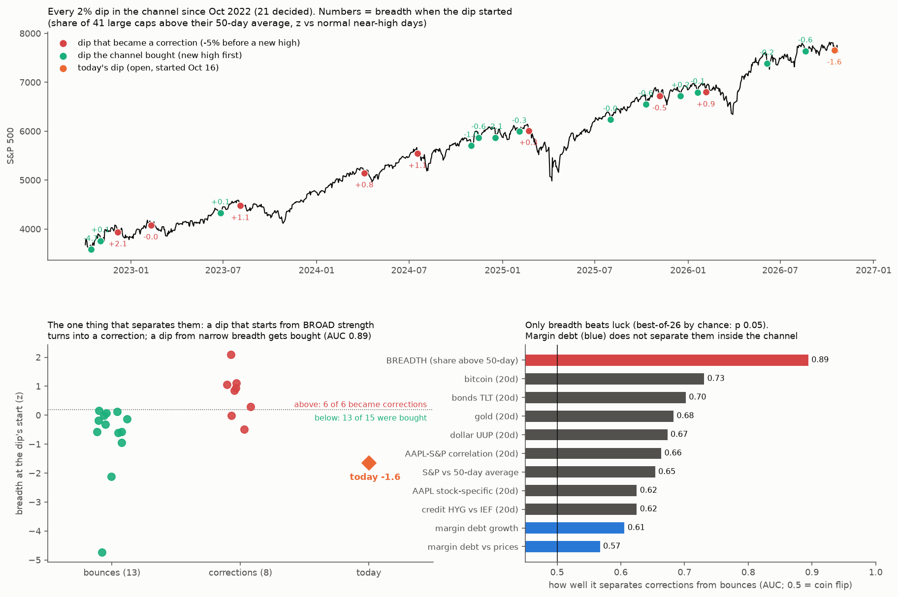
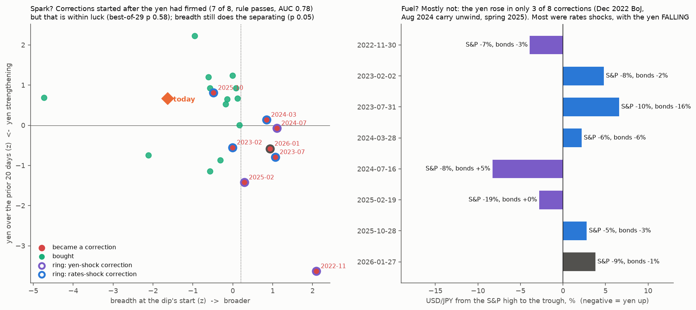

# What lines up before this channel's corrections? A theory, not a statistic

* **Owner, 2026-10-25:** "It won't make sense to back that far. This is a certain type of trade and environment. Even if the statistics is not robust enough. It's enough if we just establish very reasonable explanations for what is happening. If we have enough things lining up together that all can fall in a nice 'theory' or explanation."
* **Scope:** only the post-2022 channel (2022-10-13 to 2026-10-23).
* **Events** (from [spy-channel-reversion](../2026-10-25-spy-channel-reversion/)):

  | Type | Top dates |
  |---|---|
  | Three main corrections | **2023-07-31, 2025-02-19, 2026-01-27** |
  | Three minor pullbacks | 2024-03-28, 2024-07-16, 2025-10-28 |

* **Not a significance test.** The filter is consistency plus mechanism: an indicator counts only if it lines up across events **and** fits a causal chain with the others.

## Method (fixed before computing)
**Indicators, daily**, known at that day's close. Percentiles are trailing 252 days.

| Group | Indicators |
|---|---|
| **Leadership / rotation** | semis vs SPY (20-day log change of SMH/SPY); AAPL stock-specific 20-day return (residual vs S&P ex-AAPL); AAPL–S&P 20-day correlation; equal weight vs cap weight (RSP/SPY, 20 days); small caps vs SPY (IWM/SPY); defensives vs SPY (XLP/SPY) |
| **Breadth** | share of a 41-stock large-cap panel above its 50-day average; average pairwise 20-day correlation of that panel |
| **Dealers / flows** | SqueezeMetrics GEX percentile; DIX percentile; SPY dealer gamma (`gex_classic`) percentile (through 2026-10-09) |
| **Volatility structure** | VIX percentile; VIX/VIX3M (term structure); VVIX percentile; SKEW percentile; 20-day correlation of daily VIX change with the S&P return (spot-vol; normally about −0.8, and rising toward 0 means "spot up, vol up") |
| **Cross-asset** | TLT, UUP, BTC and GLD 20-day returns; HYG vs IEF (credit); KRE vs SPY (banks) |
| **Stretch** | S&P vs its 50-day average; S&P 20-day return |

**Event reading:**
* Each indicator's average over the 10 sessions ending at each top.
* It is shown as a z-score against its distribution on channel days when the S&P is within 3% of its 252-day high, i.e. against normal "near the high" days.

**"Lines up":** |z| ≥ 0.5 in the same direction before all 3 main corrections **and** at least 5 of the 6 events.

**Theory step:** the indicators that line up are arranged into a causal chain, and any that fit no chain are reported as loose ends.

**Today:**
* The same reading for the 10 sessions ending 2026-10-23.
* A similarity score: cosine similarity of today's z-profile to the average pre-top profile, over the indicators that line up, compared with every other channel day near the high.

## Round 1 results (`dossier.py`, `posthoc_types.py`; `out/profile.csv`, `out/lineup.csv`, `out/dossier.json`, `out/types.json`)
**Nothing lines up by the rule. No indicator is |z| ≥ 0.5 in the same direction before all 3 main corrections:**
* not in the 10 sessions before the top;
* not in the earlier window (sessions t−30 to t−11; post hoc check).

| Near misses | Before the 3 main corrections | Before all 6 events |
|---|---|---|
| VVIX high | 3 of 3 | 4 of 6 |
| Gold up | 2 of 3 | 4 of 6 |
| SKEW high | 2 of 3 | 4 of 6 |

**The three corrections looked different beforehand.** Cosine similarity of their 23-indicator pre-top profiles:
* Jul 2023 vs Feb 2025: −0.16
* Jul 2023 vs Jan 2026: −0.02
* Feb 2025 vs Jan 2026: +0.31

What each top looked like:
* **Jul 2023, "exhaustion":**
  * S&P stretched above its 50-day average (+1.1), broad breadth (+1.4), low VIX (−1.2);
  * spot and vol rising together (spot-vol correlation +1.5);
  * strong credit and banks; high GEX.
* **Feb 2025, "rotation under the surface":**
  * semis already lagging (−1.1, after DeepSeek), AAPL decoupled (correlation −1.1), defensives leading (+0.9);
  * gold (+1.2) and bonds (+0.9) bid; VIX elevated (+0.6); credit weakening (−0.8);
  * S&P below its usual stretch (−0.8).
* **Jan 2026, "broadening on a thin cushion":**
  * semis (+1.2), equal weight (+1.2), small caps (+1.4), defensives (+1.4) and gold (+1.5) all up;
  * AAPL lagging (−1.6);
  * low dealer gamma: GEX −1.4, SPY gamma −0.9, DIX −0.9.

**Today** (10 sessions to Oct 23) is most similar to **Feb 2025 (+0.47)** and the opposite of Jul 2023 (−0.46):
* semis lagging (−1.3), AAPL decoupled (−1.5), defensives leading (+1.7), small caps lagging (−1.3);
* breadth weak (−1.5), credit weakening (−1.5), low GEX (−1.1), VIX term structure up (+0.9), SKEW high (+1.1);
* S&P below its usual stretch (−1.4).
* Unlike Feb 2025, gold (−1.3) and bonds (−0.3) are not bid.

## Amendment 1 (round 2, owner-aligned and still channel-only): dip anatomy. Written before computing.
* **Why:** no common setup precedes the tops. The question a trader faces right now (S&P −2.5% from its Oct 6 high) is different: **is this dip the start of a correction, or a dip the channel will buy?** The channel has many more dips than corrections, so both outcomes are well represented.
* **Episode:** the first close ≥ 2% below the running 252-day high (high made on or after 2022-10-13), outside an open episode.
  * Outcome: **correction** if a close ≥ 5% below that high comes before a new high; **bounce** if a new high comes first.
  * An episode ends when its outcome is decided.
* **Reading:** each indicator's mean over the 5 sessions ending on the episode's first day, as a z-score as before.
* **Separates:** at least 5 of the 6 corrections on the same side of the bounces' median, including all 3 main corrections, with the corrections' mean differing from the bounces' mean by ≥ 0.5 SD.
* **Theory step and today:** as before. Today's episode began on the first close ≥ 2% below the Oct 6 high.

**Added by the owner before the dip anatomy was computed:** "Also that margin and debt thing u said before that can drive moves." Two indicators join the list, and are also reported for the pre-top profiles:
* **margin debt growth:** FINRA margin debt, year on year, from the macro panel ([channel-reversion-macro](../2026-10-15-channel-reversion-macro/), which found margin-debt surges before reversions after 2010).
* **margin debt vs prices:** margin-debt year-on-year growth minus the S&P's year-on-year growth for the same month. Leverage growing faster than prices is the cleaner proxy that [forced-flow](../2026-10-24-forced-flow/) D suggested.
* Both use a 2-month lag (FINRA publishes about three weeks after month end), so each day sees only what was public.

## Amendment 1 results (`dips.py`, `luck.py`, `figure.py`; `out/dips.csv`, `out/dip_profiles.csv`, `out/dip_separation.csv`, `out/luck.json`, `out/luck_auc.json`, `out/channel_dips.png`)

**Episodes:** 21 decided 2% dips: 8 corrections, 13 bounces.
* The corrections' highs are 2022-11-30, 2023-02-02, 2023-07-31, 2024-03-28, 2024-07-16, 2025-02-19, 2025-10-28 and 2026-01-27. That is the owner's 6 plus two early-channel ones.
* Today's dip is open: high 2026-10-06 at 7,818.93; the episode started 2026-10-16 at −2.04%.

**Reading of the rule:** with 8 corrections instead of 6, "at least 5 of 6" scales to **at least 7 of 8**, with all 3 main corrections included.

| | Breadth (share of 41 large caps above their 50-day) | Bitcoin, 20 days |
|---|---|---|
| Direction in corrections | **higher**: z +0.73 vs −0.76 for bounces (difference 1.5 SD) | lower: −0.60 vs +0.14 |
| Corrections beyond the bounce median | 7 of 8, all 3 main corrections | 7 of 8, all 3 main corrections |
| AUC | **0.89** | 0.73 |
| Best-of-26 luck check | **p 0.049** | p 0.82 (luck level) |

* Shuffling outcomes, about 1.9 indicators pass the count rule by chance, so the count alone means little. **Breadth is the only indicator whose effect size beats luck**, using a best-of-26 AUC check (5,000 shuffles).
* **Post hoc split** (threshold read off the data):
  * breadth z > 0.2 at the dip's start: **6 of 6 became corrections**;
  * breadth z ≤ 0.2: **13 of 15 were bought**.
* Margin debt does not separate the outcomes inside the channel (AUC 0.61 and 0.57). Corrections came at both low growth (2022–23) and high growth (2025–26).

## The theory: synchronized vs rolling
1. **A dip becomes a correction when it starts from broad strength.**
   * With most large caps above their 50-day average, positioning is crowded everywhere and nothing is under-owned.
   * A shock forces synchronized de-risking across the board. Examples: Jul 2023 (rates), Jul 2024 (the carry unwind after the small-cap squeeze), Feb 2025 (DeepSeek, then tariffs), Jan 2026.
2. **A dip from narrow breadth is a rolling correction already under way.**
   * Most stocks have already pulled back beneath a firm index, so sellers are largely done.
   * Money **rotates instead of leaving**: into AAPL, defensives or the laggards. That is what the AAPL quirks study saw now (semis −2.6% vs SPY, AAPL-specific +4.2%, defensives leading).
   * The index dip gets bought.
3. **How the other observations fit:**
   * The three main corrections had different setups (round 1) because the **shock** differed each time. The common factor is the state the shock hit: broad, crowded participation.
   * Margin debt is high in both outcomes in 2024–26: at most fuel for depth, not the spark (consistent with forced-flow D).
   * AAPL decoupling flagged many of these windows in the channel because rotation inside the index produces it. Rotation is the *bounce* signature, which is why it does not predict tops by itself.

## Today and the live call (written 2026-10-25, before the outcome is known)
* **Today's dip started from very narrow breadth:**
  * z **−1.6**: 39% of the panel above its 50-day on Oct 16 and 44% on Oct 23, against 64% on normal near-high days;
  * the second-lowest start of all 22 dips;
  * it sits on the **bounce** side, with rotation visible (AAPL, defensives).
* **Live call:** the S&P makes a new closing high above **7,818.93** before any close at or below **7,427.98** (−5% from the Oct 6 high).
  * Channel base rate: 13 of 21 bounced. With breadth z ≤ 0.2: 13 of 15.
  * **The theory is wrong if 7,427.98 comes first.**
* **What would change the reading before then:** breadth surging back above normal while the index stalls (a synchronized state), or the rotation stopping, with AAPL and defensives falling alongside semis.

## Amendment 2 (owner: "Can u check the yen too since yen trade also can be a drive of some sort"). Written before downloading or computing.
* **Mechanism:** the carry trade borrows cheap yen to buy higher-yielding and risk assets. A sharp yen rise (USD/JPY falling), or a jump in yen volatility, forces those positions to unwind, which means selling risk assets. Aug 2024 is the textbook case.
* **Data:** Yahoo `JPY=X` (USD/JPY, daily), aligned to S&P sessions.
* **Indicators (all known at that day's close):**

  | Indicator | Definition | Carry stress when |
  |---|---|---|
  | yen 20-day | 20-day log change of USD/JPY | **negative** (yen strengthening) |
  | yen 5-day | 5-day log change of USD/JPY | negative (sharp moves) |
  | yen volatility | trailing-252 percentile of USD/JPY 20-day realized volatility | high |

* **Tests:**
  * **(a) Spark:** the same dip-anatomy rule as Amendment 1 (at least 7 of 8 corrections beyond the bounce median, all 3 main corrections, |difference| ≥ 0.5 SD), plus AUC. The best-of-indicators luck check is re-run with all 29 indicators.
  * **(b) Before the tops:** the yen indicators in the 10-day pre-top profiles of the 6 events (Round 1 method).
  * **(c) Fuel:** USD/JPY's log change from each dip's start to its outcome date, corrections vs bounces, plus its correlation with the correction's depth. Descriptive.
* **Today:** the yen readings for the open episode and for the last 10 sessions.
* **Reading:**
  * The yen is a **spark** if (a) passes.
  * It is **fuel** if the yen strengthens in at least 6 of 8 corrections during the decline, against at most half of the bounces.
  * Otherwise it is **context** only.

## Amendment 2 results: the yen (`yen.py`, `posthoc_shock.py`, `figure_yen.py`; `out/yen.json`, `out/yen_episodes.csv`, `out/shock_types.json`, `out/yen_carry.png`)

**(a) Spark: passes the pre-registered rule, but not the luck check.**
* Corrections started after the yen had **firmed** over the prior 20 days: z −0.76 vs +0.49 for bounces; 7 of 8 corrections beyond the bounce median, all 3 main corrections included; AUC 0.78.
* **Best-of-29 luck check: p 0.58.** Breadth is still the only separator beyond luck (p 0.051 with 29 indicators).
* The yen 5-day change (AUC 0.72) and yen volatility (AUC 0.77) do not pass the rule.
* By the pre-registered reading the yen counts as a "spark", but it is a weak one. It adds little once breadth is known: the corrections with the firmest yen (Nov 2022, Feb 2025) also had above-normal breadth.

**(b) Before the tops** (10-day pre-top z, yen 20-day): the yen was firming before Jul 2023 (−1.0) and Feb 2025 (−1.5), but not before Jan 2026 (+0.3), Jul 2024 (+0.8) or Oct 2025 (+0.8).

**(c) Fuel: no.**
* The yen strengthened during only **2 of 8** corrections (start to decided) vs **9 of 13** bounces. The median USD/JPY move was +1.6% in corrections and −1.2% in bounces.
* No link with depth (correlation 0.21).

**What each correction's shock was (post hoc, descriptive; USD/JPY and TLT from high to trough):**

| Correction | S&P | USD/JPY | TLT | Shock |
|---|---|---|---|---|
| Dec 2022 | −7% | **−3.9%** | −3% | **yen** (BoJ yield-curve-control tweak) |
| Feb 2023 | −8% | +4.8% | −2% | rates |
| Jul–Oct 2023 | −10% | +6.6% | **−16%** | **rates** |
| Apr 2024 | −5.5% | +2.2% | −6% | rates |
| Jul–Aug 2024 | −8.5% | **−8.3%** | +5% | **yen** (carry unwind) |
| Feb–Apr 2025 | −19% | −2.8% | 0% | yen / haven (tariffs) |
| Nov 2025 | −5% | +2.8% | −3% | rates |
| Jan–Mar 2026 | −9% | +3.8% | −1% | other |

## Updated theory: state × shock
1. **The state decides whether a dip turns into a correction:** broad participation means crowded and fragile (breadth, the one separator beyond luck).
2. **The shock comes through financing costs, by one of two routes:**
   * **US rates** (yields up, yen down): 4 of 8;
   * **the yen** (carry unwind, yen up): 3 of 8.
   * Both make leverage more expensive or force it to unwind. That fits margin debt being high in both outcomes: the fuel is always there, and the state decides whether it ignites.
3. **The two corrections that started from narrow breadth (Feb 2023, Nov 2025) were both rates shocks, and both were shallow (−7.8%, −5.1%).** A strong enough rates shock can break even a rolling, narrow tape, but only into a shallow correction.

## Today, updated
* **Yen:**
  * USD/JPY 156.8, −0.7% since the Oct 6 high;
  * yen 20-day z at the dip's start +0.67 (bounce side);
  * yen volatility at the 20th percentile (calm).
  * **No carry stress.**
* **Rates are the live risk:**
  * the 10-year was 4.99% at end-September (4.60% in July), with the Fed hiking;
  * TLT 20-day z at the dip's start −0.75.
  * The only narrow-breadth corrections in the channel were rates shocks.
* **The live call is unchanged:** a new high above 7,818.93 before a close at or below 7,427.98.
* **The main way it fails:** a rates shock (yields breaking higher, TLT falling hard). Even then, the channel's history points to a shallow correction rather than a deep one.

## Amendment 3 (owner: "Fed meeting next week also gold and oil are making movements… Should we do a multivariate here like we did before. Do it"). Written before downloading oil or computing anything new.
**New variables** (added to the 29; known at each day's close):

| Variable | Definition |
|---|---|
| oil 20-day | 20-day log change of WTI front month (Yahoo `CL=F`) |
| oil volatility percentile | trailing-252 percentile of oil's 20-day realized volatility |
| FOMC within the next 10 sessions | 1 if a scheduled FOMC decision falls in the 10 sessions after the day |
| sessions to the next FOMC decision | count of sessions |
| sessions since the last FOMC decision | count of sessions |

* **FOMC decision dates** are the scheduled meetings' second days:
  * 2022: 01-26, 03-16, 05-04, 06-15, 07-27, 09-21, 11-02, 12-14
  * 2023: 02-01, 03-22, 05-03, 06-14, 07-26, 09-20, 11-01, 12-13
  * 2024: 01-31, 03-20, 05-01, 06-12, 07-31, 09-18, 11-07, 12-18
  * 2025: 01-29, 03-19, 05-07, 06-18, 07-30, 09-17, 10-29, 12-10
  * 2026: 01-28, 03-18, 04-29, 06-17, 07-29, 09-16, **10-28**, 12-09
* Gold is already in the set (`gold (20d)`).

**Univariate:** AUC for each new variable at the dip's start (corrections vs bounces), and the best-of-all-indicators luck check re-run with all 34.

**Multivariate:** 21 decided dips, so every fitted model is scored by **leave-one-dip-out** cross-validation (LOO AUC).

| Model | What it is |
|---|---|
| **M0** | breadth alone (logistic) |
| **M1, theory composite, no fitting** | equal-weight sum of z-scores with signs fixed by mechanism: + breadth (crowded), − TLT 20-day (rates pressure), − yen 20-day (yen firming), + oil 20-day (inflation/rates), + gold 20-day (hedging demand), + FOMC within 10 sessions (event shock), + margin debt vs prices (fuel) |
| **M2** | ridge logistic on all 34 indicators (penalty 1 on standardized inputs) |
| **M3** | inside each fold, pick the 3 indicators with the highest univariate AUC on the training dips, then ridge logistic: "stack the best few" without leakage |

* **Pass:** a multivariate model (M1, M2 or M3) beats M0's LOO AUC by ≥ 0.05. Otherwise the model stays "breadth alone".
* **Today:** each model's probability that today's open dip becomes a correction, fitted on all 21. M1 is reported as a percentile against the 21 dips.
* **Sensitivity:** ridge penalties of 0.3 and 3 are also reported.
