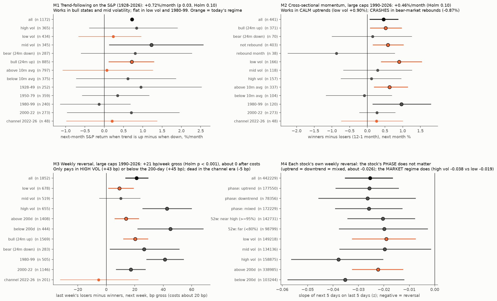

# Momentum and mean reversion, split by regime, trend and stock phase

* **Owner, 2026-10-25:** "But momentum reversion being a main quant strategy why we didn't derive anything useful from it. That mathematician founded his whole fund based upon it. Can u research it deeply and try some tests on it. And test per regimes and stock phases and trends, don't lump data analysis together."
* **Builds on:**
  * [sp-multivariate](../2026-10-15-sp-multivariate/): momentum/RSI was the one family that predicted S&P 10% corrections (AUC 0.68);
  * [technical-indicators](../2026-10-16-technical-indicators/): mostly null;
  * [forced-flow](../2026-10-24-forced-flow/): reversal of forced moves;
  * [intraday-hours](../2026-10-25-intraday-hours/): the "open personality" persists.

## Part 1: what is known (research map)
| Horizon | Effect | Evidence | Where it works and where it fails |
|---|---|---|---|
| Intraday | **Same-hour persistence:** a stock's return in a given half-hour repeats at the same time on later days | Heston, Korajczyk & Sadka (2010, *JF*) | Driven by recurring flows, such as trading at fixed times |
| 1 day to 1 week | **Short-term reversal:** last week's losers beat last week's winners | Lehmann (1990, *QJE*); Jegadeesh (1990, *JF*); Lo & MacKinlay (1990, *RFS*) | It is a **liquidity-provision** premium, so it is **largest when volatility is high and liquidity scarce** (Nagel 2012, *RFS*, "Evaporating liquidity"). It dies after costs in calm, liquid markets |
| 1 month | 1-month reversal | Jegadeesh (1990) | As above |
| 3–12 months | **Cross-sectional momentum:** past winners beat past losers | Jegadeesh & Titman (1993, *JF*); Carhart (1997); near-52-week-high stocks keep winning: George & Hwang (2004, *JF*) | **Crashes** in "panic" states: after bear markets, when volatility is high and the market rebounds, losers rip (Daniel & Moskowitz 2016, *JFE*). Scaling by volatility helps (Barroso & Santa-Clara 2015, *JFE*) |
| 1–12 months, own past | **Time-series momentum (trend-following):** an asset's own past-year return predicts its next month | Moskowitz, Ooi & Pedersen (2012, *JFE*); Hurst, Ooi & Pedersen (2017, a century of trend-following) | Works best in long trends and as "crisis alpha" in drawn-out bear markets. Whipsaws in choppy, range-bound markets |
| Multi-year | Long-term reversal | De Bondt & Thaler (1985, *JF*) | Weak in modern large caps |

**Renaissance / Jim Simons:**
* Public accounts (Zuckerman 2019, *The Man Who Solved the Market*) describe many weak, short-horizon price signals: reversion over hours to days, plus some trend. They are combined across thousands of instruments, run with very low trading costs, high turnover and leverage.
* The edge comes from **breadth of signals and execution**, not from one big pattern. Their exact methods are not public.
* A daily-bar test on 81 large caps can find **whether the raw effects exist and in which regimes**. It cannot reproduce Medallion.

## Part 2: tests (pre-registered here, before any computation)
**Data:**
* ^GSPC daily since 1928.
* 41 large caps (daily, from listing, back to 1970 for many).
* 40 more large caps from 2019, making 81.
* Yahoo hourly bars for 51 tickers (2023-11 to 2026-10).
* All are today's large caps, so the sample is **survivorship-biased**. That biases cross-sectional momentum down (dead losers are missing) and reversal up. It is noted wherever relevant.

**Regimes**, all known at the time of the signal:

| Regime | Definition |
|---|---|
| Market trend | S&P above or below its 200-day average (10-month average for monthly tests) |
| Market state | **bull** if the S&P's 24-month return > 0, otherwise **bear** (Daniel–Moskowitz) |
| Rebound | bear state **and** the S&P up over the signal month: the momentum-crash condition |
| Volatility | S&P 63-day realized volatility as a percentile of its trailing 10 years, in thirds (low / mid / high) |
| Era | 1928–49, 1950–79, 1980–99, 2000–22, and **the channel 2022-10 to 2026** |
| Stock phase (per stock, daily) | **uptrend** = close > 50-day > 200-day; **downtrend** = close < 50-day < 200-day; **mixed** = otherwise. Separately: **near high** (≥ 95% of its 252-day high) vs **far** (< 80%) |

**Tests**, each with a **primary** statistic (Holm-corrected across the five) and **regime cells** (reported with denominators and block-bootstrap 90% intervals):

| Test | Design | Primary prediction | Regime contrasts (each with a predicted sign) |
|---|---|---|---|
| **M1 Time-series momentum, S&P 1928–2026, monthly** | sign of the past 12-month return; next month's return when long minus when short. Secondary: 1- and 3-month lookbacks | > 0 | the edge is larger in **high volatility** and in **bear states** (crisis alpha) |
| **M2 Cross-sectional momentum, large caps 1990–2026, monthly** | rank by the return from t−12 to t−1 months; next-month return of the top third minus the bottom third, equal weight | > 0 | lower in **bear states**; **negative in rebound months** (crash) |
| **M3 Short-term reversal, large caps 1990–2026, weekly** | rank by the past 5-day return; next-5-day return of the bottom third minus the top third. Gross, and net of 10 bp per leg per week | gross > 0 | **larger in high volatility** (Nagel); larger below the 200-day |
| **M4 Own-stock autocorrelation by phase, large caps 1990–2026, daily** | slope of the next-5-day z-return on the past-5-day z-return, pooled within stock (z = return ÷ trailing 20-day volatility) | < 0 (weekly reversal) | **weaker reversal / more continuation in uptrends and near highs** (George–Hwang) than in downtrends and far from highs |
| **M5 Same-hour persistence, 51 tickers, hourly, 2023-11 to 2026-10** | each day and hour slot (7 slots), rank stocks by their mean return in that slot over the previous 20 days; today's slot return of the top third minus the bottom third | > 0 | by slot (first hour, midday, last half hour); by volatility third |

**Null:** block bootstrap (12-month blocks for monthly tests, 20-day blocks for daily and weekly), 4,000 draws. Primary p-values are one-sided in the predicted direction.

**Pass:** a primary passes if Holm-adjusted p < 0.05. A regime contrast is "supported" if it has the predicted sign with bootstrap p < 0.05. All cells are reported regardless.

**Today:** the current regime on each axis, and which effects are "on" or "off" under it.

## Results (`momentum.py`, `m1_fix.py`, `today.py`, `figure.py`; `out/momentum.json`, `out/m1.json`, `out/cells.csv`, `out/today.json`, `out/momentum_regimes.png`)

**A correction before reading the results:**
* `momentum.py` first computed M1 as "strategy minus buy-and-hold", which is not the registered statistic. `m1_fix.py` computes the registered one: the next-month return when the 12-month sign is + minus when it is −.
* M1 numbers below come from `out/m1.json`. The M1 entries in `out/momentum.json` are superseded.
* For M2–M5 the era cell labelled "1980-99" covers 1990–99 only.

**Primaries (Holm across the five):**

| Test | Result | Raw p | Holm p | Verdict |
|---|---|---|---|---|
| **M3 weekly reversal** (gross) | **+21 bp/week**; net of 20 bp costs **+1 bp** | < 0.001 | < 0.001 | **pass** (gross); about 0 after costs |
| **M4 own-stock weekly reversal** | slope **−0.025** | < 0.001 | < 0.001 | **pass**: tiny (2.5% of last week's move reverses) |
| M1 trend-following, S&P | +0.72%/month (815 long / 357 short months) | 0.033 | 0.10 | not after Holm |
| M2 cross-sectional momentum | +0.46%/month (441 months, median 40 stocks) | 0.037 | 0.10 | not after Holm |
| M5 same-hour persistence | +0.6 bp per slot | 0.08 | 0.10 | no |

**By regime (90% block-bootstrap intervals; see the figure):**
* **M1 trend-following:**
  * works in **bull states** (+0.71%/month, interval above 0) and mid volatility (+1.22%);
  * flat in low volatility (+0.23%), in 1980–99 (−0.14%) and in the channel (+0.20%, only 6 short months).
  * The predicted contrasts (high vol > low vol; bear > bull) are not supported (p 0.25, 0.47).
* **M2 cross-sectional momentum:**
  * works in **calm uptrends**: low volatility **+0.90%** (interval above 0), bull +0.52%, above the 10-month average +0.63%;
  * fails in high volatility (+0.11%) and below trend (−0.09%);
  * **crashes in bear-market rebound months: −0.87%** (38 months, 55% negative), the Daniel–Moskowitz pattern;
  * weak in 2000–22 (+0.27%) and the channel (+0.26%).
  * Bear < bull is in the predicted direction but not significant (p 0.30).
* **M3 weekly reversal:**
  * concentrated in **high volatility (+43 bp)** and **below the 200-day (+45 bp)**. Both contrasts are **supported** (p 0.003, 0.018). This replicates Nagel.
  * Low volatility +9 bp, above the 200-day +14 bp. After about 20 bp of costs it pays only in stress.
  * **Dead in the channel era (−5 bp).**
* **M4 own-stock reversal by stock phase:** the **stock's own phase does not matter**:
  * uptrend −0.026, downtrend −0.026, mixed −0.026; near the 52-week high −0.020, far from it −0.020;
  * neither phase contrast is supported (p 0.48, 0.51).
  * The **market** regime does matter: high volatility −0.038 vs low −0.019; below the 200-day −0.035 vs above −0.022.
* **M5 same-hour persistence:**
  * positive in the **last two hours** (14:30–15:30 +1.8 bp, 15:30–close +2.4 bp, intervals above 0);
  * negative in the first hour (−1.9 bp);
  * stronger in high volatility (+2.3 bp). Small.

## Verdict: why we found little before, and what is useful
1. **The effects are real but regime-specific, and they offset when lumped together.**
   * Momentum, trend-following and cross-sectional, pays in **calm bull markets**.
   * Reversal pays in **high-volatility, below-trend markets**, and momentum crashes in rebounds out of bear markets.
   * Averaging across regimes dilutes both.
2. **Per trade, the effects are small** (basis points per week), so they need many stocks and very low costs. That is the Renaissance recipe: thousands of weak signals combined, with execution as the edge. A single-index or single-stock rule built on them is weak.
3. **The stock's own phase (trend, distance from its high) does not change short-term reversal. The market's volatility and trend do.** So regime first, stock phase second.
4. **The channel era (2022–26) is unusual.** Weekly reversal vanished (−5 bp), and cross-sectional momentum and trend-following were weak. That fits a concentrated, AI-led tape in which leaders keep leading and laggards keep lagging over weeks.

## Today (Oct 23 close)
* **Regime:** S&P above its 200-day; **bull** state (24-month return > 0, 12-month +13.8%); **low-volatility third**; not a rebound.
* **On:**
  * cross-sectional momentum (its best regime historically, +0.90%/month in low volatility);
  * the S&P trend signal is **long**.
* **Off:** short-term reversal (+9 bp gross in low volatility, below costs).
* **Momentum leaders and laggards among the 81 large caps** (12-1 month, `out/today.json`):
  * leaders: MU, INTC, AMD, AMAT, MRK, TXN, CAT, CSCO, DE, COP;
  * laggards: INTU, ORCL, NKE, NFLX, ADBE, ACN, NOW, HD, BKNG, ISRG.
* **Stock phases:**
  * AAPL, MSFT, XOM, UNH and LLY are in uptrends;
  * NVDA, AMZN, GOOGL, META and TSLA are mixed;
  * AVGO is in a downtrend.
  * Across the 81: 37% uptrend, 12% downtrend, 51% mixed. That fits the narrow-breadth reading.
* **Caveat:** survivorship bias. Today's large caps exclude the losers that dropped out, which biases momentum down and reversal up.
