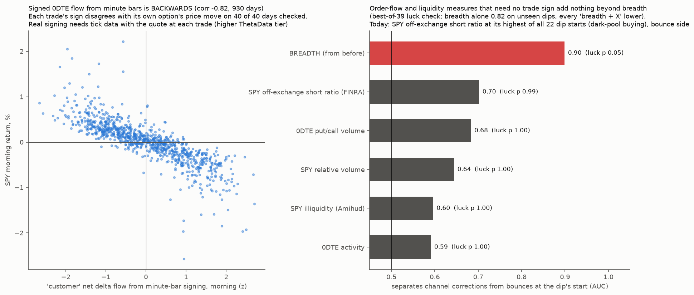

# Order flow: what quants know, and what holds in our data

* **Owner, 2026-10-25:** "Quants integrate order flow and there are abnormalities and inefficiencies and rules that help describe and predict price action. Research it and try apply it."
* **Builds on:**
  * [channel-correction-theory](../2026-10-25-channel-correction-theory/): breadth separates channel corrections from bounces;
  * [forced-flow](../2026-10-24-forced-flow/): moves made on low-gamma days fade;
  * [spy-intraday-multiday](../2026-10-16-spy-intraday-multiday/): its 5-minute "flow leads SPY" test FL was designed but never run, because the owner gave that question to a blind thread. **This study does not run FL.** It uses other horizons.

## Part 1: the research map (stylized facts, with sources)
| # | Rule | Evidence | Status in the literature |
|---|---|---|---|
| R1 | **Order flow moves price at the same moment.** Signed order imbalance explains a large share of same-period returns | Kyle (1985, *Econometrica*); Chordia, Roll & Subrahmanyam (2002, *JFE*, "Order imbalance, liquidity, and market returns"); Cont, Kukanov & Stoikov (2014, *J. Financial Econometrics*): order-flow imbalance explains most 10-second price changes | Robust; it describes price action rather than predicting it |
| R2 | **Impact is concave and largely transient.** A large order moves price by about √(size), and part of that reverts after it finishes | Bouchaud, Gefen, Potters & Wyart (2004, *Quantitative Finance*); Tóth et al. (2011, *Physical Review X*, square-root law); Hendershott & Menkveld (2014, *JFE*, "Price pressures") | Robust. **Uninformed flow-driven moves partly revert** |
| R3 | **Order flow is persistent** (long memory in trade signs, because big orders are split), yet prices stay close to unpredictable because liquidity adapts | Lillo & Farmer (2004, *SNDE*, "The long memory of the efficient market"); Bouchaud et al. (2004) | Robust. Flow persistence is not a free price prediction |
| R4 | **Imbalance predicts short-horizon returns**: positive for informed flow, reversing for liquidity pressure | Chordia & Subrahmanyam (2004, *JFE*): daily imbalance predicts next-day stock returns positively | Mixed; small and horizon-dependent |
| R5 | **Option order flow is informative.** Buyer-initiated put-call volume predicts stock returns | Easley, O'Hara & Srinivas (1998, *JF*); Pan & Poteshman (2006, *RFS*); Muravyev (2016, *JF*, order flow and option returns) | Robust in single names; weaker for index products |
| R6 | **Dealer hedging creates mechanical flows**: short gamma gives intraday momentum into the close; long gamma gives dampening and pinning at expiry; leveraged-ETF rebalancing lands at the close | Baltussen, Da, Lammers & Martens (2021, *JFE*); Ni, Pearson & Poteshman (2005, *JFE*); Cheng & Madhavan (2009); Dim, Eraker & Vilkov (0DTE gamma, working paper) | Documented. **Our forced-flow study confirmed the fade side; last-half-hour momentum died in 2023–26** |
| R7 | **Retail marketable flow predicts returns over weeks** (sub-penny trade identification) | Boehmer, Jones, Zhang & Zhang (2021, *JF*) | Needs tick data; not testable here |
| R8 | **Flow toxicity** (VPIN) rises before liquidity events | Easley, López de Prado & O'Hara (2012, *RFS*); disputed by Andersen & Bondarenko (2014, *JFM*) | Contested |
| R9 | **Overnight vs intraday tug of war** between investor clienteles | Lou, Polk & Skouras (2019, *JFE*) | Robust; **confirmed in our intraday-hours study** (each stock's "open personality") |
| R10 | **Illiquidity predicts returns and crashes**: price moves per dollar traded (Amihud) rise when liquidity is fragile | Amihud (2002, *JFM*) | Robust in the cross-section; noisier as a timing tool |

## Part 2: our own order flow, SPY 0DTE options, 2023-01-03 to 2026-10-15 (pre-registered here)
* **Data:** the owner's private ThetaData minute files for same-day SPY options: 15 strikes either side, volume, VWAP and NBBO. Licensed, so they stay out of this repo; only aggregates are written.
* **Definitions** (reused unchanged from spy-intraday-multiday):
  * **Trade sign:** s = clip((VWAP − mid) / half-spread, −1, 1) for each contract-minute.
  * **Customer net delta flow:** F = Σ s × volume × delta × 100, in SPY share-equivalents. Positive means customers bought upside (calls bought or puts sold), so dealers were left short delta and must buy SPY to hedge.
  * **Customer net gamma flow:** G = Σ s × volume × gamma × 100. Positive means customers bought options, leaving dealers shorter gamma.
  * **SPY minute price:** from put-call parity.
* **Segments:**
  * morning = 09:35 to 12:00; afternoon = 12:00 to 15:59 (parity prices);
  * next day = SPY's official close-to-close (Yahoo).
  * Flows are z-scored against their own trailing 60 days, since 0DTE volume grew over the period.
* **Tests** (day-block bootstrap with 20-day blocks; years 2023/24/25/26 reported separately):

  | Test | Question | Prediction | Basis |
  |---|---|---|---|
  | A1 | Does morning flow z go with the morning return? | slope > 0, one-sided. A sanity check of the signing | R1 |
  | A2 | Does morning flow z predict the afternoon return (controlling for the morning return)? | two-sided | R4/R5 informed (+) vs R2 pressure reversal (−) |
  | A3 | Does the day's total flow z predict the next day's return (controlling for the day's return)? | two-sided | |
  | A4a | Do flow-driven morning moves revert in the afternoon? Afternoon return on morning return × [top-quintile \|flow z\|] | coefficient < 0, one-sided | R2 |
  | A4b | Does dealer short gamma bring continuation? Afternoon return on morning return × [customer gamma-flow z > 0] | coefficient > 0, one-sided | R6 |

* **Pass:** p < 0.05, **and** the same sign in at least 3 of the 4 years.

## Part 3: order flow at the start of the channel's dips (applies Part 2 to the main question)
* **Measures** (5 sessions ending at each dip's start; 21 decided dips plus today's):

  | Measure | Definition |
  |---|---|
  | 0DTE customer net delta flow | 5-day sum, z vs its trailing 60 days |
  | 0DTE customer net gamma flow | 5-day sum, z vs its trailing 60 days |
  | SPY Amihud illiquidity | 20-day mean of \|return\| / dollar volume, as a trailing-252 percentile |
  | SPY relative volume | 5-day / 60-day average volume |
  | SPY FINRA short-volume ratio | short / total volume, 5-day mean, as a trailing-252 percentile (FINRA files run to 2026-10-14) |

* **Statistics:**
  * AUC either direction (no direction is assumed);
  * a best-of-all luck check that includes the 34 earlier indicators;
  * whether any of these adds to breadth: leave-one-dip-out logistic with breadth plus the new measure vs breadth alone.
* **Today:** the open dip started 2026-10-16. 0DTE data end on Oct 15, FINRA on Oct 14, so today's reading uses the available days (at least 3 of 5).

## Amendment 1: the signing convention was wrong. Diagnosed without using returns; fixed before re-running.
**Run 0** (multiday's convention: mid = average of minute t's and minute t+1's quote rows) gave **corr(morning flow z, morning return) = −0.82**. Every year was negative.
* Customers appeared to sell calls and buy puts whenever SPY rose. No real flow is that strongly anti-price.
* That points to a quote-timing artefact. Run-0 outputs are kept as `out/*_v0`.

**Diagnostic** (`quote_alignment.py`, `out/quote_alignment.json`; 40 days, option prices only, no SPY returns):
* For contract-minutes with trades, the mid closest to the minute's VWAP is **minute t−1's quote row 61% of the time**, against 16% for minute t and 19% for minute t+1.
* So a quote row stamped t is the **end** of minute t (the start of t+1), while the trades in OHLC row t happened during minute t.
* The run-0 average of t and t+1 therefore looked about one minute ahead. When 0DTE prices drift by more than the spread each minute (VWAP falls inside a single quote snapshot only about 14% of the time), that forward look mislabels trades as sells in up-moves for calls and as buys for puts.

**Fix:** sign against the average of minute t−1's and minute t's mid, i.e. the start and the end of the trade minute. That is centred on the trades, so drift cancels to first order. Everything else is unchanged.
* A1 is the pre-registered sanity check. If it is still ≤ 0, minute-level option signing is judged unreliable here, and Part 3 drops the signed-flow measures.
* **Caveat:** with only minute snapshots, any signing of 0DTE options is noisy, because prices move several ticks within a minute.

## Amendment 1 result: **the sanity check fails again. Signed option flow is unreliable in this data.**
| Run | corr(morning flow z, morning return) | A1 coefficient by year (2023 / 2024 / 2025 / 2026) |
|---|---|---|
| Re-run with the centred mid (`out/tests_v1.json`) | still **−0.82** | −0.0040 / −0.0033 / −0.0040 / −0.0036 |

**Tick-level validation was not possible:** ThetaData answers trades, trades-with-quotes and 1-second quotes with "requires a STANDARD subscription; you only have VALUE".

**Own-price check** (`sign_check.py`, `out/sign_check.json`; option prices only):
* If trade signs were right, buying would lift the option's own mid within the same minute, so corr(sign, own mid change) would be > 0.
* It is **negative on all 40 sampled days** under both conventions: centred −0.06, run-0 forward −0.11.
* **Minute-bar signing of 0DTE options systematically labels trades against the price move.** Within a minute the price drifts by several ticks, so VWAP lags the quote path. Summed across strikes and weighted by delta, that bias becomes the −0.82.

**Consequences, by the rule fixed in Amendment 1:**
* **A1 fails.** A2–A4 are computed (`out/tests_v1.json`), but they are **void**: their input is contaminated, so they are not interpreted.
* Part 3 **drops the signed-flow measures**.
* **A practical warning:** "options flow" built from minute bars, as many retail dashboards do, can carry the opposite sign of the real flow. Real signing needs trade-by-trade data with the quote at each trade.

## Amendment 2: unsigned order-flow measures for Part 3. Written before computing.
Part 3 keeps its pre-registered unsigned measures (SPY Amihud illiquidity, SPY relative volume, SPY FINRA short-volume ratio) and adds two that need no trade sign:

| Measure | Definition |
|---|---|
| 0DTE put/call volume ratio | 5-day sum of put volume / call volume (minute files), as a trailing-252 percentile |
| 0DTE activity | 5-day / 60-day average of 0DTE contract volume |

The statistics are unchanged:
* AUC either direction;
* best-of-all luck check, including the 34 earlier indicators;
* leave-one-dip-out logistic with breadth plus the measure vs breadth alone.

Today's dip uses the available days: 0DTE data run to Oct 15, FINRA to Oct 14.

## Part 3 results (`dips_flow.py`, `figure.py`; `out/dips_flow.json`, `out/dips_flow_features.csv`, `out/order_flow.png`)

| Measure at the dip's start | AUC | Direction in corrections | Best-of-39 p | Breadth + this, LOO AUC (breadth alone 0.82) | Today, percentile among dips |
|---|---|---|---|---|---|
| SPY FINRA short ratio | 0.70 | lower | 0.99 | 0.78 | **100th** (the highest of all 22) |
| 0DTE put/call volume (16 dips with data) | 0.68 | lower | 1.00 | 0.70 | 81st |
| SPY relative volume | 0.64 | lower | 1.00 | 0.80 | 24th |
| SPY Amihud illiquidity | 0.60 | lower | 1.00 | 0.81 | 52nd |
| 0DTE activity (17 dips with data) | 0.59 | higher | 1.00 | 0.79 | 59th |

* Breadth stays the only measure beyond luck (best-of-39 p 0.046).
* **None of the unsigned order-flow or liquidity measures separates the outcomes, and none improves on breadth.**
* **Today's context:** SPY's off-exchange short ratio over the 5 sessions to Oct 14 is its highest at any dip start. Under the DIX reading of that data, market makers shorting to fill buy orders means buying under the surface. That points the same way as breadth (bounce side), but it is luck-level evidence.

## Verdict
1. **Research map (Part 1):**
   * The robust order-flow rules mostly *describe* price, not predict it: flow moves price at the same moment (R1); impact is concave and partly transient (R2); flow persists while prices stay close to random (R3).
   * Predictive edges are small and specific: informative option flow in single names (R5), mechanical dealer and rebalancing flows (R6), and clientele effects overnight vs intraday (R9).
2. **What we had already confirmed earlier:**
   * R2/R6 in [forced-flow](../2026-10-24-forced-flow/): low-gamma moves fade, and calendar forced-flow days fade;
   * R9 in [intraday-hours](../2026-10-25-intraday-hours/): each stock's "open personality" persists.
3. **What we could not test properly:** signed option order flow (R4/R5).
   * Minute-bar signing of 0DTE options comes out **backwards**: corr −0.82 with price, and every trade sign disagrees with its own option's price move on 40 of 40 days.
   * Tick-level data (trades with quotes) needs ThetaData's Standard tier, which we do not have.
   * **This is a warning about minute-bar "options flow" dashboards.**
4. **Applied to the channel:** unsigned flow and liquidity measures add nothing beyond breadth. The channel theory is unchanged.
5. **Next step if the owner wants signed flow:**
   * a tick data source, i.e. a ThetaData Standard upgrade, or Databento OPRA trades and quotes (spending needs the owner's approval);
   * then a proper Pan–Poteshman test (opening buy volume by side) and a dealer-hedging-flow test.
