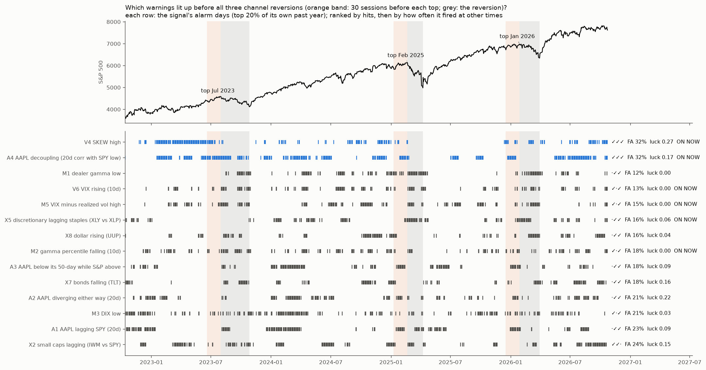

# What warns that the S&P is about to revert inside its rising channel?

**Agent / session:** Claude, claude.ai session for the owner, 2026-10-25
**Type:** pre-registered test of 24 candidate warnings in four families, with family-wise error control. This file was pushed before any outcome was computed.
**Builds on:**
* sp-multivariate (10% corrections, weekly: only a broken trend warned; options and volatility structure added nothing after 2019);
* forced-flow (forced moves fade);
* spy-channel (the owner's 2026 channel).

**Verdict: nothing passes the pre-registered bar. The owner's AAPL hunch is the one signal that stands out.**
* **Only 2 of 28 signals fired before all three reversions,** about the 2.6 expected by luck:
  * **SKEW high:** on 32% of other days, and pullbacks were *less* likely when it was on, so it is not a warning;
  * **AAPL decoupling from SPY** (20-day correlation in the bottom fifth of its past year).
* **AAPL decoupling** fired before all three reversions and all three minor pullbacks (6 of 6), with 16–29 sessions of lead.
  * When on, a pullback of 5% or more started within 30 sessions 36% of the time, vs 12% when off (base rate 22%). That difference is post-hoc, with circular-shift p 0.024.
  * **Today the AAPL–SPY correlation is −0.17,** its lowest in a year and lower than before any of the six channel tops.
* **Reading:** with six events this is a lead to watch, not a tested rule. It is right more often than chance, and it is on now.

## Question
* Since the Oct 2022 low the S&P has risen in a channel, with reversions inside it: Jul–Oct 2023, Apr 2024, Jul–Aug 2024, Feb–Apr 2025 and Feb–Mar 2026.
* What, observable beforehand, warns of the next one?
  * microstructure and forced flow;
  * momentum and trend;
  * volatility structure;
  * other ETFs that turn first.
* **Why not test on the channel alone:** this channel has about 5 reversions, too few for a test. The test uses every day since mid-2011 on which the S&P was near its highs. The 2022–2026 reversions and today's readings are then shown descriptively.

## Design
* **Data:**
  * Yahoo daily ^GSPC, SPY, ^VIX, ^VIX3M, ^VIX9D, ^VVIX, ^SKEW, and the ETFs HYG, IEF, IWM, RSP, SMH, XLY, XLP, TLT, UUP, KRE, BTC-USD. Dividend-adjusted closes are used for the ETFs.
  * SqueezeMetrics GEX and DIX.
  * Everything is as known at day t's close.
* **Universe:** trading days from 2011-06-01 to 2026-09-24 on which the S&P closed **within 5% of its 252-day high** (near the top of the channel). All days are also reported.
* **Outcome (primary):** within the next 20 sessions, the S&P closes at least **5% below day t's close**.
* **Outcome (secondary):** at least 8% below.

**Predictors.** Each has its direction fixed here; "risk when" means a higher risk of a reversion. Percentiles are trailing 252-day.

| Family | Predictor | Risk when |
|---|---|---|
| **M** microstructure / forced flow | M1 S&P dealer gamma (GEX) percentile | low |
| | M2 10-day change in the GEX percentile | falling (pin released) |
| | M3 DIX percentile | low (less dark-pool buying) |
| | M4 20-day realized-volatility percentile | low (volatility-target funds at maximum exposure) |
| | M5 VIX minus 20-day realized volatility | high (hedging demand) |
| **T** momentum / trend | T1 close vs its 50-day average | low (trend broken) |
| | T2 20-day return | low |
| | T3 RSI(14) | **high (overbought hypothesis)** |
| | T4 sessions since the 252-day high | many (stalling) |
| **V** volatility structure | V1 VIX ÷ VIX3M | high |
| | V2 VIX9D ÷ VIX | high |
| | V3 VVIX percentile | high |
| | V4 SKEW percentile | high |
| | V5 10-day correlation of S&P returns with VIX changes | high (VIX not falling on up days) |
| | V6 10-day change in VIX | rising |
| **X** other ETFs (20-day relative return) | X1 HYG vs IEF (credit) | low |
| | X2 IWM vs SPY (small caps) | low |
| | X3 RSP vs SPY (equal weight, breadth) | low |
| | X4 SMH vs SPY (semis, leadership) | low |
| | X5 XLY vs XLP (discretionary vs staples) | low |
| | X6 KRE vs SPY (regional banks) | low |
| | X7 TLT 20-day return | low (yields rising) |
| | X8 UUP 20-day return | high (dollar rising) |
| | X9 BTC 20-day return (2014+) | low |

**Statistics:**
* Each predictor's **AUC** for the primary outcome on the universe days, in its pre-set direction.
* **Family-wise null:** circular shifts of the outcome against all predictors at once. 2,000 shifts, minimum shift 60 days. The p-value uses the maximum AUC across the 24 predictors per shift (Westfall–Young).
* **A predictor passes** if its family-wise p < 0.05.

**Composite ("a group of setups"):**
* Family scores are the mean of the sign-aligned trailing percentiles; the setup score is the mean of the four family scores. Its AUC is tested with the same shift null.
* **Walk-forward logistic regression** (L2, C = 0.3; refit yearly; tested 2016–2026) on all 24 predictors, compared with two single-variable baselines: VIX alone and T1 alone.
* **Pass for the combination:** AUC above the better baseline by at least 0.03, with a calendar-year bootstrap 95% interval above 0.

**Descriptive:**
* each family's reading in the 20 sessions before every 2022–2026 reversion of 5% or more from a high;
* today's readings.

**Prediction (written before the run):**
* T1/T2 (broken trend) pass, as in sp-multivariate.
* Credit (X1) may pass.
* T3 (overbought) fails or points the other way.
* Microstructure and volatility structure are weak after 2019.
* The combination does not beat the best single predictor.

## Threats to validity
* **Few independent episodes.** Roughly 25–35 reversions of 5% or more since 2011. Overlapping 20-day outcomes are handled by the shift null.
* **The near-high universe is a choice.** All-days results are reported alongside it.
* **ETF relative returns are noisy proxies** for the flows they stand in for.

## Redirect by the owner (before any outcome was computed): this channel only, three reversions, add AAPL
**This replaces the 2011–2026 test above, which was not run.**

**The owner's three reversions** (S&P closes):
1. **2023-07-31** top 4,589 → 2023-10-27 low 4,117 (−10.3%, 63 sessions).
2. **2025-02-19** top 6,144 → 2025-04-08 low 4,983 (−18.9%, 34 sessions).
3. **2026-01-27** top 6,979 → 2026-03-30 low 6,344 (−9.1%, 43 sessions).

**Minor pullbacks:** 2024-03-28 → 04-19 (−5.5%), 2024-07-16 → 08-05 (−8.5%) and Nov 2025 (−5.1%). They are not counted as hits or as false alarms; how the signals behaved before them is reported.

**Design (descriptive fingerprint plus a luck check; three events allow no significance test):**
* **Period:** the channel, 2022-10-13 to 2026-10-23.
* **Signals:** the 24 above, plus **AAPL**, since the owner sees it behave differently first:
  * A1 AAPL's 20-day return minus SPY's (risk when low: AAPL lagging);
  * A2 the size of that gap in either direction (risk when high: divergence);
  * A3 AAPL below its 50-day average while the S&P is above its own (risk when on);
  * A4 the 20-day correlation of AAPL's and SPY's daily returns (risk when low: AAPL decoupling).
* **Alarm:** the sign-aligned trailing-252-day percentile ≥ 0.80. A3 is on when its condition is true.
* **Hit:** the alarm is on for at least 3 of the 30 sessions ending at a top. **Lead:** sessions from the first alarm day in that window to the top.
* **False-alarm rate:** the share of normal channel days with the alarm on. Normal days exclude:
  * the pre-top windows;
  * the reversions themselves;
  * the minor pullbacks and the 30 sessions before them.
* **Ranking:** signals that hit 3 of 3, ordered by false-alarm rate.
* **Luck check:** each signal is circularly shifted within the period, 1,000 times. For each, the share of shifts that hit 3 of 3 with a false-alarm rate at or below the observed one. Their sum is the number of signals expected to look this good by chance.
* **Today:** each signal's state at the Oct 23, 2026 close.

**Reading rule (written before the run):**
* A signal is a **candidate warning** only if it hits 3 of 3, its false-alarm rate is ≤ 15%, and its luck share is ≤ 0.05.
* With three events, even a candidate is a hypothesis to watch, not a tested rule.

## Results (`fingerprint.py`, `aapl_check.py`; `out/fingerprint.csv`, `out/fingerprint.json`, `out/aapl_check.json`, `out/fingerprint.png`)

**Pre-registered fingerprint (28 signals, 645 normal days):**

| Signal | Hits (2023, 2025, 2026) | Lead (sessions) | False alarms | Luck share | Before minor pullbacks | On now |
|---|---|---|---|---|---|---|
| **A4 AAPL decoupling (20-day correlation with SPY low)** | ✓✓✓ | 29, 16, 23 | 32% | 0.17 | 3 of 3 | **yes** |
| V4 SKEW high | ✓✓✓ | 29, 25, 29 | 32% | 0.27 | 2 of 3 | yes |
| M1 dealer gamma low | ·✓✓ | –, 28, 6 | 12% | – | 0 of 3 | no |
| V6 VIX rising (10d) | ✓·✓ | 17, –, 8 | 13% | – | 2 of 3 | yes |
| M5 VIX minus realized vol high | ✓·✓ | 17, –, 8 | 15% | – | 2 of 3 | yes |
| M2 gamma percentile falling | ✓·✓ | 27, –, 26 | 18% | – | 2 of 3 | yes |
| X5 discretionary lagging staples | ·✓✓ | –, 5, 7 | 16% | – | 2 of 3 | yes |
| T1/T2 broken trend | ·✓· | –, 29, – | 11–12% | – | 0 of 3 | yes |
| T3 RSI overbought | ✓·✓ | 29, –, 29 | 27% | 0.30 | 2 of 3 | no |

* **Expected number of 3-of-3 signals by luck:** 2.6. Observed: 2. **No candidate meets the pre-registered rule** (3 of 3, false alarms ≤ 15%, luck share ≤ 0.05).
* **Each reversion had a different look:**
  * **2023:** volatility rising and the gamma percentile falling.
  * **2025:** dealer gamma low, the dollar rising, credit and the trend breaking.
  * **2026:** almost everything fired.
* **Many of the signals on today are reacting to the current −2.5% dip,** not leading it.

**Post-hoc (not pre-registered): pullback odds when AAPL decouples**
* **Events:** the three major tops plus three minor (2024-03-28, 2024-07-16, 2025-10-28).
* **The alarm** is on 40% of non-reversion days. A top followed within 30 sessions 36% of the time when on vs 12% when off. Base rate 22%; difference +24 points, circular-shift p 0.024.
* **Lowest AAPL–SPY 20-day correlation in the 30 sessions before each top:** 0.51 (Jul 2023), 0.11 (Feb 2025), 0.01 (Jan 2026), 0.24 (Mar 2024), 0.26 (Jul 2024), 0.14 (Oct 2025). The channel median is 0.61.
* **Today: −0.17,** below every pre-top reading in the channel.

**Reading:**
* **A possible mechanism:** AAPL is about 7% of the S&P and among its most widely held passive names. When the largest name stops moving with the index, the index's rise is being carried by a narrower group, and leadership is rotating. That is a breadth crack seen through the single biggest holding.
* **Six events and a post-hoc probability test.** Treat it as a watch signal, combined with the tested state signals (the S&P gamma rungs), not as a timing rule.
