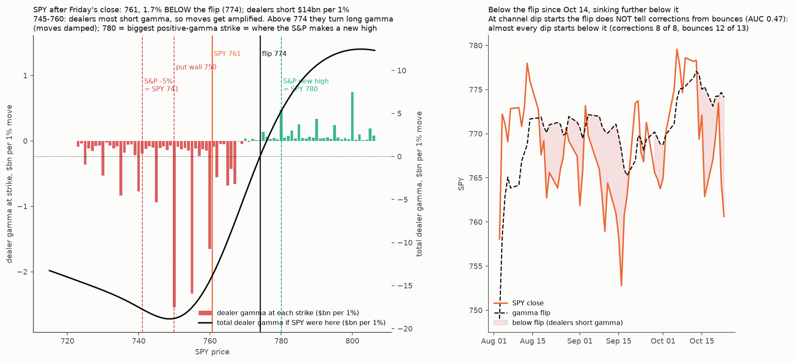

# SPY dealer gamma: the flip and next levels into Fed week, and whether the flip mattered at channel dips

* **Owner, 2026-10-25:** "Wait we didn't use gamma to check spy flips and next levels."
* **Engine:** `research/microstructure/td_gamma.py` plus `hd_gamma.day_metrics` / `flip` (classic convention: dealers long calls, short puts; 81-point grid from 0.8 to 1.2 × spot), imported unchanged. It is the same code path as the exact TSLA flip of Oct 23.
* **Data:** ThetaData Value tier.
  * Stored SPY end-of-day chains and OI run to 2026-10-14 (git-ignored).
  * Oct 15–23 pulled into the scratchpad on 2026-10-25 (licensed; not in this repo).
  * Only computed levels are written here.

## Method (fixed before computing)
1. **Verify the code path** against the engine's stored rows for 2026-10-08 and 10-09 (flip, spot, GEX).
2. **Daily rows, Oct 12–23:** spot (put-call parity at the close), flip, GEX, call wall and put wall (largest OI within 45 days and ±25%).
3. **Map after Friday's close:**
   * Oct 23 closing chain (IVs and spot) with OI dated Oct 23. That is positions at the Oct 22 close; Monday's file is not published yet, so the OI is one day stale.
   * Oct 23 expiries excluded.
   * Reported:
     * dealer GEX by strike: the largest positive strikes (where dealers dampen moves: magnets and resistance) and the largest negative ones (where dealers amplify moves: accelerants), within ±5%;
     * the total-GEX profile across prices from −6% to +6%;
     * the share of gamma by expiry (Fed decision Wed Oct 28; Fri Oct 30; monthly Nov 20).
4. **Channel check:**
   * SPY's distance to its flip (spot/flip − 1) at the start of each of the 21 decided dips, from the engine's daily history plus the new rows.
   * AUC, corrections vs bounces.
   * Forced-flow prediction: corrections start closer to or below the flip (dealers less long gamma).
   * Descriptive only, because 21 dips is a small sample. Today's dip is placed on it.

## Results (`spy_gamma.py`, `figure.py`; `out/levels.json`, `out/daily.csv`, `out/profile.csv`, `out/strikes.csv`, `out/spy_gamma_map.png`)

**1. Verification:** the code path reproduces the stored engine rows exactly for 2026-10-08 and 10-09 (flip 775.12 / 775.37, spot 774.65 / 778.60, GEX −$1.24bn / +$4.72bn).

**2. Daily, Oct 12–23:**
* SPY has closed **below the flip every day since Oct 14**: −0.9, −0.4, −1.6, −0.8, −0.6, −0.1, −1.3 and **−1.7%**.
* The flip itself is steady at 773–777.
* Dealer GEX swung from +$2.9bn (Oct 12) to **−$13.9bn per 1%** (Oct 23).

**3. The map after Friday's close** (OI = positions at the Oct 22 close; Oct 23 expiries removed):
* SPY **760.6**; **flip 774.1** (the only zero crossing within ±6%); total dealer GEX −$13.9bn per 1%.
* **Below spot: short-gamma accelerants.**
  * Largest strikes: 750 (−$2.5bn), 755 (−$2.3bn), 760 (−$1.7bn), 745 (−$0.9bn).
  * The total-gamma profile is most negative at **745–753** (about −$18.5bn).
  * The **put wall is 750** (286k OI within 45 days).
* **Above the flip: long gamma.** The largest positive strike is **780** (+$0.48bn), then 790, 785, 795. The **call wall is 800** (159k OI).
* **Gamma by expiry:**

  | Expiry | Share of \|gamma\| | Net |
  |---|---|---|
  | Fri **Oct 30** (after the Fed) | 22% | −$4.1bn |
  | Monthly Nov 20 | 18% | −$2.7bn |
  | **Mon Oct 26** (0DTE) | 15% | −$4.1bn |
  | Dec 18 | 13% | |
  | Fed-day Oct 28 | small, not in the top 8 | |

* **The live call in SPY terms:** the S&P's new high (7,818.93) ≈ **SPY 780**, the biggest positive-gamma strike. The S&P's −5% line (7,427.98) ≈ **SPY 741**, just below the 745–755 short-gamma pocket and the 750 put wall.

**4. Channel check:**
* AUC **0.47**: distance to the flip does **not** separate corrections from bounces.
* A 2% dip almost always pushes SPY below the flip: corrections 8 of 8, bounces 12 of 13. Being below the flip is the normal state of a dip, not a warning.

## Reading
* **Short term:** dealers are heavily short gamma between 745 and 774, so moves in either direction get amplified. A flush into 745–755 can be fast.
* ~~**Medium term:** by the forced-flow law, moves made on low-gamma days tend to be given back over about 10 sessions. That fits the breadth "bounce" call.~~
  **Correction (2026-10-25, after the owner asked):** that overstated the [forced-flow](../2026-10-24-forced-flow/) result.
  * The give-back under low gamma is an **up-day** effect in single names: squeeze rallies are given back.
  * **Down days are retraced about 10% over 10 days whether gamma is high or low.**
  * At the S&P level, the gamma effect is not significant once volatility is held fixed.
  * So the law says nothing special about this selloff fading. The bounce call rests on breadth alone. Short gamma sets how big the moves are, not their direction.
* **Levels to watch:**
  * **774** (flip: reclaiming it flips dealers to damping);
  * **780** (the gamma magnet, and the S&P's new high);
  * **750** (put wall, centre of the short-gamma pocket);
  * **741** (the theory's invalidation line).
* **Caveat:** Monday's OI file (positions at Friday's close) is not yet published. The map is one day stale on positions; the 0DTE gamma at 760 is Monday's.
