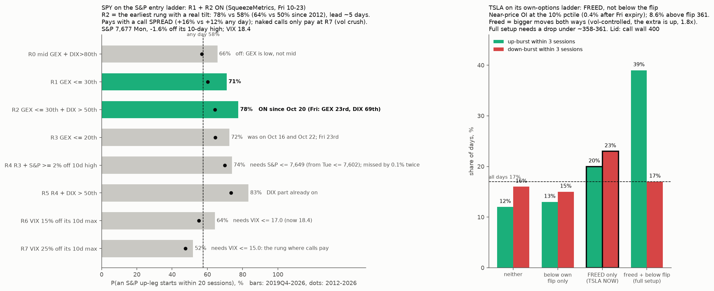

# Where SPY and TSLA sit on the tested ladders (Oct 26 close), what is solid, and what to test next

* **Owner, 2026-10-26:** "stick for now to what we have strongly studied for tsla and spy and then list best tests or next findings… that need more investigations and data later"; "Where does spy sit as for our R stages… and tsla too".
* A live read, not a new test. Original code imported unchanged (`microstructure/ladder.py`, `forecast.py`, `release.py`; `2026-10-26-tsla-gap-states/levels_live.py`), run on a fresh copy of the free data.
* **Reproduce:** `python status.py <fresh folder with data/{^GSPC,^VIX,^VIX3M,^VIX9D}_1d.json + data/DIX.csv> <spyg folder> <live23/td folder>`, then `python figure.py`.
* **Data:** SqueezeMetrics GEX/DIX to Oct 23 (Oct 26 not yet published at 17:00 ET); Yahoo S&P/VIX to Oct 26; TSLA open interest dated Oct 26 with Oct 23 IVs (ThetaData, licensed, aggregates only).

## 1. SPY on the S&P entry ladder (REPORT §4i)
* **On: R1 and R2.** GEX at the 23rd percentile and DIX at the 69th (Fri Oct 23). R2 has been on since Oct 20.
* **R2's history:** P(an up-leg, a top-decile 10-day S&P rise, starts within 20 sessions) is **64% vs 50%** any day (2012–26) and **78% vs 58%** (2019Q4–26); median lead 5 days.
  * A 60-DTE ATM/+5% call spread: +15% / +16% vs +9.5% / +12% any day. A naked call: about −1% (no edge: vol is expensive at low gamma).
* **Near misses:** R3 (GEX ≤ 20th) was on Oct 16 (4th pct) and Oct 22 (18th). Both days the S&P was 1.9–2.0% off its 10-day high, just short of R4's 2%.
* **Next triggers:**
  * **R4/R5:** GEX ≤ 20th with the S&P ≤ 7,649 (from Tue, ≤ 7,602 as the Oct 13 high leaves the window). DIX is already above 50th, so R4 would mean R5 (83% / 74%).
  * **R6:** VIX ≤ 17.0 (≤ 16.5 from Oct 30). **R7:** VIX ≤ 15.0 (≤ 14.6 from Oct 30). R7 is the only rung where naked calls beat any day. The FOMC on Oct 28 is the obvious vol-crush candidate.
* **The standing SPY checks:**
  * **Breadth (83-stock panel):** 64% above the 50-day (normal near-high 63%, z +0.04); 57% above the 100-day (17th pct of near-high days); 65% above the 200-day (27th pct). Recovering from the low start of this dip, consistent with the channel's bounce call (new high > 7,818.93 before a close ≤ 7,427.98).
  * **Gamma levels (our engine, Monday's positions):** SPY 765.29 vs flip 773.0 (−1.0%), engine GEX −$8.8bn per 1%; put walls 745/750; call wall 800.
  * **Gamma pockets:** most negative 744–760 (moves amplified); positive magnet 780; Oct 30 expiry holds 27% of gamma.
  * The two gamma measures differ on sign (SqueezeMetrics +$4.0bn, ours −$8.8bn) but agree that gamma is **low** for this year.

## 2. TSLA on its own-options ladder (REPORT §4t, §4w, §4z)
* **Freed: on.** The share of open interest within ±5% of the price (expiries ≤ 45 days) is at the **10th percentile** of the past year (freed = bottom third). After Friday's Oct 30 expiry it falls to the **0.4th percentile**.
* **Below own flip: off.** $391.62 is 8.6% above the flip (360.7; 358 after Friday). Own gamma at the 82nd percentile (dealers long, damping) falls to the 54th after Friday.
* **"Freed only" history (2021–26, 254 days):** up-burst within 3 sessions 20% vs 17% all days, down-burst 23% vs 17%; within 10 sessions 60% / 61% vs 48% / 49%.
  * Freed means **bigger moves both ways**; with volatility controlled, the extra moves are up (1.8×, p < 0.01, §4z).
* **The full setup** (freed + below the flip: 39% up vs 17% down within 3 sessions) needs a drop under about 358–361, 8–9% lower.
* **Lid:** call wall and round number $400 (38k calls ≤ 45 days); Monday's high $397.27 stalled under it (P4b footprint). Support: the $389 triple top.
* **The S&P ladder does not apply to TSLA's direction** (§4k multiverse, joint p 0.74). Low S&P gamma only makes TSLA more market-driven (correlation 0.62 vs 0.35). TSLA's S&P-based R4s/R5s are off.

## 3. What is solid (passed pre-registered tests or a multiverse)
**SPY / S&P**
1. **Low dealer gamma predicts that a big up-leg starts** (movement, not a higher average return): 216 specifications, 91% significant, joint p < 0.003, every era (§4j). This is the ladder.
2. **Legs need a gamma reset first:** 88–90% of legs had GEX ≤ 30th within 20 days vs 71–73% of days (p 0.001–0.002) (§4p).
3. **Channel corrections vs bounces:** breadth at the dip's start (50–200-day participation) separates them, AUC 0.89; all 58 versions beat luck, joint p 0.002 (channel-correction-theory).
4. **Dealer sign:** call gamma damps the next-day range in SPY/QQQ/TSLA/MSFT/NVDA; put gamma amplifies in SPY/QQQ (p < 0.001) (dealer-sign B).
5. **Forced moves fade:** moves on low-gamma days are given back over 10 days (−26 pts, p 0.002); month-end/Russell-day S&P moves fade more (p 0.026). An up-day effect; down days are not reversed (forced-flow, spy-gamma-levels).
6. **Correlation × gamma:** in true short gamma (SqueezeMetrics GEX < 0), rising correlation turns the bounce (+2.6%) into a drop (−0.8%) over 10 days, p < 0.001; mostly 2020–22 (positioning-tests P2).
7. **Round numbers hold resting orders:** day highs stall just below, lows just above (p 2e-15, 5e-5) (positioning-tests P4b).

**TSLA**
1. **Freed → 1.8× up-burst odds**, no extra down-bursts, with vol, IV and S&P gamma controlled (p < 0.01) (§4t, §4z).
2. **Below own flip → up-bursts 1.45×** (p 0.04): snap-backs, not breakdowns (§4s).
3. **Full setup 39% up vs 17% down** within 3 sessions (155 days) (§4w; reproduced in pierce-and-reclaim).
4. **RSI in its bottom tenth → up-burst within 10 sessions 57% vs 40%** (p 0.001, 115 episodes) (technical-indicators A).
5. **Breakaway gaps fill less:** 55% vs 69% within 5 sessions (p 0.04) (tsla-gap-states).

**Solidly dead (don't use):** drawn lines/VIX-free channel touches (48–50% vs placebo), S&P gamma for TSLA direction, signed minute-bar option flow, margin debt, yen, oil, gold, FOMC timing for corrections, year analogs, Kronos/TimesFM, last-hour patterns.

## 4. Next tests, ranked
| # | Lead (from) | Why it's promising | Needs |
|---|---|---|---|
| 1 | **Signed 0DTE/option flow** (order-flow A1 void; Oct 16 one-day lead +0.23) | Minute-bar signing failed for a data reason, not an idea reason | ThetaData Options Standard ($80/mo): tick trades + NBBO |
| 2 | **Intraday stop cascades at prior highs / round levels** (P1 TSLA $389 run; P4a daily null) | Osler's mechanism is intraday; daily bars can't see it | Stock trades + quotes or order book: Databento (free $125 credit first) |
| 3 | **SqueezeMetrics GEX vs our engine** (today +$4bn vs −$8.8bn) | Only SqueezeMetrics carries P2; our flip carries the rally-hold result. Which is right when they disagree? | Data in hand |
| 4 | **P2 with implied correlation (COR1M) and in the channel** (only 42 GEX < 0 days since 2023) | The letter's actual variable; the channel sample is thin | Cboe COR1M history |
| 5 | **Large put closes, more events** (P3: 9 events, right direction) | Extend to IWM, XLK, single names; separate closes from transfers | ThetaData OI (have) + signed trades (Standard) |
| 6 | **TSLA put-side dealer sign** (dealer-sign: TSLA puts inconclusive, p 0.24) | Decides whether "below the flip" is a real hedging state for TSLA | ThetaData Standard (open/close flags via trades) |
| 7 | **Futures footprint at SPY gamma levels** (absorption, delta divergence at 773/780/745) | One central book; the cleanest order-flow test of the gamma map | Sierra Chart Pkg 11/12 + Denali (~$57–67/mo) |
| 8 | **Small-n leads to re-test with time:** TSLA RSI divergence after a bounce (86% vs 69%, p 0.21), MSFT stretched release (p 0.053), weekly ADX (+23 pts, p 0.046), TSLA R7 (82%, raw p 0.02) | Each could be real; none survives correction yet | Time (more events) |

**Forward checks already scheduled by earlier studies:** channel call (new high > 7,818.93 before ≤ 7,427.98); TSLA short interest for Oct 30 (published ~Nov 10); AAPL residual Oct 26–Nov 2 (R3d); SPCX–TSLA retest ~Feb 2027; this ladder after the Oct 28 FOMC and Oct 30 expiry.
