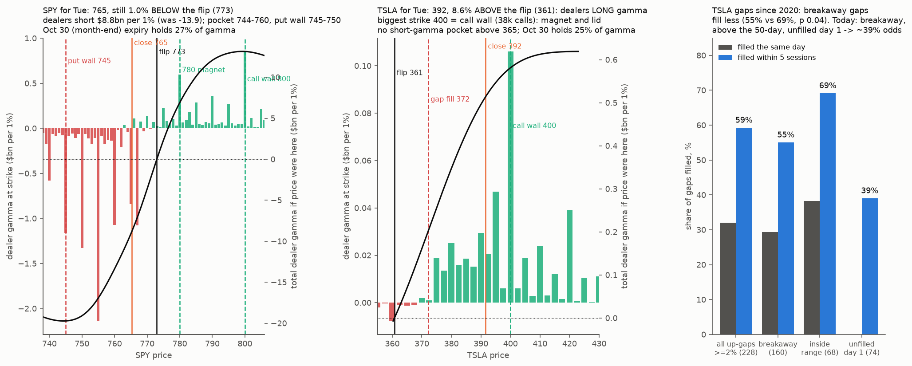

# Do TSLA gaps that open in a different "state" fill less often?

* **Owner, 2026-10-26:** "tsla opened with a gap up. Usually gaps happen about critical levels where the stock opens in a different 'state'. I'm not sure if it will fill the gap or it's going on from here."
* **Today:** TSLA closed Fri Oct 23 at $372.22, opened Mon Oct 26 at $383.98 (**+3.2% gap**) and closed $391.62 (+5.2%).

## Test (pre-registered before computing)
* **Data:**
  * TSLA daily OHLC from Yahoo, 2020-01 to 2026-10-23;
  * TSLA's dealer-gamma flip from `research/microstructure/out/td_gamma_TSLA.csv` (2020 to 2026-10-09), using the flip known at the prior close;
  * the 50-day average from the closes.
* **Events:** up-gaps of at least 2% (open ÷ prior close − 1 ≥ 0.02). Also reported for ≥ 3%.
* **Outcomes:**
  * **filled same day:** the day's low ≤ the prior close;
  * **filled within 5 sessions:** any low over the next 5 sessions ≤ the prior close;
  * the close-to-close return from the gap day's open over 5 sessions.
* **States:**

  | State | Definition |
  |---|---|
  | S1, flip crossing (primary) | the prior close was below the flip and the open is above it ("opens in a different gamma state"), vs every other up-gap |
  | S2, breakaway | the open is above the prior day's high, vs inside the prior day's range |
  | S3, trend | the prior close was above vs below the 50-day average |

* **Prediction (owner's hypothesis):** S1 and S2 gaps fill **less** often than the other gaps.
* **Statistic:** the difference in 5-session fill rate. Bootstrap by event, two-sided p. Descriptive with 95% intervals, because events are few.
* **Today's gap is placed in its cell.**

## Results (`gap_test.py`, `levels_live.py`, `figure.py`; `out/gaps.json`, `out/gaps.csv`, `out/levels_live.json`, `out/live_read_1027.png`)

**TSLA up-gaps ≥ 2%, Feb 2020 to Oct 16 2026: 228 events.**
* All gaps: 32% fill the same day; 59% fill within 5 sessions.
* Gaps ≥ 3% (109): 26% fill the same day; 53% within 5 sessions.

| State | Events (yes / no) | Fill same day | Fill within 5 sessions | Difference, p |
|---|---|---|---|---|
| **S2 breakaway** (open > prior high) | 160 / 68 | 29% vs 38% | **55% vs 69%** | **−14 points, p 0.04** ✅ |
| S3 prior close above the 50-day | 128 / 100 | 27% vs 39% | 55% vs 64% | −9 points, p 0.19 |
| S1 flip crossing (primary) | 15 / 205 | 13% vs 33% | 60% vs 59% | +1 point, p 0.88 ❌ (too few events) |

* **Primary (S1) not supported.** TSLA rarely gaps *across* its flip (15 times).
* **The owner's idea holds in the breakaway form:** gaps that open above the prior day's high fill less often.
* **Post hoc, descriptive:** breakaway gaps above the 50-day that did **not** fill on day 1 (74) filled within the next 4 sessions only **39%** of the time, with a mean return of **+2.7%** from the open over 5 sessions.

**Today's TSLA gap:**
* breakaway: open $383.97 vs prior high $377.32;
* prior close above the 50-day ($363.77);
* not a flip crossing: Friday's close $372.22 was already above the flip ($364.97);
* **not filled on day 1** (low $383.84).

**Gamma maps for Tue Oct 27** (Oct 23 closing IVs, OI dated Oct 26 = positions at Friday's close, Monday's close as spot):
* **SPY 765.29:**
  * **flip 773.0** (−1.0%); dealer GEX −$8.8bn per 1% (Friday −$13.9bn);
  * put wall 745 (210k OI), then 750 (198k);
  * negative strikes 755 (−$2.1bn), 750, 745, 767, 760; total gamma most negative at 744;
  * positive strikes 800 (call wall), 780, 810;
  * the Oct 30 expiry holds 27% of gamma.
* **TSLA 391.62:**
  * **flip 360.7** (+8.6%: dealers long gamma); GEX +$0.51bn per 1%;
  * **call wall 400** (38k calls, the largest strike, +$0.11bn), then 420; no short-gamma pocket above 365;
  * the Oct 30 expiry holds 25% of gamma.
