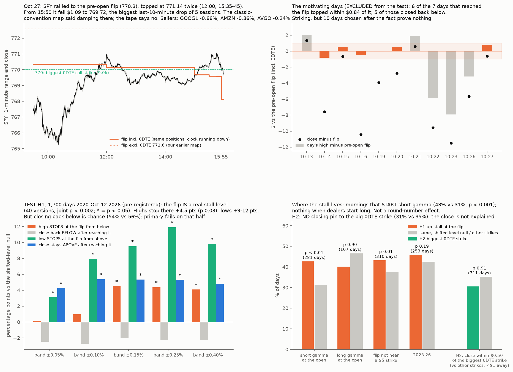

# Does SPY wick at its gamma flip, and pin at the close? Motivating days, then a pre-registered test

* **Owner, 2026-10-27:** "Spy wicked this price level multiple times. I think it was the flip. Can we understand why it behaved this way at it, with supporting data, especially at close. That doesn't seem post hoc."
* **Prior work:**
  * [spy-gamma-levels](../2026-10-25-spy-gamma-levels/) (rallies above the flip hold);
  * [spy-intraday-levels](../2026-10-16-spy-intraday-levels/): on one partial day, intraday turns were no closer to option levels than to round strikes, p 0.54–0.67;
  * [dealer-sign](../2026-10-16-dealer-sign/): the classic convention is supported for calls; call gamma damps SPY's range;
  * [positioning-tests](../2026-10-26-positioning-tests/) P4b: round numbers hold resting orders;
  * Ni, Pearson & Poteshman (2005, *JFE*): stocks pin to strikes at expiry when hedgers are net long options.

## The pre-open map (`flipmap.py`)
* **Built only from what is known before day D's open:**
  * positions = OI dated D (the prior close's positions);
  * IVs and spot = the prior session's closing chain.
* **Same-day (0DTE) expiries are kept,** with time to expiry measured from 9:30. Our earlier maps dropped them, so their flip ran $2–4 higher.
* Engine code is imported unchanged. The one addition is a $0.05 search inside the engine's 0.5%-wide flip interval.

## Motivating days, descriptive (`recent.py`; `out/recent.json`). These days are EXCLUDED from the test below.
| Day | Pre-open flip (incl 0DTE) | Open | High | High − flip | Close − flip |
|---|---|---|---|---|---|
| Oct 14 | 777.19 | 774.92 | 776.35 | **−0.84** | −7.58 |
| Oct 15 | 772.37 | 766.25 | 772.87 | **+0.50** | −0.66 |
| Oct 16 | 773.75 | 773.24 | 773.25 | **−0.50** | −10.44 |
| Oct 19 | 770.48 | 767.23 | 770.46 | **−0.02** | −3.94 |
| Oct 20 | 771.76 | 765.86 | 772.29 | **+0.53** | −2.74 |
| Oct 21 | 772.55 | 771.17 | 774.44 | +1.89 | +0.58 |
| Oct 22 | 773.57 | 766.39 | 767.71 | −5.86 | −9.58 |
| Oct 23 | 771.39 | 759.90 | 763.47 | −7.92 | −11.48 |
| Oct 26 | 770.88 | 762.25 | 767.73 | −3.15 | −5.65 |
| Oct 27 | 770.34 | 767.34 | 771.14 | **+0.80** | −0.62 |

* **Six of the 7 days that reached the flip** saw the high stop within $0.84 of it, and 5 of those 6 closed back below it. The flip without 0DTE (772.6–777.4) fits worse.
* **Oct 27, as the day ran down** (same positions; the 0DTE time to expiry shrinks):
  * The flip moved from 770.34 (9:30) to 770.14 (12:00), 769.67 (15:00), 769.57 (15:45) and 768.12 (15:55).
  * Total dealer gamma at 770 went from −$0.63bn (9:30) to +$0.54bn (15:00), +$1.54bn (15:45) and +$4.1bn (15:55).
  * The late session was **long gamma** around 770, so dealers sold rallies and bought dips.
* **Oct 27 0DTE open interest:**
  * Calls 770: 9,041; 775: 8,082; 768: 7,766; 767: 7,433.
  * Puts 767: 20,530; 765: 12,455.
  * The close, 769.72, came $0.28 from the 770 strike.
* **Hypothesis from these days:**
  1. Below the flip, dealers chase, so price is carried up to the flip.
  2. Above it, they fade, so price stalls and wicks back.
  3. Into the close, 0DTE gamma concentrates and the session turns long gamma, so price pins to the big 0DTE call strike.
* These are post hoc readings of 10 days. The tests below decide whether they are real.

## Pre-registration (written before any historical computation)
**Sample:** SPY, 2020-01-02 to 2026-10-12 (everything before the motivating days). Daily OHLC from Yahoo (unadjusted for dividends, matching strikes).

**H1. The flip as a ceiling from below (and a floor from above)** (`history.py`).
* **Level** L = the pre-open flip including 0DTE.
* **Up-approach days:** open < L. A day "reaches" when high ≥ L·(1 − b).
  * **Stall** = high ≤ L·(1 + b): the day stops inside the band instead of running through.
  * **Reject** = close < L.
* **Down-approach mirror:** open > L; reach = low ≤ L·(1 + b); stall = low ≥ L·(1 − b); hold = close > L.
* **Null:** circularly shift each day's relative level (L / open − 1) by k sessions, k in [20, N − 20], 500 shifts. This keeps how far levels sit from the open and destroys their link to that day's positions. Statistic: real share minus the null mean. p = share of null ≥ real, one-sided.
* **Primary:** up-approach Stall and Reject at **b = 0.15%**. **Passes if both p < 0.05.**
  * Stated plainly: b = 0.15% and "incl 0DTE" were chosen after seeing the table above. Hence the multiverse.
* **Multiverse:** b ∈ {0.05, 0.10, 0.15, 0.25, 0.40}% × {up, down} × {stall, reject/hold} × {incl, excl 0DTE} = 40 cells. Joint p from the median z across cells under the same shifts.
* **Splits (descriptive):**
  * 2020–22 vs 2023–26 (the daily-0DTE era);
  * whether L is within $0.50 of a $5 multiple (the round-number confound, P4b).

**H2. Closing pin to the big 0DTE strike** (`pin.py`).
* **Sample:** days with a same-day expiry, 2023-11-27 to 2026-10-12 (SPY hourly bars give the 15:30 price, the open of the 15:30 bar).
* **Candidates:** integer strikes within ±$3 of the 15:30 price. K* = the candidate with the largest 0DTE OI (calls + puts, prior close's positions).
* **Outcome:** close within $0.50 of the strike.
* **Statistic:** hit rate at K* minus hit rate at the other candidates in the same $1 distance bucket from the 15:30 price, weighted by K* counts. Bootstrap by day, 2,000 draws.
* **Prediction:** > 0. **Passes if p < 0.05.**
* **Sign split (tests the convention):** K* call-heavy (classic: dealers long → pin) vs put-heavy (classic: dealers short → no pin). Prediction: the pin is stronger when call-heavy.

**What would falsify the owner's reading:** H1 at or below the null means the flip wicks were coincidence (or round numbers). H2 at or below zero means the close behaviour was not a pin.

## Results (run after the pre-registration commit ffed9e4)
`history.py` → `out/preopen_levels.csv`: 1,702 days, 1,433 with a same-day expiry, 1 flip missing, 0 errors. `h1.py` → `out/h1.json`; `pin.py` → `out/h2.json`; `figure.py` → `out/flip_wicks.png`.

**H1 verdict: the flip is a real stall level (joint p < 0.002 over 40 versions; median z +2.7). The pre-registered primary fails on its second half: after reaching the flip, closing back below is chance.**

| Incl. 0DTE, band ±0.15% | Days | Real | Shifted null | Diff | p |
|---|---|---|---|---|---|
| **Up: high stops in the band** | 388 | 42.0% | 37.5% | **+4.5 pts** | **0.03** |
| Up: close back below the flip | 388 | 53.6% | 55.6% | −2.0 | 0.77 |
| **Down: low stops in the band** | 433 | 45.3% | 35.8% | **+9.5 pts** | **< 0.002** |
| **Down: close stays above** | 433 | 67.2% | 61.9% | **+5.3 pts** | **< 0.002** |

* **Every band (±0.05% to ±0.40%):**
  * The down-side stall and hold beat the null (p ≤ 0.04).
  * The up-side stall beats it from ±0.15% outward (+4.1 to +4.5 pts).
  * The up-side "reject" is negative in all 5 bands.
* **The flip without 0DTE** is as strong or stronger: up stall +8.5 pts at ±0.15% (p 0.002); down stall +11.8 pts. Including 0DTE, the motivating-day choice, did not improve it.
* **Where it lives** (up stall, ±0.15%):
  * Mornings that start with dealers **short** gamma: 42.7% vs 31.2% (p < 0.001, 281 days).
  * Mornings that start long gamma: 40.2% vs 46.6% (p 0.90).
  * It is not a round-number effect: flip not near a $5 strike 43.2% vs 37.5% (p 0.01); near one, n.s. (78 days).
  * It holds in both eras in direction (2020–22 +2.6 pts, 2023–26 +3.3 pts); neither era alone is significant.
* **Reading:**
  * Below the flip, dealers' hedging chases the move, so a rally runs up to the flip.
  * At the flip the hedging changes sign and the chase stops, so the day's high tends to land there.
  * From above, the flip is a stronger floor (+9.5 pts) and closes stay above more often (+5.3 pts). This fits the earlier result that rallies above the flip hold.
  * What the flip does **not** do is send the close back down. Once a day reaches it from below, the close finishes under it at the chance rate.

**H2 verdict: no closing pin.**
* Over 711 days (Nov 2023 – Oct 12 2026), the close landed within $0.50 of the biggest 0DTE strike near the 15:30 price **31% vs 35%** for other strikes at the same distance. Weighted difference −2.1 pts, p 0.91.
* Neither the call-heavy (−2.6 pts) nor the put-heavy (−1.9 pts) days pin.
* The close moved toward the big strike on 41.5% of days vs 43.0% for other strikes.
* Ni–Pearson–Poteshman pinning does not show in SPY 0DTE closes on this test.

## What this says about Oct 27
* **The 770–771 wicks: consistent with a tested effect.** SPY started the day short gamma (pre-open flip 770.34, above the 767.34 open) and rallied into the flip, where its highs stopped (twice). That is the setting where highs stall at the flip (43% vs 31%).
* **The close under the flip: not explained by any tested rule.** H1 says the close side is chance. H2 says there is no 0DTE pin. The classic-convention map said the late session was damping; the tape contradicted it (see the correction below).
* **For trading the level:**
  * Expect the flip to slow a move (above all from above, as support).
  * Don't treat a touch from below as a short signal for the close.
  * A close above the flip is what matters for the next days (spy-gamma-levels Amendment 1).
* **Wednesday:** the pre-open flip will be rebuilt from Oct 28 OI. Monday's positions put it near 770 with 0DTE (772.5 without).

## Correction (owner: "there was strong last ten min selling. It wasn't sticky like u say")
The owner is right; the "damping" line above was the map's prediction, not what happened.
* **The last 10 minutes (Yahoo 1-minute bars):**
  * SPY went from 770.81 (15:49) to 769.72: **−$1.09 (−0.14%), 18% of the day's range**.
  * That is the largest last-10-minute drop of the 5 sessions: Oct 21 −0.48, Oct 22 +1.79, Oct 23 −0.35, Oct 26 −0.19.
  * Volume 3.49M shares (4.5% of the day), with 1.0M in the final minute.
  * The selling started at **15:50**, when the exchanges publish closing-auction (MOC) imbalances.
* **Who was sold, 15:50 → close (5-minute bars):**
  * GOOGL −0.66% (reports Wed), AMZN −0.36% (reports Thu), AVGO −0.24% (the day's leader), NVDA −0.15%.
  * Equal-weight RSP −0.04%, IWM 0.00%, XLF/XLP about 0.
  * Narrow, cap-weighted selling of the winners and the names reporting this week, ahead of the FOMC. Not broad selling.
* **What the 0DTE map implies, by convention** (positions at the Oct 26 close only; same-day 0DTE trades are invisible):
  * Pure time decay at a fixed price: tiny under either convention (±0.03M shares).
  * The slide from 770.81 to 769.72 through the 770 (9.0k) and 771 (5.1k) calls:
    * **classic** (dealers long the calls): dealers **buy** about 0.75M shares (damping);
    * **all-short** (customers long the calls): dealers **sell** about 1.04M shares, about 30% of the last-10-minute volume (amplifying).
  * The tape fits the all-short reading for these 0DTE calls, or a sell imbalance large enough to overwhelm classic damping. One day cannot tell which. Signing the trades needs tick data (TODO T1, T2).
* **Our earlier test of last-half-hour momentum** (forced-flow A2) died, so there is no tested rule for the closing move either way.
* **Added to TODO:**
  * N3: last-30-minute continuation vs the 0DTE call/put mix near the price (a convention test on 711 days in hand).
  * N4: pre-earnings de-risking into the close in mega caps.
  * D3: closing-auction imbalance data (Databento imbalance feeds).
