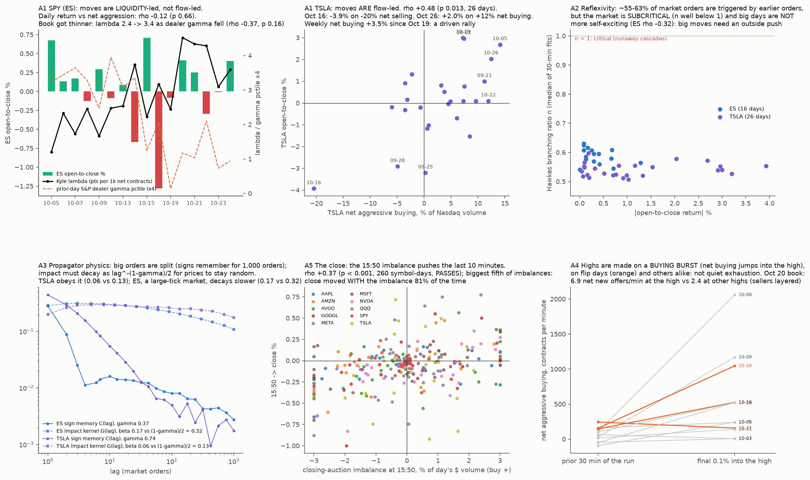
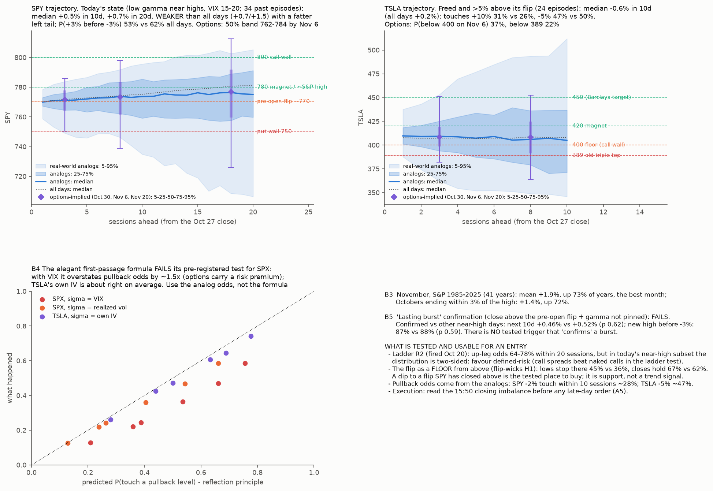

# Order-flow physics of the last weeks (SPY via ES, TSLA) and a tested trajectory for the next days

* **Owner, 2026-10-27:**
  * "use Databento for the best useful tests to explain the last few days' price action on weekly and daily frames, and to put a statistical trajectory on the next few days, with explanations we can reuse (strengthen our grasp of market mechanics)";
  * "I want to make an entry for the possible November rally on SPY and TSLA, if we can confirm a lasting burst and it drops a bit to a favourable price";
  * "rigorous quant, elegant physics-like stuff"; budget about $15.
* **Why this design:** the last three studies tested patterns without a mechanism ([flip-wicks](../2026-10-27-flip-wicks/) correction). Here every measurement is a named mechanism from the microstructure literature, measured on the actual order flow, against each instrument's own baseline weeks.
* **Data (Databento, licensed, kept in `data/`, gitignored):**
  * ES (CME, ESZ6) trades with aggressor side, regular hours, Oct 5–26 (16 sessions). ES is SPY's single central book.
  * One ES order-by-order (MBO) session (Oct 20).
  * TSLA Nasdaq trades with aggressor side, Sep 21 – Oct 26 (Nasdaq is part of TSLA's volume; stated limit).
  * Closing-auction imbalances: SPY (NYSE Arca), and TSLA, GOOGL, AMZN, NVDA, AVGO, MSFT, AAPL, META, QQQ (Nasdaq), Sep 21 – Oct 26.
  * Oct 27 is added when Databento publishes it.
  * Quoted cost about $9.3 now, plus about $5 for Oct 27.
  * Not bought: the SPY 0DTE options tape ($16–21 per day).
* **Free data:** ThetaData Value chains, SqueezeMetrics, Yahoo bars, and our engine.

## Part A — mechanics of the last weeks (each is a named mechanism; baseline = the instrument's own other sessions)
**A1. Who drove each day: signed flow and Kyle's lambda** (Kyle 1985; Hasbrouck 1991).
* Per session: aggressor-signed volume ("delta", buy − sell) and its running sum, daily and weekly.
* Kyle's λ: per session, regress 5-minute price changes on 5-minute signed volume. λ = price move per contract of net aggression, i.e. 1 / market depth.
* **Reading:**
  * A move with large delta and normal λ is *driven* (aggressors paid up).
  * A move with small delta and high λ is *liquidity-led*: the book thinned, so little flow moved price far.
* **Prediction:** the down legs (Oct 16, Oct 22–23) were driven by sell aggression with λ above the baseline median. The Oct 26 rally was driven by buy aggression.

**A2. How self-exciting the tape was: Hawkes branching ratio** (Filimonov & Sornette 2012; Hardiman, Bercot & Bouchaud 2013).
* Market-order arrivals (trades with the same timestamp and side merged into one event) are fit with an exponential-kernel Hawkes process by maximum likelihood, in 30-minute windows.
* The branching ratio n is the share of activity triggered by earlier activity (endogenous) rather than by outside news. n → 1 is a "critical" market where cascades run.
* Daily median n for ES and TSLA.
* **Prediction:** n is higher on the trend days (Oct 16, 22, 26) than on drift days.

**A3. How long a trade's push lasts: the propagator** (Bouchaud, Gefen, Potters & Wyart 2004; Lillo & Farmer 2004).
* Sign autocorrelation of merged market orders, C(ℓ) ~ ℓ^(−γ): long memory, from order splitting.
* Response R(ℓ) = ⟨ε_n (p_{n+ℓ} − p_n)⟩.
* Physics consistency check: prices stay diffusive only if the impact kernel decays as ℓ^(−β) with **β = (1 − γ)/2**. We estimate γ and β separately and test whether β ≈ (1 − γ)/2 (within ±0.1).
* Per regime: the persistence ratio R(1000)/R(10) on up days vs down days.

**A4. The flip wicks in the footprint (ES).**
* Days whose SPY high came within ±0.15% of the pre-open flip (incl. 0DTE; flip-wicks `recent.json`): Oct 14, 15, 16, 19, 20 (Oct 27 later).
* SPY → ES via the open's ES/SPY ratio.
* In the last 0.10% of the run into the day's high vs the prior 30 minutes:
  * buy-aggressor volume per minute;
  * price progress per 1,000 contracts bought (absorption ratio).
* **Absorption** (a passive seller): buying holds or rises, progress collapses. **Exhaustion** (the chase stops): buying falls.
* Placebo: the same measures at the highs of the other sessions in the window.
* **Prediction from the H1 mechanism** (dealers' chase stops at the flip): exhaustion, not absorption.
* MBO on Oct 20: whether the offers at the high refilled (iceberg / passive seller).

**A5. Closing auction: does the published imbalance push the close?** (Cushing & Madhavan 2000; Bogousslavsky & Muravyev 2023).
* For each symbol-day: the first imbalance message at or after 15:50:00 ET, signed by side; dollars = paired-off imbalance quantity × reference price.
* Outcome: the 15:50 → close return (Yahoo 5-minute bars).
* **Test:** Spearman correlation of signed imbalance (as % of the day's dollar volume) with the outcome, pooled over about 10 symbols × 25 days, bootstrap by day. **Passes if > 0 with p < 0.05 (one-sided).**

**A6. TSLA's Oct 26–27 composition.**
* TSLA daily delta, λ and Hawkes n vs its 5-week baseline.
* Retail-size share (trades < 100 shares).
* Around the $389 cross on Oct 26: buy-aggressor events per second in the 60 s after the first print above 388.90 vs the 60 s before, and vs the same at the day's other round-dollar crosses (stop-cascade signature: a burst right after the cross).

## Part B — a trajectory for the next days, and an entry rule (free data; methods fixed here)
**B1. Risk-neutral distribution** (Breeden & Litzenberger 1978).
* From the latest ThetaData closing chains: SPY and TSLA, Oct 30, Nov 6 and Nov 20 expiries.
* Smoothed IV smile → density → quantiles, and P(below / above key levels).

**B2. Conditional ensemble (real-world distribution).**
* **SPY:** analog days, S&P 2012–2026, matching today's state, defined now:
  * R2 fired within the last 10 sessions;
  * S&P within 2% of its 252-day high;
  * VIX 15–20.
  * Fan of 1–20-day forward returns (5/25/50/75/95%), and P(+3% before −3%).
* **TSLA:** 2021 – Oct 14 2026: freed (near-price OI ≤ 1/3 pctile) and above its own flip by > 5%. Forward 1–10-day fan vs all days.

**B3. November base rate:** S&P November returns 1950–2025, all years and years where the S&P ended October within 3% of its 52-week high. Descriptive.

**B4. Entry physics: first-passage probabilities (reflection principle / gambler's ruin for drifted Brownian motion).**
* P(touch a pullback level L within T days) and P(L before target U), from σ (implied vol) and μ (= 0 as the null; B2's conditional drift as the alternative).
* **Validation test (must pass before use):**
  * SPY daily paths 2012 – Oct 12 2026. Each day, with σ from that day's VIX, predict P(touch −1%, −2%, −3% within 5 and 10 sessions).
  * Compare with what happened: calibration slope (realized on predicted, binned) and Brier skill vs the unconditional rate.
  * **Usable if the slope is within 0.8–1.2 and Brier skill > 0.**
  * Same for TSLA with its 30-day ATM IV (engine history).

**B5. "Lasting burst" confirmation rule** (from earlier results, not tuned here).
* For SPY 2020 – Oct 12 2026 (pre-open flips from flip-wicks), the confirmation = **a close above the pre-open flip AND SqueezeMetrics GEX < 90th pctile (not pinned)**.
* Prediction: forward 10-day return and P(new 20-day high before −3%) are higher on confirmed days than on other days within 2% of the high.
* Circular-shift null on the confirmation series. **Passes if p < 0.05.**
* Descriptive add-on: whether breadth (50-day participation rising over 5 days) strengthens it.

**Reporting:** every result with its denominator. Part A is mechanism measurement on a few weeks, so it explains, it does not forecast. Only B4 and B5 (tested on years) may be used for the entry.

## Results (run after the pre-registration commit bdc698c)
* **Spend:** $9.16 of Databento credit: ES trades $6.76, TSLA trades $0.79, imbalances $0.55, ES MBO $1.05. About $5.8 is reserved for Oct 27 once published.
* **Scripts:** `a_flow.py`, `a3_mid.py`, `a4_wicks.py`, `a5_imbalance.py`, `a_summary.py`, `b1_density.py`, `b2_b3.py`, `b4_b5.py`, `figure.py`.
* **Output:** `out/*.json` and `out/*.csv` (aggregates only).

### Part A — what the order flow says (mechanism measurements, 16 ES and 26 TSLA sessions)
| | Result | Prediction | Verdict |
|---|---|---|---|
| **A1 ES** | Daily return vs net aggression ρ −0.12 (p 0.66). Kyle λ 2.4 → 3.4 pts per 1k net contracts (first vs second half; peak 4.5 on Oct 20). λ vs prior-day dealer-gamma pctile ρ −0.37 (p 0.16, n 16) | Down legs driven by sell aggression | **Not supported.** Oct 14 fell −0.67% on *net buying* (+1.2%); Oct 16 fell −1.3% on only −0.8%. SPY's moves are **liquidity-led**: the book thinned (λ up about 40%) as dealer gamma fell. |
| **A1 TSLA** | Daily return vs net aggression ρ **+0.48 (p 0.013)**. Oct 16 −3.9% on −20% net selling; Oct 26 +2.0% on +12% net buying; net buying +3.5% of volume in the week of Oct 19 | Rally driven by buy aggression | **Supported:** TSLA is **flow-led**, and the late-October rally was bought with aggression |
| **A2 Hawkes** | n: ES 0.54–0.63, TSLA 0.51–0.60. vs \|return\|: ES ρ −0.32, TSLA +0.14 (both n.s.) | n higher on trend days | **Not supported.** Both markets are subcritical. The big days were *not* more self-exciting, so they were pushed from outside (news, forced flows). |
| **A3 propagator** | ES γ 0.37, β 0.17 vs (1−γ)/2 = 0.32; TSLA γ 0.74, β 0.06 vs 0.13 | β ≈ (1−γ)/2 ± 0.1 | **TSLA passes, ES fails.** ES is a large-tick market where the small-tick theory is known to fit poorly. Mid-price proxies were used (trade-price response showed bid-ask bounce: the first run, `out/a3.json`, is superseded by `out/a3_mid.json`). |
| **A4 footprint at highs** | Net buying per minute jumps into the final 0.1% before the day's high on most days (flip days: 3 usable, buy/min 1.08–1.90×; other days median 1.09×; exhaustion in 0 of 3 flip days, 3 of 9 others). Oct 20 MBO: 6.9 net new offers/min at the high vs 2.4 median at 10 other swing highs | Exhaustion at the flip | **Not supported.** Highs are made on a buying burst into layered offers, an absorption-like signature (one MBO day). Oct 14 and 16 had their highs at the open, so no run-up. |
| **A5 closing auction** | Spearman **+0.37** (90% CI 0.23–0.49, p < 0.001, 260 symbol-days). Biggest fifth: the close moved with the imbalance **81%** of the time. Single stocks 0.23–0.59; SPY 0.18; TSLA 0.09; QQQ −0.45 | ρ > 0 | **PASSES** |

**Mechanics lessons, for reuse:**
1. **SPY moves when the book thins, not when aggression spikes.**
   * In low dealer gamma, depth falls (λ up), so ordinary flow moves price further.
   * Gamma regime → liquidity → move size is the chain. "Who is buying" matters less than "how thin is it".
2. **TSLA is the opposite: aggressive flow drives it.** Net aggressive buying is the variable to watch.
3. **About 60% of market orders are reactions to earlier orders, but the market is far from critical.**
   * Cascades die out.
   * A big day needs an outside shove: news, forced hedging, the close.
4. **Big orders are sliced, so order signs stay correlated for about 1,000 orders.**
   * Prices stay unpredictable only because each trade's impact fades at the matching rate.
   * TSLA satisfies this. ES, with its coarse tick, holds impact longer.
5. **The close is an auction.** The imbalance published at 15:50 predicts the last 10 minutes. Read it before any late order.
6. **Session highs are buying bursts into offers that refill,** not buyers fading out. "Wicks" are where a burst meets passive supply.

### Part B — trajectory and entry (tested on years of data)
* **B1. Options-implied, from the Oct 27 close** (density mass 0.99–1.05):

| | Oct 30 (3d) | Nov 6 (10d) | Nov 20 (24d) |
|---|---|---|---|
| SPY 25–50–75% | 764 / 772 / 778 | 762 / 773 / 784 | 760 / 777 / 792 |
| SPY P(< 760) | 16% | 22% | 26% |
| TSLA 25–50–75% | 398 / 409 / 419 | 391 / 408 / 425 | 383 / 408 / 434 |
| TSLA P(< 400) / P(< 389) | 28% / 10% | 37% / 22% | 41% / 30% |

* **B2. Real-world analogs:**
  * **SPY state** (R2 within 10 sessions + within 2% of the high + VIX 15–20; 175 days, 34 episodes, 2012–2026):
    * median +0.52% at 10d and +0.70% at 20d, vs +0.72% / +1.51% on all days;
    * 5% tail at 20d −8.2% vs −5.9%;
    * P(+3% before −3%) **53% vs 62%**;
    * P(a close ≤ −2% within 10 sessions) 28% vs 28%.
    * Low gamma near the high is a **two-sided** state, not a bullish one.
  * **TSLA state** (freed, more than 5% above its flip; 159 days, 24 episodes):
    * median −0.6% at 10d vs +0.15%;
    * touches +10% 31% vs 26%; touches −5% 47% vs 50%.
    * Essentially neutral, slightly fatter on the upside.
* **B3. November, S&P 1985–2025** (41 years; Yahoo monthly history starts in 1985, not 1950 as registered):
  * mean +1.9%, median +2.45%, up 73% of years: **the best month**;
  * with October ending within 3% of the 12-month high: +1.4%, up 72%.
* **B4. First-passage (reflection principle): FAILS the pre-registered calibration rule** (none of the 18 cells usable).
  * With σ = VIX, SPX touch odds are overstated about 1.5× (−2% within 5 sessions: predicted 39% vs real 25%). That is the variance risk premium.
  * With realized vol, the averages are right but the day-to-day spread is overconfident (slope 0.3–0.6).
  * TSLA's own IV is right on average; its slope is 1.3–2.0.
  * **Pullback odds must come from the empirical analogs, not the formula.**
* **B5. "Lasting burst" confirmation (close above the pre-open flip + GEX < 90th): FAILS.**
  * 840 near-high days, 378 confirmed.
  * 10-day return +0.46% vs +0.52% (p 0.62).
  * New 20-day high before −3%: 87% vs 88% (p 0.59).
  * Components alone: also nothing.
  * **We have no tested trigger that "confirms" a lasting burst.**

### What this means for a November entry (the owner's goal)
* **The tilt is up but modest:**
  * November's base rate (+1.9%, 73% up);
  * ladder R2 fired Oct 20 (an up-leg within 20 sessions 64–78% of the time historically).
* **But the current state is two-sided:**
  * SPY analogs are weaker than average with a fatter left tail;
  * the book is thin (λ up 40%);
  * events (FOMC Oct 28, GOOGL/MSFT, AMZN, PCE, Oct 30 expiry, midterms Nov 3) can move a thin book.
* **Tested tools to use:**
  * **Where to buy:** the pre-open flip *from above*. Once SPY has closed above it, a dip back to it is where lows tend to stop (flip-wicks H1: 45% vs 36%, closes hold 67% vs 62%). It is support for days, not a trend call (B5).
  * **How often a pullback comes:**
    * SPY: a −2% touch within 10 sessions is about 28%.
    * TSLA: a −5% touch is about 47%. The options market prices TSLA below 400 by Nov 6 at 37%, and below 389 at 22%.
  * **What to buy:** in the ladder test, call spreads beat naked calls from R2 onward; naked calls paid only after the vol crush (R7).
  * **How to execute late in the day:** check the 15:50 closing imbalance (A5).
* **Not available:**
  * a validated burst confirmation;
  * a validated formula for pullback odds;
  * any statement that the November rally "has started".
