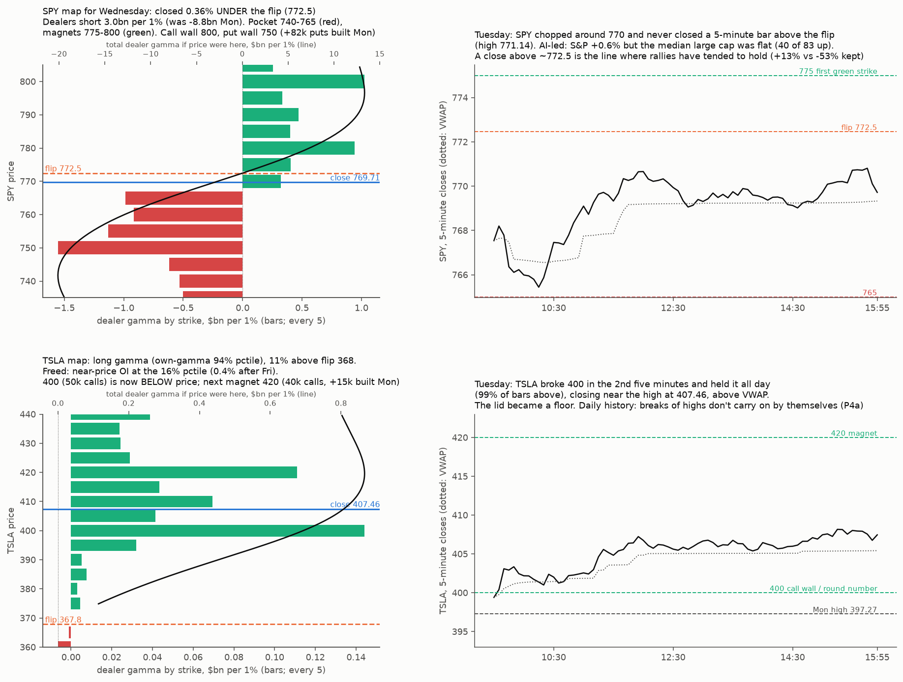

# Live read, Tue Oct 27 close (for Wed Oct 28: FOMC, GOOGL/MSFT after the close)

* A live read, not a new test. It uses the tested tools only:
  * the S&P ladder ([ladder-status](../2026-10-26-ladder-status/));
  * the engine gamma map ([tsla-gap-states](../2026-10-26-tsla-gap-states/) `levels_live.py`, imported, with the dates as parameters);
  * breadth ([channel-correction-theory](../2026-10-25-channel-correction-theory/)).
* **Data:**
  * ThetaData OI dated Oct 27 (positions at the Oct 26 close) and Oct 26 closing chains. Licensed; only aggregates are written here.
  * SqueezeMetrics to Oct 26.
  * Yahoo 5-minute and daily bars to the Oct 27 close.
  * News via Tavily.
* **Reproduce:** `python levels.py <live27/td> <spyg>`, then `python figure.py <live27/y>`.

## SPY (standing checklist)
* **Day:** S&P +0.60% to 7,722.6, 1.23% under its high (7,818.93); SPY 769.71. Equal weight (RSP) +0.09%; 40 of 83 large caps up, median −0.01%. **A narrow, AI-led rally:** SMH +3.0%, AVGO +4.0%, NVDA +0.9%; XLE −2.0%, XLP −0.9%, META −1.6%.
* **Breadth (83 names):**
  * 61% above the 50-day (Mon 64%; normal near-high 63%, z −0.15);
  * 60% above the 100-day (25th pctile);
  * 64% above the 200-day (23rd pctile).
  * Middling, not the synchronized high-breadth state that preceded the channel's corrections.
* **Gamma levels (engine):**
  * Flip **772.5**; SPY closed **0.36% under it**, and no 5-minute bar closed above it (high 771.14).
  * Dealer GEX −$3.0bn per 1% (Mon −$8.8bn at 765).
  * Call wall 800, put wall 750.
* **Gamma pockets:**
  * **Negative (moves amplified):** 765–740, deepest near 742; strikes 750 (−$1.55bn), 755, 765, 760.
  * **Positive (magnets):** 775 (+$0.40bn), 780 (+$0.94bn), 790, 800 (+$1.03bn). Total gamma is most positive near 797.
* **What Monday built (OI change, ±10%, ≤ 45 days):**
  * Puts: +82k at 750 and +48k at 725, against −51k at 755 and −43k at 745. Downside hedges rolled lower and grew.
  * Calls: +14k at 780 and +11k at 770.
* **Gamma by expiry:** Oct 30 holds 25% of gamma, Nov 20 21%, and tomorrow's Oct 28 expiry 7%.
* **S&P ladder (SqueezeMetrics Mon):**
  * GEX at the 25th pctile ($4.30bn), so **R1 is on**.
  * DIX fell to the 49th pctile, so **R2 is off by a hair**. Its event already fired on Oct 20 (78% / 64% leg odds within 20 sessions).
  * R4/R5 need S&P ≤ 7,602.
  * **R6 needs VIX ≤ 17.0** (closed 17.48); R7 needs VIX ≤ 15.0. From Oct 30 the bars are 16.5 and 14.6.
* **Correlation × gamma (P2):** off. SqueezeMetrics GEX is positive.
* **Channel call:** new high > 7,818.93 (+1.25%) before ≤ 7,427.98 (−3.8%). Still open.

## TSLA
* **Day:** +4.03% to 407.46. Opened 397.80, low 395.25 in the first minutes. It closed above **$400 by 9:35 and held all day** (99% of 5-minute bars above). High 408.45; close above VWAP (405.43).
* **Map:**
  * Flip 367.8; TSLA is 10.8% above it.
  * Dealer GEX +$0.81bn, own-gamma 94th pctile: long gamma, damping.
  * Call wall still 400 (50k calls), now **below** price. Next magnet **420**: 39.5k calls, and total gamma peaks at 419.7.
* **Monday's build:**
  * Calls +15.3k at 420, +12.0k at 400, +7.5k at 410.
  * Puts +10.1k at 380, +8.8k at 390, +8.1k at 395.
  * The sign (customer buying vs selling) is untestable without tick data (TODO T1/T2).
* **Freed:** near-price OI at the 16th pctile. After Friday's expiry it falls to the 0.4th (flip 361.5, put wall 350).
  * The "freed only" state: bigger moves both ways (20% up / 23% down within 3 sessions vs 17%/17%; vol-controlled, the extra is up).
* **Reading:**
  * $400 flipped from lid to floor (P4b footprint: Monday stalled at 397.27; today it was accepted).
  * Daily history gives no follow-through edge after a break of a high (P4a: +0.026z, p 0.13), so this is no chase signal.
  * Levels: 400 is the first support (largest positive gamma below price), then 389. 420 is the magnet and lid.

## Backdrop
* **Chips:** Broadcom +4% on a $63bn bank-and-Blackstone financing for Anthropic's purchase of Broadcom technology, plus a DA Davidson upgrade. This followed Anthropic's S-1 filing on Monday.
* **Leaders and laggards:** CoreWeave +8.5%. META −1.6% on its stock sale to fund AI.
* **TSLA:** follow-through from Monday's Barclays upgrade ($450 target) and the SpaceX merger committees.
* **Oil and rates:** oil −1.9% to $99.85 ahead of the Fed; 10-year 4.99%, flat.
* **FX and others:** dollar +0.3%, yen 157.9 (BoJ Friday, a December hike expected); gold +0.9% to $4,074; HYG +0.5%.
* **Vol:** VIX −5% to 17.48, with VIX9D (16.6) under VIX (17.5) under VIX3M (19.5). The front end is calm into the Fed.
* **Calendar:**
  * Wed: FOMC 2pm (hold at 3.75–4.00% about 90% priced; a December hike about 75%); GOOGL and MSFT after the close.
  * Thu: PCE and Q3 GDP; AMZN after the close.
  * Fri: Oct 30 expiry; BoJ.
  * Nov 3: midterms.
