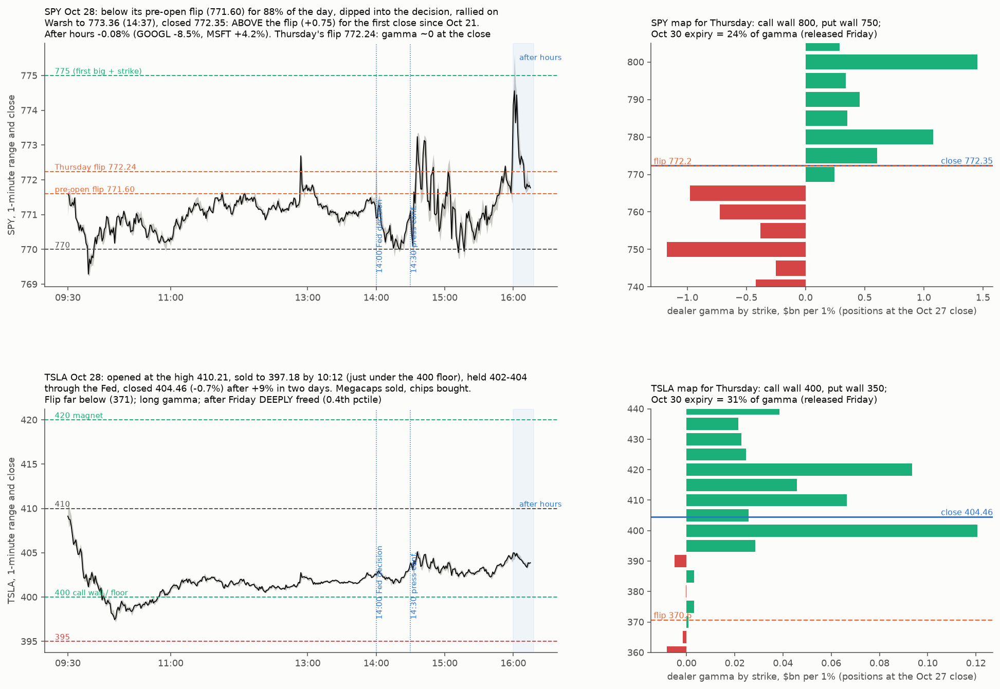

# Live read, Wed Oct 28 (FOMC, MSFT and GOOGL after the close) for Thu Oct 29 – Fri Oct 30

* A live read with the tested tools: the pre-open flip (flip-wicks), the gamma map (engine), breadth, and the ladder (ladder-status).
* **Data:**
  * ThetaData OI dated Oct 28 (positions at the Oct 27 close) and the Oct 27 chains (≤ 60 days; far expiries from the Oct 26 chain, stated); licensed, aggregates only;
  * Yahoo 1-minute bars including after hours;
  * news via Tavily.
* **Reproduce:** `python maps.py <live28/td> <live27/td> <live28/y>`, then `python figure.py <live28/y> <live28/td> <live27/td>`.

## Backdrop
* **Fed, 2pm:**
  * **Held at 3.75–4.00%, 10–2.** Governor Cook and Cleveland's Hammack dissented for a 25 bp **hike**. It is the first governor-plus-president joint dissent since 1992.
  * The statement keeps "inflation remains elevated" and upgrades the economy to "expanding at a strong pace" (from "solid").
  * Warsh: "the monetary medicine is starting to work some, but there is no firm conclusions"; a wait-and-see stance.
  * A December hike was about 78% priced before the meeting.
  * Market: 10-year 5.05% (+6 bp), TLT −0.75%, dollar −0.2%, VIX −4.5% to **16.83**.
* **Microsoft (after the close):**
  * **Azure +48%** in constant currency vs its own 44–45% guide, the fifth straight beat. Azure was $33.2bn.
  * Revenue $92.3bn (+19%) vs a $89.85–90.95bn guide. EPS $4.92 GAAP / $4.89 non-GAAP.
  * Capex $45.2bn, **below** the "over $50bn" outlook. Commercial RPO $677bn (+73%).
  * Shares **+4.2%** after hours (553.8).
* **Alphabet (after the close):**
  * Revenue $127.6bn (+25%), about in line.
  * **Cloud $30.7bn (+103%)** vs about $29.6bn expected; operating margin 31.8%.
  * **But:** Search & other +12% (vs mid-teens expected); EPS $2.12 vs about $3.00 expected; **free cash flow −$9.07bn vs −$0.04bn expected**.
  * Shares **−8.5%** after hours (297.8).
* **Calls:** Alphabet's started at 4:30pm ET, Microsoft's at 5:30pm. Transcripts and capex guidance updates were not yet available at writing.
* **Session:**
  * S&P +0.32% (7,748). QQQ +0.6%, SMH +1.8% (SK hynix), AVGO +2.8%.
  * TSLA −0.7%, AAPL −0.9%, META −1.2%, NVDA −1.2%. Megacaps sold, chips bought.
  * After hours: QQQ −0.25%, AVGO −1.3%, SPY −0.08%.

## SPY (standing checklist)
* **Pre-open flip (incl. 0DTE) 771.60:** SPY spent 88% of the day under it.
  * Low 769.24 at 9:48.
  * −0.05% from 14:00 to 14:29 (the decision); +0.13% from 14:30 to 15:49 (the press conference), with the high of 773.36 at 14:37; +0.06% into the close.
  * **Closed 772.35, +0.75 above the flip.** That is the first close above the pre-open flip since Oct 21.
* **Thursday's map** (positions one day stale until Oct 29 OI):
  * Flip **772.24**, with total gamma about 0 (+$0.13bn) at the close: right at the transition.
  * Call wall 800 (224k calls); positive strikes 800/780/810/775.
  * Put wall 750 (271k puts); negative strikes 750/765/760.
  * Pocket 742–765. Oct 30 holds 24% of gamma.
* **Breadth:**
  * 66% above the 50-day (normal 63%), 61% above the 100-day (29th pctile), 65% above the 200-day (27th pctile).
  * 45 of 83 up, median +0.08%. Improving at 50 days, still middling.
* **Ladder:**
  * VIX 16.83 ≤ 16.99, so **R6 is on** at the close: P(up-leg within 20 sessions) 55% / 64% vs 50% / 58% any day; call spread +11.5% / +13.3% vs +9.5% / +12.3%.
  * R7 needs VIX ≤ 15.0.
  * The R2 window from Oct 20 runs to about Nov 17.
  * SqueezeMetrics for Oct 28 not yet published at writing.

## TSLA
* **Path:**
  * Opened 410.21, which was the day's high.
  * Sold to **397.18 by 10:12**, just under the 400 floor.
  * Held 401–404 through the Fed and closed 404.46 (−0.7%) after +9% in two sessions (Reuters: megacap weakness while chips rallied).
* **Map:** long gamma (+$0.65bn); flip about 371; call wall 400 (45k calls) under price; magnet 420 / total-gamma peak about 424; put wall 350. Oct 30 holds 31% of gamma.
* **Freed** (raw OI, all expiries ≤ 120 days): near-price share 0.089 (**20th pctile**) now. After Friday 0.0555 (**0.4th pctile**): still deeply freed, despite new Nov 6 contracts (+9k near the price).
  * *Correction:* the first run read the 91st pctile because the Oct 27 chain stops at 60 days. Fixed by counting from the raw OI file.
* **DPI** (Oct 27): 5-day 0.532, 75th pctile. Oct 28's FINRA file was not yet published at writing.

## Implications (tested signals only)
* **Thursday:**
  * The after-hours netting (GOOGL −8.5% vs MSFT +4.2%) leaves SPY about flat, near Thursday's flip (772.2) with gamma at zero, so either side is open.
  * Tested: once SPY is above its pre-open flip, dips back to it are where lows tend to stop (H1: 45% vs 36%). The real Thursday flip comes from Oct 29 OI in the morning.
  * 8:30am PCE and Q3 GDP, and the 10-year at 5.05%, are the rate risk. AMZN reports after the close.
* **Friday:** the Oct 30 expiry releases 24% of SPY's and 31% of TSLA's gamma. Month-end. BoJ.
* **Next weeks:**
  * Midterms Nov 3.
  * November base rate +1.9%, 73% up.
  * Ladder R2 (to about Nov 17) and R6 (on now): up-leg odds above base, best played with defined risk.
  * Real-world analogs for SPY stay two-sided (flow-physics B2).
* **TSLA:**
  * Up moves made in high own gamma tend to persist (forced-flow law).
  * After Friday, deep freed plus being far above its flip; historically (post hoc, 20 days) 50% up-bursts vs 20% down-bursts within 3 sessions. The window usually closes in about 4 sessions.
  * Floor 400 (wicked to 397 today); next 395 / 389. Lid and magnet 420–424.

## Calls and late updates (written 23:40 UTC, about 7:40pm ET)
* **After hours, about 19:35 ET, vs the close:**
  * GOOGL 292.67 (−9.9%), MSFT 544.35 (+2.5%, down from +4.2% in early trading), AVGO −2.4%, NVDA −0.6%, AMZN −0.6%, META +0.8%.
  * SPY 768.72 (−0.46%), QQQ −1.09%, TSLA 401.50 (−0.67%). Source: Yahoo 1-minute bars.
* **Alphabet call** (investing.com transcript):
  * The 2026 capex range of $195–205bn is **unchanged**. Capex is still expected to "increase significantly in 2027", with details on the Q4 call.
  * Alphabet started renting **third-party compute** at the end of Q3 and will ramp it in Q4, so Cloud margins face near-term headwinds.
  * TPU system sales keep scaling in Q4, with "a meaningful revenue ramp in 2027". The negative free cash flow is framed as TPU inventory built before billing.
  * Search growth will be pressured in Q4 as it laps last year's acceleration.
* **Microsoft call** (Business Insider):
  * Calendar-2026 capex was **cut to $170bn from $175bn**, a rare cut.
  * Q1 capex was $39.4bn ex-leases and $45.2bn with leases, under the ~$46bn expected.
  * The Dec-quarter Azure guide was not in the coverage I could find at writing.
* **SqueezeMetrics, Oct 28:** GEX +$5.61bn (47th pctile of the past year), DIX 46.1% (64th). GEX is not low, so the R4/R5 rungs stay off. R6 (VIX) stays on.
* **FINRA TSLA, Oct 28:** short share of off-exchange volume 53.7% (Oct 27 48.7%). 5-day 0.515, so DPI is middling.
* **What this changes:**
  * Netting the two reports is no longer flat. SPY after hours is **under Thursday's flip (772.24)**, with total gamma near zero, so the open would start on the short-gamma side.
  * The negative strikes are at 765 and 760, and the pocket is 742–765.
  * Tested rule: below the flip, dips are not where lows stop (H1). Pre-open flip H1 holds only above it.
  * The real Thursday flip comes from Oct 29 OI in the morning. PCE/GDP at 8:30 can move the futures before then.
  * TSLA after hours sits just above its 400 floor (wick 397.18 today); next 395 / 389.
