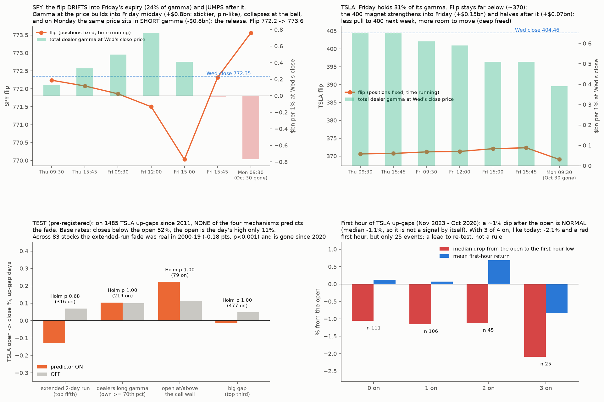

# The gap-up-then-sell open: what predicts it (TSLA, then the 83-stock panel). Pre-registration

* **Owner, 2026-10-28:** "TSLA gap open then volatile sell. What drove that… a common stock behaviour I've seen, and if predicted it can signal to sell held calls right away at the open (I've been tricked by this multiple times)… generalize rules of microstructure."
* **Today (descriptive):**
  * The TSLA "gap" was printed overnight. The first premarket trade (04:00, 412.17) was the premarket **high**; price drifted down to 410.16 by 09:29.
  * It opened 410.21 (+0.67%) and fell to 397.18 by 10:12, just under the 400 call wall.
  * It did this on the **lowest** first-30-minute volume of the three sessions: 8.3M shares vs 24.0M (Oct 26) and 11.2M (Oct 27).
  * That is a fade without heavy selling: the opening buyers simply did not come.

## Mechanisms (each maps to a predictor below)
1. **Attention buying at the open** (Berkman, Koch, Tuttle & Zhang 2012; Lou, Polk & Skouras 2019).
   * After an attention-grabbing run, retail orders pile into the overnight and opening auction and push the open up.
   * Professionals supply them, and the price reverts intraday. **Predictor P1: an extended 2-day run.**
2. **Dealer long gamma** (dealer-sign B: TSLA call gamma damps the next-day range, p < 0.001).
   * When dealers are long gamma, they sell rallies and buy dips. An open above the gamma mass gets pulled back toward it.
   * **P2: own gamma ≥ 70th pctile.**
3. **The call-wall magnet/lid** (positioning-tests P1: gaps over the largest call strike fade, −0.58% vs +0.28%, p 0.17).
   * **P3: open at or above the prior close's call wall.**
4. **Gap size.** Bigger overnight gaps leave more to give back. **P4: gap in the top third of the trailing year's up-gaps.**
5. **Not testable here yet:**
   * call profit-taking at the open (customers selling calls → dealers unwind long-stock hedges; needs OI change and signed option trades);
   * the opening-auction imbalance (Databento);
   * premarket drift (needs premarket history).
   * These go to TODO.

## Tests (fixed before any computation)
* **Events:** TSLA up-gap days, open ≥ prior close × 1.005.
  * Daily data 2011 – Oct 23 2026 for P1 and P4.
  * 2021 – Oct 14 2026 for P2 and P3 (engine history).
* **Outcomes:**
  * **O1 (primary):** open → close return.
  * O2: P(close < open).
  * O3: "the open was the high" (day's high ≤ open × 1.002).
  * O4: first-hour return and the drop from the open to the first-hour low (hourly bars, Nov 2023 – Oct 2026).
* **For each predictor (on vs off among events):**
  * the difference in mean O1;
  * bootstrap by event (2,000), one-sided (on fades more);
  * **Holm across P1–P4.**
* **A predictor passes if Holm p < 0.05 on O1.** O2–O4 are reported.
* **Count rule:** the number of predictors on (0–4) vs O1, Spearman (descriptive).
* **Generalization (G1):**
  * 83-stock panel, daily data 2020 – Oct 2026 (and 41 stocks from 1990).
  * Events: up-gaps ≥ 0.5%.
  * P1 on (the stock's own 2-day return in its top quintile) vs off: difference in mean open → close, bootstrap by day.
  * **Passes if p < 0.05.** P4 is reported the same way.
* **Today's state:** up-gap +0.67%; P1 on (+9.4% in 2 days); P2 on (own gamma 94th pctile); P3 on (open 410 ≥ call wall 400); P4 to be computed.

## Results (run after the pre-registration commit 082e59d; `fade.py` → `out/fade.json`)

**Verdict: no predictor passes.** The TSLA gap-and-fade is not predictable from these pre-open states.
* **TSLA up-gaps ≥ 0.5%,** 2011 – Oct 2026 (1,485 events):
  * mean open → close +0.03%; close below the open 52%; **the open was the day's high only 11% of the time**.
* **By predictor:**
  * **P1** extended 2-day run: open → close −0.13% vs +0.07% (−0.20 pts, p 0.17, Holm 0.68). Right direction, not significant.
  * **P2** long own gamma: +0.10% vs +0.10% (Holm 1.0).
  * **P3** open at or above the call wall: +0.22% vs +0.11% (Holm 1.0). Opposite direction; it does not replicate positioning-tests P1 on smaller gaps.
  * **P4** big gap: −0.01% vs +0.05% (Holm 1.0).
* **Count of predictors on:** no relation (Spearman −0.03).
* **First hour** (Nov 2023 – Oct 2026):
  * The median drop from the open to the first-hour low is about **−1.1% whatever the state**. The early dip is normal noise.
  * With 3 of 4 on (today's case): first-hour return −0.83% and a median −2.1% drop, but **25 events**. A lead, not a rule.
* **G1, 83-stock panel, extended-run up-gaps vs other up-gaps:**
  * 2020–2026: −0.03 pts (p 0.37). **Fails** (the primary sample).
  * 2000–2019: −0.18 pts (p < 0.001).
  * The attention-buying reversal (Berkman et al.) was real and has **decayed since 2020**, plausibly with 24-hour trading and options-driven flow. Not tested.
* **Reading for call holders:**
  * The open is rarely the day's high (11%) and the close finishes below the open about half the time.
  * "Sell at the open" is not a rule the data supports. Neither is panic-selling the routine ~1% first-hour dip.
  * What made Oct 28 different was descriptive, not predictive: an overnight high printed at 4am, the lowest opening volume in three sessions, long dealer gamma with the 400 wall below, and megacap rotation into chips.
* **Added to TODO:**
  * N7: premarket drift and overnight-high timing as a predictor (needs premarket history);
  * D5: the Nasdaq opening-cross imbalance and the first-30-minute aggressor flow (Databento, about $0.05 a day);
  * T4: call profit-taking at the open (OI change + signed option trades).
