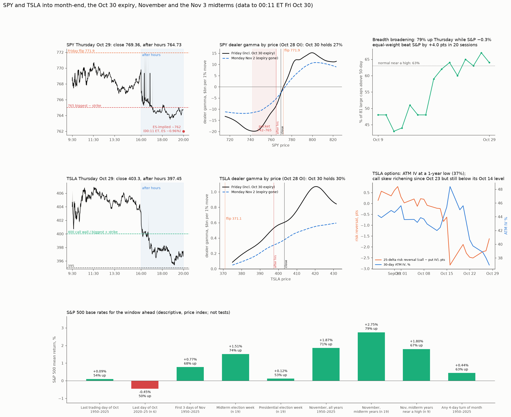

# Live read: SPY and TSLA into month-end, the Oct 30 expiry, November and the Nov 3 midterms

* **Owner, 2026-10-30 (00:15 ET):** "pausing investigations for now. from all our strong point since the beginning of this thread … give me picture of tsla and spy as of today and now and your insight with tomorrow being last day of month and November starting with elections coming. And our triggers and setups for tsla and spy."
* **This is a live read, not a new test.** Every trigger below comes from a study already in this folder tree. Each one carries its evidence strength and its options-era caveat (R0 before 2020, R1 2020–21, R2 2022+; see OWNER_NOTES). The calendar numbers are descriptive base rates, not tests.
* **Reproduce:**
  * `python maps.py <live28/td> <live29/td>`
  * `python tsla_state.py <live28/td> <live29/td>`
  * `python skew_now.py <TSLA chain files Oct 15–28>`
  * `python context.py <breadth dir> <GSPC long json> <fresh ^GSPC json>`
  * `python figure.py <live29/y>`
  * The engine code is imported unchanged: flipmap, td_gamma, hd_gamma, levels_live, and `skew.one_month` from the permanence study.
* **Data and staleness:**
  * Option positions are **OI dated Oct 28, which reflects the Oct 27 close**. ThetaData had not published Oct 29 OI or chains at writing. IVs come from the Oct 28 closing chains.
  * Prices: Yahoo, Oct 29 1-minute bars plus after hours to 20:00. ES and NQ futures at 00:11 ET.
  * SqueezeMetrics GEX/DIX are for Oct 29. FINRA short volume is for Oct 29.
  * Breadth: 81 of the 83-stock panel (2 had no fresh data).
  * Licensed data stays out of git. Only aggregates are committed: total-gamma profiles and per-strike exposure totals, never raw OI.

## Now (00:11 ET Friday)
* **Futures:** ES 7679.75 (−0.96% vs the 16:00 settle). NQ 28,950 (−2.07%). That implies SPX about 7,646 and **SPY about 762**.
* **After hours:**
  * AMZN 225.99 (−7.3%, missed EPS). INTC about −23%. AAPL 352.05 (+0.9%). NVDA 210.15 (−1.7%).
  * SPY 764.73, QQQ 704.30, TSLA 397.45.
* **Thursday's session:**
  * GOOGL −12.6% (283.82; post-report, a record drop). SPX −0.30% to 7,720.39.
  * GDP 3.4% beat; PCE 3.6%, in line.
  * VIX 17.20 (VIX9D 15.87, VIX3M 19.37).
* **The shape of it:** the selling is **cap-weighted and megacap-specific** (AI capex and cloud reports). The average stock was strong: 79% of the panel rose Thursday, median +1.36%, while the S&P fell.

## SPY checklist
* **Breadth:**
  * 64% of the panel above the 50-day, up from 43% two weeks ago; 63% is normal near a high.
  * 60.5% above the 100-day, 64% above the 200-day. 20% within 2% of a 52-week high, 2.5% near a low.
  * The equal-weighted panel beat the S&P by **+4.0 pts over 20 sessions**.
  * Read: broadening underneath while the megacaps reprice. That is not the signature of a broad liquidation.
* **Gamma levels** (our engine, Oct 28 OI):

| | Friday (incl. the Oct 30 expiry) | Monday Nov 2 (after it) |
|---|---|---|
| Flip | **771.94** | **773.62** |
| SPY vs flip | close 769.36 = −0.34%; after hours 764.73 = −0.94%; ES-implied ~762 = −1.3% | |
| Total gamma at spot, $bn per 1% | −3.1 at the close, **−8.6** at 764.7 | −2.8 / −5.4 |
| Call wall / put wall | 800 / 750 | 800 / 750 |
| Most negative strikes | 765 (−1.5 → −2.8 at 764.7), 750, 760, 740 | 750, 760, 740, 730 |
| Short-gamma zone | 716–772 | 716–773 |
| Pocket (most negative total gamma) | 742–765, deepest about **743** | shallower; deepest about 733 |

  * The Oct 30 expiry holds **27%** of SPY's gamma.
  * **Friday is the day the pocket is deepest:** at 745, total gamma is −$20bn per 1% on Friday vs −$12bn on Monday. Moves into 742–765 get the most dealer amplification on Friday. After the expiry the same band is milder.
* **SqueezeMetrics (SPX-wide):** GEX +$5.62bn (48th percentile), DIX 45.8% (59th). The two measures disagree on sign, as before; both say gamma is **not high**.
* **S&P ladder** (REPORT §4i): **all rungs off.** GEX rose to the 48th percentile, so R1 and R2 (GEX ≤ 30th) switched off. VIX 17.20 is above R6's line (≤ 16.99 Thursday, about 16.5 from Friday as Oct 16's 19.99 leaves the 10-day window).
* **FINRA short share, Oct 29:** SPY 63.7%, QQQ 68.9%, TSLA 53.9%. Our fragility tests (gap-context F family) found no signal here, so this is context only.

## TSLA
* **Path:** opened 405.87, low 400.50 at 09:39, high 406.98, closed 403.30. Then lost the 400 floor after hours with NQ: 397.45.
* **Map** (Oct 28 OI):
  * Dealers are **long gamma**: +$0.6bn per 1% at the close, +$0.53bn at 397.45. Own-gamma percentile 87th (77th at 397.45). Moves get damped.
  * Flip 371 (366.5 after Friday). Call wall **400**, which is also the biggest positive strike (+$0.18–0.19bn). Put wall 350. Total-gamma peak (magnet) about 420.
  * The Oct 30 expiry holds **30%** of TSLA's gamma. The 400 strike's gamma falls from 0.18 to 0.08 after Friday.
* **Freed:**
  * Near-price OI share is at the 20th percentile now (freed) and at the **0.4–0.8th percentile after Friday**: deeply freed.
  * Own gamma falls to the 59–66th percentile.
  * Price stays 7–10% above the flip, so the full setup (freed + below the flip) is off.
* **Options pricing** (`out/tsla_skew_recent.csv`):
  * 30-day ATM IV **37.0%, the lowest of the past year** (0th percentile).
  * The 25-delta risk reversal is −1.62 pts. That is up from −2.51 on Oct 22–23, but still **0.8 pts below its Oct 14 level** (t−10).
  * So over the run window the call skew is still *cheaper* than at the start. By the permanence/regimes construct this is not the fragile type of run, but it is moving that way.

## Friday Oct 30: what the mechanics say
1. **SPY opens below its flip, in the short-gamma zone, on the day the pocket is deepest.** Dealer hedging adds to moves on both sides until SPY is back above about 772.
   * Accelerants down: 765 (spot is already at or under it), 760, 750 (put wall).
   * The pocket bottom is about 743.
2. **Month-end plus a 27% (SPY) / 30% (TSLA) gamma roll-off.** Two tested effects pull in opposite directions for next week:
   * **Month-end moves are given back:** S&P moves on calendar forced-flow days are given back −35% over 5 sessions vs −9% on other days (p 0.026, 1990–2026); month-end alone −36%. Pooled, not split by options era.
   * **Bigger gamma roll-off means a weaker following week:** ρ +0.17, Holm 0.10, a near-pass, from calendar-mechanics A7.
   * Net: a big Friday move is more likely to be partly retraced than extended. The roll-off tilt is weak.
3. **AAPL is an earnings gap-up (+0.9% after hours).** Tested and confirmed out of sample: earnings-morning gap-ups fade violently about twice as often as other gap-ups.
   * VF rate 25–30% vs 12–15%; Holm 0.031 on 9 new names; stronger since 2020 (16% → 30% / 27%).
   * Most still don't fade, but the tilt is against AAPL holding the gap, which matters for the index. AMZN gaps *down*; the rule is untested for gap-downs.
4. **The closing auction will be big (month-end).** The 15:50 imbalance predicts the close in the pooled sample: ρ 0.37, 81% in the top fifth. **For SPY (ρ 0.18) and TSLA (0.09) it is weak**, so don't lean on it for these two.
5. **TSLA into the expiry:** long gamma with 400 as the biggest positive strike, so a pull toward 400 is the mechanical default. This is mechanics; pinning was not tested separately.
   * Below 400: 395, then 389 (old triple top).
   * TSLA's coupling to the S&P rises when S&P gamma is low (correlation 0.62 vs 0.35, REPORT §4t). A deep SPY flush drags TSLA as beta.

## November and the midterms (S&P 500, descriptive)
| Window | Mean | % up | n |
|---|---|---|---|
| Last trading day of October, 1950–2025 | +0.09% | 54% | 76 |
| … 2020–25 only | −0.45% | 50% | 6 |
| First 3 days of November | +0.77% | 68% | 76 |
| Any 4-day turn of month, 1950–2025 / 2020–25 | +0.44% / +0.25% | 63% / 53% | 912 / 72 |
| November, all years 1950–2025 / 2000–25 | +1.87% / +2.18% | 71% / 77% | 76 / 26 |
| November, first half (days 1–10) / second half | +1.18% / +0.68% | 65% / 65% | 76 |
| November, midterm years | +2.75% | 79% | 19 |
| **Midterm election week** (close before election day → Friday after) | **+1.51%** | **74%** | 19 |
| Presidential election week | +0.12% | 53% | 19 |
| Midterm October close → next April | +14.8% | **100%** | 19 |
| … only years whose October close was within 5% of a 52-week high (2026: −1.3%) | +13.7%; November +1.8% | 100%; November 67% | 9 |
| All years, October close → next April | +7.0% | 76% | 75 |

* **Caveats:**
  * These are 19-year samples with no mechanism.
  * The REPORT already found midterm Q4 strength to be "not a real edge": +5.0% vs +2.9%, but the **same 79% hit rate**.
  * The turn-of-month effect has faded since 2020.
  * The one calendar rhythm our tests support is the **half-month effect** (first half +4.2 vs second half +2.6 bp/day since 1987). It favours early November.
* **Election volatility (REPORT §4v, 17 elections since 1992):**
  * The VIX build into the vote and the VIX drop after it correlate at **−0.77**. The more hedging is bought, the more is released.
  * Today VIX is flat since Oct 20, the start of the 10-session window into the vote (17.31 → 17.20), and **VIX9D (15.87) sits below VIX**. The 9-day window covering Nov 3 carries no event premium.
  * With nothing built, there is little to release. Expect no big post-vote vol crush unless Friday and Monday build hedges.
  * TSLA had election bursts in 2012 and 2024 (presidential) and nothing in 2016 or 2018 (n = 2), so don't count on one for a midterm.

## Triggers and setups (tested rules only)
| # | Trigger (watch for) | Action it supports | Evidence | Era caveat |
|---|---|---|---|---|
| S1 | SPY rallies back to **771.9 (Fri) / 773.6 (Mon)**, the flip | **Exit / trim short-dated calls there**. A close and hold above it flips dealers to long gamma: grinding, damped tape toward 780, then 800 | Flip-wicks H1: the flip is a real stall level (joint p < 0.002, 40 versions); stronger as a floor (45% vs 36%). Closing back below after touching it is chance | 2020–26 data (0DTE included) |
| S2 | SPY in **742–765** on Friday | Moves get amplified (deepest pocket of the next week). Don't chase puts into the close: month-end moves are partly given back | Pocket is mechanics; give-back −36% over 5 sessions (forced-flow, p 0.026) | give-back pooled 1990–2026 |
| S3 | **S&P close ≤ 7,602 (SPY ≈ 757.6) and SqueezeMetrics GEX ≤ 20th pct** (DIX is above 50th already) → R4 = R5 | Up-leg odds within 20 sessions **74% / 83%** vs 50% / 58% any day. Use a 60-DTE ATM/+5% call spread, not naked calls (−3%) | REPORT §4i ladder | 2019Q4–26 column: the spread paid +11% vs +12.4% any day, so the odds rise but the spread's payoff doesn't. Odds yes, payoff edge no, in the recent era |
| S4 | **VIX ≤ ~16.5** (R6) / **≤ ~14.6** (R7) | R6: up-leg 55% / 64% vs 50% / 58%, spread +11.5% / +13.3%. **R7 is the only rung where naked calls pay** (+5% / +10%) | REPORT §4i | R7 needs a vol crush; election VIX shows nothing built to crush (−0.77 rule) |
| S5 | Friday big S&P move (≥ 1%) | Expect about a third back within 5 sessions. A Friday flush is a candidate call-spread entry for next week, not a trend signal | forced-flow (p 0.026); short-gamma-day moves −18% by day 10 | low-gamma give-back held 2011–19, **not 2020–26** (regimes); month-end version not split |
| T1 | TSLA **400** on Friday | From below: lid and magnet (biggest + strike, expiring 30%). Take profits on short calls into 400–405 Friday. Above 400 and holding: damped | Mechanics + Oct 26 P4b footprint (stalled under 400) | descriptive |
| T2 | **After Friday (Mon–Thu): deeply freed** (0.4–0.8th pct) | Bigger moves both ways. With volatility controlled, the extra moves are up (1.8×, p < 0.01). **ATM IV at a 1-year low makes long premium cheap** for that window | REPORT §4z (2021–26). Freed + far above the flip: 50% up vs 20% down bursts within 3 sessions, but **post hoc, n ≈ 20** | 2021–26 only |
| T3 | TSLA **risk reversal climbs above about −0.8** (richer than at the run's start) while price rises | The run turns into the fragile kind. Take call profits faster (fade risk) | Regimes: call-skew richening predicts run fades in 2022+ (ρ −0.33, p 0.006, n 100) | **2022+ only**; no effect before |
| T4 | TSLA **< ~366–371** (below the flip) while freed | Full setup: 39% up vs 17% down bursts within 3 sessions | REPORT §4t–4z (TSLA own-options ladder) | 2021–26 |
| T5 | TSLA dips **while the S&P is in R4/R5** (S3 fires) | **Don't buy TSLA calls**; use SPX/SPY spreads instead | REPORT, TSLA ladder: TSLA calls in R4s/R5s were the worst entry (−25% to −27% vs +12% / +22%) | 2012–26 |
| T6 | A TSLA rally made while own gamma is high (77–87th pct Friday) | More likely to hold than one made in low gamma | Forced-flow law, single names | low-gamma give-back weaker since 2020 |

* **Not usable as triggers:**
  * The 09:35 first-five-minute rule: 61% / 55%, weak since 2020, tested on gap-ups only.
  * FINRA short share.
  * The closing imbalance for SPY or TSLA.
  * The midterm and November base rates as stand-alone signals.

## What I would watch, in order
1. **08:00–09:30:**
   * Whether ES holds −1% or extends.
   * SPY opens near 762. Every dollar lower puts more of the pocket in play, with 760 and 750 the next accelerants.
2. **The open:** AAPL's gap (the fade risk) and AMZN's follow-through decide whether the cap-weighted index or the broad tape leads.
3. **Morning:** the real Friday flip from the Oct 29 OI (published in the morning).
   * If SPY reclaims 772 it is long gamma again, and the month-end give-back story says buy dips.
   * If not, it stays two-sided and amplified.
4. **The close:** the month-end auction.
5. **The weekend into Monday:** whether VIX builds into Nov 3. Without a build there is no release trade.

## Flags
* Positions are 2 sessions old (Oct 27 close). The Oct 28–29 trading, including FOMC Wednesday and GOOGL Thursday, is not in the OI. Treat every level as ±1 strike.
* The SPY engine sign (−$3bn) vs SqueezeMetrics (+$5.6bn) disagree, as in every read since Oct 23. The engine is SPY-only; SqueezeMetrics is SPX-wide.
* ES-implied SPY of 762 assumes the basis is unchanged since 16:00.
* No new hypotheses were tested; $0 data spend.
