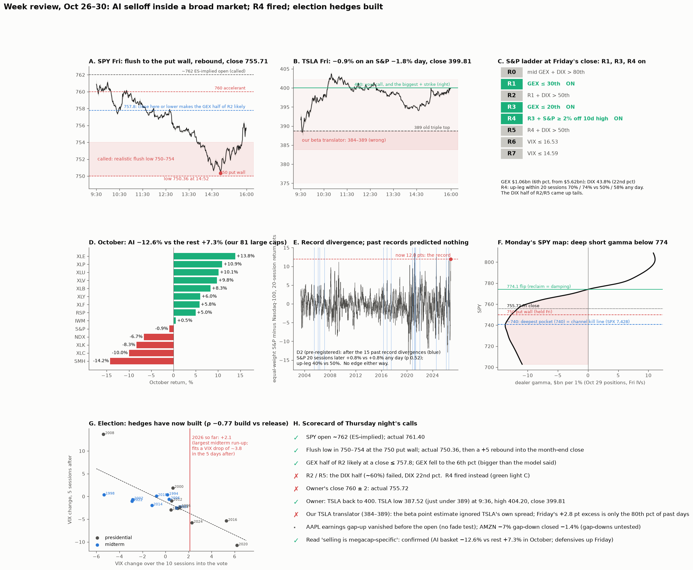

# Week review (Oct 26–30): scorecard of Friday's calls, the "stealth bear market" note, and the week ahead

* **Owner, 2026-10-31:** pasted a third-party note: "the 'stealth' bear market is in full swing … Nasdaq 100 erased −$4 trillion in 25 days … the 'S&P 500 Excluding AI' hit a record high … AI stocks fell over −13% in October while the S&P 500 excluding AI gained +8% … ~58% of the S&P 500 is down −20% or more … we believe the market is ultimately setting up for its next leg higher."
  * The owner's ask: "This week ended very interestingly. Do a full analysis based on all our strong points."
* The note is third-party content. Its claims are checked against our data where possible, never taken as given.
* **Plan:**
  * (1) Score the pre-stated calls from [2026-10-30-live-read](../2026-10-30-live-read/) against Friday's tape.
  * (2) Check the note's claims on our data.
  * (3) Read the week ahead from every tested rule: ladder, channel dip rule, month-end give-back, election VIX, TSLA states.
  * (4) One new pre-registered test, D2, below.

## Pre-registration D2 (written and pushed before computing): what follows a record tech-vs-rest divergence?
* **Why:** the note's thesis is that a stealth bear in AI inside a bull in everything else sets up "the next leg higher". Our channel theory says the same thing in mechanical terms. Rotation inside the index (money moving, not leaving) is the bounce signature, and synchronized selling is the correction signature.
* **Data:** Yahoo adjusted daily closes for RSP (equal-weight S&P, 2003-05+), QQQ (Nasdaq-100) and ^GSPC.
* **Signal:**
  * spread = RSP 20-session return − QQQ 20-session return.
  * **Event:** spread ≥ its 97.5th percentile, computed only on data before that day (expanding window, at least 500 days of history), **and** RSP within 2% of its 252-day closing high.
  * Only the first day counts, and events must be at least 20 sessions apart.
* **Outcomes:**
  * (a) S&P 20-session forward return.
  * (b) P(an S&P up-leg starts within 20 sessions). Up-leg = a top-decile 10-session S&P rise, the ladder's definition.
  * (c) QQQ 20-session forward return: does tech rebound?
* **Baselines:**
  * All days.
  * Matched dip days: S&P ≥ 2% below its 10-day high. This separates the divergence from the dip itself.
* **Statistics:** event means vs baseline. p from 5,000 random draws of the same number of baseline days, each at least 20 sessions apart. 90% bootstrap CIs over events. Every n is reported.
* **Prediction:**
  * (a) and (b) above both baselines; the rotation theory says bounce.
  * (c) no prediction; tech could keep lagging.
  * Confidence is low: expect roughly 10–25 events.
* **Regimes:** results split pre-2020 / 2020–21 / 2022+ per OWNER_NOTES, descriptive given the n.
* **Today's value** is reported, not used to tune anything.

## Results
* **Reproduce:**
  * `python d2_divergence.py <live31/long>`
  * `python maps_mon.py <live31/td>`
  * `python figure_week.py <live31>`
  * Ladder: `2026-10-26-ladder-status/status.py:spx_ladder` on a fresh data folder.
* **Data:**
  * Yahoo through Fri Oct 30 (daily, 1-minute).
  * SqueezeMetrics GEX/DIX for Oct 30. FINRA Oct 30.
  * ThetaData OI dated Oct 30 (= the Oct 29 close; Friday's trading is not in it) and Oct 30 closing chains. The client was reinstalled in a Python 3.12 venv after a container restart.
  * News: Reuters, CNN, Bloomberg via search.

### 1. Scorecard of the pre-stated calls (2026-10-30-live-read)
| Call | Outcome |
|---|---|
| SPY opens ~762 (ES-implied) | ✓ 761.40 |
| Flush low 750–754 at the 750 put wall; 743 only on a 3-sigma day | ✓ low **750.36** at 14:52, then +5.35 into the close |
| "Don't chase puts into the close" (month-end) | ✓ +0.7% off the low in the last hour |
| The GEX half of R2 is likely at a close ≤ 757.8 | ✓ GEX $5.62bn → **$1.06bn** (6th pct). The drop was bigger than the regression implied |
| The DIX half (~60%) | ✗ DIX 43.8% (22nd pct): **R2 and R5 off** |
| Green light C (R4) | ✓ **R4 on**, together with R1 and R3 |
| Owner's close 760 ± 2 | ✗ 755.72 |
| Owner: TSLA "gravitates back to 400" | ✓ low 387.52 at 09:36 (just under 389), high 404.20, close **399.81** |
| Our D1 translator: SPY 755.7 → TSLA 384–389 | ✗ The beta point estimate ignored TSLA's own spread (SD of excess 3.4 pts). Friday's +2.8 pt excess is only the **80th percentile** of the 195 D1 days |
| AAPL earnings gap-up fade | · no event: the +0.9% after-hours gap was gone by the open (AAPL −1.2%) |
| AMZN | · −7% after-hours gap-down closed −1.4% (gap-downs untested) |
| "Selling is megacap-specific" | ✓ see section 2 |

### 2. The note's claims, checked on our data
| Claim | Our check | Verdict |
|---|---|---|
| AI −13% in October, S&P ex-AI +8% | 81-stock panel: AI basket (13 names: semis + hyperscalers + ORCL), equal-weighted, **−12.6%**; the other 68 **+7.3%** | ✓ |
| S&P ex-AI at a record on Friday | The rest-of-panel equal-weight index is 0.3% under its Oct 22 record; RSP −1.6% from its high and −0.8% on Friday | ≈ near a record, not on Friday in our proxy |
| Nasdaq-100 "briefly in correction" | NDX close −9.1% from its 52-week high; QQQ Friday low 683.45 | ≈ |
| S&P 3.5% from its record | −3.05% on closes (7,580 vs 7,818.93) | ≈ |
| ~58% of the S&P ≥ 20% off highs | Our large caps: **33%** ≥ 20%, 53% ≥ 10%, 17% ≥ 30%. AI names 69% ≥ 20% vs 26% for the rest | not verifiable for the full S&P; large caps are healthier |
| Widest divergence on record | RSP − QQQ 20-session spread **+12.0 pts**, the 99.93rd pct since 2003 and 1.6× the largest past event (7.3) | ✓ |
| Most S&P members green over 5 days | Panel: 68% up over 5 sessions | ✓ |
| "Setting up for the next leg higher" | D2: record divergences alone predicted nothing (below) | the conclusion may hold, but not because of the divergence |

### 3. D2 result: **fails** (pre-registered @ a60ae3a)
| | 15 events | All days | Dip days |
|---|---|---|---|
| S&P 20 sessions later | +0.78% [−0.42, +2.08] | +0.82% (p 0.52) | +1.19% (p 0.64) |
| QQQ 20 sessions later | +1.18% | +1.31% (p 0.55) | +1.77% |
| P(up-leg ≤ 20 sessions) | 40% [20, 60] | 50% (p 0.85) | 77% |

* **Regimes:**
  * pre-2020: n 7, P(leg) 0%.
  * 2020–21: n 4, 75%.
  * 2022+: n 4, 75%.
  * Descriptive only.
* **The current episode** began Oct 22. Today's spread is far beyond any past event, so this is out-of-sample territory.
* **Reading:** rotation in itself is neither the bounce signal nor the crash signal. The prediction (a bounce above both baselines) is wrong.
* The channel rule's breadth reading is a different variable: participation at the dip's start, not the tech-vs-rest spread.

### 4. The week ahead, from tested rules only
* **Ladder (REPORT §4i): R4 fired Fri Oct 30, its first firing this episode.**
  * Odds: up-leg within 20 sessions **70% / 74%** vs 50% / 58% any day. Median lead 4–5 days; the window runs to about Nov 27.
  * Structure: 60-DTE ATM / +5% call spread, +17% / +11% vs +9.5% / +12.4%. **Odds edge yes; payoff edge not in 2019Q4–26.** Naked calls −4%.
  * Multiverse: lower GEX thresholds strengthen P(leg); GEX is at the 6th pct.
* **Next rungs:**
  * **R5:** R4 + DIX > 50th → 74% / 83%. From Nov 4 the 10-day high becomes 7,743.98, so R4 then needs the S&P ≤ ~7,589.
  * **R6 / R7:** VIX ≤ 16.53 / ≤ 14.59.
* **Election (REPORT §4v):**
  * The VIX run-up into the vote is **+2.1 pts** so far (17.31 → 19.42), the largest midterm run-up in our set (previous max 2010, +0.94). It is comparable to 2024 (+2.29).
  * The 17-election fit (ρ −0.77) gives **VIX about −3.8 pts in the 5 sessions after the vote**. From 19.4 that is about 15.6: R6 territory, short of R7.
  * The S&P link is weaker (fit +1.5%, ρ 0.53).
  * Caveat: much of this run-up is the AI selloff, not election hedging as such.
  * Midterm election week base rate: +1.5%, 74% up (n 19, descriptive).
* **Month-end give-back (forced-flow):** S&P moves on month-end days give back −36% over 5 sessions (p 0.026, pooled 1990–2026). Friday's −1.82% implies about +0.6% back.
  * Counterweights: the low-gamma give-back held in 2011–19, **not 2020–26** (regimes); and the gamma roll-off tilts the week weaker (near-pass).
* **Channel dip rule:**
  * The episode is still open; it began Oct 16 from narrow breadth (bounce side).
  * **Kill line: S&P close ≤ 7,427.98 (SPY ≈ 740.6)**, which coincides with the deepest point of Monday's SPY gamma pocket (~740).
  * The pre-stated warnings are not triggered:
    * Breadth is normal (63% above the 50-day), not surging.
    * The rotation has not stopped: defensives rose Friday (XLP +1.4, XLU +0.7, XLV +0.5, XLE +1.9) while semis fell (SMH −7.0).
  * Rates eased (10-year 4.93%, −36 bp in October). The narrow-breadth corrections in the channel were both rates shocks.
  * Gold −3.5% (bounce side). Yen calm (USD/JPY 157.8).
* **Correlation × gamma (P2) is the risk to watch:**
  * In true short gamma (SqueezeMetrics GEX < 0), rising correlation turned bounces into drops (2020–22 mostly).
  * GEX is +$1.06bn, near zero. The panel's average pairwise correlation is 0.09 and flat: dispersion, not contagion.
  * GEX turning negative with correlation rising would mean the AI selling is spreading. That breaks the rotation reading.
* **Monday's SPY map** (Oct 29 positions, Friday IVs; Friday's trading not in the OI):
  * Flip **774.1**; total gamma −$11.7bn per 1% at 755.7.
  * Put wall 750 (it held Friday); negative strikes 750 / 760 / 755 / 757; deepest pocket ~740; short-gamma zone 703–774.
  * Moves are amplified both ways until 774. A rally into 760–765 accelerates; 774 is the stall level.
* **Calendar:** the half-month effect (first half stronger, tested since 1987) favours Nov 2–13.

### 5. TSLA
* **Week:** +7.4%, the only Magnificent Seven gainer (Opening Bell Daily). Friday −0.9% vs S&P −1.8%.
* **Monday state:**
  * Freed: near-price OI at the **4th pct**.
  * Own gamma 60th pct.
  * Flip 372–375; call wall 400; put wall 350.
  * Positive strikes 420 / 400 / 410; total-gamma peak ~428; total gamma +$0.31bn per 1% (Friday +$0.6bn).
* **Options:**
  * ATM IV 41.4%, up from 37.0% on Oct 28.
  * 25-delta risk reversal **−4.8**, from −1.6: puts were bid and call skew cheapened.
  * By the 2022+ skew rule (T3) this is the opposite of a fragile run.
* **Rules that apply:**
  * Freed: bigger moves both ways; with volatility controlled the extra moves are up (1.8×, 2021–26).
  * **T5: the S&P is in R4 now. If TSLA dips, TSLA calls were the worst entry (−25% to −27%).** Use S&P spreads instead.
  * D1: on S&P −1% days TSLA averages about 2× the move, with a wide spread (SD 3.4 pts).
* **New lead (not tested), Friday was an expiry day:** TSLA sat at the 400 strike that held the most gamma, with 30% of its gamma expiring. A selloff day plus an expiry-day pin at the top strike is untested. Added to TODO.

## Flags
* OI is one day stale for Monday. The Nov 2 file will show Friday's positions.
* The AI basket is our definition (13 names in the 81-stock panel), not the note's index.
* D2 has 15 events; its CI is wide.
* The election fit has 17 points, and 2026's run-up is partly the AI selloff.
* Spend: $0 (ThetaData plan, free sources).
