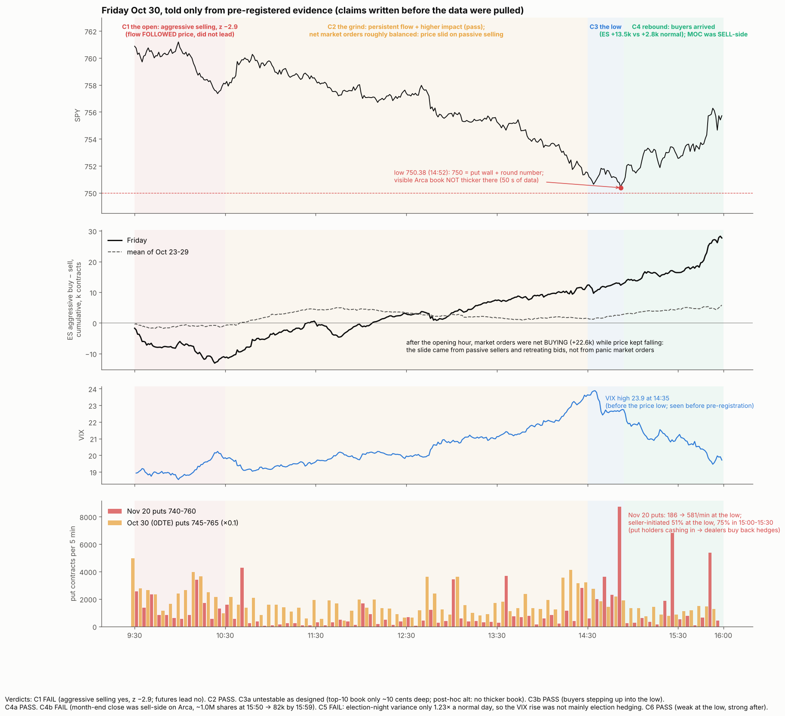
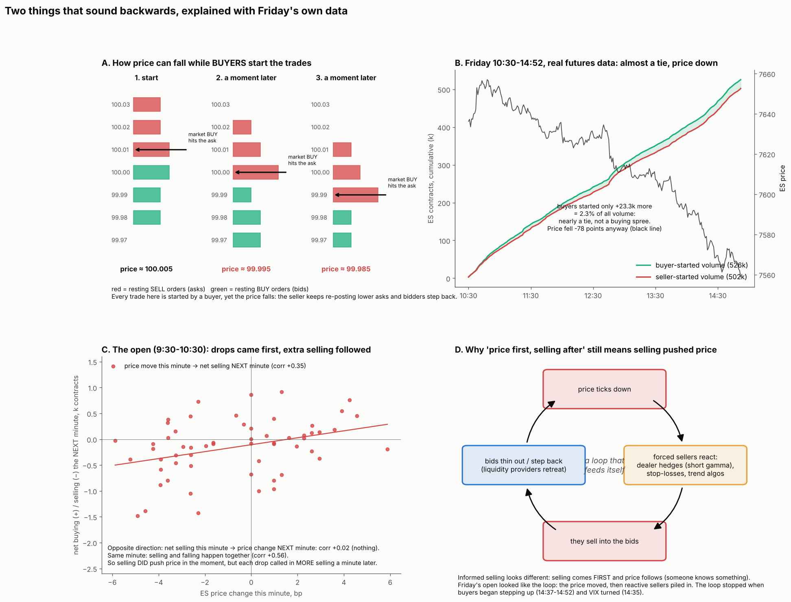
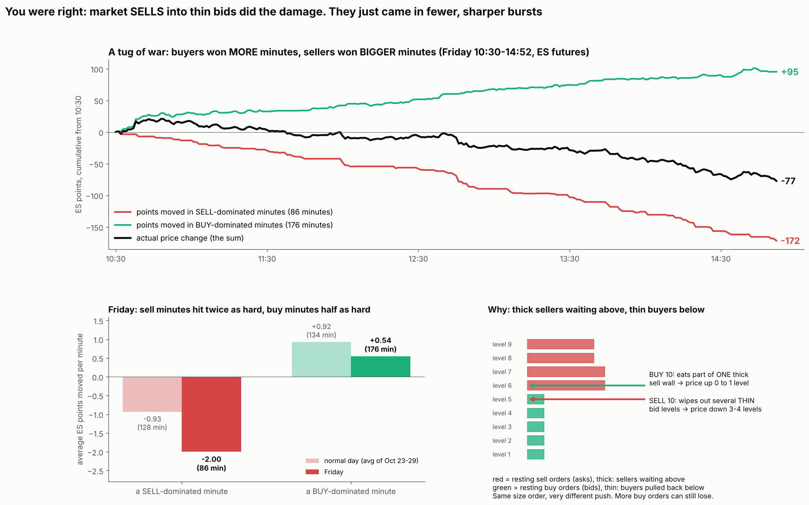
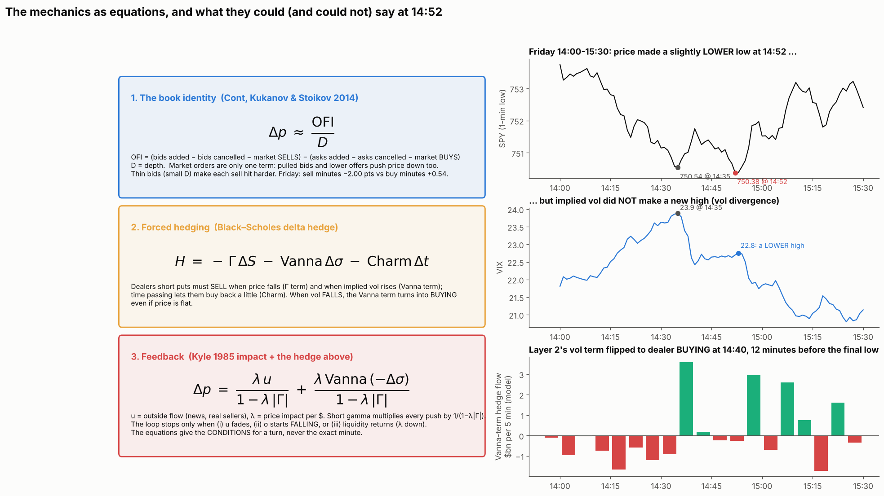
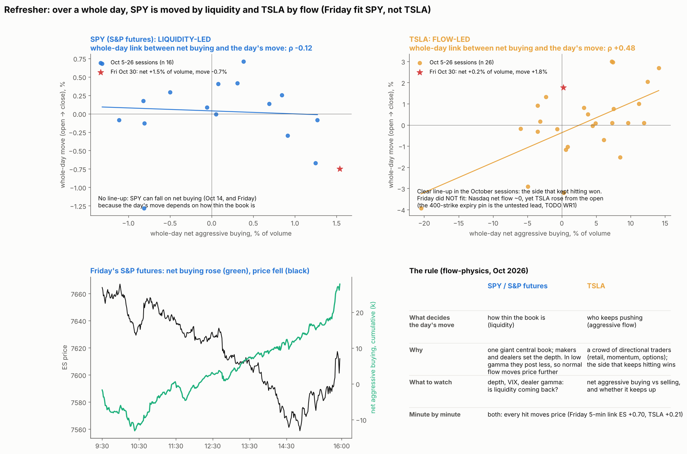

# Friday Oct 30 from the open to the close: a narrative built from pre-registered evidence

* **Owner, 2026-11-01:** "Days like this offer windows in the world of microstructure. Can we make a 'narrative' for it from start to end based on evidence. Not post hoc."
  * Also open from the owner: "How did u know it's election hedges", the time-decay question, and "why did the bounce start … was it a highly liquid level so selling through it became harder".
* **How this avoids post hoc:**
  * Each chapter below states a claim, a measure, a baseline and a falsifier. All of it was written and pushed **before** pulling the microstructure data: Databento ES and SPY trades, Arca book and closing imbalance, OPRA put trades, and the SPY IV term structure.
  * A chapter is told as written only if its evidence passes. A chapter that fails is reported as failed, and the narrative changes.
* **Already seen before this pre-registration (cannot count as confirmation):**
  * SPY 1-minute path: open 761.40, low 750.36 at 14:52, close 755.71.
  * VIX 5-minute path: high ~23.5 around 14:30.
  * The engine's dealer-flow model (2026-11-01-rsi-gamma-precedents).
  * The 750 put wall and the pocket.
  * Thursday night's ex-ante calls (2026-10-30-live-read).
  * ES daily volume.
* **Baseline days:** the 5 prior sessions, Oct 23–29, same clock windows.
* **Cap:** Databento spend ≤ $15 (costs checked first: ES trades ~$0.67/day, Arca book ~$1.05, Arca imbalance ~$0.01; OPRA limited to named contracts).

## Chapters, claims and falsifiers
* **C1. The open, 09:30–10:30: was the drop aggressive selling, with futures leading?**
  * Measure: ES aggressor-signed volume (buy − sell, front month), cumulative over the window, as a z-score vs the baseline days' same window. Also the lead-lag: correlation of 1-minute ES signed flow with the **next** minute's SPY return vs the reverse.
  * Claim: z ≤ −1 and ES leads.
  * **Falsifier:** z > −1, which would make it a gap with no aggressive selling.
* **C2. The grind, 10:30–14:30: persistent, mechanical-looking selling in thin liquidity?**
  * Measure (a): lag-1 autocorrelation of 5-minute ES signed flow vs the baseline days.
  * Measure (b): price impact per signed contract (Kyle's λ, a 1-minute regression of ES return on signed flow) vs the baseline days.
  * Claim: (a) above the baseline median and (b) above the baseline median.
  * **Falsifier:** both at or below the median.
* **C3. The low, 14:30–14:55: did resting liquidity at 750 and fading selling stop the fall?**
  * (a) **Arca bid depth** within $0.50 above 750.00 during 14:40–14:55 vs bid depth at the same distance from price in other windows of the day. Claim: larger (top quartile of the day). **Falsifier:** not in the top half.
  * (b) **Exhaustion:** ES signed flow per minute in the 15 minutes before the 14:52 low vs the 30 minutes before that. Claim: less negative. **Falsifier:** selling at its most intense into the low.
  * (c) VIX peaking before the price low: already seen, reported only.
* **C4. The rebound and close, 14:55–16:00: buyers arriving, or sellers stepping away?**
  * (a) ES signed flow in the 10 minutes after the low. Claim: positive, so buyers arrived. **Falsifier:** at or below zero, meaning the rebound came from absent sellers.
  * (b) **Month-end closing auction** (Arca imbalance feed). Claim: buy-side imbalance into the close. This is pre-stated from pension rebalancing: in October stocks −0.9% vs long bonds +5.6%, so rebalancers buy equities. **Falsifier:** sell-side imbalance.
* **C5. Was there an election premium? (owner's question)**
  * Measure: SPY implied variance for the single-day interval covering election night (Nov 3 → Nov 4 expiry), from ATM implied vols per expiry on the Oct 30 close, vs the neighbouring single-day intervals.
  * Claim (as I implied last week): ≥ 1.5× the neighbours.
  * **Falsifier:** below 1.5×, in which case the VIX rise was not specifically election hedging.
* **C6. Put monetization at the low (owner's bounce question)**
  * Measure: OPRA trades in near-money SPY puts (Oct 30 expiry 745–760; Nov 20 expiry 740–760). Share of put volume traded at or below the mid (customer selling) in 14:30–15:00 vs 13:30–14:30, and volume per minute.
  * Claim: more selling-to-close and higher volume at the low.
  * **Falsifier:** put trades skew to buying at the low.
* **Answer kept separate from the evidence: time decay.**
  * Dealers short puts hedge by holding short stock.
  * Over time an out-of-the-money put's delta shrinks, so dealers **buy back** stock. The model said time decay was a small net *buyer* on Friday (+$1.2bn).
  * This is mechanics, not tested here.

## Results
* **Reproduce:**
  * `python narrative.py <db dir> <td dir>`
  * `python figure.py <db dir> <Yahoo 1m dir>`
* **Data:**
  * Databento: ES front-month trades Oct 23–30; SPY 1-minute bars (EQUS.MINI); Arca SPY top-10 book and closing imbalance; OPRA trades with quotes for 10 SPY puts. Spend **$6.95**.
  * ThetaData SPY closing chain for Oct 30.
* **Bug found and fixed before reading any result:** Databento trade `size` is unsigned, so negating sells wrapped around. It is now cast to int64. Every number below is from the fixed run.

| Chapter | Pre-registered claim | Evidence | Verdict |
|---|---|---|---|
| **C1** open | aggressive selling (z ≤ −1) **and** ES leads SPY | ES signed −11,007 contracts in 09:30–10:30, **z −2.88** vs the 5 prior days. But ES flow did **not** lead (corr with next-minute SPY return 0.01); price led flow (0.34 vs 0.11 on baseline days) | **fail** (half right: heavy selling, but reactive) |
| **C2** grind | persistent flow and higher impact | 5-minute flow autocorrelation 0.30 vs baseline median 0.16; λ 4.9 vs 4.0 bp per 1k contracts | **pass** |
| C2, descriptive | | net aggressive flow **+22,590** (buying) in 10:30–14:30 while ES fell. The slide came from passive selling and retreating bids, not from market-order selling | |
| **C3a** 750 depth | thicker resting bids at 750 | **untestable as designed:** the top-10 Arca book spans only ~$0.10, so the same-distance comparison is empty. Post-hoc alternative: when the best bid was 750.30–750.55 (50 seconds), top-10 bid size was 4,014 vs a 4,204 all-day median (31st pct) | not supported on the visible book |
| **C3b** exhaustion | selling eases into the low | ES flow +30/min in 14:07–14:36 → **+166/min** in 14:37–14:51. Buyers stepped up while price made its last low | **pass** |
| C3c | VIX peaks before the price low | VIX 23.9 at 14:35 vs the price low at 14:52 | seen before; not counted |
| **C4a** rebound | buyers arrive | ES +1,093 in the 10 minutes after the low; **+13,512 in 15:00–15:59** vs +2,750 on baseline days | **pass** |
| **C4b** month-end close | buy-side imbalance (pension rebalancing) | Arca closing imbalance **sell-side**: ~1.0M shares at 15:50 (indicative 746.74), 935k at 15:55, 82k at 15:59 | **fail** |
| **C5** election premium | election-night variance ≥ 1.5× neighbours | **1.23×**: forward vol for Nov 3 → Nov 4 21.1% vs about 19% for neighbouring days | **fail**: the VIX rise was mostly the AI selloff |
| **C6** put monetization | more customer put selling at the low | Nov 20 puts: volume **186 → 581/min**, seller-initiated 48.8% → 50.7%. 0DTE puts 46.8% → 48.2% | **pass (weak)** |
| C6, after the pre-registered window | | Nov 20 puts in 15:00–15:30: **75% seller-initiated**. Put holders cashed in during the rebound | descriptive |

### The narrative (only what survived)
1. **Before the open (stated Thursday night):** ES −1%, SPY below its flip in short gamma, the deepest pocket 742–765, the 750 put wall, and 27% of gamma expiring.
2. **09:30–10:30:** the most one-sided selling of the week in futures (z −2.9). It was **reactive**: futures flow followed price minute by minute rather than leading it, the pattern of hedging and trend flows responding to moves.
3. **10:30–14:30:** a slow grind. Flow was more persistent and each contract moved price more than normal: thin, one-way liquidity. But **market orders were net buyers**. The decline came from sellers working passive orders and bids stepping back, which fits dealers and other liquidity providers retreating in short gamma.
4. **14:30–14:52:** VIX topped first (14:35). Aggressive buyers had already stepped up (+166 contracts/min) while price made its final low at 750.36.
   * The visible Arca book was **not** thicker at 750.
   * The "big liquid level" idea is not supported by what we can see. Hidden orders and other venues are invisible to this test.
5. **14:52–16:00:** buyers arrived in size (ES +13.5k in the last hour, about 5× normal). Put holders cashed in, which lets dealers buy back their short-stock hedges.
   * **The month-end close was a sell imbalance** (~1M shares on Arca at 15:50). It was absorbed as the imbalance shrank to 82k by 15:59.
   * The pension-rebalancing call was wrong.
6. **Background:** the options market priced only a small election-night bump (1.23× a normal day). The VIX run-up was mainly the AI selloff, not election hedging. **Last week's "election hedges built" framing overstated it.** The regression's sign stands, but its premise is weak.

### Threats
* Five baseline days.
* ES front month only; SPX and SPY options flows are not in the trade data.
* Arca is one venue, and its top-10 book is shallow.
* The trade-side split for options uses the mid-quote rule.
* The C6 effect at the low is small.

### Explainer for the owner (descriptive, not new tests)

* **Net buying with falling prices:**
  * In 10:30–14:52, buyer-initiated ES volume was 526k contracts and seller-initiated 502k. Buyers started 2.3% more of the volume: almost a tie.
  * Price fell 78 points anyway. Price is set by where resting orders sit, not by who crosses the spread.
  * Sellers who re-post lower offers, and bidders who step back, move the quote down even when market orders are balanced or tilted to buys.
  * Arca's top-10 book had more resting shares on the ask than the bid about 60–65% of the time all day (imbalance −0.06). That held in the rebound too, so it is context, not a cause.
* **Price first, selling after (the open):**
  * Same minute: corr(net flow, return) +0.56. Selling and falling coincide.
  * Return this minute → net flow next minute: **+0.35**. Drops called in more selling.
  * Net flow this minute → return next minute: +0.02 (nothing).
  * This is a feedback pattern (reactive sellers: dealer hedges, stops, trend algos), not an informed seller leading the price.

### Correction after the owner's question ("why isn't it selling market orders where the liquidity is thin?")

* **The owner's picture was right, and my earlier wording was wrong.** I wrote that the slide came "not from market-order selling". Splitting 10:30–14:52 into minutes (`tugofwar.py` → `out/tug_of_war.json`) shows otherwise.

| ES, 10:30–14:52 | Sell-dominated minutes | Buy-dominated minutes | Total |
|---|---|---|---|
| Friday | **86 min, −172 pts (−2.00/min)** | 176 min, +95 pts (+0.54/min) | **−77** |
| Normal day (Oct 23–29 avg) | 128 min, −0.93/min | 134 min, +0.92/min | ≈ 0 |

* **Reading:**
  * Market sells came in fewer, sharper bursts into thin bids, and each burst hit twice as hard as normal.
  * Buy-dominated minutes were more numerous but moved price half as much as normal: sellers were waiting above.
  * "Net buying" was a count of many weak buy minutes, not buyers winning.
* **Regression of 1-minute change on buy and sell volume:**
  * Price impact per 1k contracts: buys +3.39 pts, sells −3.63 pts.
  * Drift −0.135 pts/min, which is about −35 pts over the window: quotes sliding down between trades.
  * Roughly half the decline was the sell bursts' larger impact and half was the drift.

### The mechanics as equations (owner: "a fundamental principle … like physics … that could signal 2:52, and would it usually work")

* **The three layers, each derived rather than fitted:**
  * **(1) Book identity**, Δp ≈ OFI / D (Cont, Kukanov & Stoikov 2014). Price moves with the imbalance of *all* top-of-book events (market orders, additions, cancellations) divided by depth.
  * **(2) Hedge flow**, H = −Γ ΔS − Vanna Δσ − Charm Δt, from Black–Scholes delta hedging.
  * **(3) Feedback**, Δp = λ(u + H). With dealers short gamma, every outside push u is multiplied by 1 / (1 − λ|Γ|), and a vol decline adds a buying term.
* **What they could say at 14:52:**
  * The conditions for the loop to weaken: σ falling, outside selling fading, liquidity returning. Not the minute.
  * On Friday VIX peaked at 23.9 (14:35), and the model's vanna term flipped to buying at 14:40.
  * At the 14:52 retest, price made a slightly lower low (750.38 vs 750.54) while VIX made a lower high (22.8). That is a *vol divergence*: the vol-driven forced selling had stopped.
* **Size of the multiplier, rough and flagged:**
  * Using the inelastic-markets estimate (Gabaix–Koijen: $1 of flow moves aggregate value about $5) gives λ ≈ 5 / market cap.
  * With Friday's SPY-only gamma (~$10bn per 1%), λ|Γ| ≈ 0.08, so the multiplier is about 1.09.
  * SPX options would add several times that, so the multiplier is plausibly 1.3–1.6: amplification, not explosion.
  * The parameters are not measurable precisely in real time.
* **Would it usually work: untested.**
  * Related tests: intraday gamma momentum is weak in SPY since 2023 (forced-flow A2). The impact propagator law held for TSLA but not ES (flow-physics A3).
  * Added to TODO as ND1: (a) a daily version (S&P new low with VIX below its prior high, while below the gamma flip) on free data since 1990; (b) an intraday version, which needs intraday implied vol (OPRA SPY ATM quotes, ~$ cost to check).

### Refresher: SPY is liquidity-led, TSLA is flow-led (flow-physics A1), checked on Friday

* **Whole-day net aggression vs the whole-day move** (Oct 5–26 sessions, `2026-10-27-flow-physics/out/a_daily.csv`): ES ρ −0.12 (n 16), TSLA ρ +0.48 (n 26, p 0.013).
* **Friday, open → close:**
  * ES: net **+1.5%** of volume while the move was **−0.7%**. This fits liquidity-led.
  * TSLA on Nasdaq: net **+0.2%** while the move was **+1.8%**. This does **not** fit flow-led. TSLA rose from the open without net aggression on Nasdaq.
  * Nasdaq is only part of TSLA's volume, and 43% of its prints are unsigned. The untested expiry-pin lead is TODO WR1.
* **Minute by minute, both co-move with flow:** Friday's 5-minute link was ES +0.70 and TSLA +0.21. That is the same-moment push of every trade. The day-level rule is about what the whole day's flow adds up to.
* Spend: TSLA Nasdaq trades for Friday, $0.04.
