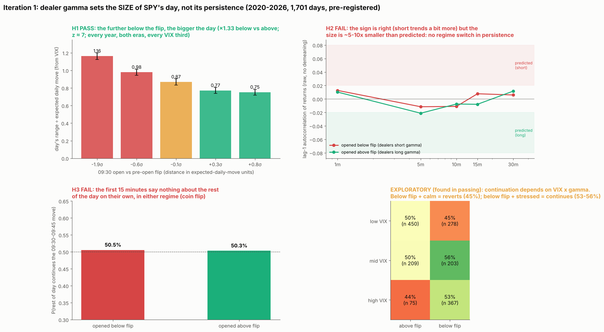

# Is dealer gamma the control parameter of SPY's intraday dynamics? A phase-diagram test, and the first-15-minute signature

* **Owner, 2026-11-01:**
  * "maybe there are a signature for what is to come once the market opens by looking at … the first 5-15 mins";
  * "for spy we almost even predicted … the pocket and the flip … How can we turn this into strong predictive factors … like weather";
  * "/loop keep going till u find something … Be like a physicist … dealing with a chaotic system".
* **Protocol:** [METHOD.md](../METHOD.md). Written and pushed **before** any intraday data are pulled.

## Mechanism and derived predictions
* **The coupling:** dealer hedge flow is H = −Γ·ΔS. Price impact gives Δp = λ(u + H).
  * Dealers **long** gamma (engine total gamma > 0, price above the flip) sell rises and buy dips: **damped**.
  * Dealers **short** gamma (below the flip) chase: **amplified**.
* **Because dealers rebalance in discrete steps, three observables follow from one coupling:**
  * **H1, variance (the known law, calibrating the instrument):** the day's range, in units of the expected daily move σ_d = VIX(prior close)/√252, is **larger** when SPY opens below its pre-open flip than above it.
    * Dose–response: the further below the flip (in σ_d units), the larger the range.
    * Predicted ratio short/long ≈ 1.2–1.5. Confidence high; this is documented in the literature and in our dealer-sign study.
  * **H2, dynamics:** intraday 5-minute returns are **positively** autocorrelated (trending) below the flip and **negatively** autocorrelated (mean-reverting) above it, with lag-1 autocorrelation ρ ≈ −λ·Γ.
    * Predicted: ρ_short ≈ +0.02 to +0.08, ρ_long ≈ −0.02 to −0.08, difference 0.03–0.15.
    * Confidence medium: forced-flow A2 (last half hour) was weak in the predicted direction; Ni, Pearson, Poteshman & White (2021) found the effect in single stocks.
  * **H3, the signature (trading use):** the first 15 minutes' move (09:30 → 09:45) **continues** to the close more often below the flip, and **reverts** more often above it.
    * Predicted continuation 53–56% vs 44–48%. Under a bivariate-normal approximation P ≈ ½ + arcsin(ρ_eff)/π, so even a real effect gives only a few points of edge.
    * Confidence medium-low.
    * This is the "Simpson in phase space" hypothesis: the weak pooled 09:35 rule may be two opposite regimes mixed together.
* **Cross-check (METHOD 11):**
  * If H1 and H2 both hold, the variance amplification and the autocorrelation must be of consistent size. For returns with lag-1 autocorrelation ρ, the 30-minute variance ratio is VR(6) ≈ 1 + 2Σ_{j=1..5}(1 − j/6)ρ^j.
  * Reported, no pass bar.

## Design
* **Days:** SPY sessions 2020-01-03 to 2026-10-12, matching the pre-open map history ([flip-wicks](../2026-10-27-flip-wicks/) `out/preopen_levels.csv`: flip incl. 0DTE from day D's OI and day P's closing IVs, plus total gamma `gex_open`).
* **Intraday data:** SPY 1-minute bars, Databento XNAS.ITCH (Nasdaq prints), 09:30–16:00. Cost checked: ~$2.69 for SPY+QQQ+TSLA 2020–2026; QQQ and TSLA are for later iterations.
* **State (known at 09:30):**
  * **Primary:** short = 09:30 open below `flip_incl`; long = above.
  * **Dose:** d = (open − flip)/(σ_d·open).
* **Outcomes:**
  * **O1** = (RTH high − low)/open/σ_d.
  * **O2:** lag-1 autocorrelation of 5-minute log returns, pooled within state with the day mean removed. Also the per-day VR(6).
  * **O3:** r15 = ln(P09:45/P09:30), rest = ln(P16:00/P09:45). Continuation = same sign. Regression rest = a + b·r15 + c·r15·short.
* **Tests (primary family, Holm over three):**
  * **H1:** mean O1 short > long. Also Spearman(d, O1) < 0, reported with a quintile plot.
  * **H2:** ρ_short − ρ_long > 0.
  * **H3:** c > 0, and P(cont | short) − P(cont | long) > 0.
* **p-values:** day-block bootstrap (5,000) for differences, plus a **circular-shift null** of the state series across days (all offsets ≥ 20 days), which keeps regime persistence.
* **Multiverse (reported in full):** return interval {5, 10, 15 min} × opening window {5, 15, 30 min} × state definition {flip-based, sign of `gex_open`, `gex_open` percentile bottom vs top third (trailing 252 days)} = 27 cells. Joint p from the median z vs the circular-shift null.
* **Controls (reported):**
  * Within VIX terciles (trailing 252 days), each effect's sign.
  * Era split per OWNER_NOTES: R1 2020–21 vs R2 2022+ (the 0DTE era).
* **Pass:** H1, H2, H3 each Holm p < 0.05 with the predicted sign. H1 must pass for H2/H3 to be read: if the known law fails, the instrument is suspect.
* **Trading reading, if they pass:**
  * At 09:45 the state plus the opening move gives a continuation-or-reversion forecast for the rest of the day, and an expected range.
  * The forecast **updates** if price crosses the flip intraday, as a nowcast would.
  * In exit terms: on short-gamma continuation days, trail rather than take fixed targets; on long-gamma days, take profits into extensions.

## Iteration 1 results (`phase.py` → `out/phase.json`, `out/days.csv`; `figure1.py` → `out/phase_iter1.png`)
* **Data:**
  * 1,701 SPY sessions (2020-01-03 to 2026-10-12): 912 opened below the pre-open flip, 789 above.
  * Databento XNAS 1-minute bars ($2.69 for SPY+QQQ+TSLA).
  * The first run was interrupted before writing anything; the vectorized rewrite implements the same registered design.

| | Prediction | Result | Verdict |
|---|---|---|---|
| **H1 range** | ×1.2–1.5 below vs above; dose–response | **×1.33** (1.026 vs 0.770 expected daily moves); quintiles 1.16 → 0.98 → 0.87 → 0.77 → 0.75; Spearman −0.42; circular-shift p < 0.002, Holm ≈ 0; multiverse median z **6.8** | **pass**, every year, both eras, every VIX third |
| **H2 persistence** | ρ_short +0.02…+0.08, ρ_long −0.02…−0.08 | ρ diff **+0.011** (p 0.20, Holm 0.40); multiverse median z 0.3 | **fail**: right sign, about 5–10× too small |
| **H3 first-15-min signature** | continuation 53–56% vs 44–48% | **50.5% vs 50.3%** (p 0.48); interaction c −0.13 (wrong sign, n.s.); multiverse median z −1.0 / 0.1 | **fail** |

* **Cross-check (METHOD 11):** VR(6) 0.92 below vs 0.88 above, both < 1. The variance difference (×1.33) is **not** accompanied by the persistence that a slow feedback loop would need.
  * The implied coupling λ_eff·|Γ| at 5–15-minute scales is about 0.01, a feedback multiplier of about 1.01.
* **Reading:**
  * Dealer gamma sets the **size** of SPY's day, strongly and monotonically. It does **not** make moves persist from one 5–15-minute interval to the next, and the opening move alone predicts nothing.
  * In weather terms, the pre-open map forecasts the storm's *intensity*, not its *direction*.

### Anomaly log (METHOD 13: exploratory until confirmed)
* **A. "Both regimes mean-revert" was partly an artefact (step b).**
  * Within-day demeaning biases lag-1 autocorrelation by about −1/n (−0.013 at 5 min, −0.04 at 15 min).
  * On raw returns: 1-minute +0.013 / +0.010, 5-minute −0.012 / −0.021, 15-minute **+0.008 / −0.008**.
  * The regime difference has the predicted sign at every horizon, growing with horizon (+0.002 → +0.010 → +0.016), but it is tiny.
  * The H2 difference test is unaffected, since the bias is common to both regimes.
* **B. Continuation depends on VIX × gamma (found in passing; continuation in the rest of the day):**

| | Above flip | Below flip |
|---|---|---|
| low VIX | 50% (n 450) | **45% (n 278)** |
| mid VIX | 50% (n 209) | **56% (n 203)** |
| high VIX | 44% (n 75) | 53% (n 367) |

  * Same direction in 2020–23 and 2024–26, and for the 5- and 15-minute opening windows; weaker for 30.
  * **Candidate mechanism:** feedback strength ∝ λ·|Γ|, and illiquidity λ rises with VIX. Short gamma trends only when liquidity is thin; long gamma damps harder when it is thin (44%).
  * The low-VIX/below-flip *reversion* (45%) is **not** explained by this mechanism: coupling should be about zero there, giving ~50%. It needs its own explanation, perhaps shallow dips in calm markets getting bought.
* **C. The H1 ratio drifted:** 1.5 in 2020–21, about 1.1–1.15 in 2022–24, 1.35 in 2025, 1.14 in 2026. In 2022 almost every day was below the flip (220 of 251).
* **D. The key open question about H1: is it dealer gamma or just "stress"?**
  * Opening below the flip usually follows a decline, and declines have high realized vol relative to VIX whatever dealers hold.
  * The dose–response is consistent with both. Iteration 2 separates them.

## Iteration 2 pre-registration (written before running)
* **I. Is H1 dealer gamma or stress? (separating the cause)**
  * **I-a Controls.** O1 ~ below-flip + |prior-day return| + prior-day range + |overnight gap| + prior-day ΔVIX + 5-day return, all in σ_d units. **Prediction:** the below-flip coefficient stays positive with p < 0.05 and keeps ≥ half its raw size.
  * **I-b Natural experiment (move the control parameter, not the system).**
    * Split the day-to-day change in distance-to-flip, Δd, into a **price part**, Δopen/(σS), and a **flip part**, −Δflip/(σS).
    * The flip part comes from open-interest changes (expiries, new positions) with price held fixed.
    * Regress ΔO1 (today's minus yesterday's range in σ units) on both parts.
    * **Prediction:** the flip-part coefficient is negative (the flip moving above price → bigger day), p < 0.05, and of the same order as the price part. If gamma is only a stress marker, the flip part is ~0.
  * **I-c Magnitude at fixed distance.** Among below-flip days, the partial correlation of O1 with −gex_open (more short gamma), controlling for d, is > 0.
* **II. Exploratory B, characterised (no pass bar; confirmation will be forward or on another instrument):**
  * Continuation and 15-minute raw autocorrelation by VIX tercile × state, with bootstrap CIs.
  * The same table on QQQ, using its own state (open vs the prior close's QQQ flip from `microstructure/out/td_gamma_QQQ.csv`). QQQ shares SPY's dates, so it is a weak, non-independent check, stated as such.
* **III. The practical forecast (the owner's "weather"): a 09:45 nowcast of the rest-of-day range.**
  * Target: rest-of-day high − low after 09:45, in σ_d units.
  * Predictors: state, d, first-15-minute range (σ units), |r15|, VIX percentile.
  * Fit on 2020–2023, test on 2024–2026.
  * Score:
    * out-of-sample R² vs a VIX-only baseline;
    * calibration of P(rest range > 1σ_d) by decile;
    * pinball loss of the 20/50/80% quantiles.
  * **Prediction:** state + first-15-min range beat the VIX-only baseline out of sample (R² gain > 0 with bootstrap CI excluding 0), and calibration stays within ±5 points per decile.

## Iteration 2 results (`iter2.py` → `out/iter2.json`)
| Test | Result | Verdict |
|---|---|---|
| **I-a** stress controls | Below-flip coefficient 0.255 → **0.146** with controls (keeps 57%), 90% CI [0.10, 0.19], p < 0.001. Yesterday's range (0.21) and the overnight gap (0.19) carry most of the rest | **pass** |
| **I-b** natural experiment | Flip-driven change in distance: **−0.051** (right sign), 90% CI [−0.10, +0.01], p 0.077. Price-driven part −0.007. The flip part correlates with ΔVIX (0.32), so it is not cleanly exogenous. Day after monthly opex (n 81): flip −0.12, price −0.10 | **fail (borderline)** |
| **I-c** amount of short gamma at a fixed distance | Partial Spearman **0.003** [−0.08, +0.07] | **fail** |
| **II** VIX × gamma continuation | SPY: low-VIX below-flip 45% [40, 50], mid 56% [50, 62], high 53% [49, 57]. **QQQ does not reproduce the low-VIX reversion** (52%) | exploratory B weakened |
| **III** 09:45 range nowcast | Out-of-sample R² gain over VIX-only **+0.124** [0.047, 0.205]. Almost all of it comes from the first-15-minute range (+0.118); the gamma state adds +0.006 [−0.045, +0.061]. The 20/50/80% quantiles are well calibrated (22/52/79%), but P(rest range > 1σ) is mis-calibrated (top quintile 56% forecast vs 42% observed) because I used a normal residual where the residuals are not normal | **fail on the registered calibration criterion**; the quantile forecast is usable |

* **Reading:**
  * The flip predicts the day's size beyond stress (I-a). But neither the *amount* of short gamma (I-c) nor clean day-to-day flip moves (I-b) confirm that dealer hedging is the cause.
  * The safest statement: the flip is a good **forecasting variable** for range; the mechanism is unproven. One possibility is that the flip marks where price sits relative to recently built positioning.
  * After 09:45 the opening range supersedes it.
  * **Practical:** before the open, use the flip distance to set the expected range. At 09:45, use the first 15 minutes' range: a calibrated 20/50/80% band for the rest of the day.

### Anomaly E (found in passing, 2026-11-01): the open's direction is more informative in QQQ than in SPY
* **On 1,717 common days (2020–2026), first-15-minute continuation:**
  * QQQ **53.7%** vs SPY **50.4%**. QQQ is higher in 6 of 7 years. TSLA 51.3%.
  * The gap comes from days when SPY and QQQ **open in opposite directions** (21.5%, n 370). There, SPY's own opening direction continues only **44.9%**, so the rest of the day follows **QQQ's** opening direction ~55% of the time. QQQ's own continues 54.1%.
  * When they agree: SPY 52.0%, QQQ 53.6%.
* **Artefact checks so far (b):**
  * The same pattern appears with 5-, 15-, 30- and 60-minute windows: QQQ ≥ SPY at every window.
  * The definitions are identical for both, and the effect is year-stable in sign.
* **Mechanism candidates (c):**
  1. **Information leadership:** news reaches tech first; SPY's open is diluted.
  2. **SPY opening-auction noise:** SPY's huge opening cross makes transient moves that revert.
  3. **Liquidity-led vs flow-led:** flow-physics found SPY liquidity-led and TSLA flow-led.
* **Independent predictions (d):**
  * (1) and (3): on disagreement days, QQQ's opening sign predicts SPY's rest-of-day sign.
  * (2): measuring SPY from 09:35 instead of 09:30 should raise its continuation.

## Pre-registration E (written before pulling the holdout): confirm on May 2018 – Dec 2019, data never used
* **Data:** SPY + QQQ 1-minute bars, Databento XNAS, 2018-05-01 to 2019-12-31 (cost **$0.35**). This is the smallest slice that can falsify (OWNER_NOTES data budget).
* **E1:** QQQ first-15-minute continuation > SPY's (paired by day). In-sample +3.3 pts.
* **E2 (the sharp claim):** on days when the SPY and QQQ first-15-minute moves disagree in sign, P(SPY's rest-of-day sign = QQQ's opening sign) > 50%. In-sample 55.1%.
* **E3 (mechanism 2):** SPY continuation measured from 09:35 (09:35 → 09:50 vs 09:50 → close) > from 09:30.
* **Power, stated honestly:** ~420 days and ~90 disagreement days give an SE of ~5 pts on E2. The holdout can **falsify** (e.g. ≤ 48%) but only weakly confirm.
* **Sequential rule, fixed now (METHOD 14):**
  * If E2 ≥ 52% in the holdout, extend with ES vs NQ futures (RTH, 2010–2017) **one year at a time** (~$2.4/yr), combining yearly z-scores by Stouffer.
  * **Confirm** when the combined z ≥ 3. **Abandon** if the running estimate is ≤ 50% after ≥ 400 disagreement days, or if the holdout itself is ≤ 48%.
* **One-sided p:** binomial for E2; paired day bootstrap for E1 and E3.
