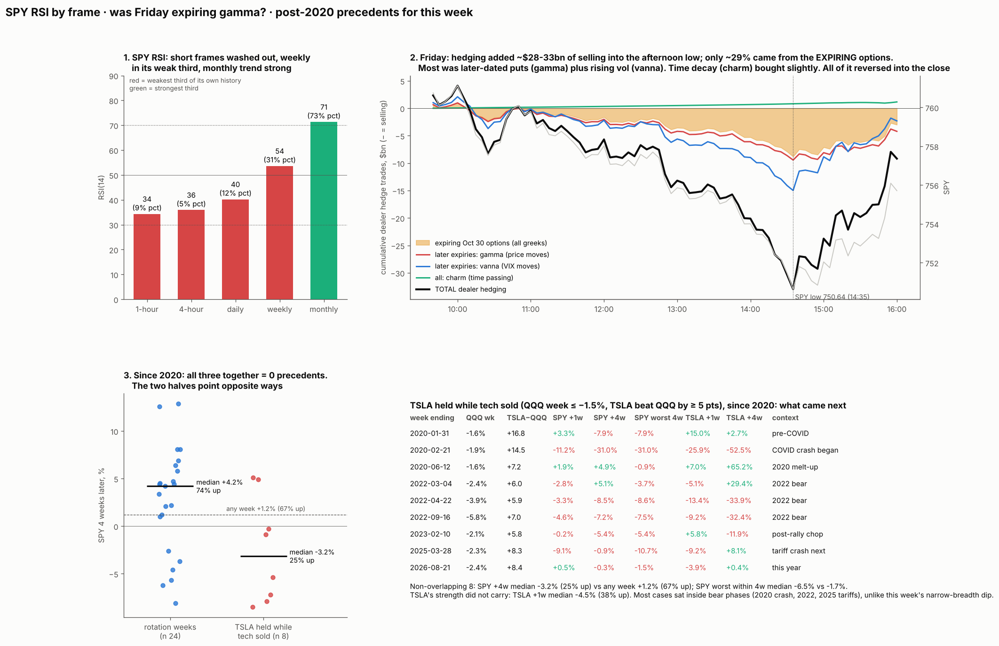

# SPY RSI across frames, was Friday's selling expiring gamma, and post-2020 precedents for this week

* **Owner, 2026-11-01:** "For spy what does rsi point to on different significant frames. And what was this hard selling a result of gamma expiring all day. And is there a precedent to a week like this (a rotation week / deep selling / and Tesla holding like this) and what happened after. Only search after 2020 for this."
* **Builds on:**
  * [technical-indicators](../2026-10-16-technical-indicators/): RSI level and divergence don't tell true lows from false ones; a 1-ATR bounce off a 20-day closing low is the filter.
  * [sp-multivariate](../2026-10-15-sp-multivariate/): for the S&P, weak weekly RSI / momentum means a broken trend and more correction risk; high RSI means lower risk.
  * [dealer-sign](../2026-10-16-dealer-sign/): the classic convention holds for SPY.
  * [week-review](../2026-10-31-week-review/).
* **Written and pushed before computing.**

## Part R: RSI (descriptive)
* **Indicator:** RSI(14), Wilder, on SPY at 1-hour, 4-hour (from 1-hour bars), daily, weekly and monthly frames, each with its trailing percentile.
* **Rules applied:**
  * The sp-multivariate reading: weekly RSI in its weakest third had a 37% chance of a 10% fall within 13 weeks vs 8% in its strongest third.
  * The 1-ATR bounce trigger level: the first close ≥ 1 ATR(14) above the latest 20-session closing low.
  * Daily bullish divergence state.

## Part M: Friday's dealer hedge flow (descriptive mechanics, no pass bar)
* **Instrument:** SPY options only.
* **Convention:** classic (dealers long calls, short puts), supported for SPY by dealer-sign.
* **Positions:** OI dated Oct 30 (the Oct 29 close). Friday's own 0DTE opening trades are **not** in any OI file.
* **IVs:** the Oct 30 closing-chain smile (engine `chain_day`), scaled each 5 minutes by VIX(t) / VIX(close).
* **Delta:** Black–Scholes, with time to 16:00 on each expiry date.
* **Path:** SPY 1-minute closes, 09:30–16:00, sampled every 5 minutes.
* **Dealer hedge trade per step** = −(change in dealer delta), split into three parts:
  * **gamma:** price moves at fixed time and vol;
  * **charm:** time passes at fixed price and vol;
  * **vanna:** vol changes at fixed price and time.
* **Expiry split:** the Oct 30 expiry vs all later expiries.
* **Scale:** cumulative hedge dollars vs SPY's traded dollar volume (Yahoo 1-minute volume × price).
* **Answers:**
  * (i) how much selling hedging added;
  * (ii) whether it came from the expiring contracts;
  * (iii) whether charm pushed selling or buying;
  * (iv) whether the 14:52 low and the rebound line up with the 0DTE hedges unwinding.
* **Threats, stated now:**
  * The convention.
  * One-day-stale positions; same-day 0DTE positions are invisible.
  * SPX and futures options are not included.
  * IV scaling is uniform across strikes.

## Part D3: precedents since 2020 (descriptive analogs)
* **Weeks:** calendar weeks ending Friday. Return = Friday close / prior Friday close − 1. Sample: weeks ending 2020-01-03 to 2026-10-23 (forward outcomes needed).
* **Primary analog:** QQQ week ≤ −1.5% **and** RSP − QQQ ≥ +2.0 pts **and** TSLA − QQQ ≥ +5.0 pts.
  * This week: QQQ −1.97%, RSP − QQQ +2.79, TSLA − QQQ +9.4.
* **Secondary sets:**
  * **S1 rotation weeks:** QQQ ≤ −1.5% and RSP − QQQ ≥ +2.0.
  * **S2 TSLA holds in a tech-selloff week:** QQQ ≤ −1.5% and TSLA − QQQ ≥ +5.
  * **S3 daily:** QQQ ≤ −3% on the day and TSLA ≥ −1% on the day. Friday: QQQ −3.47%, TSLA −0.87%.
* **Outcomes:**
  * From the week's Friday close: SPY, QQQ, TSLA at +1, +2 and +4 weeks, and SPY's worst drawdown within 4 weeks.
  * S3 from the day's close: +5, +10 and +20 sessions.
* **Base:** all weeks (all days for S3) in the same sample.
* **Spacing:** qualifying weeks within 4 weeks of an earlier one are kept in the list but excluded from the averages (no overlap).
* **Reporting:** every match is listed with its date. n will be small, so: counts, means and medians vs base, no significance claims.
* **Prediction (low confidence):**
  * Rotation weeks are followed by S&P results near base (D2 found no edge).
  * TSLA's relative strength persists a little over 1–2 weeks (momentum).

## Results

### R. RSI (`rsi.py` → `out/rsi.json`; Yahoo bars to the Oct 30 close)
| Frame | RSI(14) | Own trailing pct | Reading |
|---|---|---|---|
| 1-hour | 34 (low 22 on Friday afternoon) | 9th | washed out |
| 4-hour | 36 | 5th | washed out |
| Daily | 40 | 12th | weak; **no bullish divergence** (RSI is below its Oct 23 low's 42) |
| **Weekly** | **54** | **31st: weakest third** | sp-multivariate: weekly RSI in its weakest third → 37% chance of a 10% fall within 13 weeks vs 8% in the strongest third (base ~16%) |
| Monthly | 71 | 73rd | long-term trend intact |

* SPY sits 1.5% under its 50-day, 0.5% under its 100-day and 3.7% above its 200-day.
* **1-ATR bounce trigger:** a close **≥ 763.44** (20-session closing low 755.72 on Oct 30, plus ATR 7.72).
  * The filter was tested on TSLA: lows held 66% of the time after the bounce vs 20% when buying the new low. It is untested on SPY.
* **Reading:**
  * Short frames are oversold, but that has no tested edge (level and divergence don't separate true lows from false ones).
  * The weekly frame has just crossed into the zone our S&P study links to higher correction risk: the trend is breaking, not overbought.
  * It crossed only just (31st vs the 33rd cut). The study's full momentum model also uses 52-week momentum and breadth, which were not re-run here.

### M. Friday's dealer hedge flow (`flow.py` → `out/flow.json`, `out/flow_path.csv`)
| Window | SPY move | Dealer hedging, $bn (− = sell) | Expiring Oct 30 options | Later expiries | Charm (time) |
|---|---|---|---|---|---|
| 09:35–10:30 | −1.95 | −6.1 | −1.7 | −4.4 (vanna −2.5) | +0.1 |
| 10:30–14:50 | −6.99 | −22.4 | −6.5 | −15.9 (gamma −7.2, vanna −9.0) | +0.8 |
| 14:50–16:00 | +4.64 | **+19.4** (buying) | +5.2 | +14.1 | +0.3 |
| Whole day | −4.3 (5-min path) | −9.2 | −3.0 | −6.2 | +1.2 |

* **(i) How much hedging added:**
  * About **$28bn of SPY-equivalent selling** into the afternoon low.
  * For scale: SPY traded $106bn on the day and ES about $905bn. Hedging was material at the margin, not the main seller.
  * SPX options are not included, so the true dealer total is larger.
* **(ii) Expiring vs later:** the expiring Oct 30 contracts were 28% of gamma at the open and about **29% of the selling into the low**. About 71% came from later expiries: price moving through their puts (gamma), and rising vol (vanna, VIX 17.2 → ~20).
* **(iii) Charm (time decay) pushed slightly *buying* all day (+$1.2bn).** Time passing did not cause the selling.
* **(iv) The rebound** lines up with the same hedges reversing: gamma and vanna buying +$19bn as price lifted and VIX eased. The expiring contracts' part was +$5.2bn into the close.
* **Verdict on the owner's question:**
  * The selling started with news: Amazon capex, Intel −28%, and NQ −2% before the open.
  * Dealer hedging then amplified it, because SPY sat below its flip in short gamma.
  * It was **not mainly expiring gamma**. Most came from the longer-dated put book plus vol rising.
* **Fits the earlier tests:**
  * Forced-flow B: an expiry's size predicts later volatility only borderline (p 0.066).
  * A2: last-half-hour momentum is absent in SPY since 2023.
* **Threats:**
  * The convention.
  * Positions are one day stale. Same-day 0DTE positions (large, invisible in OI) would add more short gamma.
  * Uniform IV scaling exaggerates vanna for far-OTM puts.

### D3. Precedents since 2020 (`precedents.py` → `out/precedents.json`)
* **Primary (rotation + tech selloff + TSLA holds, all in one week): 0 matches since 2020.** This week has no post-2020 precedent.
* **S1, rotation weeks** (QQQ ≤ −1.5%, RSP beats QQQ by ≥ 2 pts): 30 matches, 24 non-overlapping.
  * SPY 4 weeks later: median **+4.2%**, mean +2.7%, 71% up, vs any week +1.2% and 67% up.
  * SPY's worst point within 4 weeks: median −1.6% vs −1.7%.
  * The % up is barely different from base, consistent with D2's "no edge".
  * TSLA 2 weeks later: +0.1% vs +2.2%.
* **S2, TSLA held while tech sold** (QQQ ≤ −1.5%, TSLA beats QQQ by ≥ 5 pts): 9 matches, 8 non-overlapping.
  * SPY 4 weeks later: median **−3.2%**, 25% up. Worst point within 4 weeks: median **−6.5%** vs −1.7%.
  * TSLA's strength did not carry: 1 week later median −4.5% (38% up); 4 weeks later +3.4% (62% up).
  * Most matches sat inside bear phases: Feb 2020, Apr and Sep 2022, Mar 2025.
* **S3, daily** (QQQ ≤ −3% and TSLA ≥ −1% on the same day): 4 matches (Mar 2020 ×2, Apr 2022, Dec 2022). TSLA 10 days later averaged −15.9% (1 of 4 up); SPY 20 days later +3.2%.
* **Prediction check:**
  * Rotation weeks near base: roughly right; mildly positive at 4 weeks, but % up is no different.
  * TSLA's relative strength persists: **wrong**; it faded in the following week.
* **Reading:**
  * The rotation half of the week points up a little. The TSLA half has historically come before more market weakness.
  * Neither has ever happened together since 2020, and the TSLA-half sample is 8 weeks dominated by bear markets.
  * Treat both as context, not a signal.
