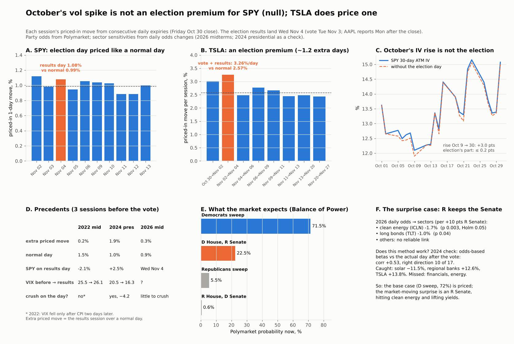

# Is October's implied-vol spike partly an election premium, and what do the party odds map to?

**Agent / session:** Claude, claude.ai session for the owner, 2026-11-02 (Sunday night; last close Fri Oct 30)
**Type:** pre-registered. Written and pushed after listing the available expiries and Polymarket markets, and before any implied variance or odds history was computed.
**Owner's ask:** "Vol crush from elections means this spike in IV in October is partially from elections. Can you null or verify? And see if it can be associated with a projection or certain parties winning (use prediction markets). Test and bring me something useful."
**Prior literature:** Kelly, Pástor & Veronesi (2016, *JF*), "The price of political uncertainty": options whose lives span national elections are more expensive, more so when political uncertainty is high.

## Part A: the election premium in SPY options
* **A1 (Oct 30 close), per-session implied variance:**
  * SPY lists daily expiries Nov 2, 3, 4, 5, 6, 9–13.
  * For each consecutive pair, the session's implied variance = w(T2) − w(T1), with w = σ²_ATM × (trading sessions to expiry)/252. ATM = the mean IV of the 2 strikes nearest the forward.
  * **Sessions:**
    * Nov 3 (election day + the AAPL report reaction; AAPL reports Mon Nov 2 after the close);
    * **Nov 4 (the market's reaction to the results; the election session);**
    * Nov 6 (payrolls).
  * **Baseline:** the median of the Nov 9–13 sessions.
  * **Verify if** the Nov 4 implied move exceeds the baseline by > 20% in variance. **Null if** it does not.
* **A2 (October history):** SPY end-of-day chains for every October 2026 session (ThetaData).
  * For each day where daily expiries bracket Nov 4, the election excess variance.
  * Its contribution to 30-day ATM IV: IV30 − √(IV30² − excess × 252/21).
  * **Report** how many of October's IV30 vol points the election explains vs the rest.
* **A3 (precedent, 2022 midterms and 2024 presidential):**
  * the same election-session implied move 3 sessions before each vote;
  * the realised SPY move on the results session;
  * the post-vote change in 30-day ATM IV and VIX over 1 and 3 sessions (the "crush").
  * Prediction: implied > realised, and a crush in both.

## Part B: prediction markets
* **Data:** Polymarket daily odds (16:00 ET) for "Which party will win the House in 2026?", "…the Senate…", "Balance of Power: 2026 Midterms", Aug 1 → Oct 30 2026. Replication market: "Presidential Election Winner 2024" (Trump odds), Aug 1 → Nov 4 2024.
* **B1, uncertainty → premium (descriptive):** within October 2026, the correlation of the election excess variance (A2) with race closeness, 4·p(1−p) for the House and Senate.
  * Across 2022 / 2024 / 2026: the premium vs closeness at T−3 (n 3, descriptive only).
* **B2, party odds → sectors:** daily return of each ETF on the daily change in P(Republicans win the House), and on P(Trump) in 2024. Day-block bootstrap.
  * **Sectors:** XLF, KRE, IWM, XLE, ITA (defense), XLV, XBI, TAN (solar), ICLN, XLU, TLT, the dollar, BTC-USD, TSLA, SPY, QQQ.
  * **2024 predicted "Trump trade" signs:** + KRE, IWM, XLF, BTC, TSLA; − TAN, ICLN; + yields (− TLT).
  * **2026:** the same signs for P(R House), weaker. Holm across sectors within each market.
* **"Projection" output:** today's outcome probabilities and, per outcome, the sector moves implied by the 2026 betas (and the 2024 betas as a check). Labelled as a mapping, not a forecast.

## Limits stated now
* One election per market; ~60 trading days of odds each. Party-odds moves are small on most days, so betas will be noisy.
* AAPL's report reaction falls on Nov 3, the same session as election day. The results reaction is Nov 4. Payrolls are Nov 6. The baseline sessions (Nov 9–13) may contain CPI.

---

## Results (2026-11-02, after the pre-registration push at 3d583b1)

**Bottom line:**
* **SPY: null.** The election results session (Wed Nov 4) is priced at a 1.08% move against a ~1.0% normal day. The election explains ≤ 0.2 of the +3.0 vol-point rise in SPY 30-day IV since Oct 9. October's IV spike is stress, not an election premium.
* **TSLA does price one.** The Nov 3–4 sessions are priced at 3.26% per day against 2.57% normal, about 1.2 extra normal days of variance and ~1.2 vol points of TSLA IV30.
* **Prediction markets:** Polymarket prices a Democratic sweep at 71.5%. Across 2026 odds moves, only the Senate odds map to sectors, and only clean energy (ICLN) comes close to passing Holm. The method's 2024 check got 10 of 17 directions right; its magnitudes are unreliable.

### Deviations from the pre-registration (disclosed)
* **Time convention.** IV was solved on calendar time and w = σ²·T_cal; the registration wrote trading sessions/252. The total implied variance w is the same whichever clock the IV is quoted on, so per-session variance is unaffected. Weekend variance lands on the Monday session (Oct 30→Nov 2: 1.12%; Nov 6→Nov 9: 1.04%).
* **Baseline.** The code used the median of every consecutive pair from Nov 6 onward. The registered baseline was the Nov 9–13 sessions. Both give a null, but the verdict is close to the 20% bar:

| Baseline | Normal-day move | Nov 4 excess variance | Verdict (> 20%) | Share of Oct 30 IV30 |
|---|---|---|---|---|
| Registered: sessions Nov 9–13 | 0.997% | 17.1% | null | 0.07 vol pts |
| As coded: pairs from Nov 6 on | 0.987% | 19.5% | null | 0.08 vol pts |
| Sensitivity: Nov 10–13 only (drops the weekend-loaded Monday) | 0.942% | 31.1% | would pass | 0.11 vol pts |

* **Reading.** SPY prices a small premium on the results day, worth about +0.1 point of daily move. Whether it clears 20% depends on the baseline. In every version it is ≤ 0.11 vol points of IV30, so the October conclusion does not depend on this choice.
* **TSLA (not registered; added as a same-method comparison).** TSLA has no Nov 3 expiry, so the pair Nov 2→Nov 4 covers two sessions: the vote day (which is also the AAPL report reaction, since AAPL reports Mon Nov 2 after the close) and the results day. The premium cannot be split between them. The baseline is the median of the Nov 6–20 pairs.

### A1. Per-session implied moves at the Oct 30 close

| Session | SPY | | TSLA pair | TSLA per session |
|---|---|---|---|---|
| Mon Nov 2 (incl. weekend) | 1.12% | | Oct 30→Nov 2 | 3.01% |
| Tue Nov 3 (vote; AAPL reaction) | 0.98% | | Nov 2→Nov 4 (2 sessions) | **3.26%** |
| **Wed Nov 4 (results)** | **1.08%** | | | |
| Thu Nov 5 | 0.94% | | Nov 4→Nov 6 | 2.48% |
| Fri Nov 6 (payrolls) | 1.06% | | | |
| Nov 9–13 | 1.04, 1.03, 0.88, 0.88, 1.00% | | Nov 6→Nov 20 pairs | 2.44–2.77% |
| **Normal day (baseline)** | **0.99%** | | | **2.57%** |

* **TSLA excess** = 120.8% of one normal day's variance (move-equivalent 2.83%).
* A straddle from the Nov 2 close to the Nov 4 expiry prices about √2 × 3.26 = 4.6% against 3.6% normal.
* **Playbook tag: map** (one snapshot of prices, not a tested edge).

### A2. October decomposition (SPY)
* 30-day ATM IV: 13.62% (Oct 1) → 12.10% (Oct 9) → 15.07% (Oct 30), a rise of +3.0 points from Oct 9.
* The election session's share of IV30 was 0.0, 0.2 and 0.08 vol points on those dates. There is an election estimate for every October date, because daily expiries bracketing Nov 4 exist from Oct 1.
* **Premium path.** As a share of a normal day's variance, the election premium ran 30–68% on most October dates. It was noisy: before Oct 19 the pairs spanned 5 sessions (Oct 30→Nov 6), and a few dates came out ≤ 0. It fell to 19% on Oct 30 as normal-day vol rose from 0.83% to 0.99%. In absolute terms it never exceeded 0.21 vol points of IV30.
  * **So October's rise came from normal days getting more expensive, not from the election day.**
* **B1:** across 22 October days, the correlation of the election excess with Senate closeness is 0.013, a null.

### A3. Precedents: implied move vs realised, and the "crush"

| | 2022 midterm (T−3 = Nov 3) | 2024 presidential (T−3 = Oct 31) | 2026 midterm (T−3 = Oct 29) |
|---|---|---|---|
| Election excess (move-equivalent) | 0.20% (pair Nov 7→9, 2 sessions) | **1.89%** | 0.26% |
| Normal day | 1.45% | 1.01% | 0.91% |
| Realised SPY, results session | −2.06% | +2.49% | (Nov 4) |
| VIX: day before → results day → +3 sessions | 25.5 → **26.1** → 23.7 | 20.5 → **16.3** → 15.0 | |
| SPY IV30: day before → results day | 24.1 → 24.6 | 16.5 → 12.8 | |

* **Registered prediction "implied > realised": failed in both.** 2024: implied total ≈ 2.14% vs realised 2.49%. 2022: ≈ 1.46% vs 2.06%.
* **Registered prediction "crush in both": 1 of 2.**
  * 2024 crushed: VIX −4.2, IV30 −3.7.
  * 2022 did not: VIX rose on the results day and fell only after the CPI report two sessions later.
* **Pattern (n = 3, descriptive):** presidential elections carry a premium and a crush; midterms barely do, and 2026 looks like 2022.

### B2. Party odds → sectors (daily changes, 5-day block bootstrap, Holm across 17 assets)

| Market | Strongest links (per +10 pts of odds) | Passes Holm? |
|---|---|---|
| 2026 P(R Senate) | **ICLN −1.70% (p 0.003, Holm 0.051)**; TLT −1.01% (p 0.036, Holm 0.58) | none (ICLN just misses) |
| 2026 P(R House) | BTC −9.9% (p 0.041, Holm 0.70); registered signs mostly wrong (KRE, IWM, XLF negative) | none |
| 2024 P(Trump) | XLV −1.02% (p 0.041); XLU −1.71% (p 0.048) | none |

**2024 validation:** predicted results-day move = β × (1 − 0.619) / 0.10, using P(Trump) at the Nov 5 close, compared with actual Nov 6 2024.
* Correlation across 17 assets: +0.53. Direction right for 10 of 17.
* **Caught:**
  * solar TAN: predicted −5.2%, actual −11.5%;
  * ICLN: −3.4% vs −7.6%;
  * KRE: +2.6% vs +12.6%;
  * IWM: +1.6% vs +5.6%;
  * TSLA: +10.7% vs +13.8%;
  * 10y: +5.9bp vs +13.7bp;
  * also SPY, QQQ, XLU, BTC.
* **Missed:**
  * XLF: −2.1% vs +5.9%;
  * TLT: +1.4% vs −2.8%;
  * also XLE, ITA, XLV, XBI and the dollar.
* **Magnitudes:** off by 2–5× in both directions.

### "Projection" (a map, not a forecast)
* **Polymarket Balance of Power at Oct 30:**
  * Democrats sweep: 71.5%;
  * R Senate, D House: 22.5%;
  * Republicans sweep: 5.5%;
  * D Senate, R House: 0.6%.
* **P(R keeps the Senate) = 28%.**
* **Base case (D sweep, 72%):** already priced; the 2026 betas map it to mild ICLN and TLT strength.
* **Surprise (R keeps the Senate, 28%):** maps to clean energy down and long bonds down (yields up).
* **Why directions only:** extrapolating the linear betas to a 72-point move gives absurd sizes (TLT about −7% in a day). Betas estimated on small daily odds changes do not scale to resolution, and the 2024 check showed magnitudes off by 2–5×.
* **Confound:** ICLN and TLT are both rate-sensitive (see polymarket-fed). Days when yields rise for other reasons could also be days when R Senate odds tick up, so the link may be partly a shared driver.

### What this changes
* **Machine ledger (july-october-machine):** the VIX9D/VIX "event kink" at 0.99 is not election premium. SPY options price the results day like a normal day plus about 0.1 point, so a post-vote VIX crush is not scheduled; it needs the October stress itself to fade. Erratum 3 added there. Forecasts C1–C4 are unchanged; they condition on observed VIX.
* **Tradeable read:**
  * SPY has little election event premium to sell.
  * TSLA's premium is about 1 vol point and should bleed out after Nov 4, all else equal.
  * The market-moving outcome is the 28% R-Senate surprise, read through clean energy and yields.
* **Follow-up EV1 (score Nov 5):**
  * realised SPY and TSLA moves on Nov 3–4 vs the implied 1.08% and 4.6% (two-day);
  * TSLA IV30 change from the Nov 2 close to the Nov 5 close;
  * the direction of ICLN and TLT on the results day vs the outcome.

Cost: $0 (ThetaData Value tier, Polymarket and Yahoo public APIs).
