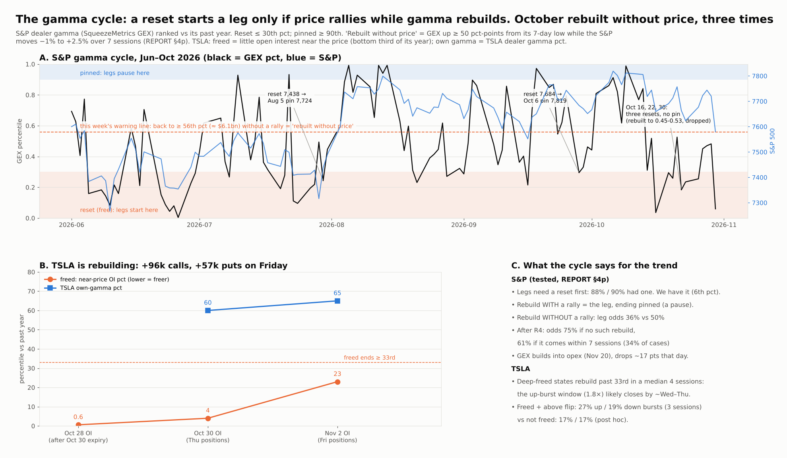
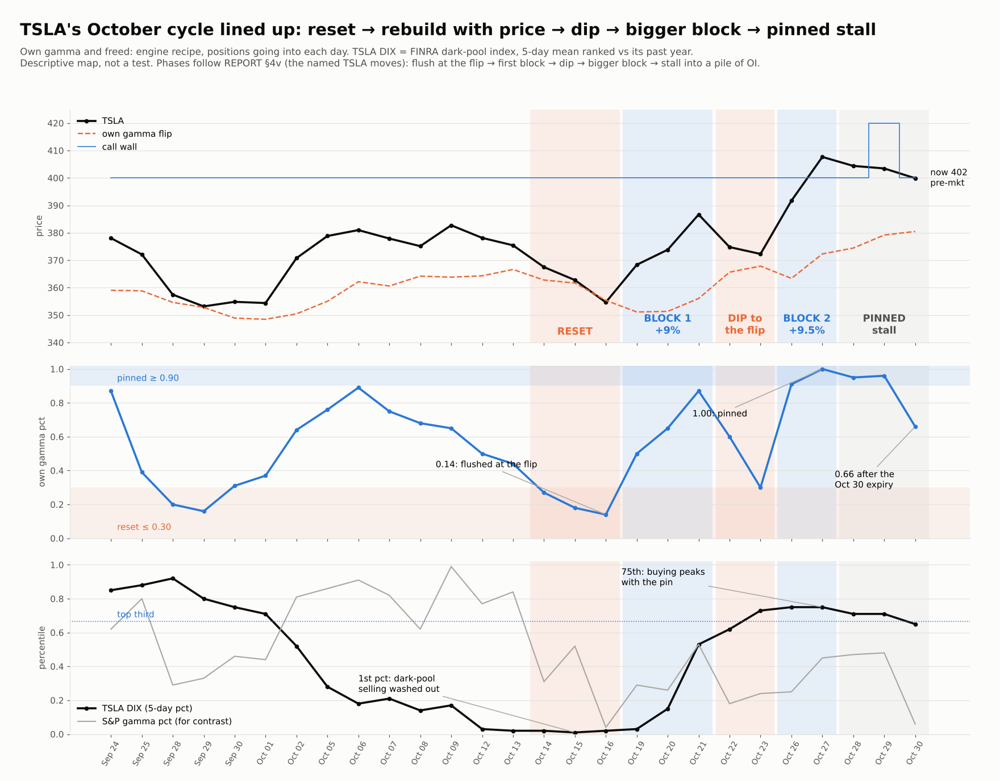

# Live read, Mon Nov 2 (08:25 ET): SPY and TSLA for today, election Tuesday and the week, with projections

* **Owner, 2026-11-02 (pre-market):**
  * "where is spy standing as of now and what are your predictions for today and tomorrow and rest of week and different projections and for tsla too"
  * Follow-up: "does tsla have these 'pockets' to the upside same way spy did, and does this pocket for spy that sent it down last week work in reverse too?"
* **This is a live read plus forecasts, not a new test.**
  * The forecasts below are written and pushed **before the 09:30 open**, to be scored on Nov 2, 3, 4 and 6.
  * Each probability is my judgment. It starts from the options-implied map and adds the tilts from tested rules, which are named with their strength.
* **Data:**
  * ThetaData OI dated **Nov 2 (= Friday Oct 30 close positions, fresh)**, plus the Oct 30 closing chains for IVs.
  * Yahoo 5-minute bars incl. pre-market (ES, NQ, RTY futures, SPY, TSLA at 08:20 ET; VIX in global trading hours).
  * Breadth, ladder and SqueezeMetrics readings as of Friday Oct 30 (from [week-review](../2026-10-31-week-review/)). There has been no session since.
* **Reproduce:**
  * `python maps_now.py <td>`: engine code unchanged from week-review/maps_mon.py; OI file swapped to Nov 2.
  * `python curves_ext.py <td> <TSLA oi Oct 20–30>`
  * `python project.py`

## Now (08:20 ET)
* **Futures:** ES 7,640 (+0.36% vs Friday 16:00), NQ +0.63%, RTY +0.53%.
* **Pre-market:** SPY **758.60** (Friday 755.72), TSLA **402.22** (Friday 399.81).
* **Other:** VIX 19.47 (global trading hours; Friday 19.4). 10-year 4.93%.
* **Calendar:**

| Day | Events | SPY priced move | TSLA priced move |
|---|---|---|---|
| Mon Nov 2 | ISM manufacturing 10:00; **AAPL reports after the close**; SPY 0DTE holds 15.8% of SPY gamma, TSLA's Nov 2 expiry 18.4% | | |
| Tue Nov 3 | Vote day + AAPL reaction | 0.98% | 3.26%/day over Tue–Wed |
| **Wed Nov 4** | **Results** | 1.08% | (same pair) |
| Thu Nov 5 | | 0.94% | 2.48%/day over Thu–Fri |
| Fri Nov 6 | Payrolls | 1.06% | (same pair) |

## SPY checklist
* **Breadth (Friday):**
  * 63% of the panel above the 50-day (normal near a high).
  * The equal-weight panel beat the S&P by +4.0 pts over 20 sessions; the RSP − QQQ 20-session spread is a record +12 pts.
  * 68% of names rose over 5 sessions. Pairwise correlation 0.09: dispersion, not contagion.
  * Read: rotation, not liquidation. (D2 said a record divergence alone predicts nothing.)
* **Gamma (fresh Nov 2 OI):**
  * Flip **766.4**, down from 774.1 on stale OI, because Friday's put buying moved the map. SPY at 758.6 is **1.0% below the flip**.
  * Total gamma: −$7.6bn per 1% at 758.6 and −$10.5bn at 755.7.
  * Call wall 800, put wall **750**. Top negative strikes 750, 740, 730, 735; positive strikes 800, 780, 756, 790.
  * **The pocket:** total gamma −$20 to −21bn per 1% across **730–745** (floor about 743.6), −16 at 750, −8 at 758, −0.4 at 766, +5.9 at 775, +8.5 at 780, peak +12.5 at 800.
* **Ladder:** R4 fired Friday (up-leg within 20 sessions 70% / 74% vs 50% / 58% on any day; *odds edge, no payoff edge in spreads*).
* **SqueezeMetrics:** GEX $1.06bn (6th pct), DIX 43.8%.

### Owner's Q2: does the pocket work in reverse? **Yes, and historically more so.**
* **Mechanics:** below the flip, dealers are short gamma. They sell into drops and buy into rallies, so both directions are amplified.
  * The amplification is **lopsided right now**. Falling from 758 into 745 crosses −8 → −21 ($bn per 1%), the strongest. Rising from 758 to 766 crosses −8 → 0, so it fades as SPY climbs.
* **History (microstructure REPORT §4z, SPY, volatility controlled, next 3 sessions):** below its flip, SPY's **up-bursts are 2.8× more likely (p < 0.001)**; down-bursts are not raised (0.7×, p 0.13).
  * The extra big moves from below the flip are **snap-backs, not breakdowns**. QQQ: up 3.8× (p < 0.001), down 1.3× (p 0.12).
  * **Tag: proven** (passed after the §4z timing fix; 2021–26).
* **Past the flip, damping starts:** gamma turns positive at 766 and thickens to 780 (+8.5). A snap-back should **slow at 766–780**, not run through it. This matches the call-wall soft ceiling (proven for SPY/QQQ), with the wall far away at 800.

### SPY forecasts (scored on the stated dates)
Map = options-implied paths from 758.60, Gaussian, no drift. My call adds the tilts:
* below-flip snap-back (proven);
* month-end give-back of about +0.6% over 5 sessions (p 0.026 pooled; **not** significant in 2020–26);
* midterm election week up in 74% of cases (n 19, descriptive);
* the half-month effect;
* the election premium is small (election-vol null), so **no scheduled VIX crush**.

| # | Forecast | Map | **My call** |
|---|---|---|---|
| S1 | Mon close > 755.72 | 65% | **65%** |
| S2 | Mon close inside 751–766 | 68% | **70%** |
| S3 | Trades ≥ 766.4 (the flip) by Fri Nov 6 | 62% | **65%** |
| S4 | Fri Nov 6 close ≥ 766.4 | 32% | **35%** |
| S5 | Trades ≤ 750 (the put wall) by Fri | 60% | **50%** |
| S6 | Fri Nov 6 close > 755.72 | 56% | **60%** |
| S7 | Fri Nov 6 close ≤ 740.6 (channel kill line) | 15% | **12%** |
| S8 | VIX closes ≤ 16.5 on any day through Nov 6 | – | **25%** |

**Scenarios to Friday (my weights):**
* **A. Snap-back, 40%:** SPY reclaims 766 by Wed/Thu (post-vote relief, AAPL fine), then stalls at 770–780 as gamma turns positive. Friday 765–778.
* **B. Chop, 38%:** 748–766, with wide days both ways inside the short-gamma zone. Friday 750–765.
* **C. Flush, 22%:** loses 750 and drops into the 730–745 pocket, where dealer selling is strongest. Tests ~740.
  * A close ≤ 740.6 kills the channel dip rule.
  * The trigger would be the AI selling spreading: GEX < 0 with correlation rising (P2).

## TSLA (8-step read, TSLA_PLAYBOOK)
1. **State:**
   * 402.2 pre-market, **6.1% above its own flip (376.8; the engine's flip 381.2)**, so dealers are long gamma: +$0.47bn per 1% at 402, 65th pct.
   * Freed: near-price OI at the **23rd pct** (was 4th); still in the bottom third, so **freed is on**.
   * Full setup (freed + below flip): **off**.
   * Gamma slope: rising steeply above. **[map]**
2. **Levels:**
   * Call wall **400**: the biggest positive strike, and Friday's biggest call add (+15.6k). It is today's pin candidate (18% of TSLA gamma expires today).
   * Put wall **380**, up from 350 (+5.5k puts).
   * Negative strikes 397.5, 380, 390. Short-gamma zone 372–381.
   * Calls added Friday: 400, 410, 435, 415, 422.5. Net Friday adds: +96k calls vs +57k puts. **[map]**
3. **Calendar:** Monday (see below); vote and results over Tue–Wed, priced at 3.26% per day vs 2.57% normal. **[map]**
4. **Market:** SPY is below its flip. **SPY drags TSLA about 2× on S&P down days of −1% or worse [proven #6].**
5. **Flow:** Friday's tape not pulled (Databento budget). Last read: the Oct 26–27 burst, buying aggression 90th pct. **[lean]**
6. **Setups:**
   * **Monday up-only burst effect** (REPORT §4o, the most robust calendar finding; Friday up-bursts suppressed). **[proven-ish]**
   * Freed means up-bursts 1.8× **[proven #1]**.
   * No RSI washout and no 20-day low.
7. **Top watch:**
   * IV rose with price (37 → 41%), but skew is put-bid (25-delta risk reversal −4.8), the opposite of the flat skew seen at tops.
   * 1 of 5 top elements: **no top profile**. **[lean]**
8. **Tags:** as marked. Eras: 2021–26. Open interest lags one session; Databento and Yahoo closes differ on some days.

### Owner's Q1: does TSLA have SPY-style pockets to the upside? **No negative pocket above; it has a "plateau".**
* **Total gamma (positive = damping):**

| Price | 380 | 390 | 400 | 410 | 420 | 430 | 440 | 450 |
|---|---|---|---|---|---|---|---|---|
| $bn per 1% | ~0 | 0.15 | 0.39 | 0.72 | 0.84 | 0.86 | 0.87 | 0.97 |

  The peak is about 455.
* **400 → 420:** damping thickens fast. Rallies should **grind** here (stair-step, not snap). This matches the wall-flow read ("stall near 420").
* **420 → 440:** a **plateau**. Damping stops increasing, so once through 420 the move to ~440 is lighter. This is the closest thing TSLA has to an upside "pocket", though it is still damped, not amplified.
* **The amplifying pocket is below:** under ~381 gamma turns negative (−0.1 at 370, −0.2 at 340).
  * TSLA's own history says that below its flip the extra moves are also **up** (snap-backs 1.45×, p 0.04) [proven #2 context].

### TSLA forecasts
| # | Forecast | Map | **My call** |
|---|---|---|---|
| T1 | Mon close > 399.81 | 59% | **62%** (Monday effect, freed) |
| T2 | Mon close within 395–410 (the 400 pin) | – | **60%** |
| T3 | Trades ≥ 420 by Fri Nov 6 | 46% | **45%** (damping 400–420 offsets the freed up-lean) |
| T4 | Fri Nov 6 close ≥ 420 | 24% | **20%** |
| T5 | Trades ≤ 380 by Fri | 37% | **30%** |
| T6 | Fri Nov 6 close > 399.81 | 52% | **57%** |

**Scenarios to Friday:**
* **A. Grind up, 40%:** holds 400, stair-steps to 410 and then 420. Friday 410–425; through 420, a light run to ~435–440 is possible.
* **B. Pin, 35%:** 392–412 around the 400 strike. Friday 395–410.
* **C. Drag, 25%:** an SPY flush with the 2× drag. TSLA 380–390, where the put wall and flip zone (377–381) should hold first; below that, the small negative pocket to ~372.
* **Election (from tsla-politics, lean):** a Talarico win (75%) is mostly priced. A Paxton upset maps to a large TSLA up-day (CI wide). TSLA's ~1-vol-point election premium should bleed out after Nov 4.

## Scoring
* Wording fix at 08:31 ET, before the open: S7 originally read "Any Fri close ≤ 740.6 this week"; the map number (15%) and my call refer to the Fri Nov 6 close.
* Score S1, S2, T1 and T2 after Monday's close; S3–S8 and T3–T6 on Fri Nov 6 (TODO LR1).
* Report Brier scores for my calls vs the map, so the tilts are tested over time.

---

## Added 08:35 ET (pre-open): per the ladder and our trigger table
*Owner: "But u didn't do it per the ladder and the conditions we had before."* Correct. The first pass led with the gamma/options map and mentioned the ladder only in passing. This section walks the ladder rung by rung (REPORT §4i; same definitions as `microstructure/ladder.py`), then the Oct 30 trigger table (S1–S5, T1–T6) with today's lines.
* `python ladder_now.py <DIX.csv> <^VIX json>` (SqueezeMetrics through Fri Oct 30).
* `python ladder_week.py <DIX.csv> <^VIX> <GSPC_long> <TSLA>`: what the S&P and TSLA did in the 5 sessions after past rung first-days.

### The ladder at Friday's close (GEX $1.06bn = 6th pct, DIX 43.8% = 22nd pct, VIX 19.42, S&P 7,580.07)

| Rung | Condition | Status | Up-leg within 20 sessions, 2012–26 / 2019Q4–26 | Line this week |
|---|---|---|---|---|
| R1 | GEX ≤ 30th pct ($4.53bn) | **ON** (first day Fri) | 61% / 72% | GEX ≤ $4.53bn |
| R2 | R1 + DIX > 50th pct (45.36%) | off | 65% / 79% | **DIX > 45.36%** (it was 45.8% on Thu) |
| R3 | GEX ≤ 20th pct ($3.35bn) | **ON** (first day Fri) | 65% / 73% | GEX ≤ $3.35bn |
| **R4** | R3 + S&P ≥ 2% off its 10-day high | **ON, fired Fri Oct 30** | **70% / 74%**; 2022+ 71% | S&P close ≤ 7,602 (Mon–Tue), ≤ 7,589 (Wed–Fri) |
| R5 | R4 + DIX > 50th | off | 73% / 83%; 2022+ 84% | a day with R4's price line **and** DIX > 45.36% |
| R6 | GEX ≤ 20th in the last 15 sessions (live) + VIX ≤ 0.85 × 10-day max | off | 55% / 66% | **VIX ≤ 16.53** (16.51 Fri) |
| R7 | same + VIX ≤ 0.75 × 10-day max | off | 46% / 52%; the only rung where naked calls pay | **VIX ≤ 14.59** |

* **R4's clock:**
  * Median lead to the leg is 4 sessions (6.5 in 2022+).
  * The leg starts within this week in 40% of R4 events (29% in 2022+), vs 21–26% on any day.
  * The window runs to about Nov 27.
* **R4's structure:**
  * A 60-DTE ATM/+5% call spread, not naked calls (−4%).
  * The odds edge is solid; the spread's payoff edge did not hold in 2019Q4–26 (+11% vs +12.4% any day).
* **What can fire this week:**
  * **R2:** DIX back above 45.36% while GEX stays ≤ $4.53bn (GEX was $5.6bn at higher prices on Oct 28–29).
  * **R5:** a down or flat day that keeps the S&P ≤ 7,602 / 7,589, with dark-pool buying (DIX > 45.36%).
  * **R6:** VIX ≤ 16.53, i.e. the post-vote relief.
  * R5 and R6 come from opposite tapes: R5 fires on weakness with buying, R6 on calm.

### The week after past R4 first-days (S&P intraday high/low over the next 5 sessions, in % from the event close, mapped to SPY from 755.72)

| | 2012–26 (n 97) | 2019Q4–26 (n 48) | 2022+ (n 32) |
|---|---|---|---|
| Week closes up | 63% (median +0.53%) | 58% (+0.53%) | 53% (+0.27%) |
| Hits the flip-equivalent (+1.42% = 766.4) | 61% | 65% | 53% |
| Hits 774 (+2.42%) | 36% | 38% | 22% |
| **Hits the put-wall-equivalent (−0.76% = 750)** | **61%** | **67%** | **72%** |
| Hits the pocket floor (−1.60% = 743.6) | 43% | 52% | 62% |
| Week closes ≥ the flip | 34% | 33% | 25% |
| TSLA week closes up (median) | 62% (+1.9%) | 54% (+1.7%) | 50% (+0.6%) |
| TSLA closes ≥ +5% (≈ 420) at some point | 42% | 48% | 41% |
| TSLA closes ≤ −5% (≈ 380) at some point | 28% | 40% | 44% |

* **Reading:**
  * The R4 week is **two-sided**: a test of the low side first is usual, and the leg comes after.
  * The typical path, as medians from Friday's 755.72:
    * 2012–26: low −0.64% (750.9 ≈ the put wall), high +1.45% (766.7 ≈ the flip), close +0.5% (≈ 760);
    * 2022+: low −1.58% (≈ 743.8, the pocket floor), high +0.83%.
  * **The ladder's history and today's gamma map put the same three numbers on the board: 750, 743.6 and 766.**
* **What this changes vs my 08:26 calls:** I under-weighted the dip side. S5 at 50% sat below both the map (60%) and the ladder (61–72%).

### Revised calls (08:35 ET, pre-open). Both sets are scored; the 08:26 set stays as written above

| # | Forecast | Map | Ladder (2012–26 / 2022+) | 08:26 call | **Revised** |
|---|---|---|---|---|---|
| S3 | Hits 766.4 by Fri | 62% | 61% / 53% | 65% | **60%** |
| S4 | Fri close ≥ 766.4 | 32% | 34% / 25% | 35% | **30%** |
| S5 | Hits 750 by Fri | 60% | 61% / 72% | 50% | **65%** |
| S6 | Fri close > 755.72 | 56% | 63% / 53% | 60% | **58%** |
| S9 (new) | Hits 743.6 (pocket floor) by Fri | 37% | 43% / 62% | – | **45%** |
| S10 (new) | R2 fires (first day) by Fri | – | – | – | **45%** |
| S11 (new) | R5 fires by Fri | – | – | – | **25%** |
| S8 | VIX ≤ 16.5 by Fri (= R6 fires) | – | – | 25% | **25%** |
| T5 | TSLA hits 380 by Fri | 37% | 28% / 44% (closes) | 30% | **35%** |
| T6 | TSLA Fri close > 399.81 | 52% | 62% / 50% | 57% | **55%** |

S1, S2, S7 and T1–T4 are unchanged.

### The trigger table (from 2026-10-30-live-read), with today's lines

| # | Trigger | Today | Action it supports | Evidence |
|---|---|---|---|---|
| S1 | SPY back to the flip | **766.4** (was 773.6 on stale OI) | Trim short-dated calls there. A close and hold above it means long gamma: damped toward 780, then 800 | Flip-wicks H1: the flip is a stall level (joint p < 0.002) |
| S2 | SPY in the pocket | **730–745** (−$21bn per 1%), put wall 750 | Moves get amplified. Don't chase puts into it: below the flip, big up-days are 2.8× more likely and big down-days are not | Mechanics; REPORT §4z |
| S3 | R4 / R5 | **R4 fired Fri.** R5 needs S&P ≤ 7,602 / 7,589 with DIX > 45.36% | 60-DTE ATM/+5% SPX/SPY call spread. Odds yes, payoff edge no in 2019Q4–26 | REPORT §4i |
| S4 | VIX ≤ 16.53 (R6) / ≤ 14.59 (R7) | VIX 19.4; the election premium is small (election-vol), so no scheduled crush | R6: spread. R7: the only rung where naked calls pay | REPORT §4i |
| S5 | Friday's big move (−1.82%) | fired | About a third back within 5 sessions (+0.6%). Not significant in 2020–26 | forced-flow (p 0.026 pooled) |
| T1 | TSLA 400 | call wall, today's pin candidate (+15.6k calls Fri; 18% of gamma expires today) | Above 400 and holding: damped | mechanics |
| T2 | Freed | **23rd pct** (was 0.4–4th); still ≤ 33rd | Up-bursts 1.8×. ATM IV 41% is no longer at a 1-year low, so long premium is less cheap | REPORT §4z |
| T3 | Risk reversal climbs above about −0.8 while price rises | **−4.8** (puts bid) | Not triggered. If it fires: take call profits faster | regimes, 2022+ |
| T4 | TSLA below its flip while freed | flip ~377–381; TSLA 402 | Full setup (39% up vs 17% down bursts within 3 sessions) if it gets there | REPORT §4t–4z |
| **T5** | TSLA dips while the S&P is in R4/R5 | **live now (R4 on)** | **Don't buy TSLA calls on a TSLA dip** (−25% to −27% vs +12% / +22%); use SPX/SPY spreads | REPORT §4k |
| T6 | A TSLA rally made in high own gamma | own gamma 65th pct | More likely to hold than a low-gamma rally | forced-flow |

**Other standing conditions:**
* **July/October machine C1–C4** (scored Nov 13 and Nov 20):
  * VIX ≤ 16.5 through Nov 6 → SPY ≥ 774 by Nov 13;
  * VIX > 17 at every close through Nov 6 → no 774 by Nov 13;
  * QQQ/IWM ≤ 90.50 on Nov 13 → no SPY close > 779.14 by Nov 20.
* **Channel dip rule:** kill line S&P close ≤ 7,427.98 (SPY ≈ 740.6).

---

## Added 08:45 ET (pre-open): owner follow-ups (TSLA's DIX, SPY above the flip, TSLA at/above 400)
* **Reproduce:** `python tsla_dpi_pin.py <FINRA TSLA rows, Sep 2025–Oct 30 2026> <td>`.
* **TSLA's own "DIX"** (the FINRA dark-pool index, recipe from [tsla-freed-dpi](../2026-10-28-tsla-freed-dpi/)):
  * Daily: 0.537 / 0.539 / 0.530 (Oct 28–30); the one-year median is 0.483 and the top tercile starts at 0.518.
  * **5-day 0.512 = 65th pct** (was 75th on Oct 27).
  * The bottom-tenth warning (5-day ≤ 0.444, which added down-bursts at p 0.049) is **off**.
  * Top-tercile DPI has led to +5.6% vs +2.5% over 20 days (p 0.19) → **lean, mildly supportive**. S&P DIX is 43.8% (22nd pct), which is the R2/R5 input.
* **SPY above the flip (766.4):**
  * **First touch from below stalls.** Highs stop within ±0.15% of the flip 43% vs 31% (flip-wicks H1, joint p < 0.002). Closing back below after a touch is chance.
  * **A close above it (a reclaim after ≥ 3 closes below):** still above 10 sessions later 65% of the time; mean 10-day return +0.90% (median +1.25%) vs +0.57% on all days (79 events since 2020).
  * **Up-days that close above the flip add +13%** over 10 sessions vs **−53%** below it (p 0.097, suggestive).
  * From above, the flip is a stronger floor (+9.5 pts).
  * The gamma above is positive and rising (+5.9 at 775, +8.5 at 780, +12.5 at 800), so expect a damped grind toward 780, with the call-wall soft ceiling at 800 (proven).
  * **Warning:** a down day that breaks back through from above tends to continue (+79%).
* **TSLA at and above 400:**
  * **400 is a durable level, not just today's pin.** Only 7% of the 400 strike's gamma expires today; 93% sits in later expiries.
  * Today's expiring gamma sits at **402.5–407.5** (52–57% of those strikes) and at 397.5, which is put-heavy and negative.
  * So **today** damping is extra thick at 402–408. **Tomorrow** (vote day) that layer is gone, and 400–410 trades freer.
  * **Round numbers (proven #11):** day lows cluster just above round levels (p 5e-5), so with an open above 400, **400 is the floor to watch**. The +0.6% gap is small; tested gaps fill the same day 32% of the time (all sizes).
  * **Punch-through up:** the next step is 410 (+6.6k calls Friday; mostly later expiries), then the 420 wall, then the 420–440 plateau. Expect a grind, not a snap (damping thickens 0.39 → 0.72 from 400 to 410).
  * **Close back below 400:** 397.5 (small negative) → 390–395 → 380 put wall / flip zone.

### Added forecasts (08:45 ET, pre-open)
| # | Forecast | Map | **My call** |
|---|---|---|---|
| T7 | TSLA trades ≤ 400.5 today (tests 400 from above) | ~85% (from 402.5, driftless) | **80%** |
| T8 | TSLA's low today ≥ 395 (400 zone holds within 1.25%) | ~53% | **60%** |
| S12 | The first day SPY's high reaches 766.4 this week, that high stays ≤ 767.55 (the +0.15% stall band) | base 31% | **45%** |

---

## Added 08:55 ET (pre-open): the gamma cycle (owner: "both SPY and TSLA gamma rebuilding again; remember it cycles low → building → dropping, and its implications for a trend")
* **Reproduce:** `python cycle_now.py <DIX.csv> <^VIX json>` (definitions copied from microstructure/reset.py) and `python figure_cycle.py`.

* **S&P (tested, REPORT §4d / §4p):**
  * A leg starts from a reset (GEX ≤ 30th pct). 88% / 90% of legs had one within 20 days.
  * The rally then rebuilds gamma until it pins (≥ 90th, ≈ $8.5bn). Ending pinned means a pause, not a top.
  * **Rebuilding without price is the failure mode:** GEX up ≥ 50 pct-points from its 7-day low while the S&P moves only −1% to +2.5% over 7 sessions.
    * Leg odds within 20 sessions: 36% vs 50% (2012–26, n 115); 49% vs 57% (2019Q4–26).
* **Where it stands:**
  * Is SPY rebuilding? **Not yet by the market-wide measure.** GEX fell to $1.06bn (6th pct) on Friday; Monday's print comes tonight.
  * Our own SPY map shows a small positions-driven rebuild: the flip moved 774 → 766, and total gamma at 755.7 went −11.7 → −10.5.
  * **October was the failure pattern three times.** Resets on Oct 16, 22 and 30, each rebuilt only to 0.45–0.53 and dropped, with lower S&P lows (7,659 → 7,663 → 7,580). No pin since Oct 9.
  * Earlier 2026 cycles completed, e.g. Jul 30 reset 7,438 → Aug 5 pin 7,724, and Sep 28 reset 7,684 → Oct 6 pin 7,819.
  * **This week's warning line:** GEX back to ≥ 56th pct (≈ $6.1bn) while the S&P stays inside the "no price" band (Mon 7,587–7,857 … Fri 7,667–7,940).
  * **After R4 first-days**, that rebuild came within 7 sessions in 33 of 96 cases (34%). Leg odds were **61% with it vs 75% without** (2019Q4–26: 70% vs 78%).
  * In only 12 of 96 did gamma rebuild *with* a > 2.5% rally inside 7 sessions.
  * GEX also builds into monthly opex (Nov 20) and drops about 17 pts that day.
* **TSLA:**
  * **It is rebuilding.** Near-price OI went 0.6th → 4th → 23rd pct across the last three OI files, and own gamma 60th → 65th pct (Friday added +96k calls and +57k puts).
  * Deep-freed states rebuild past the 33rd pct in a median 4 sessions (IQR 2–8.5). So the freed up-burst window (1.8×) likely closes by about Wed–Thu.
  * Freed and above the flip: 27% up / 19% down bursts in 3 sessions, vs 17% / 17% not freed (post hoc).
  * TSLA's own move cycle (REPORT §4v): blocks start as own gamma rebuilds after a flush. Today's flush came from the expiry roll-off, not a price dip into the flip. One loose analog: Oct–Nov 2024 had a second flush (own gamma 0.91 → 0.62) before the election block. n = 1, and Trump-specific.

### Added forecasts (08:55 ET, pre-open)
| # | Forecast | Base | **My call** |
|---|---|---|---|
| N1 | "Rebuilt without price" fires by Fri Nov 6 (GEX pct ≥ 0.56 with the S&P inside the band) | 34% after R4 (43% in 2019Q4–26) | **35%** |
| N2 | TSLA near-price OI back above the 33rd pct in the Nov 4 OI file (Nov 3 close positions) | median 4 sessions from Oct 30 | **60%** |

---

## Added 09:08 ET (pre-open): can TSLA get freed again soon? (owner) + TSLA's DIX on the one-glance picture
* **Reproduce:** `python tsla_refree.py <td>`. Map plus descriptive history, not a test.
* **Roll-off schedule.** Share of near-price OI by expiry: Nov 2 19%, Nov 4 8%, **Nov 6 30%**, Nov 13 6%, **Nov 20 monthly 28%**.
  * If nobody opens new contracts (an upper bound on freeing), the freed pct at 402 runs: now 22 → after today 31 → after Wed 23 → **after Fri Nov 6: 4th pct (Mon Nov 9)** → after Nov 13: 2nd → **after Nov 20: 0th**.
* **History (2021–26):**
  * After a freed spell ends, the next one starts in a **median 3 sessions** (IQR 2–7); 73% within 5 sessions, 84% within 10.
  * Freed odds by place in the monthly cycle: opex day 49%; 4–6 sessions after opex 42%; **4–8 sessions before opex 21%** (OI builds into opex); all days ~33%.
* **Reading:** yes, freeing recurs fast.
  * Mechanically, **Mon Nov 9** (after the Nov 6 weekly) is the next chance.
  * But next week sits 4–8 sessions before the Nov 20 monthly, historically the least-freed stretch, as new OI piles in.
  * **The bigger, more reliable reset is the week of Nov 23**, after the monthly.
* **Picture:** TSLA's own DIX (5-day dark-pool index 0.512 = 65th pct; the bottom-tenth warning is off) added as a third TSLA meter.

| # | Forecast (09:08 ET, pre-open) | Map | **My call** |
|---|---|---|---|
| N3 | TSLA freed (≤ 33rd pct) in the Nov 9 OI file (Nov 6 close positions) | 4th pct if no new OI | **50%** |
| N4 | TSLA freed in the Nov 23 OI file (after the Nov 20 monthly) | ~0 pct if no new OI | **70%** |

---

## Added 09:15 ET: TSLA's October cycle, mapped (owner: "map the cycling for DIX and gamma buildup since its uptrend on Oct 19; does it align?")
* **Reproduce:** `python tsla_cycle_oct.py <TSLA Oct EOD> <OI Oct 15/16/19 dir> <OI Oct 20–30 dir> -- <FINRA rows> <DIX.csv>` and `python figure_tsla_cycle.py`.
  * Engine recipe: day-t EOD + OI dated t. History to Oct 14 is from the engine file.
  * Oct 15–30 are new rows; TSLA OI for Oct 15, 16 and 19 was pulled from ThetaData ($0, Value tier).
  * **Descriptive, not a test.**

| Phase | Dates | Price | Own gamma pct | % above flip | TSLA DIX 5d pct | Fits the §4v template? |
|---|---|---|---|---|---|---|
| Reset | Oct 14–16 | 367 → 355 | 0.27 → **0.14** | **−0.2%** (at the flip) | **0.01–0.02** | ✓ flush at the flip; dark-pool selling washed out; S&P GEX 0.04 too |
| Block 1 | Oct 19–21 | 368 → 387 (+9%) | 0.50 → 0.87 | +8.6% | 0.03 → 0.53 | ✓ gamma rebuilt with price |
| Dip | Oct 22–23 | 375 → 372 | 0.60 → **0.30** | **+1.2%** | 0.62 → 0.73 | ✓ dip into the flip (second flush); dark-pool buying into the dip |
| Block 2 | Oct 26–27 | 392 → 408 (+9.5%) | 0.91 → **1.00** | +9.5% | 0.75 | ✓ the bigger block came second (5 of 7 named moves) |
| Pinned stall | Oct 28–30 | 404 → 400 | 0.95 → 0.66 (expiry) | +5–8% | 0.71 → 0.65 | ✓ stalled into a pile of OI (near-OI 0.93–0.96). The call wall rolled 400 → 420 on Oct 29 |

* **It aligns:**
  * Own gamma reset at the flip, then rebuilt with each block.
  * TSLA's DIX went from the 1st pct to the 75th while the move ran, and peaked with the pin.
  * The S&P's own cycle failed over the same days (GEX 0.04 → 0.53 → 0.18 → 0.48 → 0.06, no pin). TSLA's move was its own, consistent with REPORT §4k (S&P gamma does not drive TSLA legs).
* **Where it is now:** the post-pin pause.
  * Own gamma is partly flushed by the expiry (0.66; 65th on Friday positions). TSLA's DIX is fading from its peak (75 → 65).
  * Price is 5–6% above the flip. Past tops sat 15–22% above it, so this looks like a pause, not a top location.
* **What the template says comes next:**
  * Either consolidation, or a new flush toward the flip (about 377–381; a full setup if freed) that starts the next block.
  * Flush candidates: the Nov 6 weekly roll-off (30% of near OI) and the Nov 20 monthly.
  * Watch TSLA's DIX: holding the top third (≥ 67th) keeps the buying story. Sliding below its median says the dark-pool bid is done.

---

## Added 09:22 ET (pre-open): the owner's weekly rhythm and steep channel
* **Owner:** "Each week it rises first half and falls second half since October 19. Shouldn't our numbers support that? And should the pattern follow this week?"
  * The owner's chart shows a steep rising channel from the Oct 16 low. Friday's low tagged its lower line. TSLA is at 404.5 pre-market.
* **Correction first (numbers check):**
  * The Oct 15–30 own-gamma and near-OI rows in `tsla_cycle_oct.csv` used an October chain file capped at 70 days. It is missing the Jan 15 and Feb 19 2027 expiries, while the engine history uses 120 days.
  * Missing long-dated OI shrinks the denominators, so **those rows overstate own gamma and near-OI pct**. The phase *shape* comes from same-convention rows, but the levels (e.g. "1.00 pinned", "near-OI 0.93–0.96") are not comparable with the history. Erratum; recomputed below from the OI files alone.
  * The live maps (Friday positions: own gamma 60–65th, freed 23rd) used a full-coverage chain and stand.
* **Forecasts (pre-open, 09:22 ET):**

| # | Forecast | **My call** |
|---|---|---|
| W1 | TSLA's high Mon–Wed ≥ 412 (a first-half pop of ≥ +3% from Friday's close) | **60%** |
| W2 | TSLA's Fri Nov 6 close < its Wed Nov 4 close (a second-half fade) | **60%** |
| W3 | TSLA's Fri Nov 6 close ≥ 420 (keeps pace with the owner's steep channel) | **20%** (= T4) |
* **Weekly rhythm, the numbers** (`python weekly_rhythm.py <TSLA yahoo> <OI dirs>`; descriptive). See `out/weekly_rhythm.png`.
  * **Near-price OI pct going into each day**, from the OI files only (full ≤ 120-day denominator, spot = prior close):
    * week of Oct 19: Mon **14** → Tue 27 → Wed 12 → Thu 33 → Fri 35;
    * week of Oct 26: Mon **16** → Tue 35 → Wed 66 → Thu 29 → Fri 52;
    * Mon Nov 2: **23**.
    * **Every Monday since Oct 19 started freed**, right after the Friday weekly roll-off. 45–62% of near-price OI expires by each Friday; this week 56%.
  * **Engine 2023–Oct 2026, mean near-OI pct by weekday:** Mon 45, Tue 61, Wed 62, Thu 63, Fri 39 (the Friday row excludes Friday's own expiry). Own gamma is flat (47–54). A structural weekly cycle.
  * **Price:** Mon–Wed vs Thu–Fri, compounded:
    * Oct 12 week −4.1 / −3.4 (the reset);
    * **Oct 19 week +9.0 / −3.7; Oct 26 week +8.6 / −1.1**.
    * 2023–26 (200 weeks): Mon–Wed mean +1.02%, Thu–Fri −0.14%; up-then-down in 33% of weeks.
    * **After Mon–Wed > +5% (44 weeks), Thu–Fri fell only 50% (mean −0.4%).**
  * **Reading:** the rise-early half has support (the positioning cycle, plus the tested Monday up-burst effect, 1.95×). The fade-late half is a coin flip.
  * **This week** has the same setup, but weaker (Monday freed at 23rd vs 14th/16th). The election lands midweek, and the heavy Nov 6 expiry (56%) argues for a late-week pin.
  * Hand-drawn channel lines held 48–50% in our TSLA test (Tier 4), so the owner's steep channel is a guide, not a floor.

---

## Erratum (09:40 ET): TSLA October cycle recomputed with full-coverage chains
* The owner asked whether the DIX and gamma-reset visuals were accurate. Partly not.
* **TSLA's DIX (FINRA) and the S&P GEX/DIX were right**: they don't use option chains.
* **TSLA's own gamma and near-OI for Oct 15–30 were wrong.** The chain file was capped at 70 days. Re-pulled: `TSLA_eod_20261014_20261030` (≤ 125 DTE, ThetaData Value tier, $0). The old rows are kept in `out/tsla_cycle_oct_70d_cap_ERRATUM.csv`.
* **Validation:** the recomputed Oct 30 own gamma is **0.60**, matching week-review's 60th pct (same OI, full chain).

| Date | Own gamma (old → **new**) | Near-OI pct (old → **new**) | % above flip (new) |
|---|---|---|---|
| Oct 16 (reset) | 0.14 → **0.17** | 0.45 → **0.03** | +0.4% |
| Oct 21 (block 1 top) | 0.87 → **0.75** | 0.91 → **0.25** | +9.1% |
| Oct 23 (dip) | 0.30 → **0.31** | 0.64 → **0.04** | +2.0% |
| Oct 27 (block 2 top) | 1.00 → **0.93** | 0.90 → **0.18** | +10.7% |
| Oct 29 (stall) | 0.96 → **0.90** | 0.96 → **0.29** | +7.7% |
| Oct 30 | 0.66 → **0.60** | 0.73 → **0.05** | +7.4% |

* **The shape holds:** reset at the flip, rebuild with each block, a second flush at the dip, a pin (≥ 0.90) at the top.
* **What was wrong:** "stalled into a pile of OI (near-OI 0.93–0.96)". Near-price OI stayed low the whole run (0.03–0.29), so **TSLA was freed throughout**, which fits the tested freed → up-burst result. The stall came with own gamma pinned while the freed reading crept up (0.18 → 0.29 by Oct 29).
* **Weekly-rhythm figure:** its right panel counts contracts expiring that same day. Those do pin price that day, which is what makes midweek look crowded. Excluding them, the same days read 0.03–0.29. Labels corrected.
* **Figures re-rendered:** `tsla_cycle_oct.png`, `tsla_cycle_adhd.png` (adds a crowding bar), `weekly_rhythm.png`.

---

## Added 10:00 ET: one clean bull-case storyboard to Nov 27 (owner asked; a scenario, NOT a forecast)
* `python scenario.py 759.9 404.1` and `python figure_scenario.py <SPY yahoo> <TSLA yahoo>` → `out/scenario_1102.png`.
* **The logic:** the two cycles are out of sync now. SPY is at the reset (start line); TSLA is in its post-pin pause. They **sync at the Nov 20 monthly expiry**, where both pin, then both reset in the week of Nov 23.
* **SPY:**
  1. Shakeout this week: vote, AAPL, results. Tag 750 and hold; R4 weeks tagged 750 61–72% of the time.
  2. Reclaim the 766.4 flip by Nov 9–11, with gamma rebuilding *with* price.
  3. Grind to the 778–781 pin into opex. Temporary top 781.
  4. Opex roll-off; dip to ~770.
* **TSLA:**
  1. Pop to 413–416 by Wednesday, then a fade into the Nov 6 weekly pin (the rhythm).
  2. Freed again on Mon Nov 9; through the 420 wall into the lighter 420–440 stretch (431).
  3. Run to the 450–455 damping peak into opex. Temporary top 451, about 17% above today's flip, which is where past tops sat (15–22%).
  4. Monthly roll-off flush to ~420.
* **Options-implied odds of the waypoints** (no drift; ρ 0.6):

| Waypoint | Odds |
|---|---|
| SPY ≤ 751 by Nov 4 | 48% |
| SPY ≥ 766.4 by Nov 11 | 74% |
| SPY ≥ 780 by Nov 20 | 48% |
| TSLA ≥ 420 by Nov 11 | 57% |
| TSLA ≥ 450 by Nov 20 | 27% |
| **Both tops by Nov 20** | **21%** |

* **What breaks it:**
  * an SPY close ≤ 740.6;
  * tonight's GEX ≥ $6.1bn with no rally (October's failed rebuild);
  * TSLA losing 380;
  * a VIX that stays > 17 all week (machine C2).

---

## Added 10:05 ET: intraday breadth and who pushes SPY (~09:50 ET snapshot)
* **Method:** `python breadth_now.py <dir>`. SPY weights from SSGA (as of Oct 30); sectors from the 11 sector-SPDR holdings; member moves from Yahoo spark (~4 min delayed).
* **Validation:** the reconstructed cap-weighted move (+0.56%) matches SPY live (+0.57%, Twelve Data).
* **Breadth:** 358 up / 144 down (71%). Average stock **+0.81%**, median +0.98%, vs the index +0.56%. The top 10 names add +32 bp; the other 490 add +24 bp.
* **Pushes:** AMZN +4.2% (+15 bp), NVDA +1.8% (+13), GOOGL/GOOG +2.1% (+10), MSFT +0.7% (+4).
* **Drags:** AAPL −1.3% (−10 bp; reports after today's close), XOM −2.8%, ORCL −5.9%, MU −1.1%, MRVL −6.0%.
* **Sectors (average stock):**
  * up: Discretionary +2.4% (94% up), Industrials +1.6%, Comm +1.5%, Materials +1.4%, Financials +1.2% (92% up), Staples +1.1%;
  * down: Energy −2.3% (5% up), Utilities −0.3%, Tech −0.3% (53% up).
* **Chips split:**
  * AI-capex and memory still sold: STX −5.1, WDC −3.4, SNDK −2.0, MU −1.1, MRVL −6.0, INTC −2.1;
  * analog and industrial chips up 1.8–3.6% (TXN, ADI, ON, NXPI, MCHP, QCOM, KLAC, MPWR);
  * NVDA is the exception, +1.8%.
* **Reading:** the rotation continues: broad participation, with cyclicals leading. For the gamma cycle, a rally *with* breadth is the healthy rebuild.

---

## Pre-registration AS (10:12 ET, before any computation): does an AAPL earnings move spill over to the market less than the AI spenders' do?
* **Owner's thesis:** "AAPL's earnings don't have the widespread implications of the heavy-spending, debt-heavy AI names (MSFT, AMZN, META). Its move down won't cause market-wide impact, but up will bring SPY up and trigger its rally."
* **Data:**
  * reaction days = the session after each post-market report (Alpha Vantage `reportedDate`, 2015–2026) for AAPL, MSFT, AMZN, META, GOOGL and NVDA;
  * daily closes from Yahoo for each stock and for **RSP** (equal-weight S&P, which holds each stock at about 1/500, so it is close to "the rest of the market" with no mechanical overlap).
* **AS1 (spillover size):** the slope of RSP's reaction-day return on the reporting stock's reaction-day return, AAPL vs the pooled AI spenders (MSFT, AMZN, META, GOOGL).
  * **Owner's prediction:** AAPL's slope is smaller. Report also the correlation, and NVDA separately (the AI supplier).
* **AS2 (asymmetry):** AAPL's slope on up reactions vs down reactions.
  * **Owner's prediction:** down ≈ 0, up > 0.
* **Inference:** bootstrap over events (5,000), two-sided p for the differences. Report n, and the 2022+ era separately.
* **Mechanical part (not a test):** AAPL is 7.7% of SPY, so its own move moves SPY by 0.077 × its move whatever the spillover.
* **Limits:**
  * n ≈ 45 reports per stock;
  * reaction days share other news (macro, the other megacaps reporting the same week);
  * descriptive power is limited.

### AS results (`python aapl_spill.py <dates> <yahoo>`; `out/aapl_spill.json`, `out/aapl_spill.png`)
* **Data:** reaction days, 2015–2026: AAPL 47, AI spenders 192 (MSFT, AMZN, META, GOOGL), NVDA 47. Earnings dates are saved in `out/earnings_dates_2015_2026.json`.
* **AS1 fails: the owner's direction is wrong.**
  * RSP moved **0.056 per 1% of AAPL's move vs 0.018 for the AI spenders** (2015–26; diff +0.038, p 0.29).
  * 2022+: **0.157 vs 0.024** (diff +0.132, p 0.062).
  * In absolute terms, AAPL's average 3.7% reaction came with about a 0.21% RSP co-move, vs about 0.10% for the AI spenders' 5.7%.
  * **Sensitivity:** with no other megacap reacting the same day, the slopes are AAPL 0.020 vs AI 0.018 (n 25 / 79) for 2015–26, and 0.168 vs 0.024 (n 7 / 29) for 2022+.
  * **Confound:** AAPL's reaction Friday is often payrolls day. Tonight's reaction day is election day.
* **AS2 has the owner's sign, but not proven.**
  * AAPL up reactions: slope **0.177** (n 23); down reactions: **0.047** (n 24); diff p 0.25.
  * 2022+: 0.441 (n 9) vs 0.107 (n 10), p 0.17.
  * RSP's mean on AAPL down days was −0.30%, so down days were still a bit weaker than average.
* **Mechanical channel (no test needed):** AAPL is 7.7% of SPY. A ±3.5% reaction moves SPY ±27 bp by itself, either way.
* **Reading:** no evidence that an AAPL drop is "contained" relative to the AI spenders. The up-spills-more lean is the owner's best point. It is consistent with AAPL as the anti-AI-capex hedge (its residual correlates −0.34 with the AI factor; aapl-quirks), but unproven.

### Amendment AS-R (owner: "you're looking way too far back; AI capex only came under close scrutiny lately"). Written before computing.
* **The same AS1 and AS2 statistics, restricted to the scrutiny regime.** Two start dates, fixed now:
  * **(a) 2025-01-27**, the DeepSeek shock (the first market-wide AI-capex scare);
  * **(b) 2025-10-01**, when debt-financed AI capex came under scrutiny.
* **Also reported:** the event-by-event table (every reaction day with the stock's move and RSP's move), because n is tiny (AAPL 7 / 4 reports).
* **Owner's prediction:** in the regime, the AI spenders' slope > AAPL's.
* **Inference:** event bootstrap as before; with n this small the result is descriptive.

### AS-R results (`python aapl_spill_regime.py`; `out/aapl_spill_regime.json`, `out/aapl_spill_regime.png`)
* **Since 2025-01-27** (n AAPL 7, AI spenders 32, NVDA 7):
  * slopes: AAPL −0.061, AI −0.020, NVDA +0.022 (AAPL − AI p 0.64).
  * mean |RSP| on reaction days: AAPL 0.66%, AI 0.75%, NVDA 0.53%.
* **Since 2025-10-01** (n 4 / 20 / 4):
  * slopes ≈ 0 for all;
  * **mean |RSP|: AAPL 0.23% vs AI 0.77%**.
* **The owner's prediction (AI slope > AAPL's) is not supported.** In the regime, *none* of them drags the rest of the market along.
* **The new fact is rotation.** On the 18 days an AI spender fell on earnings, **RSP averaged +0.38%** (+0.39% on 13 such days since Oct 2025):
  * GOOGL −12.6% on Oct 29 2026 → RSP +1.20%;
  * META −8.6% and MSFT −3.9% on Apr 30 2026 → RSP +1.51%.
  * SPY often fell those days through the weights. AI-capex earnings move the market *within* the index.
* **AAPL in the regime:** 7 reports, no consistent spill. Down reactions: RSP −0.03% (n 5); up: −0.26% (n 2).
  * The owner's "AAPL down won't hit the market" fits: since Oct 2025, AAPL days were quiet (|RSP| 0.23%).
  * "Up triggers the rally" has no support; n is 2.
* **Tonight:** AAPL's move hits SPY mechanically (7.7% weight; ±3.5% ≈ ±27 bp). The broad tape needs its own breadth, and today has it (71% up).

---

## Added 11:00 ET: owner's TSLA "repeat October" storyboard (a scenario, NOT a forecast)
* `python tsla_cycle2.py`, `python figure_tsla_cycle2.py <TSLA yahoo>` → `out/tsla_cycle2.png`.
* **The path:**
  1. Push to 440 this week (top Wed Nov 4).
  2. Thick-OI consolidation at 425–440 next week (4–8 sessions before the monthly, historically the least-freed stretch, 21%).
  3. Dip into the Nov 20 monthly, to ~405 (−8%, like October's −7.3% into the Oct 16 monthly).
  4. Reset, then a new cycle from Mon Nov 23.
* **The October template (actual):** pin Oct 6–9 (381–383; own gamma 0.89) → dip −7.3% into the Oct 16 monthly → reset at the flip (own gamma 0.17, freed 0.03, TSLA DIX 2nd pct) → new cycle Oct 19.
* **Options-implied odds from 413.5:**
  * 440 by Fri Nov 6: 26%;
  * then Nov 13 close ≥ 420: 20% joint;
  * given 440, a dip to ≤ 408 during Nov 16–20: 33%;
  * the full path: 3% (any specific path is low).
* **What the overlay shows:** October's shape, aligned on the monthly, puts the **top about 5 sessions before the monthly (≈ Nov 13)**, with this week's push as the first block. The owner's version has the top this week. Both have the dip into the monthly and the reset after it.

---

## Pre-registration LQ (11:15 ET, before computing): was Friday Oct 30 a forced-liquidation day?
* **Owner** pasted a post ("Tom Lee said on CNBC someone is likely getting liquidated… Leopold?… Griffin will make billions") and asked whether that makes sense for last Friday, and whether it can be confirmed.
* **News check first:**
  * I found no report of a named fund being liquidated on Oct 30, and no CNBC segment with that quote dated Oct 30.
  * The "Leopold" reference matches the **reported late-July 2026 unwind of Situational Awareness LP** (an AI-focused fund that sold its public book to Citadel in a block, per FT/Bloomberg-cited reports).
  * **Who sold on Friday cannot be confirmed from public data.** What can be tested is whether Friday carries the footprint of forced de-grossing of a crowded AI book.
* **Basket (fixed now), "AI-crowded":** NVDA, AVGO, AMD, MU, MRVL, TSM, SMCI, ORCL, CRWV, NBIS, VRT, VST, CEG, LITE, COHR, ANET, CLS, WDC, STX, SNDK, IREN, CORZ, PLTR, ALAB, CRDO. **Rest of market** = RSP.
* **Footprints, each ranked against every day since 2024-01-01:**
  * **L1:** spread = basket equal-weight return − RSP return. Prediction for a liquidation day: bottom 2%.
  * **L2:** the basket's dollar volume vs its 20-day average. Prediction: top 5%.
  * **L3:** breadth of the selling, the share of basket names down. Prediction: ≥ 90% down, while RSP is not in its bottom 5%. That is the concentration signature.
  * **L4:** the next 2 sessions' spread. Forced selling is price-insensitive, so it tends to bounce back (our forced-flow law). Prediction: positive.
* **Calibration:** the same numbers on the reported July unwind window (Jul 24–31 2026). If Friday looks like July, the post is plausible; if not, it isn't.
* **Limits:** this is consistent-with evidence, never proof of a specific seller. The basket is my choice, fixed before looking.

### LQ results (`python liquidation.py <dir>`, `python liquidation_intraday.py <1m dir>`; `out/liquidation*.json`, `out/liquidation.png`)
* **Fri Oct 30:** basket −7.47% vs RSP −0.79%. Spread −6.68% = **1.4th pct since 2024**; **25 of 25 names down**; RSP at the 12.6th pct.
  * **L1 ✓, L3 ✓.**
  * **L2 ✗:** dollar volume 1.33× its 20-day average, the 90th pct, not top 5%.
* **The July unwind (calibration) looks the same on L1/L3, and its volume wasn't extreme either (0.8–1.13×):**
  * Jul 24 −6.95 (1.0th pct, 25/25 down, RSP +0.78);
  * Jul 28 −6.30; Jul 29 −5.56;
  * then **Jul 30 +12.6 pts (99.9th pct): the relief day.**
* **What argues against a forced seller on Friday:**
  * **October's bottom-2% days line up with earnings:** Oct 14, Oct 22 (META's reaction day, −8.4, the 2nd-worst since 2024), Oct 29 (GOOGL/MSFT), Oct 30 (AMZN/INTC after hours).
  * **Friday's intraday shape:** 69% of the loss came by 10:00 (the overnight gap), the low came at 15:00 (−9.25%), then a bounce into the close (−7.44%). That is not a closing-auction dump.
  * Price data can't separate de-grossing from news-driven repricing.
* **L4 (relief):** pending. Monday at 11:00 the basket is −1.93% vs RSP +1.01% (spread −2.94), so no relief yet.
  * Historically, after bottom-2% days the next-2-session spread averaged +0.05% (47% positive, n 14), so a bounce is not automatic.
* **Verdict:** consistent with AI-book de-grossing, not confirmable. **The tell to watch: a violent relief day in the basket vs the market (July's +12.6).** It would say the forced selling is done.

## Pre-registration GD (Tue Nov 3, 22:05 ET, before computing): do gap-down floors give way, or reverse?
* **Owner:** "Will the floors give way, or is this another knee-jerk one-day scare where the floor looks like it's breaking, then holds and everything reverses?"
* **Events:** SPY opens ≤ −1.0% vs the prior close (regular-session 1-minute bars: ARCX 2020-23, EQUS.MINI 2024-26, from the orb-gamma study; daily Yahoo 1993-2026 for the long run).
* **Measures, each vs all days as the baseline:**
  * **(a)** close > open (an intraday reversal off the gap);
  * **(b)** the day's low prints by 10:30 (the open area is the floor);
  * **(c)** the close recovers ≥ 50% of the gap;
  * **(d)** next-day and 5-day returns from the close;
  * **(e)** the open-day low is undercut within the next 5 sessions (the floor gives way).
* **Split:** gap-down days with the open below the pre-open `flip_incl` (`preopen_levels.csv`, 2020-26) vs above it.
* **Predictions (from §4z: below the flip, up-bursts are 2.8× as likely):**
  * gap-downs below the flip reverse more: (a) ≥ 55%;
  * 5-day return from the open > 0;
  * (e) undercut ≤ 50%.
* **Descriptive.** The event count is small, so no rule is claimed.

* **GD cancelled** (22:08 ET) at the owner's request, before any data was computed. The owner wanted a judgement call, not another base-rate table. Nothing was run.
