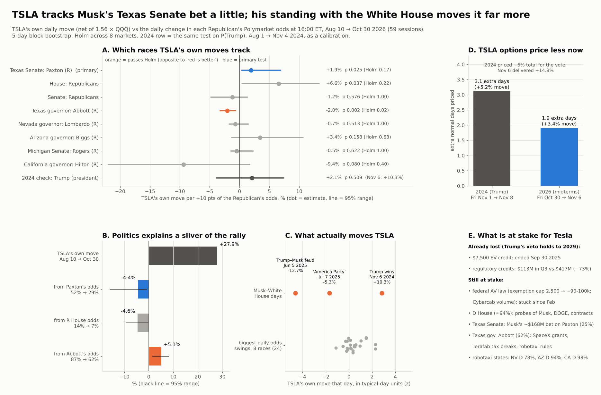

# Does TSLA price a Republican win, and which races matter to Tesla's business?

**Agent / session:** Claude, claude.ai session for the owner, 2026-11-02 (last close Fri Oct 30)
**Type:** pre-registered.
* **Seen before writing:** the list of Polymarket race markets with their current odds (needed to pick markets), and a news search on Tesla's policy exposure.
* **Not yet computed:** no odds history and no TSLA relationship.

**Owner's ask:** "Any particular senator or state or outcome important to TSLA as a business? I think red is better for TSLA, but even though they are falling way behind, TSLA doesn't seem to be really caring."
**Builds on:** [election-vol](../2026-11-02-election-vol/). Its two results here:
* 2026 TSLA beta to P(R House) was +4.7% per +10 pts (p 0.29), and to P(R Senate) +0.4% (p 0.89).
* TSLA options price an election premium of 1.2 extra normal days over Nov 3–4.

## Questions
1. Does TSLA's own move (net of the market) track Republican odds, in total or in the races tied to Tesla's business?
2. If the answer is "no", is that because TSLA doesn't care, or because a daily test can't see it? Calibrate on 2024, when TSLA clearly priced Trump (+13.8% on Nov 6).
3. Where does TSLA's political sensitivity actually come from: Congress, or Musk's standing with the White House?

## Data
* **Polymarket hourly prices** (CLOB prices-history), read at 16:00 ET each trading day, Aug 10 → Oct 30 2026. The window starts after all the primaries listed here.
* **Markets (P = the Republican's "Yes" price):**
  * party control: P(R House) and P(R Senate), from "Which party will win the House/Senate in 2026?";
  * Texas Senate: Paxton (R) vs Talarico (D). Tesla's HQ state; Musk put ~$168M into pro-Paxton groups (SLF → Texas PAC, Lone Star Liberty);
  * Texas governor: Abbott (R) vs Hinojosa (D). State robotaxi rules and Giga Texas;
  * Nevada governor: Lombardo (R) vs Ford (D). Giga Nevada and a robotaxi permit;
  * Arizona governor: Biggs (R) vs Hobbs (D). Robotaxi permits;
  * Michigan Senate: Rogers (R) vs El-Sayed (D). An open seat; Sen. Peters, the AV-bill sponsor, is retiring;
  * California governor: Hilton (R) vs Becerra (D). California is the DMV/CPUC driverless-permit regulator and Tesla's largest US market.
* **2024 calibration:** P(Trump) from "Presidential Election Winner 2024", Aug 1 → Nov 4 2024.
* **Prices:** TSLA and QQQ daily closes (Yahoo).
* **Options:** TSLA end-of-day chains (ThetaData, already on disk, $0).

## Tests
* **Residual return.** Each day, TSLA's return minus β × QQQ's return. β is the OLS slope over the 250 sessions ending Aug 7 2026, or Jul 31 2024 for the 2024 window. The regressor is the daily change in P, in points.
* **P1 (primary): Texas Senate.** The slope of TSLA's residual return on the daily change in P(Paxton).
  * Owner's prediction: positive ("red is better").
  * Inference: 5-day block bootstrap (2,000 draws), two-sided p.
* **P2 (secondary):** the same regression for the other 7 markets. Holm correction across all 8 (P1 + P2).
* **P3, power and attribution:**
  * for each market, the slope detectable with 80% power, (1.96 + 0.84) × bootstrap SE;
  * the total change in P over the window × the slope (with its 95% CI), compared with TSLA's actual cumulative residual. This answers "how much of TSLA's move since August could be politics".
* **P4, 2024 calibration:**
  * the same regression on daily P(Trump) changes, Aug 1 → Nov 4 2024;
  * TSLA's residual on Nov 6 2024;
  * **the check:** does the daily-beta method detect TSLA's political pricing in a year when it was clearly there?
* **P5, options (the Friday close before each vote):**
  * TSLA's election-window excess variance, in normal-day units: Nov 1 2024 (the expiry pair spans Nov 4–8; FOMC on Nov 7 is a disclosed confound) vs Oct 30 2026 (1.21, from election-vol);
  * the 2024 realised results-day residual vs what was priced;
  * baseline = the median per-session variance of the next three weekly pairs.
* **P6, descriptive:** TSLA's residual, in units of its trailing 60-day residual standard deviation, on Musk–White House days:
  * 2024-11-06 (Trump wins);
  * 2025-06-05 (Trump–Musk feud goes public);
  * 2025-07-07 (first session after the "America Party" announcement).
  * 2026-10-21/22 (Musk's "live by the sword" reply to Democrats' probe plans) is excluded, because it is confounded by Tesla's Q3 report.

## Predictions written now
* **P1/P2:** null (|slope| below the detectable size). The reason: a daily test is underpowered against TSLA's ~2.5% residual noise.
* **P4:** the 2024 daily slope is also not significant, even though Nov 6 2024 was a large positive residual. If so, "TSLA doesn't seem to care" is not evidence either way.
* **P5:** the 2026 premium is smaller than 2024's.
* **P6:** Musk–White House days are multi-σ residuals (|z| ≥ 3), larger than any Congress-odds day.

## Limits stated now
* One election per year, and ~58 sessions per window. The race markets are thin compared with the chamber markets; thin markets add noise, which biases slopes toward 0.
* Business relevance is argued from sources (Tesla 10-Q, bill trackers, news). It is not tested.

---

## Results (2026-11-02, after the pre-registration push at 3711f29)

**Bottom line:** TSLA *does* lean "red" in the race Musk bet on (the Texas Senate), but the effect is small, it misses the multiple-testing bar, and it is buried under TSLA's other drivers. TSLA's own move since Aug 10 is **+27.9%**; the politics links account for about ±5% of it.
* The only race that passes Holm is the **Texas governor race, in the opposite direction** to "red is better", with no business logic behind it.
* What moves TSLA is Musk's standing with the White House, not Congress odds.

TSLA's beta to QQQ over the 250 sessions to Aug 7 2026 is 1.56. Its raw return from Aug 7 to Oct 30 was +21.7%.

### P1–P3: TSLA's own move vs each Republican's odds (Aug 10 → Oct 30, n 59)

| Market | Odds Aug 7 → Oct 30 | Slope per +10 pts | p | Holm | Detectable at 80% power | TSLA move attributed to the odds change (95% range) |
|---|---|---|---|---|---|---|
| **Texas Senate: Paxton (P1)** | 52% → 29% | **+1.9%** (CI +0.4 to +6.9) | 0.025 | 0.175 | 4.6% | −4.4% (−15.8 to −0.9) |
| House: Republicans | 14% → 7% | +6.6% | 0.037 | 0.22 | 9.0% | −4.6% (−9.3 to −0.3) |
| Senate: Republicans | 55% → 29% | −1.2% | 0.58 | 1 | 4.7% | +3.1% (−3.5 to +12.4) |
| **Texas governor: Abbott** | 87% → 62% | **−2.0%** (CI −3.2 to −0.6) | 0.002 | **0.016** | 1.9% | +5.1% (+1.6 to +8.1) |
| Nevada governor: Lombardo | 48% → 22% | −0.7% | 0.51 | 1 | 2.4% | +1.9% |
| Arizona governor: Biggs | 17% → 8% | +3.4% | 0.16 | 0.63 | 8.6% | −3.1% |
| Michigan Senate: Rogers | 41% → 23% | −0.5% | 0.62 | 1 | 2.6% | +0.9% |
| California governor: Hilton | 5% → 3% | −9.4% | 0.08 | 0.40 | 16.0% | +2.1% |

* **P1 (Paxton): positive as the owner predicted. A lean, not proven.**
  * p 0.025, Holm 0.175.
  * Without the Q3 earnings reaction day (Oct 22): +2.2% per +10 pts, p 0.008. Holm was registered on the full sample.
  * Paxton's slide from 52% to 29% maps to about −4% of TSLA's own move. The range is wide (−16% to −1%).
* **Texas governor (Abbott): passes Holm (0.016), but TSLA rose when Abbott's odds fell.**
  * Exploratory robustness checks (not registered):
    * Spearman −0.29 (p 0.027);
    * the slope holds when the 3, 5 or 8 biggest odds days are dropped (−2.9, −2.7, −3.0);
    * dropping the 5 biggest TSLA days gives −1.7;
    * it holds jointly with Paxton (Abbott −2.4, Paxton +2.7);
    * it appears both before Oct 14 (−1.5, n 46) and after (−2.4, n 13);
    * there is no lead or lag (|r| ≤ 0.12).
  * **It contradicts the business channel.** Abbott is a Musk ally: Musk gave his campaign $500k in May, and Texas granted SpaceX $54M and Musk's Terafab project $1.7B in school tax breaks (per the Hinojosa lawsuit coverage).
  * In late October, Abbott's odds slid almost daily (Hinojosa's lawsuit for his Musk communications was filed Oct 19–20; the judge's order came Oct 27) while TSLA ran on its own burst.
  * **Verdict:** treat it as an unexplained statistical link. Do not trade it.
* **Power (P3):** the smallest effect the test can detect is 1.9–16% per +10 pts. The prediction "null" held for 6 of 8 markets. Two are nominally significant (Paxton, House), and Abbott passes Holm.

### P4: 2024 calibration (Aug 1 → Nov 4 2024, n 67)
* **Daily slope on P(Trump):** +2.1% per +10 pts, p 0.51; the detectable size is 8.1%. P(Trump) went from 57.5% to 57.9% over the window.
* **Nov 6 2024:** TSLA +14.75% raw and **+10.4% after QQQ** (z 2.87). The slope's point estimate implied +8.8% for the results day.
* **So the daily test missed TSLA's political pricing in the year it was clearly there**; only the point estimate was roughly right. Prediction confirmed: "TSLA doesn't seem to care" during the run-up is not evidence either way.

### P5: options, Friday close before the vote (like-for-like weekly pairs)

| | Window | Normal-day move | Extra normal days priced | Excess move-equivalent |
|---|---|---|---|---|
| 2024 | Nov 1 → Nov 8 (FOMC Nov 7 inside) | 2.96% | **3.1** | 5.2% |
| 2026 | Oct 30 → Nov 6 (AAPL reaction and payrolls inside) | 2.48% | **1.9** | 3.4% |

* Prediction "2026 premium smaller than 2024": **confirmed**.
* In 2024, options priced about a 6% move for the vote (excess plus a normal day). Nov 6 delivered +14.75%.
* The election-vol study's narrower Nov 2→4 pair gives 1.2 extra days for 2026. The weekly window adds the AAPL reaction, payrolls and weekend loading.

### P6: Musk–White House days (TSLA's own move, z vs its trailing 60-day spread)

| Day | TSLA | QQQ | TSLA's own move | z |
|---|---|---|---|---|
| 2024-11-06 Trump wins | +14.75% | +2.72% | +10.3% | +2.84 |
| 2025-06-05 Trump–Musk feud | −14.26% | −0.75% | −12.7% | **−4.62** |
| 2025-07-07 "America Party" | −6.79% | −0.75% | −5.3% | −1.69 |

* For comparison: on the 24 biggest daily odds swings across the 8 markets, TSLA's own move never exceeded |z| 2.27.
* **Prediction "all |z| ≥ 3": 1 of 3.** Two of the three (the feud and the Trump win) exceed every congressional-odds day.

### What is at stake for Tesla the business (sourced, not tested)
* **Already lost, and a Democratic Congress can't restore it (Trump's veto holds to Jan 2029):**
  * the $7,500 EV credit ended Sep 30 2025;
  * regulatory-credit revenue was **$113M in Q3 2026 vs $417M a year earlier (−73%)**. The 10-Q blames government actions restricting the credit programs.
* **Federal AV law:**
  * The SELF DRIVE Act (H.R. 7390) would lift the 2,500-vehicle-per-year exemption cap to roughly 90–100k, which the Cybercab needs.
  * It cleared subcommittee 12–11 in Feb 2026 and has not moved since. It needs 60 Senate votes regardless.
  * A Democratic House in Jan 2027 lowers its odds further; the lame duck is the last Republican-House window.
* **Investigations:**
  * House Oversight Democrats (Garcia, Crockett) pledge probes of Musk, DOGE, contracts and Starlink if they win the House (R House odds 6.5%).
  * Blumenthal (Senate investigations subcommittee) pledges the same if Democrats win the Senate.
  * Musk replied "live by the sword…" on Oct 21.
* **Texas Senate:** Musk's single largest bet, about $158M via the Senate Leadership Fund routed to the pro-Paxton Texas PAC, plus $10M to Lone Star Liberty. Talarico (D) is at 75.5%. One senator does not change law; the cost of a loss is Musk's political capital and attention.
* **Robotaxi permits are state matters:**
  * Texas: the only confirmed driverless commercial authorization. Governor Abbott (R) is at 62%.
  * Nevada: a permit; reports conflict on 5,000 vehicles vs 10. Ford (D) is at 77.5%.
  * Arizona: a ride-hailing (TNC) permit. Hobbs (D) is at 93.5%.
  * California: no driverless permit. Becerra (D) is at 98%.

### Playbook tags
* Paxton slope: **lean** (Holm 0.175).
* Abbott slope: **unexplained**; do not use.
* Options election-week premium: **map**.
* Musk–White House days: **descriptive**.
* Nothing here is promoted to proven.

### Follow-up (TP1, score Nov 5)
* TSLA's own move on Nov 4 vs the Texas Senate and House results. The Paxton slope implies about +14% for a Paxton win and about −5% for a Talarico win (point estimates, CI wide).
* TSLA's realised Nov 3–6 move vs the priced 3.4% excess.

Cost: $0 (Polymarket and Yahoo public APIs; ThetaData chains already on disk).
