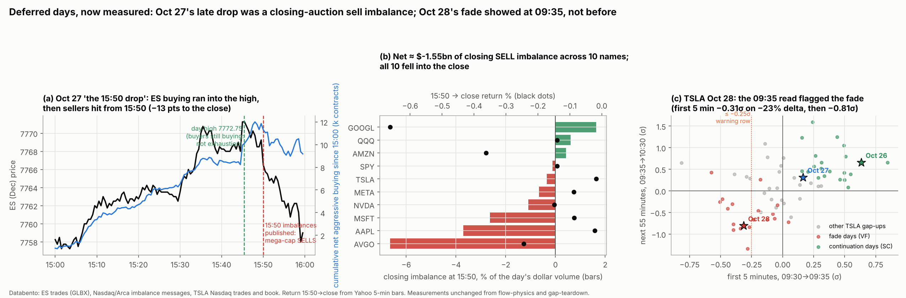

# Deferred days: Oct 27 into flow-physics (TODO D4) and TSLA Oct 28 into gap-teardown (TODO G1 / T4)

**Agent / session:** Claude, claude.ai session for the owner, Wed Nov 4.
**Owner (Nov 4):** "There were two tests tho we delayed cuz we said we can't be sure until tsla data released … just do it."

**Why now:** both studies froze their measurements and predictions before their data existed, and left these days for when Databento published them. They are published now. This folder applies the **original measurements unchanged** to the missing days.
* The original folders are not edited.
* Their scripts are imported, or their formulas copied with a pointer to the source line.

## Pre-registration (fixed before any data is pulled)

### D4: Oct 27 in flow-physics ([2026-10-27-flow-physics](../2026-10-27-flow-physics/), registered @ bdc698c)
Data (Databento; quotes checked before each pull; cap $3 for D4 + G1 together):
* ES front month (ESZ6) trades, 09:30–16:00 ET (GLBX.MDP3);
* ES order-by-order book (MBO) around the day's high;
* closing-auction imbalance messages (SPY: ARCX.PILLAR; TSLA, GOOGL, AMZN, NVDA, AVGO, MSFT, AAPL, META, QQQ: XNAS.ITCH), 15:45–16:00 ET;
* TSLA Nasdaq trades (XNAS.ITCH), 09:30–16:00 ET.

Measurements (each as defined in flow-physics):
* **A1/A2 (ES and TSLA):** session delta % of volume, Kyle λ (5-minute), Hawkes branching n median. Placed against the 16 ES and 26 TSLA baseline sessions in `out/a_daily.csv`. Descriptive.
* **A4 (ES, a flip-wick day):** the buy/min ratio (final 0.1% before the high vs the 30 minutes before) and the absorption ratio.
  * **Prediction, as registered:** exhaustion (buy/min ratio < 1), not absorption.
  * **MBO, as for Oct 20:** net new offers/min at the high vs 10 placebo swing highs that day.
* **A5 (closing auction):** the first imbalance message at or after 15:50:00 for each of the 10 symbols. Signed % of the day's dollar volume vs the 15:50→close return (Yahoo 5-minute bars).
  * **Question:** did SPY print a sell imbalance at 15:50 on Oct 27?
  * The 10 new symbol-days are added to the 260 and the pooled Spearman is recomputed (registered pass: ρ > 0, one-sided p < 0.05, bootstrap by day).
* **A6 (TSLA, the 400 break):** buy-aggressor events per second in the 60 s after the first print above 399.90 vs the 60 s before. Compared with the same measure at the day's other round-dollar crosses (stop-cascade signature: a burst right after the cross).

### G1: TSLA Oct 28 in gap-teardown ([2026-10-28-gap-teardown](../2026-10-28-gap-teardown/), registered T4)
Data (XNAS.ITCH, as `pull.py`):
* trades 04:00–10:35 ET;
* 10-level book 09:25–10:35;
* opening imbalance 09:20–09:31.

Measurements:
* `features.feats` unchanged: M1–M3, M6–M10, and the 09:35→10:30 return in σ.
* **T4 as registered:** place Oct 28 (and Oct 27, already in `out/features.csv`) on the T1 distributions (VF vs SC, TSLA and all names) and on T3 (within-TSLA ranks of M6–M10 vs the 09:35→10:30 outcome).
* Descriptive. Oct 28's gap (~0.3σ) sits below the 0.5σ setup, as noted in the original.

No new statistical test is added. Everything is a placement or the registered A5 recount.

---

# Results (written after the run; everything above was fixed before the data was pulled)

**Run:**
* `fetch.py quote|pull <cap>` (key from env).
* `run_d4.py` → `out/d4.json`.
* `run_g1.py` → `out/g1.json`.
* `figure.py` → `out/deferred_days.png`.

**Databento spend: $1.25** (quotes: trades, imbalances and book $0.48; ES MBO $0.77).

## D4: Oct 27
| Measure | Oct 27 | Baseline | Read |
|---|---|---|---|
| ES session | +0.30%; net buying **+1.6% of volume (100th pct of the 16 sessions)**; Kyle λ 2.42 (31st pct); Hawkes n 0.63 (100th pct) | medians +0.07%, 2.51, 0.59 | Normal depth, the most net buying of the window, the most self-exciting tape, still subcritical |
| TSLA session | +2.41%; net buying +8.8% (81st pct); **λ 0.0095 (lowest of 26)**; n 0.58 (92nd pct) | medians +4.1%, 0.0216, 0.54 | The 400 break was **bought into a deep book**: flow-led, as A1 found for TSLA |
| A4: the ES high (15:45:23, 7772.75; a flip-wick day) | buy/min ratio **1.36 (not exhaustion)**; absorption ratio 1.89; sell/min in the next 10 minutes **3.5×** the run's rate | flip days 0 of 3 exhausted; medians 1.56 / 3.6 | **The registered prediction (exhaustion) fails again: 0 of 4 flip days.** Buyers were still buying at the high, and the turn came from sellers arriving |
| A4 MBO at the high | net new offers 4.9/min (refill ratio 29) | 10 placebo swing highs: median 6.05; Oct 20: 6.9 | **No offer wall at the high.** Unlike Oct 20, offers refilled at an ordinary rate |
| ES net aggression by minute | +1,884 / +536 / +1,096 at 15:45–47, ~0 at 15:48–49, **−801 at 15:50, −1,160 at 15:51**, −745 / −676 at 15:54–55, **−2,233 at 15:59** | per-minute sd 361 | Selling started in the **15:50 minute**, exactly when the closing imbalances publish |
| A5: 15:50 closing imbalances | **SPY sell −$26M** (−0.12% of the day's $ volume). Large mega-cap sells: AVGO −$582M (−6.7%), AAPL −$514M, MSFT −$274M, META −$213M, NVDA −$202M, TSLA −$65M. Buys: GOOGL +$151M, QQQ +$137M, AMZN +$37M. **Net ≈ −$1.55bn** | — | **Yes, a sell imbalance printed at 15:50.** All 10 names fell 15:50→close; 7 of 10 moved with their imbalance |
| A5 pooled, with Oct 27 | ρ **+0.356** (270 symbol-days, p < 0.001) | was +0.37 on 260 | **Still passes** |
| A6: TSLA's 400 cross (09:36:08) | buy events/s 9.1 → 14.6 (1.61×), the 73rd pct of the day's 11 round-dollar crosses (median 1.08×) | — | A modest burst after the cross. **No clear stop-cascade signature** |

**Read for Oct 27:** the late drop was the closing auction, not a wall at the high. Buying ran into 15:45 without exhausting and with ordinary offer refills. At 15:50 the exchanges published about $1.55bn of net sell imbalances, concentrated in AVGO, AAPL and MSFT, and sellers hit ES within the minute. It is the A5 mechanism (the imbalance pushes the last 10 minutes) on a single day.

## G1: TSLA Oct 28 (gap-teardown T4)
| | Oct 28 | TSLA pct (all gap-ups) | VF / SC medians |
|---|---|---|---|
| Gap | +0.27σ (below the 0.5σ setup, as noted) | — | — |
| Premarket buy share (M2a) | 50% | 48th | 48% / 52% |
| Opening-cross imbalance (M3) | −0.5% of paired | 20th | 0 / 0 |
| First 5 minutes, price | **−0.31σ** | 16th | −0.28 / +0.36 |
| First 5 minutes, aggressor delta (M6) | **−22.5%** | 13th | −13% / +39% |
| Progress per 1k bought (M8) | −0.005σ | 11th | −0.003 / +0.002 |
| Book imbalance (M7) | −0.02 | 56th | +0.02 / −0.11 |
| **09:35→10:30** | **−0.81σ** | 6th | −0.59 / +0.49 |

* **Oct 28 was a VF by shape** (first hour +0.07σ / −1.30σ).
* **Nothing before the open flagged it:** neutral premarket flow, a near-zero cross.
* **At 09:35 it was flagged:** the ≤ −0.25σ row of the practical table, with delta in the bottom seventh. It then fell −0.81σ.
* This matches the gap-teardown verdict: the earliest usable read is 09:35, and flow adds nothing beyond the price.
* Oct 27 (+0.16σ / +30% delta) and Oct 26 (+0.63σ / +51%) sit in the SC cloud and continued.

## Verdicts
* **D4:**
  * The 15:50 sell imbalance is confirmed.
  * The A4 exhaustion prediction fails again (0 of 4 flip days): **highs are buying bursts that meet sellers, not buyers giving up**.
  * There was no offer wall at Oct 27's high.
  * A5 still passes with the new day.
* **G1:** Oct 28 behaved exactly like the 09:35 rule says. It is one day, outside the tested population, so this is consistent but not new evidence.
