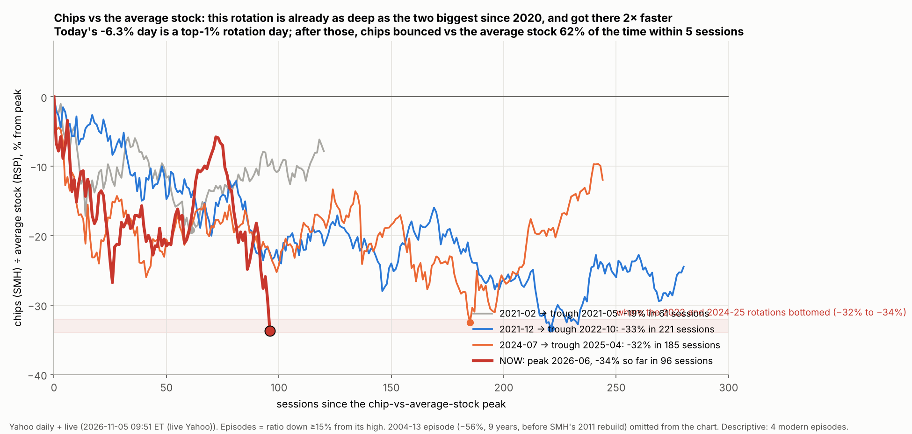

# AI/chip rotation map (descriptive live read, 2026-11-05)

Owner: "see ratio of spy to some index that reflects this ai or chip … predict what part we at in the rotation."

`python rotation.py` → `out/rotation.json`, `out/ratio.csv`; `python figure.py` → `out/ai_rotation.png`. Descriptive: 4 modern episodes, so it is a map, not a test.

