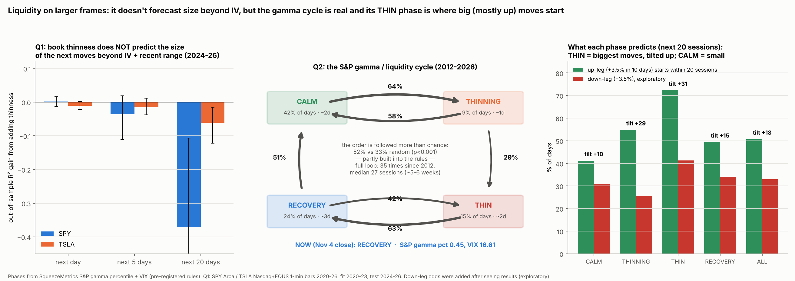

# Does liquidity predict, on larger frames, and is there a cycle? (SPY, TSLA)

**Agent / session:** Claude, claude.ai session for the owner. **Started:** 2026-11-05. **Pre-registered at commit:** the commit that first adds this README.
**Type:** extension + new question.
**Owner (Nov 5):** "does this also work on larger frames and does it have predictive powers like is there a cycle for example that's followed."

## Prior work
* [flow-physics](../2026-10-27-flow-physics/) A1.
  * SPY's daily move is not explained by net aggression (ρ −0.12, 16 days). TSLA's is (ρ +0.48, 26 days).
  * Book thinness (Kyle λ) vs dealer gamma: ρ −0.37, p 0.16.
  * Re-check on Nov 4: λ vs the size of SPY's day was ρ +0.10 (p 0.72). So **"SPY is liquidity-led" is unproven**; it rests on elimination.
* [gamma-phase-diagram](../2026-11-01-gamma-phase-diagram/): below the pre-open flip, the day's range is ×1.33; the flip adds little after 09:45.
* REPORT §4p: S&P legs follow a GEX reset (88–90%). Gamma builds, then resets in a median of 11 days.
* REPORT §4i/§4l: the ladder (R1–R7).

## Not tested here, and why
* **Aggressive flow at scale.** Signing minute bars from their own price change (bulk volume classification) makes "flow" a function of the return. Any flow-vs-move link would then be partly built in. A fair test needs real aggressor-signed trades (Databento; about $0.37/day for ES), so it is parked.

## Q1. Does yesterday's thinness predict the size of the next 1 / 5 / 20 days, beyond the obvious baseline?
* **Data:**
  * SPY Arca 1-minute bars, 2020-01 to 2026-10 (in hand).
  * TSLA Nasdaq 2020–23 plus EQUS 2024–26 bars. Venues differ, so only trailing-year percentiles are used.
  * VIX; TSLA ATM 30-day IV (`microstructure/out/td_gamma_TSLA.csv`); SqueezeMetrics S&P GEX.
* **Thinness L_t:** per day, Σ|5-minute log return| ÷ Σ dollar volume (intraday Amihud). Its 5-day mean is then expressed as a trailing-252 percentile, known at the close of t.
* **Outcome:** the log mean daily high–low range over days t+1…t+k, for k = 1, 5, 20.
* **Baseline:** log implied vol (VIX for SPY, own ATM IV for TSLA) plus log range on day t, the 5-day mean range and the 20-day mean range.
* **Added:** L_t. A second model adds the S&P GEX percentile for SPY, or TSLA's own near-price OI percentile.
* **Split:** fit 2020–2023, test 2024–2026 (out of sample).
* **Statistic:** the out-of-sample R² gain over the baseline. 90% CI by 20-day block bootstrap of the test errors.
* **Circularity, stated:** L contains |return|, but the baseline already holds the ranges. Any gain is the part of thinness that range alone doesn't carry, i.e. low volume for the move made.
* **Pass:**
  * **Q1-SPY:** gain > 0 at k = 5 (primary), 90% CI above 0.
  * **Q1-split:** SPY's gain minus TSLA's gain > 0 (CI above 0). This tests the claim "liquidity matters more for SPY".
  * k = 1 and 20 are reported, not scored.
* **What would prove the claim wrong:** no gain beyond IV + range for SPY, or a gain as large for TSLA.

## Q2. Is there a liquidity cycle, does it follow its order, and does the phase predict? (S&P, 2012-01 to 2026-11)
* **Phase at each close** (first match wins, so phases don't overlap; gp = S&P GEX trailing-252 percentile, SqueezeMetrics):

  | Phase | Rule |
  |---|---|
  | **RECOVERY** | min(gp over the last 15 sessions) ≤ 0.20 **and** VIX ≤ 0.85 × its 10-day max |
  | **THIN** | gp ≤ 0.20 |
  | **THINNING** | gp ≤ 0.50 **and** gp fell by ≥ 0.25 over the last 10 sessions |
  | **CALM** | gp ≥ 0.50 |
  | OTHER | everything else |

* **Canonical order:** CALM → THINNING → THIN → RECOVERY → CALM.
* **D1 order:**
  * Merge consecutive same-phase days into episodes, drop OTHER, merge again.
  * Statistic: the share of transitions that go to the canonical next phase.
  * Null: shuffle the episode sequence 10,000× (keeps the episode counts).
  * **Pass: p < 0.05.** The full transition matrix is reported.
* **D2 forecast:**
  * By phase vs all days: the forward 20-day S&P return, the up-leg odds (a top-decile 10-day return, ≥ +3.5%, starting within 20 sessions; REPORT §4p) and the forward 10-day mean range.
  * Null: circular shift of the phase series against outcomes (shifts ≥ 60 sessions, 2,000 draws). Holm across the 4 phases × 3 outcomes.
  * **Predictions:** RECOVERY → higher forward return and up-leg odds; THIN → higher forward range; CALM → lower range.
* **D3 (descriptive):** median episode length per phase, and the time to complete a full cycle.
* **D4 (descriptive):** phase shares by sessions to the next monthly expiry.
* **Cross-check (METHOD 11), descriptive, 2020–26:** SPY intraday thinness (L) by phase. If the cycle is a liquidity cycle, L should be highest in THIN and lowest in CALM.
* **Caveat:** D2 overlaps the ladder (R1–R7 already lift up-leg odds). The new pieces are D1 (sequence) and D3 (timing).
* **Today:** which phase the latest close is in.

## Reproduce
`python size.py <bars dir> <DIX.csv>` → `out/q1.json`; `python cycle.py <DIX.csv> <bars dir>` → `out/q2.json`; `python figure.py` → `out/liquidity_cycle.png`.

---

# Results (written after the run; everything above was fixed before any result was seen)

**Data:**
* SPY Arca 1-minute bars 2020-01 to 2026-10 (1,589 usable days).
* TSLA Nasdaq/EQUS 1-minute bars (1,576 days).
* S&P GEX (SqueezeMetrics) and VIX / ^GSPC (Yahoo), 2012-04 to 2026-11-04 (3,651 days).
* $0.

**Bug caught before reading results:** Yahoo's `range=max` silently returns **monthly** bars. The first Q1 run used monthly VIX. The loader now uses explicit dates and asserts daily spacing, and both Q1 and Q2 were rerun. All numbers below are from the fixed run.

## Q1: does thinness predict move size? **Fails**
| | Next day | Next 5 days (primary) | Next 20 days |
|---|---|---|---|
| SPY: out-of-sample R² baseline → + thinness | 0.369 → 0.371 (gain +0.002, CI −0.013 to +0.016) | 0.382 → 0.346 (gain −0.036, CI −0.112 to +0.019) | 0.194 → −0.177 (gain −0.37) |
| TSLA | 0.233 → 0.221 (−0.011) | 0.311 → 0.296 (−0.016, CI −0.038 to +0.012) | 0.349 → 0.287 (−0.061) |
| SPY gain − TSLA gain | +0.014 (CI −0.005 to +0.028) | −0.020 (CI −0.098 to +0.031) | −0.31 |

* **Q1-SPY fails; Q1-split fails.** Once implied vol and recent ranges are known, book thinness adds nothing for either stock. Out of sample it makes the 20-day forecast worse.
* **Calibration (METHOD 7):** the known law reproduces. The baseline (IV + ranges) explains 37–38% of next-day and 5-day range out of sample. Adding S&P gamma helps SPY's next day (0.369 → 0.383) but not 5 days. Its train coefficient is negative (high gamma → smaller range), as before.
* **Read:** at daily and weekly frames, "liquidity" carries no information beyond what VIX and recent volatility already say. The day-level "SPY is liquidity-led" claim was explanatory at best; it is **not predictive**.

## Q2: the cycle
* **D1 order: passes as registered, but partly by construction.**
  * 52% of 705 transitions go to the canonical next phase, vs 33% at random (95th pct 37%; p < 0.0001).
  * **Caveat found after the run:** RECOVERY requires gamma ≤ 0.20 within 15 sessions, so THIN → RECOVERY is partly built in. THINNING requires a fall, so it mostly comes from above. The shuffle null does not preserve that.
  * The informative transitions are the ones the rules don't force:

    | From | Go to | Instead of |
    |---|---|---|
    | CALM | THINNING **64%** | THIN directly 20% |
    | THINNING | back to CALM **58%** (most thinnings are false alarms) | THIN 29% |
    | RECOVERY | CALM **51%** | relapse to THIN **42%** |

* **D2 forecast:**

  | Phase (share of days) | Forward 10-day mean range | Up-leg within 20 sessions | Forward 20-day return |
  |---|---|---|---|
  | **THIN (15%)** | **1.59% vs 1.06%** (Holm ≈ 0) ✓ | **72% vs 51%** (Holm ≈ 0) | +1.41% vs +0.96% (p 0.22) |
  | **CALM (42%)** | **0.86%** (Holm ≈ 0) ✓ | **41%** (Holm ≈ 0) | +0.62% (p 0.13) |
  | THINNING (9%) | n.s. | 55% (n.s.) | n.s. |
  | **RECOVERY (24%)** | n.s. | **49% (no lift)** ✗ | +1.06% (n.s.) ✗ |

  * **RECOVERY's predictions fail.** Up-legs come from the THIN phase itself, not from the recovery after it. This matches REPORT §4p, where legs need a reset.
  * **Exploratory (added after seeing results): down-legs too.**
    * THIN has more of both: 72% up and 41% down. Its up-minus-down tilt is +31 vs +18 on all days.
    * THINNING: 55% up vs 25.5% down, a +29 tilt.
    * CALM: +10. RECOVERY: +15.
    * So low gamma means bigger moves **and** an upward tilt, the same message as the ladder (R1–R5).
* **D3 timing:**
  * Phases flicker: median episode 1–3 sessions.
  * Full CALM → THINNING → THIN → RECOVERY → CALM loops: **35 since 2012, median 27 sessions** (IQR 22–42), about one to two monthly expiry cycles.
* **D4 calendar:**
  * CALM is most common in the 5 sessions before the monthly expiry (46% vs 38% at 15+ sessions).
  * THINNING is twice as common 10+ sessions before the expiry (11% vs 6%).
  * So gamma builds into the expiry and thins after it, a mild calendar alignment.
* **Cross-check (METHOD 11):** SPY's intraday thinness percentile by phase: CALM 0.33 < THINNING 0.51 < RECOVERY 0.57 < THIN 0.69. The gamma cycle lines up with book thinness. This is partly mechanical too, because the measure contains |return|, which is higher in THIN.
* **Today (Nov 4 close): RECOVERY.**
  * Gamma pct 0.45 after Nov 4's jump to $5.46bn. VIX 16.61 is below the recovery line of 17.98.
  * Last 10 phases: THIN ×3 → RECOVERY.
  * By D2, RECOVERY has no edge. The next step is CALM 51% or a relapse to THIN 42%.

## Verdict
* **Refines flow-physics A1.** "SPY is liquidity-led" does not extend to prediction. Book thinness adds nothing to IV + recent range at 1/5/20 days, for SPY or TSLA.
* **The tradable structure is the dealer-gamma cycle,** with liquidity as its symptom:
  * THIN (gamma ≤ 20th pct) is where large, up-tilted moves start;
  * CALM means small moves;
  * a full loop takes about 27 sessions;
  * most THINNING episodes are false alarms;
  * RECOVERY by itself is not a buy signal.
* **Not tested:** aggressor-flow prediction at scale (needs signed trades; see "Not tested here").
